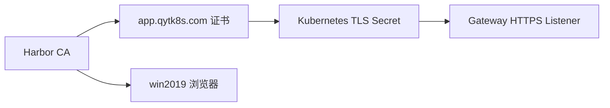

# 第 4 步：复用 Harbor CA 签发北向 HTTPS 证书

## 本步目标

使用第一章已经生成的 `Harbor CA`，为第三章业务域名 `app.qytk8s.com` 签发服务端证书，并导入 Kubernetes。

---

## 执行标记

- **执行标记：必须执行**

说明：

- 第三章从这里开始把 `域名 + HTTPS` 固定为正式入口方式
- 这一步不是临时补证书，而是把证书体系正式纳入课程主线

---

## 问题背景

第三章后半段要把应用正式发布为：

```text
https://app.qytk8s.com
```

如果没有证书，就只能退回：

- `NodeIP:NodePort`
- `http://IP`
- 浏览器不受信任的临时自签证书

这些做法都不符合第三章“正式北向发布”的目标。

因此这一页要完成的事情非常直接：

- 用现有内部 CA 为业务域名签发证书
- 把证书导入 Kubernetes
- 为后续 `Gateway` 的 HTTPS listener 做准备

---

## 理论说明

### 证书关系图



这张图说明：

- `Harbor CA` 负责签发 `app.qytk8s.com` 证书
- 证书进入 Kubernetes TLS Secret
- `Gateway` 的 `443` listener 使用这个 Secret
- 浏览器侧再导入同一套 CA 根证书，才能真正建立信任链

### 为什么第三章复用 Harbor CA

第一章已经生成了一套内部 CA，这意味着实验环境里已经存在统一信任根。

第三章继续复用它，有三个直接好处：

1. 不需要再造一套无关的新 CA
2. 学员更容易理解“同一内部 CA 可以给多个内部域名签证书”
3. 后续更多内部域名可以继续沿用同一套信任体系

### 本步关键命名

本页固定使用：

- 域名：`app.qytk8s.com`
- Secret：`app-qytk8s-com-tls`
- 命名空间：`gateway-demo`

这样后面的 `Gateway` 清单就可以直接引用这个 Secret。

### 本步关键内容示意

这一页虽然不是通过现成 YAML 清单安装组件，但最终会在集群里生成一个非常关键的对象：

- 来源方式：由 `scripts/04_issue_tls_certs.sh` 运行时动态生成
- 对象类型：`Secret`
- 说明：这里没有独立静态 YAML 文件，对象来自下面这段命令输出：

```bash
kubectl -n "${NAMESPACE}" create secret tls "${SECRET_NAME}" \
  --cert "${SERVER_CERT}" \
  --key "${SERVER_KEY}" \
  --dry-run=client -o yaml | kubectl apply -f -
```

```yaml
kind: Secret
type: kubernetes.io/tls
metadata:
  name: app-qytk8s-com-tls
  namespace: gateway-demo
```

关键字段说明：

- `type: kubernetes.io/tls`
  - 明确这是标准 TLS Secret
- `name: app-qytk8s-com-tls`
  - 后续 `Gateway` 的 HTTPS listener 会直接引用这个名字
- `namespace: gateway-demo`
  - 要和后续 `Gateway` 所在命名空间一致

另外，证书扩展文件里最关键的一段是：

```ini
subjectAltName = @alt_names

[alt_names]
DNS.1 = app.qytk8s.com
```

关键字段说明：

- `DNS.1 = app.qytk8s.com`
  - 这决定了浏览器访问这个域名时，证书主机名校验是否能通过

---

## 对应脚本

本步对应脚本：

- `k8s/03-north-south-traffic/scripts/04_issue_tls_certs.sh`

本步使用的现有 CA 文件位于：

- `/docker_k8s_2026/k8s/01-k8s-architecture/pki/harbor/harbor-ca.key`
- `/docker_k8s_2026/k8s/01-k8s-architecture/pki/harbor/harbor-ca.crt`

---

## 脚本关键任务

### 关键任务 1：生成证书扩展文件

脚本原始代码：

```bash
cat >"${SERVER_EXT}" <<EOF
authorityKeyIdentifier=keyid,issuer
basicConstraints=CA:FALSE
keyUsage = digitalSignature, nonRepudiation, keyEncipherment, dataEncipherment
extendedKeyUsage = serverAuth
subjectAltName = @alt_names

[alt_names]
DNS.1 = ${DOMAIN}
EOF
```

关键介绍：

- 明确证书用途是服务端证书
- `subjectAltName` 中固定写入 `app.qytk8s.com`

### 关键任务 2：生成私钥、CSR 和证书

脚本原始代码：

```bash
openssl genrsa -out "${SERVER_KEY}" 4096
openssl req -new -sha256 \
  -key "${SERVER_KEY}" \
  -out "${SERVER_CSR}" \
  -subj "/C=CN/ST=Beijing/L=Beijing/O=QYT/OU=K8S/CN=${DOMAIN}"

openssl x509 -req -sha256 \
  -in "${SERVER_CSR}" \
  -CA "${HARBOR_CA_CERT}" \
  -CAkey "${HARBOR_CA_KEY}" \
  -CAcreateserial \
  -out "${SERVER_CERT}" \
  -days 3650 \
  -extfile "${SERVER_EXT}"
```

关键介绍：

- 使用现有 Harbor CA 为 `app.qytk8s.com` 签发服务端证书
- 有效期固定为长期，便于课程环境反复使用

### 关键任务 3：创建 Kubernetes TLS Secret

脚本原始代码：

```bash
kubectl create namespace "${NAMESPACE}" --dry-run=client -o yaml | kubectl apply -f -
kubectl -n "${NAMESPACE}" create secret tls "${SECRET_NAME}" \
  --cert "${SERVER_CERT}" \
  --key "${SERVER_KEY}" \
  --dry-run=client -o yaml | kubectl apply -f -
```

关键介绍：

- 先确保 `gateway-demo` 命名空间存在
- 再把证书导入成 `Gateway` 能直接引用的 TLS Secret

---

## 执行命令

先给脚本增加执行权限：

```bash
chmod +x /docker_k8s_2026/k8s/03-north-south-traffic/scripts/04_issue_tls_certs.sh
```

然后执行：

```bash
bash /docker_k8s_2026/k8s/03-north-south-traffic/scripts/04_issue_tls_certs.sh
```

---

## 验证方法

### 验证 1：查看本地证书文件

```bash
ls -lh /docker_k8s_2026/k8s/03-north-south-traffic/pki/
```

预期结果：

- 本地生成了 `app.qytk8s.com.crt`
- 本地生成了 `app.qytk8s.com.key`

### 验证 2：查看 Kubernetes TLS Secret

```bash
kubectl get secret -n gateway-demo app-qytk8s-com-tls
```

预期结果：

- 集群里存在 `app-qytk8s-com-tls`

### 验证 3：查看证书主题和签发者

```bash
openssl x509 -in /docker_k8s_2026/k8s/03-north-south-traffic/pki/app.qytk8s.com.crt -noout -subject -issuer
```

预期结果：

- `subject` 中包含 `CN = app.qytk8s.com`
- `issuer` 指向 Harbor CA

---

## win2019 额外动作

为了让浏览器真正信任这个证书，需要把下面这个文件导入 `win2019` 的“受信任的根证书颁发机构”：

```text
/docker_k8s_2026/k8s/01-k8s-architecture/pki/harbor/harbor-ca.crt
```

---

## 关键看点

这一页真正要确认的是：

- `app.qytk8s.com` 的证书已经签发完成
- TLS Secret 已经进入 Kubernetes
- 浏览器侧也具备建立信任链的前提

---

## 通过标准

满足下面条件后，就可以进入下一步：

- 域名证书已签发
- Kubernetes TLS Secret 已准备好
- `win2019` 已导入 Harbor CA 根证书

---

## 下一步

进入第 5 步，正式发布 Gateway API HTTPS 演示应用：

- `docs/06_publish_gateway_demo.md`
