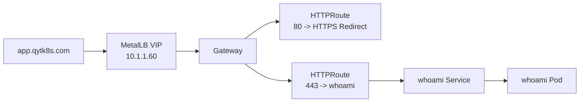
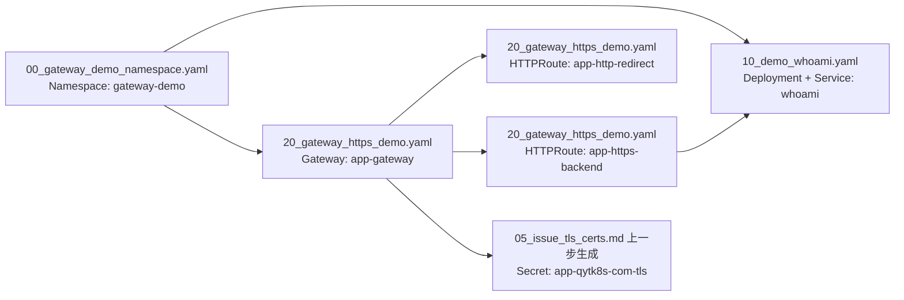

# 第 5 步：发布 Gateway API HTTPS 演示应用

## 本步目标

把演示应用正式通过下面这条链路发布给集群外部访问：

- `MetalLB VIP`
- `Gateway API`
- `app.qytk8s.com`
- `HTTPS`

---

## 执行标记

- **执行标记：必须执行**

说明：

- 这是第三章真正把内部服务发布为外部 HTTPS 服务的一步
- 本步完成后，第三章主线会第一次形成完整闭环

---

## 问题背景

到本步之前，第三章已经具备：

- `MetalLB`
- `Gateway API`
- `app.qytk8s.com` 对应证书

但这些能力此时还没有真正串成一条对外访问链路。

这一页要完成的事情是：

- 部署演示应用
- 创建 `Gateway`
- 创建 `HTTPRoute`
- 让 `Gateway` 获取固定 VIP
- 从命令行和浏览器两侧确认 HTTPS 已经真正可用

---

## 理论说明

### 发布关系图



这张图说明：

- `Gateway` 负责监听 `80/443`
- 一个 `HTTPRoute` 负责 `HTTP -> HTTPS` 跳转
- 另一个 `HTTPRoute` 负责把 HTTPS 流量转发到后端 `whoami Service`

### 本步清单关系图

对新手来说，可以先把本步涉及的几个对象理解成下面这层关系：



这张图只说明配置关系：

- `gateway-demo` 是这些对象统一所在的命名空间
- `whoami Service` 是最终后端
- `Gateway` 负责入口监听
- 两个 `HTTPRoute` 分别负责跳转和转发
- TLS Secret 不是本步新建，但会在本步被 `Gateway` 引用

### 为什么这里同时创建两个 `HTTPRoute`

第三章不是只做到“443 能打开”，而是要把正式发布的入口行为做完整：

- `80` 端口用于明文入口
- 但会立即 `301` 跳转到 HTTPS
- `443` 端口才是真正承载业务内容的入口

这更符合真实发布场景，也更适合作为教材演示“正式入口模型”。

### 本步关键清单

本步会使用下面两份清单：

- `manifests/10_demo_whoami.yaml`
- `manifests/20_gateway_https_demo.yaml`

#### `whoami` 演示应用

- 来源文件：`manifests/10_demo_whoami.yaml`
- 对象类型：`Service`

```yaml
kind: Service
metadata:
  name: whoami
spec:
  selector:
    app: whoami
  ports:
    - name: http
      port: 80
      targetPort: 80
```

关键字段说明：

- `whoami Service` 是 `Gateway` 最终要转发到的目标

#### `Gateway` 关键字段

- 来源文件：`manifests/20_gateway_https_demo.yaml`
- 对象类型：`Gateway`

```yaml
kind: Gateway
metadata:
  name: app-gateway
spec:
  gatewayClassName: cilium
  infrastructure:
    annotations:
      metallb.io/address-pool: edge-pool
      metallb.io/loadBalancerIPs: 10.1.1.60
```

关键字段说明：

- `gatewayClassName: cilium`
  - 明确由 `Cilium` 实现这个入口
- `metallb.io/address-pool: edge-pool`
  - 指定 VIP 来源于 `edge-pool`
- `metallb.io/loadBalancerIPs: 10.1.1.60`
  - 固定本章业务入口 VIP

#### `HTTPS listener` 与证书

- 来源文件：`manifests/20_gateway_https_demo.yaml`
- 对象类型：`Gateway.spec.listeners[]`

```yaml
- name: https
  hostname: app.qytk8s.com
  port: 443
  protocol: HTTPS
  tls:
    mode: Terminate
    certificateRefs:
      - kind: Secret
        name: app-qytk8s-com-tls
```

关键字段说明：

- `mode: Terminate`
  - 在 `Gateway` 处终止 TLS
- `certificateRefs`
  - 直接引用上一页已经创建好的 TLS Secret

#### `HTTP -> HTTPS` 跳转规则

- 来源文件：`manifests/20_gateway_https_demo.yaml`
- 对象类型：`HTTPRoute`

```yaml
kind: HTTPRoute
metadata:
  name: app-http-redirect
spec:
  parentRefs:
    - name: app-gateway
      sectionName: http
  rules:
    - filters:
        - type: RequestRedirect
          requestRedirect:
            scheme: https
            statusCode: 301
```

关键字段说明：

- `sectionName: http`
  - 这条路由只挂在 `Gateway` 的 `http` listener 上
- `RequestRedirect`
  - 表示这条路由不转后端，而是直接返回重定向
- `scheme: https`
  - 强制跳转到 HTTPS
- `statusCode: 301`
  - 用标准永久重定向表达正式发布入口行为

#### `HTTPS -> 后端 Service` 转发规则

- 来源文件：`manifests/20_gateway_https_demo.yaml`
- 对象类型：`HTTPRoute`

```yaml
kind: HTTPRoute
metadata:
  name: app-https-backend
spec:
  parentRefs:
    - name: app-gateway
      sectionName: https
  rules:
    - matches:
        - path:
            type: PathPrefix
            value: /
      backendRefs:
        - name: whoami
          port: 80
```

关键字段说明：

- `sectionName: https`
  - 这条路由只挂在 HTTPS listener 上
- `PathPrefix: /`
  - 表示根路径及其子路径都匹配
- `backendRefs`
  - 定义最终转发目标是 `whoami:80`

---

## 对应脚本

本步对应脚本：

- `k8s/03-north-south-traffic/scripts/05_publish_gateway_demo.sh`

本步依赖的关键清单：

- `manifests/00_gateway_demo_namespace.yaml`
- `manifests/10_demo_whoami.yaml`
- `manifests/20_gateway_https_demo.yaml`

脚本里会直接用到下面 3 个 URL 变量：

```bash
NAMESPACE_URL="http://ops:9000/03-north-south-traffic/manifests/00_gateway_demo_namespace.yaml"
WHOAMI_URL="http://ops:9000/03-north-south-traffic/manifests/10_demo_whoami.yaml"
GATEWAY_URL="http://ops:9000/03-north-south-traffic/manifests/20_gateway_https_demo.yaml"
```

关键介绍：

- `NAMESPACE_URL`
  - 指向第三章演示命名空间清单
- `WHOAMI_URL`
  - 指向后端演示应用清单
- `GATEWAY_URL`
  - 指向 `Gateway + HTTPRoute` 聚合清单

---

## 脚本关键任务

### 关键任务 0：创建演示命名空间

脚本原始代码：

```bash
kubectl apply -f "${NAMESPACE_URL}"
```

关键介绍：

- `NAMESPACE_URL` 实际对应的是：
  - `manifests/00_gateway_demo_namespace.yaml`

对应 YAML 关键内容：

- 来源文件：`manifests/00_gateway_demo_namespace.yaml`
- 对象类型：`Namespace`

```yaml
apiVersion: v1
kind: Namespace
metadata:
  name: gateway-demo
```

关键字段说明：

- `name: gateway-demo`
  - 让第三章所有发布对象收敛到同一命名空间，便于观察和验收

### 关键任务 1：部署演示应用

脚本原始代码：

```bash
kubectl apply -f "${WHOAMI_URL}"
kubectl -n gateway-demo rollout status deploy/whoami --timeout=180s
```

关键介绍：

- 先确保有一个稳定、简单的后端服务可用于发布演示
- `WHOAMI_URL` 实际对应的是：
  - `manifests/10_demo_whoami.yaml`

对应 YAML 关键内容：

- 来源文件：`manifests/10_demo_whoami.yaml`
- 对象类型：`Deployment`

```yaml
kind: Deployment
metadata:
  name: whoami
  namespace: gateway-demo
```

以及：

```yaml
kind: Service
metadata:
  name: whoami
  namespace: gateway-demo
```

- 来源文件：`manifests/10_demo_whoami.yaml`
- 对象类型：`Service`

关键字段说明：

- `namespace: gateway-demo`
  - 让第三章所有演示对象集中在一个命名空间中
- `name: whoami`
  - 作为后续 `HTTPRoute` 的明确后端目标

### 关键任务 2：创建 `Gateway` 与 `HTTPRoute`

脚本原始代码：

```bash
kubectl apply -f "${GATEWAY_URL}"
```

关键介绍：

- 一次性下发 `Gateway`
- `HTTP -> HTTPS` 跳转路由
- `HTTPS -> whoami` 后端路由
- `GATEWAY_URL` 实际对应的是：
  - `manifests/20_gateway_https_demo.yaml`

对应 YAML 关键内容：

- 来源文件：`manifests/20_gateway_https_demo.yaml`
- 对象类型：`Gateway`

```yaml
kind: Gateway
metadata:
  name: app-gateway
  namespace: gateway-demo
```

以及：

- 来源文件：`manifests/20_gateway_https_demo.yaml`
- 对象类型：`HTTPRoute`

```yaml
kind: HTTPRoute
metadata:
  name: app-http-redirect
  namespace: gateway-demo
```

以及：

- 来源文件：`manifests/20_gateway_https_demo.yaml`
- 对象类型：`HTTPRoute`

```yaml
kind: HTTPRoute
metadata:
  name: app-https-backend
  namespace: gateway-demo
```

### 关键任务 3：处理 `Cilium Gateway` 与 `MetalLB` 的兼容标签

脚本原始代码：

```bash
slice_name=$(kubectl -n gateway-demo get endpointslice -l io.cilium.gateway/owning-gateway=app-gateway -o jsonpath='{.items[0].metadata.name}' 2>/dev/null || true)
kubectl -n gateway-demo label endpointslice "${slice_name}" \
  kubernetes.io/service-name="${GATEWAY_SERVICE}" --overwrite
```

关键介绍：

- 在当前版本组合中，`Gateway` 自动生成的 `EndpointSlice` 需要补充 `MetalLB` 识别所需 label
- 脚本已经把这一步自动化处理

### 关键任务 4：等待 `Gateway` 获取固定 VIP

脚本原始代码：

```bash
current=$(kubectl get svc -n gateway-demo "${GATEWAY_SERVICE}" -o jsonpath='{.status.loadBalancer.ingress[0].ip}' 2>/dev/null || true)
if [[ "${current}" == "${VIP}" ]]; then
  echo "Gateway 地址已就绪：${current}"
fi
```

关键介绍：

- 持续等待 `LoadBalancer Service` 真正拿到 `10.1.1.60`
- 这是第三章业务发布能否成功的关键节点

### 关键任务 5：本机验证 HTTP 跳转与 HTTPS 访问

脚本原始代码：

```bash
curl -I --resolve "${DOMAIN}:80:${VIP}" "http://${DOMAIN}/"
curl --resolve "${DOMAIN}:443:${VIP}" --cacert "${CA_CERT}" "https://${DOMAIN}/"
```

关键介绍：

- 第一条命令验证 `HTTP -> HTTPS` 是否成立
- 第二条命令验证 HTTPS 证书和业务内容是否都成立

---

## 执行命令

先给脚本增加执行权限：

```bash
chmod +x /docker_k8s_2026/k8s/03-north-south-traffic/scripts/05_publish_gateway_demo.sh
```

然后执行：

```bash
bash /docker_k8s_2026/k8s/03-north-south-traffic/scripts/05_publish_gateway_demo.sh
```

---

## 验证方法

### 验证 1：查看 `Gateway` 与 `HTTPRoute`

```bash
kubectl get gateway,httproute -n gateway-demo
```

预期结果：

- `app-gateway` 存在
- `app-http-redirect` 存在
- `app-https-backend` 存在

### 验证 2：查看 `Gateway` 对应 Service

```bash
kubectl get svc -n gateway-demo
```

预期结果：

- 生成的 `LoadBalancer Service` 获得 `10.1.1.60`

### 验证 3：查看 `Gateway` 详细状态

```bash
kubectl get gateway -n gateway-demo app-gateway -o yaml
```

预期结果：

- `status.addresses` 中能看到 `10.1.1.60`

### 验证 4：本机验证 HTTP 跳转

```bash
curl -I --resolve app.qytk8s.com:80:10.1.1.60 http://app.qytk8s.com/
```

预期结果：

- 返回 `301`

### 验证 5：本机验证 HTTPS 访问

```bash
curl --resolve app.qytk8s.com:443:10.1.1.60 \
  --cacert /docker_k8s_2026/k8s/01-k8s-architecture/pki/harbor/harbor-ca.crt \
  https://app.qytk8s.com/
```

预期结果：

- 返回 `whoami` 页面内容

---

## DNS 配置

在 `win2019 DNS` 中新增：

```text
app.qytk8s.com  ->  10.1.1.60
```

---

## 外部验证

完成 DNS 和根证书导入后，从 `win2019` 浏览器访问：

```text
https://app.qytk8s.com
```

预期结果：

- 浏览器不再报根证书不受信任
- 页面能看到 `whoami` 返回内容

---

## 关键看点

这一页真正要确认的是：

- `Gateway`、`HTTPRoute`、`TLS Secret` 已经串成完整入口链路
- `MetalLB VIP` 已经真正落到业务入口上
- `app.qytk8s.com` 已能通过 HTTPS 正式访问

---

## 通过标准

满足下面条件后，就可以进入最终验收：

- `app.qytk8s.com` 已能从集群外通过 HTTPS 访问
- HTTP 访问会自动跳转到 HTTPS
- `Gateway` 对应 Service 已拿到固定 VIP `10.1.1.60`

---

## 下一步

进入 Hubble UI 正式发布与流量观察：

- `docs/07_publish_hubble_ui.md`
