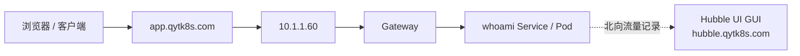
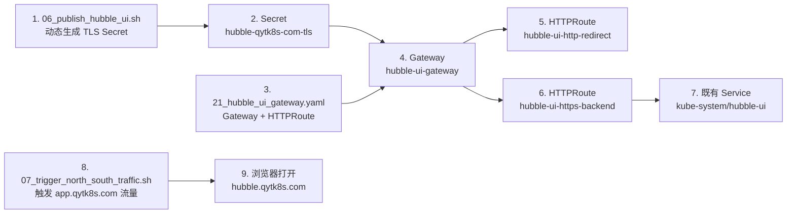
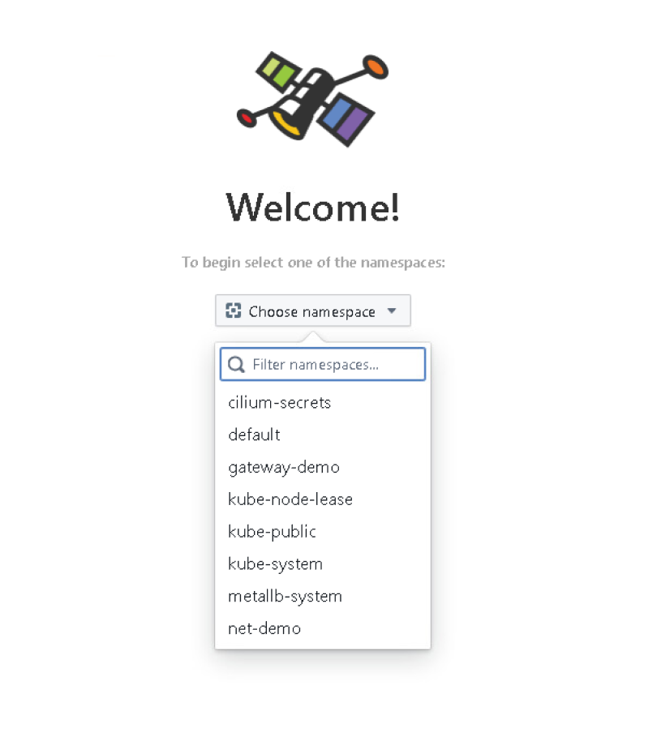
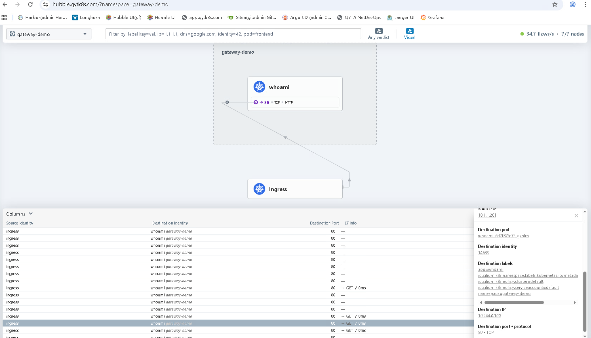

# 第 6 步：发布 Hubble UI 并观察北向流量

## 本步目标

把 `Hubble UI` 作为第三章的一个正式北向入口发布出来，并完成下面这条演示链路：

- 通过 `https://hubble.qytk8s.com` 从集群外访问 `Hubble UI`
- 再触发 `https://app.qytk8s.com` 的北向业务流量
- 最终在 `Hubble UI` 中看到第三章这条“由外到内”的访问记录

---

## 执行标记

- **执行标记：必须执行**
- 这一页把第二章的观测能力正式带入第三章的北向发布场景

---

## 问题背景

第二章已经证明 `Hubble` 可以观察东西向流量，第三章也已经证明 `app.qytk8s.com` 可以通过 `Gateway API + MetalLB + HTTPS` 正式对外发布。这一页就是把这两条能力接到一起：先把 `Hubble UI` 自己发布出来，再从图形界面里观察第三章北向流量。

---

## 理论说明

### 第三章最终演示链路



这张图只表达一件事：`app.qytk8s.com` 负责产生真实的北向业务流量，`Hubble UI GUI` 则在旁路把这条流量可视化展示出来。

### 本步对象关系图

这一页涉及的对象关系，可以先理解成下面这样：



这张图只说明配置和观察关系：第二章里已经存在 `kube-system/hubble-ui` 这个后端 `Service`，本步不重新安装 `Hubble UI`，只补齐 `Secret`、`Gateway` 和 `HTTPRoute`，把它正式发布成 `https://hubble.qytk8s.com`。

### 为什么这一页值得独立成一步

这一页单独保留出来，主要是为了说明两件事：

- 平台组件本身也可以按第三章同样的发布模型对外暴露
- `Gateway API + MetalLB + HTTPS` 这套入口模型不只服务业务应用，也服务运维与观测界面

### 本步关键 `YAML` 一次看清

<div style="padding: 10px 14px; border: 1px solid #666; border-left: 4px solid #8ab4f8; border-radius: 6px; background: rgba(138,180,248,0.08); margin: 8px 0;">
<strong>YAML 来源：</strong><code>kubectl create secret tls ... --dry-run=client -o yaml</code><br/>
<strong>本页重点对象：</strong><code>Secret/hubble-qytk8s-com-tls</code><br/>
<strong>作用：</strong>为 <code>hubble.qytk8s.com</code> 动态生成并导入 TLS Secret，供后续 <code>Gateway</code> 的 <code>HTTPS listener</code> 引用
</div>

```yaml
apiVersion: v1
kind: Secret
metadata:
  name: hubble-qytk8s-com-tls
  namespace: kube-system
type: kubernetes.io/tls
data:
  tls.crt: <base64-encoded certificate>
  tls.key: <base64-encoded private key>
```

<div style="padding: 10px 14px; border: 1px solid #666; border-left: 4px solid #7fd1b9; border-radius: 6px; background: rgba(127,209,185,0.08); margin: 8px 0;">
<strong>YAML 文件：</strong><code>manifests/21_hubble_ui_gateway.yaml</code><br/>
<strong>本页重点对象：</strong><code>Gateway/hubble-ui-gateway + HTTPRoute/hubble-ui-http-redirect + HTTPRoute/hubble-ui-https-backend</code><br/>
<strong>作用：</strong>给 <code>Hubble UI</code> 创建正式北向入口：固定 <code>VIP</code>、监听 <code>80/443</code>、把 <code>HTTP</code> 重定向到 <code>HTTPS</code>，并把业务流量转发到 <code>kube-system/hubble-ui</code>
</div>

#### `Hubble UI Gateway`

```yaml
kind: Gateway
metadata:
  name: hubble-ui-gateway
  namespace: kube-system
spec:
  gatewayClassName: cilium
  infrastructure:
    annotations:
      metallb.io/address-pool: edge-pool
      metallb.io/loadBalancerIPs: 10.1.1.61
```

关键字段说明：

- `namespace: kube-system`
  - 因为第二章已经安装好的 `hubble-ui` Service 本身就在 `kube-system`
- `gatewayClassName: cilium`
  - 继续复用第三章已经启用的 `Cilium Gateway API`
- `metallb.io/loadBalancerIPs: 10.1.1.61`
  - 为 `Hubble UI` 固定一个独立 VIP

补充说明：

- 应用 `Gateway` 后，`Cilium Gateway API` 会自动生成一个对应的 `LoadBalancer Service`
- 本页里这个自动生成的对象就是 `cilium-gateway-hubble-ui-gateway`
- 后续看到的 `10.1.1.61`，就是分配给这个 `Service` 的对外入口地址

#### `HTTPS listener` 与证书

```yaml
- name: https
  hostname: hubble.qytk8s.com
  port: 443
  protocol: HTTPS
  tls:
    mode: Terminate
    certificateRefs:
      - kind: Secret
        name: hubble-qytk8s-com-tls
```

关键字段说明：

- `hubble.qytk8s.com`
  - 作为 Hubble UI 的正式北向域名
- `hubble-qytk8s-com-tls`
  - 本页脚本会为这个域名生成并导入对应 TLS Secret

#### `HTTP -> HTTPS` 跳转规则

```yaml
kind: HTTPRoute
metadata:
  name: hubble-ui-http-redirect
spec:
  parentRefs:
    - name: hubble-ui-gateway
      sectionName: http
  rules:
    - filters:
        - type: RequestRedirect
          requestRedirect:
            scheme: https
            statusCode: 301
```

关键字段说明：

- `sectionName: http`
  - 这条路由只挂在 `Gateway` 的 `http` listener 上
- `RequestRedirect`
  - 表示这条路由不转后端，而是直接返回重定向
- `scheme: https`
  - 强制跳转到 HTTPS
- `statusCode: 301`
  - 用标准永久重定向表达正式发布入口行为

#### `HTTPRoute` 后端转发

```yaml
kind: HTTPRoute
metadata:
  name: hubble-ui-https-backend
spec:
  parentRefs:
    - name: hubble-ui-gateway
      sectionName: https
  rules:
    - backendRefs:
        - name: hubble-ui
          port: 80
```

关键字段说明：

- 最终后端目标直接是 `kube-system/hubble-ui`
- 这说明平台组件本身也能通过同样的入口模型被发布

---

## 对应脚本

本步对应两个脚本：

- 发布脚本：`k8s/03-north-south-traffic/scripts/06_publish_hubble_ui.sh`
- 触发流量脚本：`k8s/03-north-south-traffic/scripts/07_trigger_north_south_traffic.sh`

---

## 脚本关键任务

### 关键任务 1：为 `hubble.qytk8s.com` 签发证书并创建 Secret

发布脚本原始代码：

```bash
DOMAIN="hubble.qytk8s.com"
SECRET_NAME="hubble-qytk8s-com-tls"
NAMESPACE="kube-system"
```

以及：

```bash
kubectl -n "${NAMESPACE}" create secret tls "${SECRET_NAME}" \
  --cert "${SERVER_CERT}" \
  --key "${SERVER_KEY}" \
  --dry-run=client -o yaml | kubectl apply -f -
```

关键介绍：

- `Hubble UI` 使用独立域名与独立证书
- `Secret` 直接创建在 `kube-system`
- 详细字段已在上文卡片中说明

### 关键任务 2：发布 `Hubble UI` 对应的 `Gateway` 与 `HTTPRoute`

发布脚本原始代码：

```bash
kubectl apply -f "${GATEWAY_URL}"
```

关键介绍：

- 应用的就是 `manifests/21_hubble_ui_gateway.yaml`
- 一次性下发 `Gateway`、HTTP 跳转路由和 HTTPS 后端路由
- 详细字段已在上文卡片中说明

### 关键任务 3：处理 `EndpointSlice` 兼容标签并等待 VIP

发布脚本原始代码：

```bash
kubectl -n "${NAMESPACE}" label endpointslice "${slice_name}" \
  kubernetes.io/service-name="${GATEWAY_SERVICE}" --overwrite
```

以及：

```bash
current="$(kubectl get svc -n "${NAMESPACE}" "${GATEWAY_SERVICE}" -o jsonpath='{.status.loadBalancer.ingress[0].ip}' 2>/dev/null || true)"
```

关键介绍：

- 最终目标是让自动生成的 `LoadBalancer Service cilium-gateway-hubble-ui-gateway` 获得固定 VIP `10.1.1.61`

### 关键任务 4：触发第三章北向业务流量

流量脚本原始代码：

```bash
curl -I --resolve "${DOMAIN}:80:${VIP}" "http://${DOMAIN}/" || true

for i in $(seq 1 8); do
  curl --resolve "${DOMAIN}:443:${VIP}" --cacert "${CA_CERT}" "https://${DOMAIN}/" >/dev/null
  sleep 1
done
```

关键介绍：

- 先触发一次 `HTTP -> HTTPS` 跳转
- 再连续触发多次 `HTTPS` 业务访问
- 这样在 `Hubble UI` 中更容易看到连续的北向流量记录

---

## 执行命令

先给脚本增加执行权限：

```bash
chmod +x /docker_k8s_2026/k8s/03-north-south-traffic/scripts/06_publish_hubble_ui.sh
chmod +x /docker_k8s_2026/k8s/03-north-south-traffic/scripts/07_trigger_north_south_traffic.sh
```

先发布 `Hubble UI`：

```bash
bash /docker_k8s_2026/k8s/03-north-south-traffic/scripts/06_publish_hubble_ui.sh
```

然后在需要观察流量时，再触发北向流量：

```bash
bash /docker_k8s_2026/k8s/03-north-south-traffic/scripts/07_trigger_north_south_traffic.sh
```

---

## 验证方法

### 验证 1：查看 `Hubble UI` Gateway 对象

```bash
kubectl get gateway,httproute -n kube-system | grep hubble-ui
kubectl get svc -n kube-system | grep cilium-gateway-hubble-ui-gateway
```

预期结果：

- `hubble-ui-gateway` 存在
- `hubble-ui-http-redirect` 存在
- `hubble-ui-https-backend` 存在
- `LoadBalancer Service` 获得 `10.1.1.61`

### 验证 2：本机验证 Hubble UI HTTPS 访问

```bash
curl -I --resolve hubble.qytk8s.com:80:10.1.1.61 http://hubble.qytk8s.com/
curl -I --resolve hubble.qytk8s.com:443:10.1.1.61 --cacert /docker_k8s_2026/k8s/01-k8s-architecture/pki/harbor/harbor-ca.crt https://hubble.qytk8s.com/
```

预期结果：

- HTTP 返回 `301`
- HTTPS 返回 `200`

### 验证 3：浏览器观察 Hubble UI

在 `win2019 DNS` 中新增：

```text
hubble.qytk8s.com  ->  10.1.1.61
```

然后浏览器访问：

```text
https://hubble.qytk8s.com
```

预期结果：

- 页面能正常打开
- 证书链受信任

关键看点：

- 当前只需要确认 `https://hubble.qytk8s.com` 已能正常打开
- 第一次进入时会先让你选择命名空间
- 这一步先不要急着判断有没有流量图，先继续执行下一步流量触发

### 验证 4：触发流量并在 UI 中观察

保持 `Hubble UI` 页面打开，然后执行：

```bash
bash /docker_k8s_2026/k8s/03-north-south-traffic/scripts/07_trigger_north_south_traffic.sh
```

预期结果：

- `Hubble UI` 中会出现第三章北向演示流量
- 可以观察到与 `app.qytk8s.com` 发布链路相关的访问记录

关键看点：

- 先保持 `Hubble UI` 页面打开
- 再执行触发脚本制造新的北向访问
- 刷新后优先观察最近时间窗口内的新流量，而不是历史旧记录

### GUI 操作示意

完成发布并触发流量后，再回到 `https://hubble.qytk8s.com` 观察界面。

第一次打开 `Hubble UI` 时，会先让你选择命名空间：



这里的选择规则是：

- 第三章主线优先选择 `gateway-demo`

选中命名空间后，界面会展示服务关系图与最近流量表：



说明：

- 第二张图现在展示的是第三章主线推荐视角，也就是 `gateway-demo` 命名空间
- 重点是让学员直接看到第三章北向发布链路所在的命名空间界面长什么样
- 后续触发 `app.qytk8s.com` 流量后，应优先在这个视角下观察最近产生的新流量

---

## 关键看点

这一页真正要确认的是：

- `Hubble UI` 本身已经成为一个正式北向发布的 Web UI
- 第三章“由外到内”的请求链路能被图形化观察
- 网络观测不再只停留在第二章 CLI，而是变成第三章正式成果物的一部分

---

## 通过标准

满足下面条件后，就可以进入最终验收：

- `hubble.qytk8s.com` 已能通过 HTTPS 正式访问
- 执行流量脚本后，能在 `Hubble UI` 里看到北向访问记录

---

## 下一步

进入第三章最终验收：

- `docs/08_verify.md`
