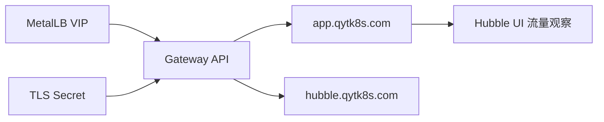

# 第 7 步：第三章最终验收

## 本步目标

只读验收第三章，确认这条主线已经闭环：

- `MetalLB` 正常
- `Gateway API` 正常
- `TLS` 正常
- `app.qytk8s.com` 可以通过 `HTTPS` 访问
- `hubble.qytk8s.com` 可以通过 `HTTPS` 访问
- `Hubble UI` 能看到第三章北向流量

本步不改配置，只做验收。

## 执行标记

- **执行标记：只读验证**

## 理论说明

### 第三章闭环关系图



## 验收顺序

请按下面顺序检查：

1. `MetalLB`
2. `Gateway API`
3. 证书
4. `app.qytk8s.com`
5. `hubble.qytk8s.com`
6. `Hubble UI` 中的北向流量

## 验证方法

### 验证 1：`MetalLB`

```bash
kubectl get pods -n metallb-system -o wide
kubectl get ipaddresspool,l2advertisement -n metallb-system
kubectl get servicel2statuses.metallb.io -n metallb-system
```

预期结果：

- `controller` 正常
- `speaker` 正常
- `edge-pool` 存在
- 能看到 `cilium-gateway-app-gateway` 和 `cilium-gateway-hubble-ui-gateway` 对应的 `ServiceL2Status`

### 验证 2：`Gateway API`

```bash
kubectl get gatewayclass
kubectl get gateway -n gateway-demo
kubectl get gateway -n kube-system | grep hubble-ui
```

预期结果：

- 存在 `cilium` GatewayClass
- `app-gateway` 正常
- `hubble-ui-gateway` 正常

### 验证 3：HTTPS 证书

```bash
kubectl get secret -n gateway-demo app-qytk8s-com-tls
kubectl get secret -n kube-system hubble-qytk8s-com-tls
```

预期结果：

- 两个 TLS Secret 都存在

### 验证 4：`app.qytk8s.com`

```bash
curl -I --resolve app.qytk8s.com:80:10.1.1.60 http://app.qytk8s.com/
curl --resolve app.qytk8s.com:443:10.1.1.60 --cacert /docker_k8s_2026/k8s/01-k8s-architecture/pki/harbor/harbor-ca.crt https://app.qytk8s.com/
```

预期结果：

- HTTP 返回 `301`
- HTTPS 返回 `whoami` 页面内容

### 验证 5：`hubble.qytk8s.com`

```bash
curl -I --resolve hubble.qytk8s.com:80:10.1.1.61 http://hubble.qytk8s.com/
curl -I --resolve hubble.qytk8s.com:443:10.1.1.61 --cacert /docker_k8s_2026/k8s/01-k8s-architecture/pki/harbor/harbor-ca.crt https://hubble.qytk8s.com/
```

预期结果：

- HTTP 返回 `301`
- HTTPS 返回 `200`

### 验证 6：`Hubble UI` 中观察北向流量

保持浏览器打开：

```text
https://hubble.qytk8s.com
```

然后执行：

```bash
bash /docker_k8s_2026/k8s/03-north-south-traffic/scripts/07_trigger_north_south_traffic.sh
```

预期结果：

- `Hubble UI` 中能看到第三章北向访问链路产生的流量记录

## 通过标准

满足下面条件后，第三章即可视为完成：

- 裸机集群已经具备 `LoadBalancer VIP`
- `Gateway API` 能工作
- `app.qytk8s.com` 与 `hubble.qytk8s.com` 都已通过 HTTPS 正式发布
- `Hubble UI` 已能观察第三章北向流量
