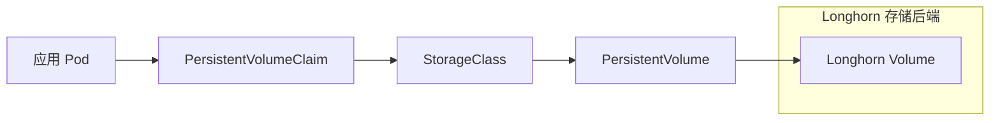
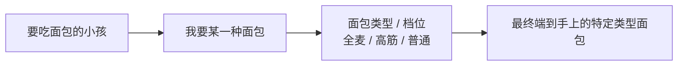
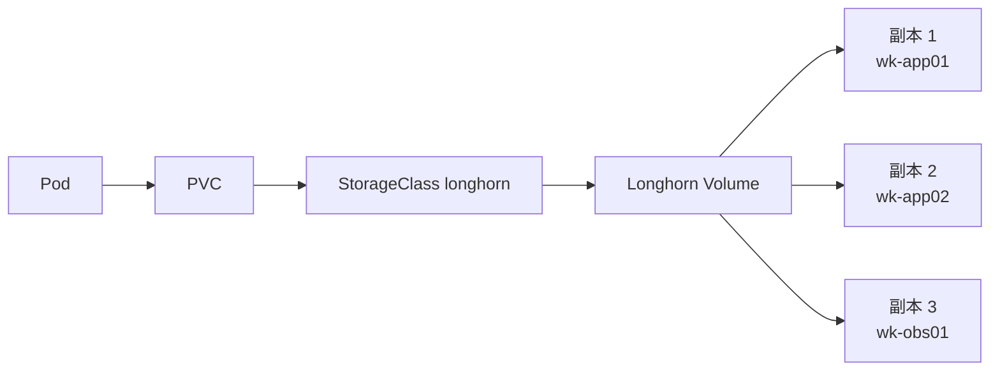
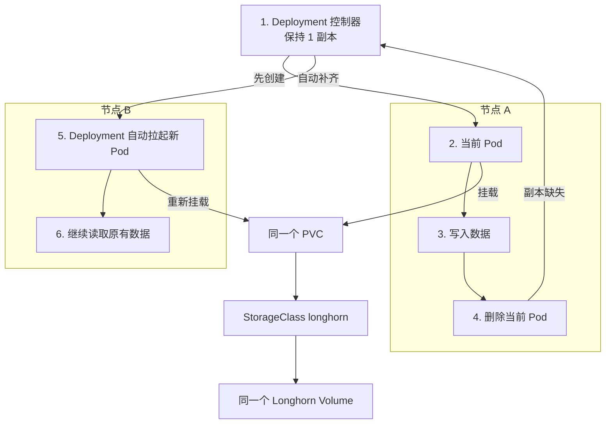
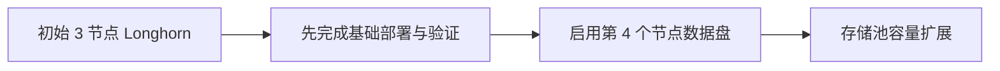

# 第四章理论导读：Longhorn、Ceph 与传统 iSCSI

## 本步目标

正式进入第四章之前，先建立 5 个关键认识：

- 第四章开始解决的是 Kubernetes 的持久化数据问题
- `PV / PVC / StorageClass` 是这章最基础的对象模型
- 第四章主线为什么选 `Longhorn`
- `Longhorn`、`Ceph`、传统 `iSCSI` 的边界分别在哪里
- 为什么这章采用“先 3 节点，再加第 4 节点”的教学节奏

---

## 问题背景

前三章已经把这些能力打通了：

- Kubernetes 集群可用
- `Cilium` 网络正常
- `MetalLB + Gateway API + HTTPS` 已就位

但前面大多数工作负载，本质上还是**无状态**。

第四章要补齐的能力包括：

- `Pod` 可以被删除和重建，但业务数据不能跟着一起丢失
- 应用需要持久卷时，集群必须能够动态提供存储
- Kubernetes 不只承载无状态工作负载，也要承载数据库、消息队列这类有状态服务

这一章结束后，要能把下面这句话讲清楚：

> Kubernetes 不只是编排容器，它也可以承载需要持久数据的应用。

---

## 理论说明

### `PV / PVC / StorageClass` 关系图



这张图要先记住：

- `Pod` 是真正使用存储的应用
- `PVC` 是应用发起的卷申请
- `StorageClass` 是这次申请应使用哪种存储档位
- `PV` 是 Kubernetes 最终交付出来的卷对象
- `Longhorn` 存储后端里真正落地的是 `Longhorn Volume`

先单独理解 `StorageClass`：

- 它可以把不同类型、不同性能、不同成本的存储，封装成不同档位
- `PVC` 再按需要申请某一种档位

例如可以抽象成：

- `gold`
  - 高性能，本地 `NVMe / SSD`
- `silver`
  - 通用型，本地机械盘或 `RAID`
- `bronze`
  - 低成本，远端共享存储或低性能块存储

也可以先用一个更直观的比喻把整条链路串起来：

- `Pod`
  - 相当于真正要吃面包的小孩
- `PVC`
  - 相当于“小孩提出我要某一种面包”的申请
- `StorageClass`
  - 相当于面包的类型或档位，例如全麦、高筋、普通白面包
- `PV`
  - 相当于最后真正端到手上的那一份面包

对应到比喻图，可以先这样理解：



一句话收束：

> `PVC` 提需求，`StorageClass` 选档位，`PV` 是最终交付出来的卷。

### 为什么存储比网络更容易让人紧张

网络问题常常在问：

- 能不能通
- 路由对不对
- 策略有没有拦

而存储问题更容易带来：

- 数据一致性
- 数据持久化
- 节点故障后的恢复
- 副本补齐
- 卷绑定和重建

所以第四章本质上是在回答一个更接近生产的问题：

> 业务 Pod 没了可以重建，但数据不能跟着一起没。

### 本章当前实践选择 `Longhorn`

第四章当前实践以 `Longhorn` 为例。

这一章先用一套具体实现，把下面这条主线讲清楚：

- `StorageClass`
- `PVC`
- 卷
- 副本
- 节点
- 数据保留

### `Longhorn` 的核心思路

`Longhorn` 是一个跑在 Kubernetes 里的分布式块存储系统。

从课程视角，先记住 4 件事：

1. 它给 Kubernetes 提供动态卷能力。
2. 它可以为卷创建多个副本。
3. 某个节点坏了，卷不一定就没了。
4. 它可以通过 `StorageClass` 为 `PVC` 动态创建卷。

### `Longhorn` 在这一章里的关系图



> 说明：
>
> 本章不是“默认碰巧有 3 副本”，而是在 `manifests/01_longhorn_values.yaml` 中明确写了 `defaultReplicaCount: 3` 和 `defaultClassReplicaCount: 3`。也就是说，第四章主线里的卷默认按 `3` 副本创建。`Longhorn` 会尽量把这些副本分散到不同节点；某个节点故障后，只要仍有可用副本，卷就还有恢复与重建的基础。

这张图表达的是：

- 应用侧主要通过 `PVC` 使用存储
- Kubernetes 按 `StorageClass` 的规则完成卷对象的动态供给
- `Longhorn` 后端真正承载的是卷创建与副本分布

这里要特别建立一个关键认识：

- `Pod` 的生命周期和数据生命周期不是同一层
- `Pod` 可以被删除、重建、漂移到其他节点
- 但只要业务重新挂载的还是同一个 `PVC`，就仍然是在访问原来的那一块卷

> 说明：
>
> 在持久化存储模型下，`Pod` 即使被重建到另一个节点，只要同一个 `PVC` 对应的卷能重新附加并挂载成功，就仍然可以继续读取之前已经写入的数据。

### `Longhorn vs Ceph`

两者都能做分布式存储，但定位并不一样。

`Ceph` 更像一个功能非常全、规模非常大的通用分布式存储平台，可以覆盖：

- 块存储
- 对象存储
- 文件存储

它很强，但也意味着：

- 架构更重
- 运维复杂度更高
- 组件层次更多

而 `Longhorn` 更像专门面向 Kubernetes 场景的分布式块存储，重点放在：

- 卷
- 副本
- 节点
- 故障恢复

从课程表达上，可以把它们先区分成两类：

- `Ceph` 更适合讲“完整的大型分布式存储平台”
- `Longhorn` 更适合先把 Kubernetes 里的有状态主线讲清楚

这里还要注意一个表述边界：

- `Longhorn` 不是 Kubernetes 内建组件
- 但它的设计和使用方式更贴近 Kubernetes 场景
- `Ceph` 也可以很好地服务 Kubernetes，只是它本身的目标范围更大，不只面向 Kubernetes

因此，就第四章当前范围而言，`Longhorn` 更适合作为本章实践模型；`Ceph` 更适合在后续单独展开更完整的分布式存储体系。

从实施与运维范围看，`Ceph` 通常也会比 `Longhorn` 更重一些，因为它的组件层次、功能覆盖面和故障处理面都更大。

### `Longhorn vs 传统 iSCSI`

传统 `iSCSI` 的思路通常是：

- 后面有一个集中式存储阵列或一台存储服务器
- 通过 `iSCSI target` 把 LUN 暴露给主机
- 主机侧再去挂载块设备

这个模型在企业里非常常见，但如果直接搬进这门课，会遇到几个问题：

- 存储高可用依赖外部阵列，不在 Kubernetes 内部闭环
- 卷、副本、节点调度关系不够直观
- 学员更容易觉得这是“外部存储接入”，而不是“Kubernetes 内部形成分布式卷能力”

一句话对比：

- 传统 `iSCSI` 更像“外部存储接入 Kubernetes”
- `Longhorn` 更像“在 Kubernetes 里长出一套分布式块存储能力”

### 为什么这一章要先 3 节点，再加第 4 节点

第四章不一开始就把 4 个节点全部放进 `Longhorn`，而是分两阶段：

第一阶段：

- `wk-app01`
- `wk-app02`
- `wk-obs01`

先组成初始存储集群。

这样最适合讲清楚：

- 3 副本
- 卷调度
- `StorageClass`
- `PVC`
- 当前 Pod 被删除后，自动重建的新 Pod 继续挂载原 PVC 时数据仍保留

第二阶段：

- 再把 `wk-edge01` 初始化为第 4 个可用存储节点

这样可以单独讲“存储扩容”，而不是把它混在安装动作里。

### 为什么一定要用独立数据盘

这一章固定要求把新增数据盘挂到：

```text
/var/lib/longhorn
```

原因很直接：

- 不把 Longhorn 数据直接压在系统盘上
- 更符合生产习惯
- 更容易观察磁盘、挂载点和 Longhorn 数据路径之间的关系
- 后面讲“新节点加入”时逻辑更清楚

### 本章最终要让学员看到什么

这一章结束后，学员首先应能看清下面这条主线：删除的是 `Pod`，不是数据。



这张图强调的是：

- `1`
  - `Deployment` 控制器保证业务始终维持 `1` 个副本
- `2 ~ 4`
  - 当前 `Pod` 在节点 A 运行、写入数据，然后被删除
- `5`
  - `Deployment` 发现副本缺失后，会自动补齐一个新 `Pod`，这个新 `Pod` 可以被调度到另一个节点
- `2` 和 `5`
  - 前后两个 `Pod` 挂载的都是同一个 `PVC`
- `同一个 PVC -> StorageClass -> 同一个 Longhorn Volume`
  - 这条存储链路没有改变，因此删除当前 `Pod` 不等于删除数据

然后还能继续看到这一章的扩容演进路径：



---

## 通过标准

读完这一页后，应该能回答下面 4 个问题：

- `PVC / StorageClass / PV` 分别做什么
- 为什么第四章主线先选 `Longhorn`
- 它和 `Ceph`、传统 `iSCSI` 有什么边界差异
- 为什么这章要先 3 节点、再加第 4 个节点

---

## 下一步

进入第四章总览页，确认本章顺序与边界：

- `docs/01_chapter_guide.md`
