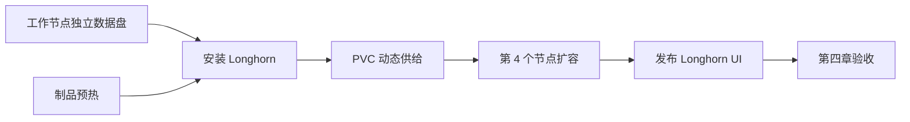

# 第四章总览：存储与有状态服务

## 本章目标

第四章的目标，是把前 3 章已经具备网络、入口和 HTTPS 能力的集群，推进到**具备有状态工作负载承载能力**的状态。

本章结束后，应达到下面状态：

- 4 个工作节点都已经挂好独立数据盘
- `Longhorn` 已安装完成
- 首批 3 个节点已作为 Longhorn 存储节点工作
- 应用可以通过 `PVC` 动态申请卷
- Pod 删除重建后，卷内数据仍保留
- `wk-edge01` 可以作为第 4 个 Longhorn 节点加入
- `Longhorn UI` 可以通过 `win2019 + HTTPS + 域名` 访问

## 问题背景

前三章已经解决：

- 集群基础能力
- 云原生网络
- 北向入口与 HTTPS 发布

但如果还没有存储，这个集群仍然更像“只能跑无状态应用的平台”。

第四章要补上的问题是：

- 谁来为 Pod 提供持久卷
- 卷如何动态分配
- Pod 删除重建后数据为什么还能保留
- 存储节点后续如何扩容

因此第四章的重点不是“再装一套组件”，而是“把前面已经稳定的集群推进到能承载有状态工作负载”。

## 课前理论导读

正式操作前，建议先阅读：

- `docs/00_storage_theory.md`

它负责先讲清：

- `PV / PVC / StorageClass`
- 为什么第四章主线选 `Longhorn`
- `Longhorn`、`Ceph`、传统 `iSCSI` 的边界
- 为什么本章采用“先 3 节点、再加第 4 节点”的节奏

## 本章重点边界

第四章只聚焦：

- `PVC`
- `StorageClass`
- `Longhorn`
- 有状态卷
- Pod 重建后的数据保留
- Longhorn 节点扩容

暂不展开：

- 备份到外部对象存储
- 灾备演练
- 存储性能压测
- `Ceph` 的完整实施

这些内容放到后续增强章节或补充实验。

## 本章总关系图

这张图表达了第四章的完整主线：

- 先准备宿主机数据盘
- 再准备 Chart、镜像和本地制品
- 然后安装 `Longhorn`
- 再用一个最小有状态演示验证 `PVC -> PV -> 数据保留`
- 之后再单独讲第 4 个节点扩容
- 最后把 `Longhorn UI` 也统一纳入课程的北向 HTTPS 访问方式

## 本章学习方式

第四章继续采用“文档主导 + 脚本辅助 + 清单独立发布”的方式：

1. 登录 `ops`
2. 先看文档，再执行脚本
3. 所有 YAML 与 Chart 继续通过 `http://ops:9000/` 提供
4. 所有镜像继续统一走 `harbor.qytk8s.com`

## 执行标记说明

为了便于在 `ops` 上直接执行，本章继续采用统一执行标记：

- **人工前置**：需要在 VMware 或 GUI 中手工完成
- **必须执行**：从第四章标准起点开始时，默认需要实际执行
- **只读验证**：这一项主要用于检查结果，不会改配置

## 本章脚本执行矩阵

| 步骤 | 文档 | 脚本 | 执行标记 | 说明 |
| :--- | :--- | :--- | :--- | :--- |
| 0 | `00_storage_theory.md` | 无 | 建议先读 | Longhorn、Ceph、传统 iSCSI 理论对比 |
| 1 | `02_add_vmware_disks.md` | 无 | 人工前置 | 先在 VMware 中给 4 个工作节点加独立数据盘 |
| 2 | `03_prepare_longhorn_disks.md` | `scripts/01_prepare_longhorn_disks.sh` | 必须执行 | 在 Linux 内初始化并挂载数据盘 |
| 3 | `04_prepare_longhorn_artifacts.md` | `scripts/02_prepare_longhorn_artifacts.sh` | 必须执行 | 固化 Longhorn Chart，推送镜像到 Harbor |
| 4 | `05_install_longhorn.md` | `scripts/03_install_longhorn.sh` | 必须执行 | 安装 Longhorn，初始化首批 3 个存储节点 |
| 5 | `06_default_storageclass_and_test_pvc.md` | `scripts/04_deploy_stateful_demo.sh` | 必须执行 | 验证 PVC 动态供给与数据保留 |
| 6 | `07_expand_longhorn_node.md` | `scripts/05_expand_longhorn_node.sh` | 必须执行 | 将 `wk-edge01` 作为第 4 个 Longhorn 节点加入 |
| 8 | `08_publish_longhorn_ui.md` | `scripts/07_publish_longhorn_ui.sh` | 必须执行 | 把 Longhorn UI 正式发布为 `https://longhorn.qytk8s.com` |
| 9 | `09_verify.md` | `scripts/06_verify_storage.sh` | 只读验证 | 第四章最终验收 |

## 本章执行顺序

请严格按下面顺序执行：

0. `00_storage_theory.md`
1. `02_add_vmware_disks.md`
2. `03_prepare_longhorn_disks.md`
3. `04_prepare_longhorn_artifacts.md`
4. `05_install_longhorn.md`
5. `06_default_storageclass_and_test_pvc.md`
6. `07_expand_longhorn_node.md`
7. `08_publish_longhorn_ui.md`
8. `09_verify.md`

## 第四章起点状态

第四章开始前，默认你已经完成第三章，并满足下面这些条件：

- 所有节点均为 `Ready`
- 第三章最终验收已经通过
- `ops` 已具备 `kubectl`、`helm`
- `ops` 已提供 `http://ops:9000/`
- `Harbor` 可用且镜像仓库保留
- 你已经在 `VMware` 中给 4 个工作节点都加好了独立数据盘
- `win2019 DNS` 后续可为 `longhorn.qytk8s.com` 指向 `10.1.1.60`

## 版本冻结

- Kubernetes：`v1.33.9`
- Longhorn：`1.11.0`
- 数据盘设备：`/dev/sdb`
- 数据盘挂载点：`/var/lib/longhorn`
- Longhorn UI 服务类型：`ClusterIP`

## 关键设计冻结

- 第四章主线选 `Longhorn`，不切到 `Ceph`
- 首批 Longhorn 节点固定为 `wk-app01`、`wk-app02`、`wk-obs01`
- `wk-edge01` 不在安装时直接纳入，而是单独作为扩容演示节点
- 新增数据盘统一固定为 `/dev/sdb`
- Longhorn 数据路径统一固定为 `/var/lib/longhorn`
- Longhorn UI 统一通过第三章已经建立的 `Gateway API + HTTPS + Harbor CA` 方式向 `win2019` 发布

## 下一步

先进入第 1 步，确认 VMware 加盘清单：

- `docs/02_add_vmware_disks.md`
