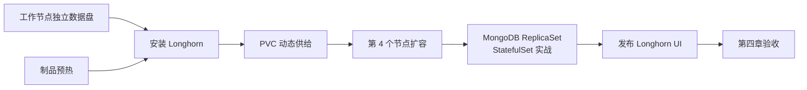

# 第四章总览：存储与有状态服务

## 本章目标

第四章的目标，是把前 3 章已经具备网络、入口和 HTTPS 能力的集群，推进到**具备有状态工作负载承载能力**的状态。

本章结束后，应达到下面状态：

- 4 个工作节点都已经挂好独立数据盘
- `Longhorn` 已安装完成
- 首批 3 个节点已作为 Longhorn 存储节点工作
- 应用可以通过 `PVC` 动态申请卷
- 当前 `Pod` 被删除后，新 `Pod` 仍可继续挂载原来的 `PVC`
- 能区分 `Deployment` 与 `StatefulSet` 的使用边界，并完成一个 `MongoDB ReplicaSet` `StatefulSet` 案例
- `wk-edge01` 可以进一步初始化为第 4 个 Longhorn 存储节点
- `Longhorn UI` 可以通过域名和 `HTTPS` 访问

---

## 问题背景

前三章已经解决：

- 集群基础能力
- 云原生网络
- 北向入口与 HTTPS 发布

但如果还没有存储，这个集群仍然更像“只能跑无状态应用的平台”。

第四章要继续补齐：

- `Pod` 的数据如何持久保存
- 卷如何动态分配
- 为什么新 `Pod` 重新挂载原 `PVC` 后还能继续读取原数据
- 什么时候继续使用 `Deployment`，什么时候改用 `StatefulSet`
- 存储节点后续如何扩容

因此第四章的重点不是“再装一套组件”，而是“把前面已经稳定的集群推进到能承载有状态工作负载”。

---

## 理论导读

正式操作前，建议先阅读：

- `docs/00_storage_theory.md`

它负责先讲清：

- `PV / PVC / StorageClass`
- 为什么本章以 `Longhorn` 为例
- `Longhorn`、`Ceph`、传统 `iSCSI` 的边界
- 为什么本章采用“先 3 节点、再加第 4 节点”的节奏

---

## 本章重点边界

第四章只聚焦：

- `PVC`
- `StorageClass`
- `Longhorn`
- 有状态卷
- `Deployment` 自动重建后的数据保留
- `Deployment` 与 `StatefulSet` 的边界
- Longhorn 节点扩容

---

## 本章总关系图

这张图表达了第四章的完整主线：

- 宿主机侧先补齐独立数据盘，为 Longhorn 数据路径提供基础承载条件
- 安装前先完成 Chart、镜像与本地制品准备
- 在此基础上安装 `Longhorn`，建立第四章的存储后端
- 随后通过一个最小有状态演示，验证 `PVC -> PV -> 数据保留` 这条主线
- 在基础验证完成后，再单独展开第 4 个节点的存储扩容
- 再通过 `MongoDB ReplicaSet` 案例说明 `StatefulSet` 的稳定身份、独立卷与自动恢复
- 最后将 `Longhorn UI` 统一纳入课程既有的北向 `HTTPS` 发布方式

---

## 本章学习方式

第四章继续采用“文档主导 + 脚本辅助 + 清单独立发布”的方式：

1. 登录 `ops`
2. 先看文档，再执行脚本
3. 所有 YAML 与 Chart 继续通过 `http://ops:9000/` 提供
4. 所有镜像继续统一走 `harbor.qytk8s.com`

---

## 执行标记说明

为了便于在 `ops` 上直接执行，本章继续采用统一执行标记：

- **人工前置**：需要在 VMware 或 GUI 中手工完成
- **必须执行**：从第四章标准起点开始时，默认需要实际执行
- **只读验证**：这一项主要用于检查结果，不会改配置

---

## 本章小单元与对应脚本

| 步骤 | 文档 | 主要任务 | 对应脚本 | 执行标记 |
| :--- | :--- | :--- | :--- | :--- |
| 1 | `02_add_vmware_disks.md` | 在 VMware 中给 4 个工作节点补齐独立数据盘 | 无 | 人工前置 |
| 2 | `03_prepare_longhorn_disks.md` | 在 Linux 内初始化并挂载 Longhorn 数据盘 | `scripts/01_prepare_longhorn_disks.sh` | 必须执行 |
| 3 | `04_prepare_longhorn_artifacts.md` | 固化 Longhorn 与 MongoDB 制品并推送镜像到 Harbor | `scripts/02_prepare_longhorn_artifacts.sh` | 必须执行 |
| 4 | `05_install_longhorn.md` | 安装 Longhorn，并初始化首批 3 个存储节点 | `scripts/03_install_longhorn.sh` | 必须执行 |
| 5 | `06_default_storageclass_and_test_pvc.md` | 验证默认 StorageClass、PVC 动态供给与数据保留 | `scripts/04_deploy_stateful_demo.sh` | 必须执行 |
| 6 | `07_expand_longhorn_node.md` | 将 `wk-edge01` 初始化为第 4 个 Longhorn 存储节点 | `scripts/05_expand_longhorn_node.sh` | 必须执行 |
| 7 | `08_statefulset_intro.md` | 使用 `MongoDB ReplicaSet` 讲清 `StatefulSet` 主线 | `scripts/08_deploy_statefulset_demo.sh` | 必须执行 |
| 8 | `09_publish_longhorn_ui.md` | 把 Longhorn UI 正式发布为 `https://longhorn.qytk8s.com` | `scripts/07_publish_longhorn_ui.sh` | 必须执行 |
| 9 | `10_verify.md` | 执行第四章最终验收 | `scripts/06_verify_storage.sh` | 只读验证 |

---

## 本章执行顺序

请严格按下面顺序执行：

1. `00_storage_theory.md`
2. `02_add_vmware_disks.md`
3. `03_prepare_longhorn_disks.md`
4. `04_prepare_longhorn_artifacts.md`
5. `05_install_longhorn.md`
6. `06_default_storageclass_and_test_pvc.md`
7. `07_expand_longhorn_node.md`
8. `08_statefulset_intro.md`
9. `09_publish_longhorn_ui.md`
10. `10_verify.md`

---

## 版本冻结

- Kubernetes：`v1.33.9`
- Longhorn：`1.11.0`
- 数据盘设备：`/dev/sdb`
- 数据盘挂载点：`/var/lib/longhorn`
- Longhorn UI 服务类型：`ClusterIP`

---

## 关键设计冻结

- 本章实践以 `Longhorn` 为例，暂不展开 `Ceph`
- 首批 Longhorn 节点固定为 `wk-app01`、`wk-app02`、`wk-obs01`
- `wk-edge01` 在安装阶段不初始化默认数据盘，而是单独作为扩容演示节点
- 新增数据盘统一固定为 `/dev/sdb`
- Longhorn 数据路径统一固定为 `/var/lib/longhorn`
- Longhorn UI 统一通过第三章已经建立的 `Gateway API + HTTPS + Harbor CA` 方式向 `win2019` 发布

---

## 下一步

先进入第 1 步，确认 VMware 加盘清单：

- `docs/02_add_vmware_disks.md`
