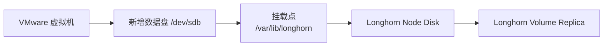

# 第 1 步：在 VMware 中为工作节点添加独立数据盘

## 本步目标

在正式安装 `Longhorn` 前，先为 4 个工作节点补齐独立数据盘。

本章固定约定：

- 新增数据盘设备名按课堂环境统一为 `/dev/sdb`
- 后续会挂载到 `/var/lib/longhorn`

## 执行标记

- **执行标记：人工前置**

说明：

- 这是第四章唯一一个不在 `ops` 上执行脚本的前置步骤
- 后面所有 Linux 初始化动作，都建立在这一步已经完成的前提上

## 问题背景

`Longhorn` 是分布式块存储，但它最终仍然要把数据落到每台宿主机上的真实磁盘路径。

如果一开始就直接复用系统盘，会带来两个问题：

1. 课程上不容易把“系统盘”和“存储数据盘”的边界讲清楚。
2. 不符合更接近生产的存储习惯。

所以第四章明确要求：

> 每个工作节点都单独加一块新的数据盘，专门给 Longhorn 用。

## 理论说明

### 宿主机磁盘与 Longhorn 的关系



这张图说明：

- VMware 里先新增磁盘
- Linux 里再把这块盘挂载到 `/var/lib/longhorn`
- Longhorn 最终把它识别成可调度的数据盘

### 为什么现在 4 个节点都先加盘

虽然 `Longhorn` 安装时不会立刻把 4 个节点都纳入存储池，但 4 个节点现在都先把盘加好，有两个直接好处：

- 后面 Linux 初始化步骤可以一次做完
- 第 4 个节点扩容时不再回头做底层加盘动作

## 本步涉及节点

- `wk-app01`
- `wk-app02`
- `wk-obs01`
- `wk-edge01`

## 推荐容量

统一建议每台加：

```text
100G
```

## VMware 侧操作原则

在 `VMware` 中为每台工作节点新增一块虚拟磁盘时，按下面原则处理：

- 关机后再加盘
- 新盘容量统一 `100G`
- 类型保持默认即可
- 建议使用 `thin provision`
- 不要在 VMware 里提前分区
- 不要在 VMware 里提前格式化
- 不要把新盘并到系统盘里

## Linux 侧预期结果

重新开机后，在各节点里应该看到：

```bash
lsblk
```

预期至少能看到：

- 系统盘：`sda`
- 新数据盘：`sdb`

## 通过标准

满足下面条件即可进入下一步：

- 4 个工作节点都已经在 VMware 中加好了新盘
- 节点开机后系统恢复正常
- `kubectl get nodes` 能看到所有节点为 `Ready`

## 下一步

进入第 2 步，在 Linux 内初始化 Longhorn 数据盘：

- `docs/03_prepare_longhorn_disks.md`
