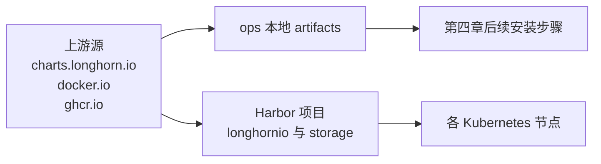

# 第 3 步：准备 Longhorn Chart 与 Harbor 镜像

## 本步目标

在正式安装 `Longhorn` 前，先把第四章所需关键制品准备到本地：

- `Longhorn Helm Chart`
- Longhorn 安装渲染清单
- Longhorn 所需镜像
- 有状态演示镜像

## 执行标记

- **执行标记：必须执行**

说明：

- 这是第四章的制品预热步骤
- 本步完成后，后续安装过程尽量不再依赖公网临时下载

## 问题背景

第四章接下来要连续完成：

- 安装 `Longhorn`
- 验证 `PVC`
- 部署有状态演示应用

如果每一步都临时去公网拉 Chart、镜像或渲染清单，课堂演示很容易受外网抖动影响。

因此这一页的意义很明确：

- 先把第四章会用到的 Chart、YAML 和镜像预热到本地与 Harbor
- 把后续部署步骤变成“拿本地制品安装”

## 理论说明

### 制品流转图



这张图说明：

- `Chart` 与渲染清单固化到 `ops` 本地 `artifacts/`
- 镜像统一进入 Harbor
- 节点提前从 Harbor 预拉镜像
- 后续安装步骤优先消费本地制品

### 为什么第四章仍然坚持“制品、配置、脚本职责分离”

第四章依然遵守整门课的一个重要规则：

- 脚本负责下载、推送、预拉、安装
- 原始 values 与 YAML 仍然独立保存在项目目录中

这样做有两个直接好处：

1. 课堂上可以单独讲清每份 values / YAML 是干什么的。
2. 后续维护时，不需要去脚本里反向提取配置。

### 第四章 Harbor 项目的角色

本章专门使用两个 Harbor 项目：

- `harbor.qytk8s.com/longhornio`
- `harbor.qytk8s.com/storage`

这样可以把 Longhorn 自身镜像和演示应用镜像区分开：

- `longhornio`
  - Longhorn 组件镜像
- `storage`
  - 第四章演示应用镜像

### 本步关键配置

第四章真正会被后续安装直接消费的关键配置是：

- `manifests/01_longhorn_values.yaml`

关键字段如下：

```yaml
defaultSettings:
  createDefaultDiskLabeledNodes: true
  defaultDataPath: /var/lib/longhorn
  defaultReplicaCount: 3
```

以及：

```yaml
persistence:
  defaultClass: true
  defaultClassReplicaCount: 3
  reclaimPolicy: Delete
```

关键字段说明：

- `createDefaultDiskLabeledNodes: true`
  - 只有被标记的节点才会自动创建默认数据盘
- `defaultDataPath: /var/lib/longhorn`
  - 和第 2 步准备好的宿主机路径严格对齐
- `defaultReplicaCount: 3`
  - 对应第四章初始 3 节点副本教学主线
- `defaultClass: true`
  - 让 `longhorn` 作为默认 `StorageClass`

## 对应脚本

本步对应脚本：

- `k8s/04-storage-and-stateful/scripts/02_prepare_longhorn_artifacts.sh`

本步会生成或使用下面这些关键文件：

- `artifacts/longhorn-1.11.0.tgz`
- `artifacts/longhorn-rendered-1.11.0.yaml`
- `artifacts/longhorn-source-images-1.11.0.txt`
- `artifacts/longhorn-harbor-images-1.11.0.txt`

## 脚本关键任务

### 关键任务 1：创建 Harbor 项目

脚本原始代码：

```bash
create_harbor_project "${HARBOR_PROJECT_LONGHORN}"
create_harbor_project "${HARBOR_PROJECT_DEMO}"
```

关键介绍：

- 第四章镜像统一进入 `longhornio` 与 `storage`
- 如果项目已存在，脚本会把它视为正常状态继续执行

### 关键任务 2：下载 Longhorn Chart

脚本原始代码：

```bash
helm pull longhorn/longhorn --version "${LONGHORN_VERSION}" --destination "${ARTIFACTS_DIR}"
```

关键介绍：

- 把第四章固定版本 `1.11.0` Chart 固化到本地
- 后续安装直接消费这个本地 Chart

### 关键任务 3：渲染本地安装清单

脚本原始代码：

```bash
helm template longhorn "${CHART_PACKAGE}" \
  --namespace longhorn-system \
  -f "${VALUES_FILE}" > "${RENDERED_MANIFEST}"
```

关键介绍：

- 不只是保存 Chart
- 还会把第四章最终会安装出来的大致对象结构提前渲染好

### 关键任务 4：推送镜像到 Harbor 并预拉

脚本原始代码：

```bash
docker pull "${src}"
docker tag "${src}" "${dst}"
docker push "${dst}"
```

以及：

```bash
crictl --runtime-endpoint unix:///run/containerd/containerd.sock pull "${image}"
```

关键介绍：

- 先把第四章镜像统一进入 Harbor
- 再让各节点提前从 Harbor 预拉，保证后续安装稳定

## 执行命令

```bash
chmod +x /docker_k8s_2026/k8s/04-storage-and-stateful/scripts/02_prepare_longhorn_artifacts.sh
```

```bash
bash /docker_k8s_2026/k8s/04-storage-and-stateful/scripts/02_prepare_longhorn_artifacts.sh
```

## 验证方法

```bash
ls -lh /docker_k8s_2026/k8s/04-storage-and-stateful/artifacts/
```

关键看点：

- 重点看是否已经出现下面 4 类文件：
  - `longhorn-1.11.0.tgz`
  - `longhorn-rendered-1.11.0.yaml`
  - `longhorn-source-images-1.11.0.txt`
  - `longhorn-harbor-images-1.11.0.txt`
- `longhorn-1.11.0.tgz` 说明本地 Chart 已固化完成
- `longhorn-rendered-1.11.0.yaml` 说明 Helm 渲染清单已提前生成
- 两个 `images` 清单说明第四章镜像来源和 Harbor 目标地址都已经整理出来

预期结果：

- `artifacts/` 目录中至少能看到上述 4 个关键文件
- 文件大小不是 `0`
- 文件修改时间应接近本次执行脚本的时间

```bash
curl -I http://ops:9000/04-storage-and-stateful/artifacts/longhorn-1.11.0.tgz
```

关键看点：

- 重点不是把 Chart 内容直接看出来
- 而是确认这份本地 Chart 已经能通过 `ops:9000` 被后续步骤访问

预期结果：

- 返回状态行为应为 `HTTP/1.0 200 OK` 或 `HTTP/1.1 200 OK`
- 响应头里通常能看到 `Content-Type` 和 `Content-Length`
- 只要状态码是 `200`，就说明后续 Helm 安装阶段可以直接消费这份本地 Chart

```bash
curl -I http://ops:9000/04-storage-and-stateful/artifacts/longhorn-rendered-1.11.0.yaml
```

关键看点：

- 重点看这份渲染清单是否也已经被 `ops:9000` 正常发布
- 这说明课堂上后续如果要讲对象结构或排查安装内容，已经有一份可直接访问的本地渲染结果

预期结果：

- 返回状态行为应为 `HTTP/1.0 200 OK` 或 `HTTP/1.1 200 OK`
- 这说明 `longhorn-rendered-1.11.0.yaml` 已经可通过 `ops` 本地 HTTP 服务访问

通过这一组验证后，应形成下面的判断：

- 本地 Longhorn Chart 已固化完成
- Longhorn 渲染清单已固化完成
- 镜像清单已整理完成
- `ops:9000` 已能为后续第四章步骤提供这些本地制品

## 通过标准

- Harbor 项目 `longhornio` 已就绪
- Harbor 项目 `storage` 已就绪
- Longhorn Chart 已落地到本地 `artifacts/`
- 所有节点都已预拉第四章所需镜像

## 下一步

进入第 4 步，安装 Longhorn：

- `docs/05_install_longhorn.md`
