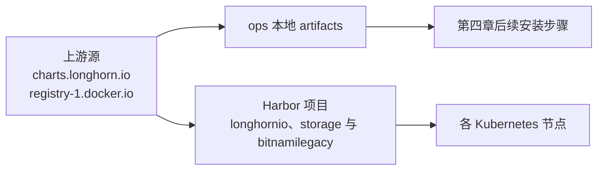

# 第 3 步：准备 Longhorn、MongoDB Chart 与 Harbor 镜像

## 本步目标

在正式安装 `Longhorn` 前，先把第四章所需关键制品准备到本地：

- `Longhorn Helm Chart`
- `MongoDB Helm Chart`
- Longhorn `rendered manifest`（供讲解与排查）
- MongoDB `rendered manifest`（供讲解与排查）
- Longhorn 所需镜像
- 有状态演示镜像
- MongoDB 副本集案例所需镜像

---

## 执行标记

- **执行标记：必须执行**
- 本步完成后，后续安装过程尽量不再依赖公网临时下载

---

## 问题背景

第四章接下来要连续完成：

- 安装 `Longhorn`
- 验证 `PVC`
- 部署有状态演示应用
- 部署一个真实的 `MongoDB ReplicaSet` StatefulSet 案例

如果每一步都临时去公网拉 `Chart`、镜像或 `rendered manifest`，课堂演示很容易受外网波动影响。

因此这一页的意义很明确：

- 先把第四章会用到的 `Chart`、`rendered manifest` 和镜像预热到本地与 Harbor
- 把后续部署步骤变成“拿本地制品安装”

---

## 理论说明

### 制品流转图



这张图说明：

- `Chart` 与 `rendered manifest` 固化到 `ops` 本地 `artifacts/`
- 镜像统一进入 Harbor
- 节点提前从 Harbor 预拉镜像
- 后续安装优先消费这些本地制品

这里也可以顺手区分两个目录：

- `manifests/`
  - 保存手工维护的源配置，例如 `values` 与独立 `YAML`
- `artifacts/`
  - 保存下载或生成后的安装制品，例如 `chart.tgz`、`rendered manifest` 和镜像清单

这里的 `rendered manifest` 可以直接理解为：

- 保留原始 `Chart`
- 再用 `helm template` 提前生成一份渲染后的对象清单

它不是 `Chart` 包本身，而是 `Chart + values` 生成出来的安装结果。第四章后续真正安装时，仍然使用 `Chart + values`；`rendered manifest` 主要用于提前查看对象结构、课堂讲解与后续排查。

### 第四章 Harbor 项目的角色

本章专门使用三个 Harbor 项目：

- `harbor.qytk8s.com/longhornio`
- `harbor.qytk8s.com/storage`
- `harbor.qytk8s.com/bitnamilegacy`

这样可以把 Longhorn 自身镜像和演示应用镜像区分开：

- `longhornio`
  - Longhorn 组件镜像
- `storage`
  - 第四章演示应用镜像
- `bitnamilegacy`
  - MongoDB Helm 案例镜像

### 本步关键配置

第四章当前需要先明确的一份关键配置是：

<div style="padding: 10px 14px; border: 1px solid #666; border-left: 4px solid #8ab4f8; border-radius: 6px; background: rgba(138,180,248,0.08); margin: 8px 0;">
<strong>YAML 文件：</strong><code>manifests/01_longhorn_values.yaml</code><br/>
<strong>本页重点对象：</strong><code>Longhorn Helm values</code><br/>
<strong>作用：</strong>定义第四章 Longhorn 安装参数，包括默认数据路径、默认副本数和默认 <code>StorageClass</code> 行为
</div>

关键字段摘录：

```yaml
global:
  imageRegistry: harbor.qytk8s.com
  cattle:
    systemDefaultRegistry: harbor.qytk8s.com

privateRegistry:
  registryUrl: harbor.qytk8s.com

defaultSettings:
  createDefaultDiskLabeledNodes: true
  defaultDataPath: /var/lib/longhorn
  defaultReplicaCount: 3
  replicaAutoBalance: least-effort
  storageMinimalAvailablePercentage: 10
  upgradeChecker: false

persistence:
  defaultClass: true
  defaultClassReplicaCount: 3
  defaultDataLocality: disabled
  reclaimPolicy: Delete

service:
  ui:
    type: ClusterIP

preUpgradeChecker:
  upgradeVersionCheck: false
```

关键字段说明：

- `global.imageRegistry`、`global.cattle.systemDefaultRegistry` 与 `privateRegistry.registryUrl`
  - 统一把 Longhorn chart 涉及的镜像 registry 收敛到 `harbor.qytk8s.com`，并与 Longhorn 私有仓库配置保持一致
- `createDefaultDiskLabeledNodes: true`
  - 只有带 `node.longhorn.io/create-default-disk` 标签的节点，才会自动创建默认数据盘；这就是为什么第四章先标记首批 3 个存储节点
- `defaultDataPath: /var/lib/longhorn`
  - 和第 2 步准备好的宿主机路径严格对齐
- `defaultReplicaCount: 3`
  - 写入 Longhorn 的全局默认设置 `default-replica-count`，对应第四章初始 `3` 副本主线
- `replicaAutoBalance: least-effort`
  - Longhorn 会尽量做副本均衡，但不会把副本迁移与重平衡当成本章主线展开
- `storageMinimalAvailablePercentage: 10`
  - 当磁盘可用空间低于这个阈值时，Longhorn 会停止继续向该磁盘调度新副本
- `upgradeChecker: false`
  - 关闭课堂环境中不需要的版本检查
- `defaultClass: true`
  - 把 `longhorn` 标记为默认 `StorageClass`
- `defaultClassReplicaCount: 3`
  - 写入默认 `StorageClass` 的 `numberOfReplicas: "3"`，也就是通过 `PVC` 动态创建出来的卷默认按 `3` 副本执行
- `defaultDataLocality: disabled`
  - 写入默认 `StorageClass` 的 `dataLocality: "disabled"`；本章先不强调本地副本贴近工作负载节点的数据本地性优化
- `service.ui.type: ClusterIP`
  - Longhorn UI 先保留集群内访问，后续再通过 `Gateway API + HTTPS` 正式发布
- `preUpgradeChecker.upgradeVersionCheck: false`
  - 关闭课堂环境中不需要的升级检查

---

## 对应脚本

本步对应脚本：

- `k8s/04-storage-and-stateful/scripts/02_prepare_longhorn_artifacts.sh`

本步会生成或使用下面这些关键文件：

- `artifacts/longhorn-1.11.0.tgz`
- `artifacts/longhorn-rendered-1.11.0.yaml`
- `artifacts/longhorn-source-images-1.11.0.txt`
- `artifacts/longhorn-harbor-images-1.11.0.txt`
- `artifacts/mongodb-15.6.0.tgz`
- `artifacts/mongodb-rendered-15.6.0.yaml`
- `artifacts/mongodb-source-images-15.6.0.txt`
- `artifacts/mongodb-harbor-images-15.6.0.txt`

---

## 脚本关键任务

### 关键任务 1：创建 Harbor 项目

脚本原始代码：

```bash
create_harbor_project "${HARBOR_PROJECT_LONGHORN}"
create_harbor_project "${HARBOR_PROJECT_DEMO}"
create_harbor_project "${HARBOR_PROJECT_BITNAMI}"
```

关键介绍：

- 第四章镜像统一进入 `longhornio`、`storage` 与 `bitnamilegacy`
- 如果项目已存在，脚本会把它视为正常状态继续执行

### 关键任务 2：下载 Longhorn 与 MongoDB Chart

脚本原始代码：

```bash
helm pull longhorn/longhorn --version "${LONGHORN_VERSION}" --destination "${ARTIFACTS_DIR}"
helm pull oci://registry-1.docker.io/bitnamicharts/mongodb \
  --version "${MONGODB_VERSION}" \
  --destination "${ARTIFACTS_DIR}"
```

关键介绍：

- 把第四章固定版本 `Longhorn` 与 `MongoDB` Chart 都固化到本地
- 后续安装仍直接消费这些本地 `Chart`

### 关键任务 3：生成 `rendered manifest`

脚本原始代码：

```bash
helm template longhorn "${CHART_PACKAGE}" \
  --namespace longhorn-system \
  -f "${VALUES_FILE}" > "${RENDERED_MANIFEST}"

helm template qytang-mongodb-demo "${MONGODB_CHART_PACKAGE}" \
  --namespace qytang-mongodb-demo \
  -f "${MONGODB_VALUES_FILE}" > "${MONGODB_RENDERED_MANIFEST}"
```

关键介绍：

- 不只保存 `Chart`
- 还会把后续安装会生成的主要对象结构提前渲染出来
- 其中 `mongodb-rendered-15.6.0.yaml` 会直接用于 [08_statefulset_intro.md](/docker_k8s_2026/k8s/04-storage-and-stateful/docs/08_statefulset_intro.md) 讲解 `StatefulSet`、`Headless Service` 和 `volumeClaimTemplates`
- 但后续真正安装时，仍然使用本地 `Chart + values`

### 关键任务 4：推送镜像到 Harbor 并预拉

脚本原始代码：

```bash
docker pull "${src}"
docker tag "${src}" "${dst}"
docker push "${dst}"
```

以及：

```bash
crictl --runtime-endpoint unix:///run/containerd/containerd.sock pull "${image}"
```

关键介绍：

- 先把第四章镜像统一进入 Harbor
- 再让各节点提前从 Harbor 预拉，保证后续安装稳定
- 后面的 `MongoDB` 案例也不再临时直连公网仓库

---

## 执行命令

```bash
chmod +x /docker_k8s_2026/k8s/04-storage-and-stateful/scripts/02_prepare_longhorn_artifacts.sh
```

```bash
bash /docker_k8s_2026/k8s/04-storage-and-stateful/scripts/02_prepare_longhorn_artifacts.sh
```

---

## 验证方法

```bash
ls -lh /docker_k8s_2026/k8s/04-storage-and-stateful/artifacts/
```

关键看点：

- 重点看是否已经出现下面 8 类文件：
  - `longhorn-1.11.0.tgz`
  - `longhorn-rendered-1.11.0.yaml`
  - `longhorn-source-images-1.11.0.txt`
  - `longhorn-harbor-images-1.11.0.txt`
  - `mongodb-15.6.0.tgz`
  - `mongodb-rendered-15.6.0.yaml`
  - `mongodb-source-images-15.6.0.txt`
  - `mongodb-harbor-images-15.6.0.txt`
- `longhorn-1.11.0.tgz` 和 `mongodb-15.6.0.tgz` 说明本地 Chart 已固化完成
- 两份 `rendered` 文件说明 `rendered manifest` 已提前生成
- 四份 `images` 清单说明第四章镜像来源和 Harbor 目标地址都已经整理出来

预期结果：

- `artifacts/` 目录中至少能看到上述 8 个关键文件
- 文件大小不是 `0`
- 文件修改时间应接近本次执行脚本的时间

```bash
curl -I http://ops:9000/04-storage-and-stateful/artifacts/longhorn-1.11.0.tgz
```

关键看点：

- 重点不是把 Chart 内容直接看出来
- 而是确认这份本地 Chart 已经能通过 `ops:9000` 被后续步骤访问

预期结果：

- 返回状态行为应为 `HTTP/1.0 200 OK` 或 `HTTP/1.1 200 OK`
- 响应头里通常能看到 `Content-Type` 和 `Content-Length`
- 只要状态码是 `200`，就说明后续 Helm 安装阶段可以直接消费这份本地 Chart

```bash
curl -I http://ops:9000/04-storage-and-stateful/artifacts/longhorn-rendered-1.11.0.yaml
```

关键看点：

- 重点看这份 `rendered manifest` 是否也已经被 `ops:9000` 正常发布
- 这说明后续如果要讲对象结构或排查安装内容，已经有一份可直接访问的本地渲染结果

预期结果：

- 返回状态行为应为 `HTTP/1.0 200 OK` 或 `HTTP/1.1 200 OK`
- 这说明 `longhorn-rendered-1.11.0.yaml` 已经可通过 `ops` 本地 HTTP 服务访问

判断：

- 本地 Longhorn Chart 已固化完成
- Longhorn `rendered manifest` 已固化完成
- MongoDB 制品与镜像清单也已整理完成
- `ops:9000` 已能为后续第四章步骤提供这些本地制品
- 后续安装仍将按 `Chart + values` 执行

---

## 通过标准

- Harbor 项目 `longhornio` 已就绪
- Harbor 项目 `storage` 已就绪
- Harbor 项目 `bitnamilegacy` 已就绪
- Longhorn 与 MongoDB Chart 都已落地到本地 `artifacts/`
- Longhorn 与 MongoDB `rendered manifest` 都已生成完成
- 所有节点都已预拉第四章所需镜像

---

## 下一步

进入第 4 步，安装 Longhorn：

- `docs/05_install_longhorn.md`
