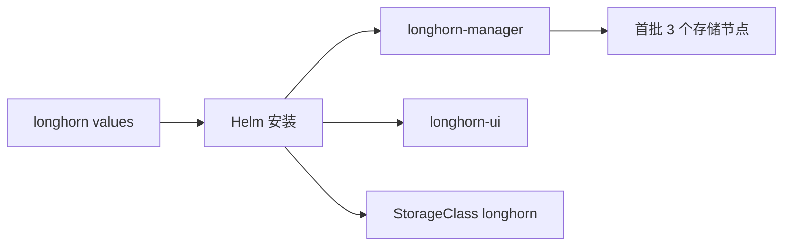

# 第 4 步：安装 Longhorn

## 本步目标

完成 `Longhorn` 安装，并把下面 3 个节点初始化为首批存储节点：

- `wk-app01`
- `wk-app02`
- `wk-obs01`

## 执行标记

- **执行标记：必须执行**

说明：

- 这是第四章真正把 Kubernetes 持久卷能力装起来的一步
- 本步完成后，集群会第一次具备动态分配 Longhorn 卷的能力

## 问题背景

到本步之前，第四章已经具备：

- 工作节点独立数据盘
- 固定的 Longhorn 数据路径
- 本地 Longhorn Chart
- Harbor 化镜像

但这些能力此时还没有真正组合成一个 Kubernetes 存储后端。

这一页要完成的事情是：

- 让 `Longhorn` 进入集群
- 让 `longhorn` `StorageClass` 出现
- 让首批 3 个节点成为可调度的存储节点

## 理论说明

### Longhorn 安装后的关系图



这张图说明：

- 第四章安装并不是只“起几个 Pod”
- 它真正建立的是一套可被 Kubernetes 消费的存储后端

### 为什么安装阶段先只纳入 3 个节点

第四章不是一开始就讲扩容，而是先把主线跑稳：

- `StorageClass`
- `PVC`
- 动态供给
- 3 副本
- Pod 重建后数据仍保留

所以安装阶段先固定 3 个节点，后面再把 `wk-edge01` 作为第 4 个节点加入。

### 本步关键配置

本步真正消费的关键配置文件是：

- `manifests/01_longhorn_values.yaml`

其中最重要的字段是：

```yaml
defaultSettings:
  createDefaultDiskLabeledNodes: true
  defaultDataPath: /var/lib/longhorn
  defaultReplicaCount: 3
```

以及：

```yaml
persistence:
  defaultClass: true
  defaultClassReplicaCount: 3
  reclaimPolicy: Delete
```

关键字段说明：

- `createDefaultDiskLabeledNodes: true`
  - Longhorn 只在被标记的节点上自动创建默认数据盘
- `defaultDataPath: /var/lib/longhorn`
  - 必须和第 2 步准备好的宿主机挂载点一致
- `defaultReplicaCount: 3`
  - 对应第四章首批 3 节点副本设计
- `defaultClass: true`
  - 让后续 `PVC` 可以直接走 `longhorn`
- `reclaimPolicy: Delete`
  - 当后续显式删除 `PVC` 时，底层卷会跟着回收
  - 这不会影响第四章主线里的“删除 Pod 后数据仍保留”，因为那一步并没有删除 `PVC`

### 为什么这里的 `reclaimPolicy` 用 `Delete`

这里的 `Delete` 是一个需要明确解释的术语。

它的准确含义是：

- 当用户后续显式删除 `PVC`
- Kubernetes 开始回收与之绑定的 `PV`
- 底层 Longhorn 卷也会一起被删除

它**不是**下面这个意思：

- 删除 Pod 就删除卷
- 删除 Pod 就删除数据

也就是说，`Delete` 描述的是**卷对象在 PVC 被删除后的回收行为**，不是 Pod 生命周期。

第四章要讲清楚的主线是：

- 删除 Pod
- 工作负载重建
- 同一个卷再次挂载
- 数据仍然存在

这里并没有删除 `PVC`，所以不会触发卷回收。

本章把默认回收策略设置为 `Delete`，更适合课堂与实验环境：

- 演示完成后，如果明确删除 `PVC`，底层卷也会自动清理
- 环境不会留下越来越多的历史测试卷
- 更符合动态供给卷在教学环境中的默认体验

一句话收束：

> `Delete` 的意思是“删 PVC 后删卷”，不是“删 Pod 后删数据”。

### 为什么这一页要提前打标签和注解

第四章不是在 Longhorn UI 里手工点盘，而是提前通过 Kubernetes 节点：

- `label`
- `annotation`

告诉 Longhorn：

- 哪些节点现在就要创建默认磁盘
- 默认磁盘路径就是 `/var/lib/longhorn`

这样更适合教材复现，也更利于后面讲第 4 个节点怎么加入。

## 对应脚本

本步对应脚本：

- `k8s/04-storage-and-stateful/scripts/03_install_longhorn.sh`

本步会直接消费：

- `artifacts/longhorn-1.11.0.tgz`
- `manifests/01_longhorn_values.yaml`

## 脚本关键任务

### 关键任务 1：标记首批存储节点

脚本原始代码：

```bash
kubectl_retry label node "${node}" node.longhorn.io/create-default-disk=config --overwrite
kubectl_retry annotate node "${node}" node.longhorn.io/default-disks-config="${DISK_CONFIG}" --overwrite
```

关键介绍：

- 告诉 Longhorn：这些节点现在就要创建默认磁盘
- 默认磁盘路径固定为 `/var/lib/longhorn`

### 关键任务 2：通过本地 Chart 安装 Longhorn

脚本原始代码：

```bash
helm upgrade --install longhorn "${CHART_URL}" \
  --namespace longhorn-system \
  --create-namespace \
  -f "${VALUES_FILE}"
```

关键介绍：

- 这里消费的是第 3 步已经固化好的本地 Chart
- 配置来自第四章自己的 `01_longhorn_values.yaml`

### 关键任务 3：等待 Longhorn 核心组件就绪

脚本原始代码：

```bash
kubectl -n longhorn-system rollout status ds/longhorn-manager --timeout=600s
kubectl -n longhorn-system rollout status deploy/longhorn-driver-deployer --timeout=600s
kubectl -n longhorn-system rollout status deploy/longhorn-ui --timeout=600s
```

关键介绍：

- Longhorn 不是只看单个 Pod
- 至少要确认 `manager`、`driver-deployer` 和 `ui` 都已就绪

## 执行命令

```bash
chmod +x /docker_k8s_2026/k8s/04-storage-and-stateful/scripts/03_install_longhorn.sh
```

```bash
bash /docker_k8s_2026/k8s/04-storage-and-stateful/scripts/03_install_longhorn.sh
```

## 验证方法

```bash
kubectl -n longhorn-system get pods -o wide
```

关键看点：

- 重点看 Longhorn 核心组件是否都已经进入 `Running`
- 至少要特别关注：
  - `longhorn-manager`
  - `longhorn-driver-deployer`
  - `longhorn-ui`
- 如果 CSI 相关组件也已经正常，这说明第四章后面的 `PVC` 演示更容易一次通过

预期结果：

- `longhorn-manager` 以 `DaemonSet` 形式在已纳入的节点上正常运行
- `longhorn-driver-deployer` 为 `Running`
- `longhorn-ui` 为 `Running`
- 大多数 Longhorn 相关 Pod 应显示为 `Running`

```bash
kubectl get sc
```

关键看点：

- 重点不是 `StorageClass` 数量有多少
- 而是要确认 `longhorn` 已经出现
- 如果 `longhorn` 被标成默认类，则后续 `PVC` 体验会更顺
- `RECLAIMPOLICY` 看到 `Delete` 时，不要直接理解成“删 Pod 就删数据”
- 这里的 `Delete` 专门描述的是：
  - 后续如果显式删除 `PVC`
  - 对应底层卷会跟着被回收删除
- 它不是 Pod 生命周期策略
- 所以第四章后面演示“删除 Pod、重建 Pod、数据仍然存在”时，不会被这个值影响

预期结果：

- 输出中应出现名为 `longhorn` 的 `StorageClass`
- 常见情况是 `longhorn` 前面带有默认标记，例如 `(*)`
- `RECLAIMPOLICY` 为 `Delete`

通过这一条验证后，应形成下面的判断：

- `longhorn` 已经成为可用的动态存储类
- 默认回收策略是“删 PVC 后删卷”
- 这不等于“删 Pod 后删数据”

```bash
kubectl -n longhorn-system get nodes.longhorn.io
```

关键看点：

- 重点看 Longhorn 是否已经真正识别出首批 3 个存储节点
- 当前这一步只要求：
  - `wk-app01`
  - `wk-app02`
  - `wk-obs01`
- 还不要求 `wk-edge01` 现在就出现

预期结果：

- Longhorn 节点列表中至少能看到首批 3 个节点
- 这些节点应处于可调度、可用状态

通过这一组验证后，应形成下面的判断：

- Longhorn 核心组件已经安装完成
- `longhorn` `StorageClass` 已经出现
- 首批 3 个存储节点已经被 Longhorn 正常纳入

## 通过标准

- Longhorn 核心 Pod 均正常
- `longhorn` `StorageClass` 已出现
- `wk-app01`、`wk-app02`、`wk-obs01` 已被 Longhorn 正常识别

## 下一步

进入第 5 步，验证 `PVC` 动态供给与数据保留：

- `docs/06_default_storageclass_and_test_pvc.md`
