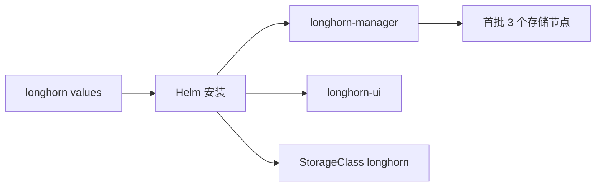

# 第 4 步：安装 Longhorn

## 本步目标

完成 `Longhorn` 安装，并把下面 3 个节点初始化为首批存储节点：

- `wk-app01`
- `wk-app02`
- `wk-obs01`

## 执行标记

- **执行标记：必须执行**

说明：

- 这是第四章真正把 Kubernetes 持久卷能力装起来的一步
- 本步完成后，集群会第一次具备动态分配 Longhorn 卷的能力

## 问题背景

到本步之前，第四章已经具备：

- 工作节点独立数据盘
- 固定的 Longhorn 数据路径
- 本地 Longhorn Chart
- Harbor 化镜像

但这些能力此时还没有真正组合成一个 Kubernetes 存储后端。

这一页要完成的事情是：

- 让 `Longhorn` 进入集群
- 让 `longhorn` `StorageClass` 出现
- 让首批 3 个节点成为可调度的存储节点

## 理论说明

### Longhorn 安装后的关系图



这张图说明：

- 第四章安装并不是只“起几个 Pod”
- 它真正建立的是一套可被 Kubernetes 消费的存储后端

### 为什么安装阶段先只初始化 3 个节点的数据盘

第四章不是一开始就讲扩容，而是先把主线跑稳：

- `StorageClass`
- `PVC`
- 动态供给
- 3 副本
- 当前 Pod 被删除后，Deployment 自动拉起新 Pod，并继续挂载原来的 PVC

所以安装阶段先固定 3 个节点完成默认数据盘初始化，后面再单独把 `wk-edge01` 初始化为第 4 个可用存储节点。

### 本步关键配置

本步真正消费的关键配置文件是：

- `manifests/01_longhorn_values.yaml`

- 来源文件：`manifests/01_longhorn_values.yaml`
- 文件类型：`Helm values`

其中最重要的字段是：

```yaml
defaultSettings:
  createDefaultDiskLabeledNodes: true
  defaultDataPath: /var/lib/longhorn
  defaultReplicaCount: 3
```

以及：

- 来源文件：`manifests/01_longhorn_values.yaml`
- 文件类型：`Helm values`

```yaml
persistence:
  defaultClass: true
  defaultClassReplicaCount: 3
  reclaimPolicy: Delete
```

关键字段说明：

- `createDefaultDiskLabeledNodes: true`
  - Longhorn 只在被标记的节点上自动创建默认数据盘
  - 这个字段限制的是“默认数据盘自动创建”
  - 不等于限制 Longhorn 只识别这些节点为 `Node` 对象
- `defaultDataPath: /var/lib/longhorn`
  - 必须和第 2 步准备好的宿主机挂载点一致
- `defaultReplicaCount: 3`
  - 对应第四章首批 3 节点副本设计
- `defaultClass: true`
  - 让后续 `PVC` 可以直接走 `longhorn`
- `reclaimPolicy: Delete`
  - 当后续显式删除 `PVC` 时，底层卷会跟着回收
  - 这不会影响第四章主线里的“删除 Pod 后数据仍保留”，因为那一步并没有删除 `PVC`

### 为什么这里的 `reclaimPolicy` 用 `Delete`

这里的 `Delete` 是一个需要明确解释的术语。

它的准确含义是：

- 当用户后续显式删除 `PVC`
- Kubernetes 开始回收与之绑定的 `PV`
- 底层 Longhorn 卷也会一起被删除

它**不是**下面这个意思：

- 删除 Pod 就删除卷
- 删除 Pod 就删除数据

也就是说，`Delete` 描述的是**卷对象在 PVC 被删除后的回收行为**，不是 Pod 生命周期。

第四章要讲清楚的主线是：

- 删除 Pod
- 工作负载重建
- 同一个卷再次挂载
- 数据仍然存在

这里并没有删除 `PVC`，所以不会触发卷回收。

本章把默认回收策略设置为 `Delete`，更适合课堂与实验环境：

- 演示完成后，如果明确删除 `PVC`，底层卷也会自动清理
- 环境不会留下越来越多的历史测试卷
- 更符合动态供给卷在教学环境中的默认体验

一句话收束：

> `Delete` 的意思是“删 PVC 后删卷”，不是“删 Pod 后删数据”。

### 为什么这一页要提前打标签和注解

第四章不是在 Longhorn UI 里手工点盘，而是提前通过 Kubernetes 节点：

- `label`
- `annotation`

告诉 Longhorn：

- 哪些节点现在就要创建默认磁盘
- 默认磁盘路径就是 `/var/lib/longhorn`

这样更适合教材复现，也更利于后面讲第 4 个节点怎么加入。

## 对应脚本

本步对应脚本：

- `k8s/04-storage-and-stateful/scripts/03_install_longhorn.sh`

本步会直接消费：

- `artifacts/longhorn-1.11.0.tgz`
- `manifests/01_longhorn_values.yaml`

## 脚本关键任务

### 关键任务 1：标记首批存储节点

脚本原始代码：

```bash
kubectl_retry label node "${node}" node.longhorn.io/create-default-disk=config --overwrite
kubectl_retry annotate node "${node}" node.longhorn.io/default-disks-config="${DISK_CONFIG}" --overwrite
```

关键介绍：

- 告诉 Longhorn：这些节点现在就要创建默认磁盘
- 默认磁盘路径固定为 `/var/lib/longhorn`

### 关键任务 2：通过本地 Chart 安装 Longhorn

脚本原始代码：

```bash
helm upgrade --install longhorn "${CHART_URL}" \
  --namespace longhorn-system \
  --create-namespace \
  -f "${VALUES_FILE}"
```

关键介绍：

- 这里消费的是第 3 步已经固化好的本地 Chart
- 配置来自第四章自己的 `01_longhorn_values.yaml`

### 关键任务 3：等待 Longhorn 核心组件就绪

脚本原始代码：

```bash
kubectl -n longhorn-system rollout status ds/longhorn-manager --timeout=600s
kubectl -n longhorn-system rollout status deploy/longhorn-driver-deployer --timeout=600s
kubectl -n longhorn-system rollout status deploy/longhorn-ui --timeout=600s
```

关键介绍：

- Longhorn 不是只看单个 Pod
- 至少要确认 `manager`、`driver-deployer` 和 `ui` 都已就绪

## 执行命令

```bash
chmod +x /docker_k8s_2026/k8s/04-storage-and-stateful/scripts/03_install_longhorn.sh
```

```bash
bash /docker_k8s_2026/k8s/04-storage-and-stateful/scripts/03_install_longhorn.sh
```

## 验证方法

```bash
kubectl -n longhorn-system get pods -o wide
```

示例输出：

```text
NAME                                                READY   STATUS    RESTARTS      AGE   IP             NODE        NOMINATED NODE   READINESS GATES
csi-attacher-7c7b6b6c98-hn47q                       1/1     Running   0             20m   10.244.5.201   wk-edge01   <none>           <none>
csi-attacher-7c7b6b6c98-ph7tf                       1/1     Running   0             20m   10.244.0.23    wk-app01    <none>           <none>
csi-attacher-7c7b6b6c98-vv52r                       1/1     Running   0             20m   10.244.6.148   wk-obs01    <none>           <none>
csi-provisioner-7fff9c6b47-cw8s2                    1/1     Running   0             20m   10.244.6.101   wk-obs01    <none>           <none>
csi-provisioner-7fff9c6b47-ls4sf                    1/1     Running   0             20m   10.244.5.174   wk-edge01   <none>           <none>
csi-provisioner-7fff9c6b47-wxmqv                    1/1     Running   0             20m   10.244.4.87    wk-app02    <none>           <none>
csi-resizer-76b6c86d7c-jxfv9                        1/1     Running   0             20m   10.244.0.155   wk-app01    <none>           <none>
csi-resizer-76b6c86d7c-v6zp4                        1/1     Running   0             20m   10.244.4.125   wk-app02    <none>           <none>
csi-resizer-76b6c86d7c-w6hkx                        1/1     Running   0             20m   10.244.5.19    wk-edge01   <none>           <none>
csi-snapshotter-76588758d-9tvhw                     1/1     Running   0             20m   10.244.0.14    wk-app01    <none>           <none>
csi-snapshotter-76588758d-h7b2f                     1/1     Running   0             20m   10.244.5.83    wk-edge01   <none>           <none>
csi-snapshotter-76588758d-jtc26                     1/1     Running   0             20m   10.244.4.117   wk-app02    <none>           <none>
engine-image-ei-32e10da1-48gzx                      1/1     Running   0             21m   10.244.6.25    wk-obs01    <none>           <none>
engine-image-ei-32e10da1-7qqf9                      1/1     Running   0             21m   10.244.4.52    wk-app02    <none>           <none>
engine-image-ei-32e10da1-s524b                      1/1     Running   0             21m   10.244.0.42    wk-app01    <none>           <none>
engine-image-ei-32e10da1-tdmtv                      1/1     Running   0             21m   10.244.5.157   wk-edge01   <none>           <none>
instance-manager-8de10a99cf6fb1ab11adb5b3f67be2b6   1/1     Running   0             20m   10.244.5.8     wk-edge01   <none>           <none>
instance-manager-9ddca1fb59063984659805462d99caed   1/1     Running   0             21m   10.244.4.72    wk-app02    <none>           <none>
instance-manager-dad6f1655172abc2188da49e83d3ebb9   1/1     Running   0             21m   10.244.6.224   wk-obs01    <none>           <none>
instance-manager-f2ead243d1deffb9fc73c2cc0ccfc20a   1/1     Running   0             21m   10.244.0.71    wk-app01    <none>           <none>
longhorn-csi-plugin-4tbp8                           3/3     Running   0             20m   10.244.4.70    wk-app02    <none>           <none>
longhorn-csi-plugin-gtnzf                           3/3     Running   0             20m   10.244.0.175   wk-app01    <none>           <none>
longhorn-csi-plugin-kfcp6                           3/3     Running   0             20m   10.244.6.122   wk-obs01    <none>           <none>
longhorn-csi-plugin-whj7w                           3/3     Running   0             20m   10.244.5.210   wk-edge01   <none>           <none>
longhorn-driver-deployer-594bdf49d6-b687q           1/1     Running   0             21m   10.244.0.153   wk-app01    <none>           <none>
longhorn-manager-2dzw7                              2/2     Running   0             21m   10.244.6.214   wk-obs01    <none>           <none>
longhorn-manager-2r567                              2/2     Running   1 (21m ago)   21m   10.244.4.176   wk-app02    <none>           <none>
longhorn-manager-fp8c6                              2/2     Running   1 (21m ago)   21m   10.244.0.241   wk-app01    <none>           <none>
longhorn-manager-gv2sd                              2/2     Running   3 (20m ago)   21m   10.244.5.208   wk-edge01   <none>           <none>
longhorn-ui-68b4446bcf-q92mp                        1/1     Running   0             21m   10.244.6.176   wk-obs01    <none>           <none>
longhorn-ui-68b4446bcf-rx282                        1/1     Running   0             21m   10.244.5.209   wk-edge01   <none>           <none>
```

关键看点：

- 不要只盯住某一个 Pod 名字，而要先按组件层次看
- 先看控制与管理面：
  - `longhorn-manager`
  - `longhorn-driver-deployer`
  - `longhorn-ui`
- 再看存储运行面：
  - `engine-image`
  - `instance-manager`
- 最后看 Kubernetes 对接层：
  - `longhorn-csi-plugin`
  - `csi-attacher`
  - `csi-provisioner`
  - `csi-resizer`
  - `csi-snapshotter`
- 重点不是每个名字都要背下来，而是要理解：
  - Longhorn 不只是一个 Pod
  - 它已经同时把管理面、卷运行面和 CSI 对接层都拉起来了

预期结果：

- `longhorn-manager` 以 `DaemonSet` 形式在当前已纳入的节点上正常运行
- `longhorn-driver-deployer` 为 `Running`
- `longhorn-ui` 为 `Running`
- `engine-image` 和 `instance-manager` 已经在对应节点出现
- `CSI` 相关组件大多为 `Running`
- 整体上，大多数 Longhorn 相关 Pod 应显示为 `Running`

```bash
kubectl get sc
```

示例输出：

```text
NAME                 PROVISIONER          RECLAIMPOLICY   VOLUMEBINDINGMODE   ALLOWVOLUMEEXPANSION   AGE
longhorn (default)   driver.longhorn.io   Delete          Immediate           true                   18m
longhorn-static      driver.longhorn.io   Delete          Immediate           true                   18m
```

关键看点：

- 重点不是 `StorageClass` 数量有多少
- 而是要确认 `longhorn` 已经出现
- 如果 `longhorn` 被标成默认类，则后续 `PVC` 体验会更顺

预期结果：

- 输出中应出现名为 `longhorn` 的 `StorageClass`
- 常见情况是 `longhorn` 后面带有默认标记，例如 `longhorn (default)`
- `RECLAIMPOLICY` 为 `Delete`

说明：

- 这里的 `RECLAIMPOLICY=Delete`，描述的是后续如果显式删除 `PVC`，对应底层卷会被回收删除
- 它不是 `Pod` 生命周期策略
- 所以后面第四章演示“删除 `Pod`、重建 `Pod`、数据仍然存在”时，不会被这个字段直接影响

通过这一条验证后，应形成下面的判断：

- `longhorn` 已经成为可用的动态存储类
- 默认回收策略是“删 PVC 后删卷”
- 这不等于“删 Pod 后删数据”

```bash
kubectl -n longhorn-system get nodes.longhorn.io
```

关键看点：

- 重点不是“列表里只能出现 3 个节点”
- 而是要区分：
  - 哪些节点只是被 Longhorn 识别成 `Node` 对象
  - 哪些节点已经真正带有默认数据盘并可承载卷副本
- 当前这一步只要求：
  - `wk-app01`
  - `wk-app02`
  - `wk-obs01`
- 这 3 个节点应已经完成默认磁盘初始化
- `wk-edge01` 即使已经出现在列表里，也不表示它已经完成第四章后面的扩容动作

预期结果：

- Longhorn 节点列表中至少能看到首批 3 个节点
- `wk-app01`、`wk-app02`、`wk-obs01` 应处于可调度、可用状态
- 当前如果看到 `wk-edge01` 也出现在列表中，这不算异常
- 关键区别在于：首批 3 个节点应已经带有 `/var/lib/longhorn` 默认数据盘；而 `wk-edge01` 此时通常还没有完成这一步

通过这一组验证后，应形成下面的判断：

- Longhorn 核心组件已经安装完成
- `longhorn` `StorageClass` 已经出现
- 首批 3 个存储节点已经被 Longhorn 正常纳入
- 后续第 4 个节点扩容，指的是把 `wk-edge01` 也初始化成真正可用的数据盘节点，而不是让它第一次在列表里出现

## 通过标准

- Longhorn 核心 Pod 均正常
- `longhorn` `StorageClass` 已出现
- `wk-app01`、`wk-app02`、`wk-obs01` 已被 Longhorn 正常识别

## 下一步

进入第 5 步，验证 `PVC` 动态供给与数据保留：

- `docs/06_default_storageclass_and_test_pvc.md`
