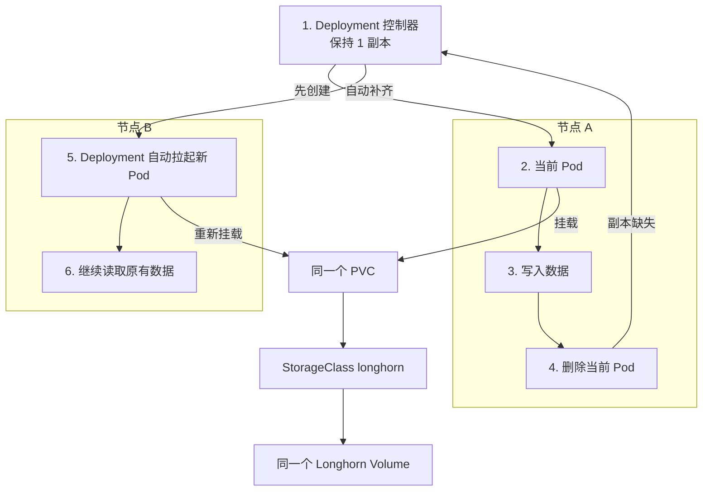
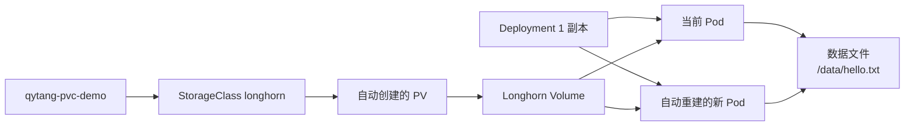
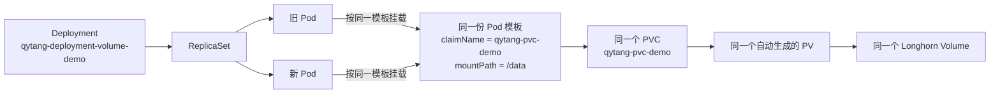

# 第 5 步：验证 StorageClass、PVC 与数据保留

## 本步目标

通过一个最小有状态演示，把下面这条链路走通：



---

## 理论说明

### 按图理解这一页

- `1`
  - `Deployment` 维持 `1` 个副本
- `2 -> 4`
  - 当前 `Pod` 挂载卷、写入数据、随后被删除
- `5`
  - 控制器自动补齐新 `Pod`
- `2` 和 `5`
  - 前后挂载的是同一个 `PVC`
- `PVC -> StorageClass -> Longhorn Volume`
  - 说明卷对象没有因为删除 `Pod` 而消失
- `6`
  - 新 `Pod` 仍然可以继续读取之前写入的数据

这一页先用“删除 Pod”演示这条主线，不直接展开节点故障路径。

### `PVC -> PV -> Pod` 关系图



这张图表达的是：

- Pod 只是卷的使用者
- 控制器负责把 Pod 维持在期望状态
- 数据真正保存在 Longhorn 卷里
- Pod 没了，卷还在

---

## 测试过程与关键看点

### 1. 创建命名空间与 PVC

这一组命令实际对应两份清单：

<div style="padding: 10px 14px; border: 1px solid #666; border-left: 4px solid #8ab4f8; border-radius: 6px; background: rgba(138,180,248,0.08); margin: 8px 0;">
<strong>YAML 文件：</strong><code>manifests/00_stateful_demo_namespace.yaml</code><br/>
<strong>本页重点对象：</strong><code>Namespace</code><br/>
<strong>作用：</strong>创建 <code>qytang-stateful-demo</code> 命名空间，把第四章这组最小有状态演示对象与系统组件隔离开
</div>

```yaml
apiVersion: v1
kind: Namespace
metadata:
  name: qytang-stateful-demo
```

<div style="padding: 10px 14px; border: 1px solid #666; border-left: 4px solid #8ab4f8; border-radius: 6px; background: rgba(138,180,248,0.08); margin: 8px 0;">
<strong>YAML 文件：</strong><code>manifests/02_demo_pvc.yaml</code><br/>
<strong>本页重点对象：</strong><code>PersistentVolumeClaim</code><br/>
<strong>作用：</strong>申请一块由 <code>longhorn</code> 动态供给的持久卷，供后续演示工作负载挂载使用
</div>

```yaml
kind: PersistentVolumeClaim
metadata:
  name: qytang-pvc-demo
  namespace: qytang-stateful-demo
spec:
  accessModes:
    - ReadWriteOnce
  storageClassName: longhorn
  resources:
    requests:
      storage: 2Gi
```

关键字段说明：

- `name: qytang-pvc-demo`
  - 这是第四章后续演示应用要挂载的 PVC 名称
- `namespace: qytang-stateful-demo`
  - 把这一组演示对象和系统组件隔离开
- `ReadWriteOnce`
  - 这一章主线先讲最常见的 `RWO` 卷
- `storageClassName: longhorn`
  - 明确让这次卷申请走第四章刚安装好的 Longhorn
- `storage: 2Gi`
  - 演示容量不大，但足够说明动态供给链路已经成立

<div style="padding: 12px 14px; border: 1px solid #666; border-left: 6px solid #ea4335; border-radius: 6px; background: rgba(234,67,53,0.10); margin: 8px 0;">
<strong>❗ 本步必须粘贴执行</strong><br/>
下面命令是主线必跑命令，用于创建命名空间与 PVC 并检查绑定状态。
</div>

```bash
kubectl apply -f http://ops:9000/04-storage-and-stateful/manifests/00_stateful_demo_namespace.yaml
kubectl apply -f http://ops:9000/04-storage-and-stateful/manifests/02_demo_pvc.yaml
kubectl -n qytang-stateful-demo get pvc
```

关键看点：

- `qytang-pvc-demo` 应该很快进入 `Bound`
- 这一步说明 `longhorn` 已经可以动态供给卷

### 2. 查看自动生成的 PV

<div style="padding: 12px 14px; border: 1px solid #666; border-left: 6px solid #ea4335; border-radius: 6px; background: rgba(234,67,53,0.10); margin: 8px 0;">
<strong>❗ 本步必须粘贴执行</strong><br/>
下面命令是主线必跑命令，用于查看自动生成的 PV。
</div>

```bash
kubectl get pv
```

关键看点：

- 应该能看到一个自动生成的 `PV`
- `CLAIM` 应该指向 `qytang-stateful-demo/qytang-pvc-demo`

### 3. 部署 1 副本有状态演示工作负载

这一组命令实际对应的是：

<div style="padding: 10px 14px; border: 1px solid #666; border-left: 4px solid #8ab4f8; border-radius: 6px; background: rgba(138,180,248,0.08); margin: 8px 0;">
<strong>YAML 文件：</strong><code>manifests/03_demo_app.yaml</code><br/>
<strong>本页重点对象：</strong><code>Deployment</code><br/>
<strong>作用：</strong>部署一个最小 1 副本工作负载，把前面申请到的 <code>PVC</code> 真正挂进 Pod，用于验证“删除 Pod 后自动恢复且数据仍保留”
</div>

```yaml
kind: Deployment
metadata:
  name: qytang-deployment-volume-demo
  namespace: qytang-stateful-demo
spec:
  replicas: 1
  template:
    spec:
      nodeSelector:
        node-role: app
      containers:
        - name: busybox
          image: harbor.qytk8s.com/storage/busybox:1.36.1
          volumeMounts:
            - name: qytang-volumes-demo
              mountPath: /data
      volumes:
        - name: qytang-volumes-demo
          persistentVolumeClaim:
            claimName: qytang-pvc-demo
```

关键字段说明：

- `name: qytang-deployment-volume-demo`
  - 这是第四章用于演示“控制器自动重建 + 持久卷保留”的最小工作负载
- `replicas: 1`
  - 同一时刻只保留 1 个 Pod，符合这一页 `ReadWriteOnce` 卷的主线演示
- `nodeSelector: node-role: app`
  - 让演示 Pod 固定落在应用节点侧，便于课堂上理解工作负载位置
- `image: harbor.qytk8s.com/storage/busybox:1.36.1`
  - 第四章专门准备的最小演示镜像
- `name: qytang-volumes-demo`
  - 这是这份 Pod 清单内部自定义的卷名字
  - 它只是一个普通名字，不是 Kubernetes 关键字
- `mountPath: /data`
  - 后续写入和读取的数据都发生在这个卷挂载路径下
- `claimName: qytang-pvc-demo`
  - 明确把前面创建的 `PVC` 真正挂进 Pod

关联关系要看清楚：



这张图对应的关系是：

- `Deployment`
  - 负责保持“始终有 1 个 Pod 在运行”
- 旧 Pod 被删除后
  - `Deployment/ReplicaSet` 会自动创建一个新 Pod
- 同一份 Pod 模板里的 `persistentVolumeClaim.claimName: qytang-pvc-demo`
  - 决定旧 Pod 和新 Pod 挂载的是同一个 `PVC`
- 这个 `PVC` 背后对应的仍然是同一个自动生成 `PV`
  - 不是旧 Pod 一个 `PV`、新 Pod 再来一个 `PV`

因此，这一页最重要的不是“起一个 BusyBox”，而是：

- 用一个固定的控制器管理工作负载
- 让它始终挂载同一个 `PVC`
- 让这个 `PVC` 始终对应同一个 `PV` 和同一个 `Longhorn Volume`
- 删除当前 Pod 后，让系统自动拉起新 Pod
- 再证明新 Pod 读到的还是原来的卷数据

<div style="padding: 12px 14px; border: 1px solid #666; border-left: 6px solid #ea4335; border-radius: 6px; background: rgba(234,67,53,0.10); margin: 8px 0;">
<strong>❗ 本步必须粘贴执行</strong><br/>
下面命令是主线必跑命令，用于部署 1 副本演示工作负载并等待就绪。
</div>

```bash
kubectl apply -f http://ops:9000/04-storage-and-stateful/manifests/03_demo_app.yaml
kubectl -n qytang-stateful-demo rollout status deploy/qytang-deployment-volume-demo --timeout=300s
kubectl -n qytang-stateful-demo get pods -o wide
```

关键看点：

- 当前应只看到 1 个业务 Pod
- 这一步说明工作负载和卷挂载链路已经建立

### 4. 先向卷里写入测试数据

<div style="padding: 12px 14px; border: 1px solid #666; border-left: 6px solid #ea4335; border-radius: 6px; background: rgba(234,67,53,0.10); margin: 8px 0;">
<strong>❗ 本步必须粘贴执行</strong><br/>
下面命令是主线必跑命令，用于向卷挂载路径写入测试数据。
</div>

```bash
kubectl -n qytang-stateful-demo exec deploy/qytang-deployment-volume-demo -- sh -c 'echo hello-from-longhorn > /data/hello.txt && cat /data/hello.txt'
```

关键看点：

- 重点不是写入命令本身
- 而是确认数据已经真正写进卷挂载路径 `/data`

### 5. 删除当前 Pod，观察系统自动重建

<div style="padding: 12px 14px; border: 1px solid #666; border-left: 6px solid #ea4335; border-radius: 6px; background: rgba(234,67,53,0.10); margin: 8px 0;">
<strong>❗ 本步必须粘贴执行</strong><br/>
下面命令是主线必跑命令，用于删除当前 Pod 并观察控制器自动重建。
</div>

```bash
OLD_POD=$(kubectl -n qytang-stateful-demo get pod -l app=qytang-deployment-volume-demo -o jsonpath='{.items[0].metadata.name}')
kubectl -n qytang-stateful-demo delete pod "${OLD_POD}" --wait=true
kubectl -n qytang-stateful-demo rollout status deploy/qytang-deployment-volume-demo --timeout=300s
kubectl -n qytang-stateful-demo get pods -o wide
```

关键看点：

- `OLD_POD` 只是当前这个 Pod 的运行时名字
- 旧 Pod 被删后，不需要手工再 `apply` 新 YAML
- `Deployment` 会自动拉起一个新的 Pod
- 这里要让学员明确看到：变的是 Pod，不是 PVC

### 6. 在自动重建的新 Pod 中再次读取数据

<div style="padding: 12px 14px; border: 1px solid #666; border-left: 6px solid #ea4335; border-radius: 6px; background: rgba(234,67,53,0.10); margin: 8px 0;">
<strong>❗ 本步必须粘贴执行</strong><br/>
下面命令是主线必跑命令，用于在新 Pod 中再次读取数据。
</div>

```bash
kubectl -n qytang-stateful-demo exec deploy/qytang-deployment-volume-demo -- sh -c 'cat /data/hello.txt'
```

关键看点：

- 通过上一条 `get pods` 输出，应能看到新 Pod 名字已经不同于 `OLD_POD`
- 仍然能读到 `hello-from-longhorn`
- 这一步就是第四章最核心的证据：
  - 控制器自动重建了新 Pod
  - 新 Pod 继续挂载原来的 PVC
  - 原来的数据没有丢

### 7. 可选补充：查看 Longhorn 卷对象

<div style="padding: 10px 14px; border: 1px solid #666; border-left: 4px solid #8ab4f8; border-radius: 6px; background: rgba(138,180,248,0.08); margin: 8px 0;">
<strong>ℹ️ 可选查看命令</strong><br/>
下面命令用于补充观察 Longhorn 卷对象。
</div>

```bash
kubectl -n longhorn-system get volumes.longhorn.io
```

关键看点：

- 能看到由 `qytang-pvc-demo` 触发创建的 Longhorn 卷
- 这进一步把 Kubernetes 侧的 `PVC/PV` 和 Longhorn 侧的卷对象对应起来

---

## 通过标准

- `qytang-pvc-demo` 已成功绑定
- 自动生成了 `PV`
- 当前 Pod 被删除后，Deployment 自动拉起新 Pod，并继续挂载原来的 `PVC`
- 学员能解释清楚 `PVC / PV / Pod` 三者关系

---

## 下一步

进入第 6 步，把 `wk-edge01` 初始化为第 4 个 Longhorn 存储节点：

- `docs/07_expand_longhorn_node.md`
