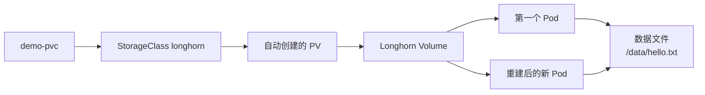

# 第 5 步：验证 StorageClass、PVC 与数据保留

## 测试目标

通过一个最小有状态演示，把下面这条链路走通：


## 理论说明

### 这一页真正要验证什么

很多人安装完存储组件后，只看：

- Pod 是不是 `Running`
- `StorageClass` 在不在

但真正要验证的是：

- 卷有没有真正被动态供给
- 数据有没有真正落盘
- 工作负载重建后卷是不是还在

第四章的“有状态”闭环，就是在这一页完成的。

### `PVC -> PV -> Pod` 关系图



这张图表达的是：

- Pod 只是卷的使用者
- 数据真正保存在 Longhorn 卷里
- Pod 没了，卷还在

### 为什么 `reclaimPolicy=Delete` 不影响这一页的演示

第四章这一页验证的是：

- 删除 Pod
- 新 Pod 重新挂载同一个卷
- 数据仍然存在

这里的关键点是：

- 被删除的是 Pod
- 没有删除 `PVC`

因此即使 `longhorn` `StorageClass` 的回收策略是 `Delete`，也不会影响这一页的结果。

`Delete` 只会在后续显式删除 `PVC` 时，决定底层卷是否一起回收。

这里再次强调：

- `Delete` = 删除 `PVC` 后回收卷
- 不是删除 Pod 后回收卷

## 测试过程与关键看点

### 1. 创建命名空间与 PVC

这一组命令实际对应两份清单：

- `manifests/00_stateful_demo_namespace.yaml`
- `manifests/02_demo_pvc.yaml`

其中最关键的是 `PVC` 清单：

```yaml
kind: PersistentVolumeClaim
metadata:
  name: demo-pvc
  namespace: stateful-demo
spec:
  accessModes:
    - ReadWriteOnce
  storageClassName: longhorn
  resources:
    requests:
      storage: 2Gi
```

关键字段说明：

- `name: demo-pvc`
  - 这是第四章后续演示应用要挂载的卷名
- `namespace: stateful-demo`
  - 把这一组演示对象和系统组件隔离开
- `ReadWriteOnce`
  - 这一章主线先讲最常见的 `RWO` 卷
- `storageClassName: longhorn`
  - 明确让这次卷申请走第四章刚安装好的 Longhorn
- `storage: 2Gi`
  - 演示容量不大，但足够说明动态供给链路已经成立

```bash
kubectl apply -f http://ops:9000/04-storage-and-stateful/manifests/00_stateful_demo_namespace.yaml
kubectl apply -f http://ops:9000/04-storage-and-stateful/manifests/02_demo_pvc.yaml
kubectl -n stateful-demo get pvc
```

关键看点：

- `demo-pvc` 应该很快进入 `Bound`
- 这一步说明 `longhorn` 已经可以动态供给卷

### 2. 查看自动生成的 PV

```bash
kubectl get pv
```

关键看点：

- 应该能看到一个自动生成的 `PV`
- `CLAIM` 应该指向 `stateful-demo/demo-pvc`

### 3. 部署有状态演示应用

这一组命令实际对应的是：

- `manifests/03_demo_app.yaml`

其中最关键的内容是：

```yaml
kind: Deployment
metadata:
  name: volume-demo
  namespace: stateful-demo
spec:
  template:
    spec:
      nodeSelector:
        node-role: app
      containers:
        - name: busybox
          image: harbor.qytk8s.com/storage/busybox:1.36.1
          volumeMounts:
            - name: data
              mountPath: /data
      volumes:
        - name: data
          persistentVolumeClaim:
            claimName: demo-pvc
```

关键字段说明：

- `name: volume-demo`
  - 这是第四章用于演示“Pod 删除重建后数据仍在”的最小工作负载
- `nodeSelector: node-role: app`
  - 让演示 Pod 固定落在应用节点侧，便于课堂上理解工作负载位置
- `image: harbor.qytk8s.com/storage/busybox:1.36.1`
  - 第四章专门准备的最小演示镜像
- `mountPath: /data`
  - 后续写入和读取的数据都发生在这个卷挂载路径下
- `claimName: demo-pvc`
  - 明确把前面创建的 `PVC` 真正挂进 Pod

也就是说，这份 Deployment 清单最重要的不是“起一个 BusyBox”，而是：

- 用一个最简单的 Pod
- 把 `demo-pvc` 真正挂载进来
- 让第四章后面“写数据、删 Pod、再读数据”的链路成立

```bash
kubectl apply -f http://ops:9000/04-storage-and-stateful/manifests/03_demo_app.yaml
kubectl -n stateful-demo rollout status deploy/volume-demo --timeout=300s
kubectl -n stateful-demo get pods -o wide
```

关键看点：

- `volume-demo` 应该进入 `Running`
- 这一步说明卷已经成功被 Pod 挂载

### 4. 写入一条测试数据

```bash
POD_NAME=$(kubectl -n stateful-demo get pod -l app=volume-demo -o jsonpath='{.items[0].metadata.name}')
kubectl -n stateful-demo exec "${POD_NAME}" -- sh -c 'echo hello-from-longhorn > /data/hello.txt && cat /data/hello.txt'
```

关键看点：

- 重点不是写入命令本身
- 而是确认数据已经真正写进卷挂载路径 `/data`

### 5. 删除当前 Pod，模拟工作负载重建

```bash
kubectl -n stateful-demo delete pod "${POD_NAME}" --wait=true
kubectl -n stateful-demo rollout status deploy/volume-demo --timeout=300s
kubectl -n stateful-demo get pods -o wide
```

关键看点：

- 这里是第四章最重要的动作
- 要让学员明确看到：Pod 可以消失，但卷不会跟着消失

### 6. 在新 Pod 中再次读取数据

```bash
NEW_POD=$(kubectl -n stateful-demo get pod -l app=volume-demo -o jsonpath='{.items[0].metadata.name}')
kubectl -n stateful-demo exec "${NEW_POD}" -- sh -c 'cat /data/hello.txt'
```

关键看点：

- 仍然能读到 `hello-from-longhorn`
- 这一步就是第四章最核心的“数据保留”证据

### 7. 可选补充：查看 Longhorn 卷对象

```bash
kubectl -n longhorn-system get volumes.longhorn.io
```

关键看点：

- 能看到由 `demo-pvc` 触发创建的 Longhorn 卷
- 这进一步把 Kubernetes 侧的 `PVC/PV` 和 Longhorn 侧的卷对象对应起来

## 通过标准

- `demo-pvc` 已成功绑定
- 自动生成了 `PV`
- Pod 删除重建后数据仍存在
- 学员能解释清楚 `PVC / PV / Pod` 三者关系

## 下一步

进入第 6 步，把 `wk-edge01` 作为第 4 个 Longhorn 节点加入：

- `docs/07_expand_longhorn_node.md`
