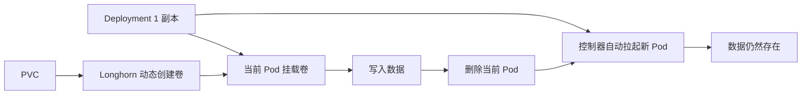
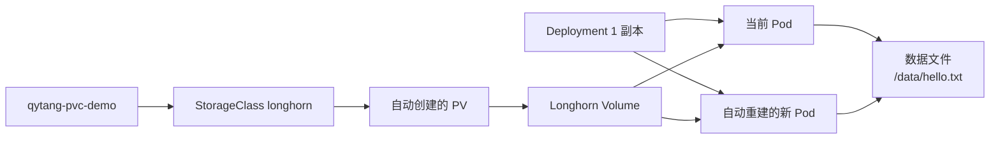
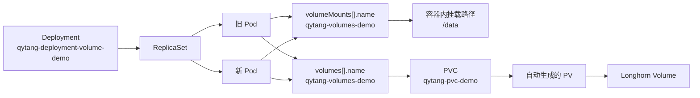

# 第 5 步：验证 StorageClass、PVC 与数据保留

## 本步目标

通过一个最小有状态演示，把下面这条链路走通：



## 理论说明

### 这一页真正要验证什么

很多人安装完存储组件后，只看：

- Pod 是不是 `Running`
- `StorageClass` 在不在

但真正要验证的是：

- 卷有没有真正被动态供给
- 数据有没有真正落盘
- 工作负载自动重建后卷是不是还在

第四章的“有状态”闭环，就是在这一页完成的。

### 这一页的完整故事

这一页真正要讲清楚的，不是“手工起两个 Pod”。

它要讲的是：

- 有一个受控制器管理的工作负载
- 这个工作负载挂载一个固定的 `PVC`
- 当前 Pod 被删除后，控制器会自动拉起一个新 Pod
- 新 Pod 会继续挂载原来的卷
- 因此业务状态能够“重生”

第四章这里选择用 `Deployment replicas=1` 来演示这条主线。

这样学员既能看清：

- `Pod` 会变化
- `PVC / PV / Longhorn Volume` 不会因为删除 Pod 而消失
- Kubernetes 控制器和持久卷能力是一起完成“自动恢复”的

### 为什么这里先用“删 Pod”演示，而不是直接做节点故障

节点故障当然也是这条故事的一部分，但它会同时引入：

- Node `NotReady` 判定时间
- Pod 驱逐与重调度时间
- Longhorn 卷 `detach / attach` 时间

对课堂第一版主线来说，先用“删除 Pod”更稳定，也更容易把机制讲清楚。

只要这一页跑通，后面再做“节点故障后跨节点恢复”，本质上就是同一个故事的进一步展开。

### `PVC -> PV -> Pod` 关系图



这张图表达的是：

- Pod 只是卷的使用者
- 控制器负责把 Pod 维持在期望状态
- 数据真正保存在 Longhorn 卷里
- Pod 没了，卷还在

### 为什么 `reclaimPolicy=Delete` 不影响这一页的演示

第四章这一页验证的是：

- 删除当前 Pod
- `Deployment` 自动重建新 Pod
- 新 Pod 重新挂载同一个卷
- 数据仍然存在

这里的关键点是：

- 被删除的是 Pod
- 没有删除 `PVC`

因此即使 `longhorn` `StorageClass` 的回收策略是 `Delete`，也不会影响这一页的结果。

`Delete` 只会在后续显式删除 `PVC` 时，决定底层卷是否一起回收。

这里再次强调：

- `Delete` = 删除 `PVC` 后回收卷
- 不是删除当前 Pod 后回收卷

## 测试过程与关键看点

### 1. 创建命名空间与 PVC

这一组命令实际对应两份清单：

- `manifests/00_stateful_demo_namespace.yaml`
- `manifests/02_demo_pvc.yaml`

其中最关键的是下面这份 `PVC` 清单：

- 来源文件：`manifests/02_demo_pvc.yaml`
- 对象类型：`PersistentVolumeClaim`

```yaml
kind: PersistentVolumeClaim
metadata:
  name: qytang-pvc-demo
  namespace: qytang-stateful-demo
spec:
  accessModes:
    - ReadWriteOnce
  storageClassName: longhorn
  resources:
    requests:
      storage: 2Gi
```

关键字段说明：

- `name: qytang-pvc-demo`
  - 这是第四章后续演示应用要挂载的 PVC 名称
- `namespace: qytang-stateful-demo`
  - 把这一组演示对象和系统组件隔离开
- `ReadWriteOnce`
  - 这一章主线先讲最常见的 `RWO` 卷
- `storageClassName: longhorn`
  - 明确让这次卷申请走第四章刚安装好的 Longhorn
- `storage: 2Gi`
  - 演示容量不大，但足够说明动态供给链路已经成立

```bash
kubectl apply -f http://ops:9000/04-storage-and-stateful/manifests/00_stateful_demo_namespace.yaml
kubectl apply -f http://ops:9000/04-storage-and-stateful/manifests/02_demo_pvc.yaml
kubectl -n qytang-stateful-demo get pvc
```

关键看点：

- `qytang-pvc-demo` 应该很快进入 `Bound`
- 这一步说明 `longhorn` 已经可以动态供给卷

### 2. 查看自动生成的 PV

```bash
kubectl get pv
```

关键看点：

- 应该能看到一个自动生成的 `PV`
- `CLAIM` 应该指向 `qytang-stateful-demo/qytang-pvc-demo`

### 3. 部署 1 副本有状态演示工作负载

这一组命令实际对应的是：

- `manifests/03_demo_app.yaml`

来源说明：

- 来源文件：`manifests/03_demo_app.yaml`
- 对象类型：`Deployment`

其中最关键的内容是：

```yaml
kind: Deployment
metadata:
  name: qytang-deployment-volume-demo
  namespace: qytang-stateful-demo
spec:
  replicas: 1
  template:
    spec:
      nodeSelector:
        node-role: app
      containers:
        - name: busybox
          image: harbor.qytk8s.com/storage/busybox:1.36.1
          volumeMounts:
            - name: qytang-volumes-demo
              mountPath: /data
      volumes:
        - name: qytang-volumes-demo
          persistentVolumeClaim:
            claimName: qytang-pvc-demo
```

关键字段说明：

- `name: qytang-deployment-volume-demo`
  - 这是第四章用于演示“控制器自动重建 + 持久卷保留”的最小工作负载
- `replicas: 1`
  - 同一时刻只保留 1 个 Pod，符合这一页 `ReadWriteOnce` 卷的主线演示
- `nodeSelector: node-role: app`
  - 让演示 Pod 固定落在应用节点侧，便于课堂上理解工作负载位置
- `image: harbor.qytk8s.com/storage/busybox:1.36.1`
  - 第四章专门准备的最小演示镜像
- `name: qytang-volumes-demo`
  - 这是这份 Pod 清单内部自定义的卷名字
  - 它只是一个普通名字，不是 Kubernetes 关键字
- `mountPath: /data`
  - 后续写入和读取的数据都发生在这个卷挂载路径下
- `claimName: qytang-pvc-demo`
  - 明确把前面创建的 `PVC` 真正挂进 Pod

关联关系要看清楚：



这张图对应的关系是：

- `Deployment`
  - 负责保持“始终有 1 个 Pod 在运行”
- 旧 Pod 被删除后
  - `Deployment/ReplicaSet` 会自动创建一个新 Pod
- `persistentVolumeClaim.claimName: qytang-pvc-demo`
  - 决定旧 Pod 和新 Pod 挂载的其实是同一个 `PVC`

因此，这一页最重要的不是“起一个 BusyBox”，而是：

- 用一个固定的控制器管理工作负载
- 让它始终挂载同一个 `PVC`
- 删除当前 Pod 后，让系统自动拉起新 Pod
- 再证明新 Pod 读到的还是原来的卷数据

```bash
kubectl apply -f http://ops:9000/04-storage-and-stateful/manifests/03_demo_app.yaml
kubectl -n qytang-stateful-demo rollout status deploy/qytang-deployment-volume-demo --timeout=300s
kubectl -n qytang-stateful-demo get pods -o wide
```

关键看点：

- 当前应只看到 1 个业务 Pod
- 这一步说明工作负载和卷挂载链路已经建立

### 4. 先向卷里写入测试数据

```bash
kubectl -n qytang-stateful-demo exec deploy/qytang-deployment-volume-demo -- sh -c 'echo hello-from-longhorn > /data/hello.txt && cat /data/hello.txt'
```

关键看点：

- 重点不是写入命令本身
- 而是确认数据已经真正写进卷挂载路径 `/data`

### 5. 删除当前 Pod，观察系统自动重建

```bash
OLD_POD=$(kubectl -n qytang-stateful-demo get pod -l app=qytang-deployment-volume-demo -o jsonpath='{.items[0].metadata.name}')
kubectl -n qytang-stateful-demo delete pod "${OLD_POD}" --wait=true
kubectl -n qytang-stateful-demo rollout status deploy/qytang-deployment-volume-demo --timeout=300s
kubectl -n qytang-stateful-demo get pods -o wide
```

关键看点：

- `OLD_POD` 只是当前这个 Pod 的运行时名字
- 旧 Pod 被删后，不需要手工再 `apply` 新 YAML
- `Deployment` 会自动拉起一个新的 Pod
- 这里要让学员明确看到：变的是 Pod，不是 PVC

### 6. 在自动重建的新 Pod 中再次读取数据

```bash
kubectl -n qytang-stateful-demo exec deploy/qytang-deployment-volume-demo -- sh -c 'cat /data/hello.txt'
```

关键看点：

- 通过上一条 `get pods` 输出，应能看到新 Pod 名字已经不同于 `OLD_POD`
- 仍然能读到 `hello-from-longhorn`
- 这一步就是第四章最核心的证据：
  - 控制器自动重建了新 Pod
  - 新 Pod 继续挂载原来的 PVC
  - 原来的数据没有丢

### 7. 可选补充：查看 Longhorn 卷对象

```bash
kubectl -n longhorn-system get volumes.longhorn.io
```

关键看点：

- 能看到由 `qytang-pvc-demo` 触发创建的 Longhorn 卷
- 这进一步把 Kubernetes 侧的 `PVC/PV` 和 Longhorn 侧的卷对象对应起来

## 通过标准

- `qytang-pvc-demo` 已成功绑定
- 自动生成了 `PV`
- 当前 Pod 被删除后，Deployment 自动拉起新 Pod，并继续挂载原来的 `PVC`
- 学员能解释清楚 `PVC / PV / Pod` 三者关系

## 下一步

进入第 6 步，把 `wk-edge01` 初始化为第 4 个 Longhorn 存储节点：

- `docs/07_expand_longhorn_node.md`
