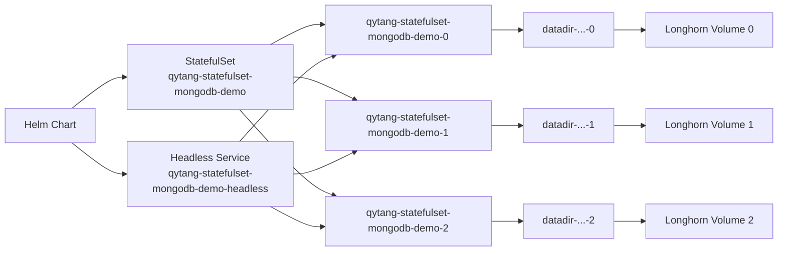

# 第 7 步：Helm 部署 MongoDB ReplicaSet

## 本步目标

这一页不再只讲抽象的 `StatefulSet` 机制，而是直接部署一个真实的 `MongoDB ReplicaSet`，把下面 4 件事讲清楚：

- 为什么很多数据库更适合 `StatefulSet`
- `Headless Service` 在真实业务里到底起什么作用
- 为什么每个副本都要有自己的 `PVC`
- 删除一个成员后，为什么系统会按原编号自动恢复

---

## 这一页的完整故事

这一页真正要让学员看到的是下面这条完整链路：

- `Helm` 先把 `MongoDB ReplicaSet` 自动化部署出来
- 集群里会出现 `-0`、`-1`、`-2` 这 3 个固定编号成员
- 每个成员都有自己的 `PVC` 和 Longhorn 卷
- 手工向集群写入一条测试数据
- 删除 `-1`
- Kubernetes 会自动恢复同名的 `-1`
- 副本集重新回到健康状态
- 原来的测试数据仍然还能读到

也就是说，这一页不是为了讲 MongoDB 运维细节，而是借一个真实数据库案例，把 `StatefulSet` 的意义讲清楚。

---

## 执行标记

- **执行标记：必须执行**

说明：

- 安装过程尽量交给 `Helm`
- 手工重点只放在 `show` 和验证

---

## 问题背景

第四章前面已经通过 `Deployment + PVC` 讲清了第一条主线：

- 当前 `Pod` 被删除
- 控制器自动拉起新的 `Pod`
- 新 `Pod` 继续挂载原来的 `PVC`
- 数据仍然存在

但很多真实数据库比这再复杂一步。

它们不只需要“有卷”，还需要：

- 固定编号
- 固定网络身份
- 每个实例自己的独立卷
- 故障后按原身份恢复

这正是 `StatefulSet` 发挥价值的地方。

---

## 理论说明

### 为什么这一步选 `MongoDB ReplicaSet`

这一页选 `MongoDB ReplicaSet`，是因为它能把 `StatefulSet` 的几个核心能力一次讲清：

- 3 个成员都有固定名字
- 3 个成员都各自有自己的卷
- 集群成员之间需要稳定 DNS
- 删除一个成员后，恢复回来的仍然是同名成员

也就是说，这一页真正要讲的是：

- `StatefulSet` 不是“比 Deployment 多几个 Pod”
- 而是用来承载“每个副本都带身份”的有状态系统

### `Deployment` 和 `StatefulSet` 的本质区别

可以先用一句话记住：

- `Deployment` 关心“维持几个 Pod”
- `StatefulSet` 关心“每个 Pod 不仅要活着，还要保留自己的名字、自己的网络身份和自己的卷”

对应到这一页：

- `MongoDB` 不是 3 个匿名副本
- 而是 3 个有编号的数据库成员

更直接地看，可以先记住这张表：

| 对比项 | `Deployment` | `StatefulSet` |
| :--- | :--- | :--- |
| Pod 身份 | 更像匿名副本 | 每个 Pod 都有固定编号 |
| Pod 名字 | 重建后可能变化 | 重建后仍按原编号恢复 |
| 网络身份 | 通常只关心 Service 入口 | 每个成员都需要稳定 DNS |
| 卷的使用方式 | 常见是多个 Pod 共用同一套模板 | 常见是每个副本各自独立 PVC |
| 更适合什么 | 无状态应用，或单实例简单持久化 | 数据库、消息系统、需要成员身份的集群 |

### `Headless Service` 一针见血的理解

- `clusterIP: None`
  - 这表示它不是给一组 Pod 做统一负载均衡，而是直接为每个 Pod 提供稳定 DNS 名字
- `selector`
  - 让这项服务直接把 StatefulSet Pod 暴露为可预测的解析目标

放到这一页，就是：

- `qytang-statefulset-mongodb-demo-0`
- `qytang-statefulset-mongodb-demo-1`
- `qytang-statefulset-mongodb-demo-2`

都能通过固定 DNS 名字被找到。

### 先把访问模式看清

MongoDB 这一步里，每个副本都不是共用一块卷，而是各自使用自己的卷。

常见访问模式可以先这样理解：

| 访问模式 | 含义 | 这一页怎么理解 |
| :--- | :--- | :--- |
| `ReadWriteOnce` | 一块卷通常由一个实例独占读写 | 最常见，也最符合数据库单成员独占自己数据盘的方式 |
| `ReadOnlyMany` | 多个实例可同时只读 | 不适合数据库正常写入主线 |
| `ReadWriteMany` | 多个实例可同时读写同一块卷 | 更适合共享文件类场景，不是这一页重点 |
| `ReadWriteOncePod` | 一块卷只允许一个 Pod 挂载 | 比 `ReadWriteOnce` 约束更强 |

### 为什么不是 3 个副本共用一块卷

这一页必须分清：

- 不是 3 个 MongoDB Pod 一起共用一块 `ReadWriteOnce` 卷
- 而是每个成员各自有自己的 `PVC`
- 每个 `PVC` 背后再对应自己的 Longhorn 卷

这才符合真实数据库副本集的工作方式：

- 每个成员维护自己的数据副本
- 应用自身负责复制、选主和同步
- 存储层只负责把“每个成员自己的卷”稳定提供出来

---

## 本步对象关系图



这张图表达的核心是：

- `Helm` 负责把复杂安装自动化
- `StatefulSet` 负责稳定身份
- `Headless Service` 负责稳定 DNS
- `Longhorn` 负责每个成员自己的独立卷

---

## 本步关键配置

### MongoDB Helm values

<div style="padding: 10px 14px; border: 1px solid #666; border-left: 4px solid #8ab4f8; border-radius: 6px; background: rgba(138,180,248,0.08); margin: 8px 0;">
<strong>YAML 文件：</strong><code>manifests/07_mongodb_values.yaml</code><br/>
<strong>本页重点对象：</strong><code>MongoDB Helm values</code><br/>
<strong>作用：</strong>定义第四章 MongoDB ReplicaSet 案例的安装参数，包括副本集模式、镜像来源、认证信息、反亲和与持久化卷配置
</div>

```yaml
global:
  imageRegistry: harbor.qytk8s.com

fullnameOverride: qytang-statefulset-mongodb-demo

image:
  repository: bitnamilegacy/mongodb

architecture: replicaset
replicaCount: 3
replicaSetName: rs0

auth:
  enabled: true
  rootUser: root
  rootPassword: QytangMongo123456
  replicaSetKey: QytangReplicaSet123456

arbiter:
  enabled: false

hidden:
  enabled: false

podAntiAffinityPreset: soft

persistence:
  enabled: true
  storageClass: longhorn
  accessModes:
    - ReadWriteOnce
  size: 2Gi
```

关键字段说明：

- `global.imageRegistry: harbor.qytk8s.com` 与 `image.repository: bitnamilegacy/mongodb`
  - 组合后的实际镜像来源是 `harbor.qytk8s.com/bitnamilegacy/mongodb`
- `fullnameOverride: qytang-statefulset-mongodb-demo`
  - 固定这套案例的对象名字，便于课堂观察 `Pod`、`PVC`、`Headless Service` 与副本集成员
- `architecture: replicaset`
  - 明确要求创建 `ReplicaSet`，而不是单实例
- `replicaCount: 3`
  - 对应 3 个固定编号成员：`-0`、`-1`、`-2`
- `replicaSetName: rs0`
  - 指定副本集名称，后续 `rs.status()` 看到的就是这套成员关系
- `auth.enabled: true`、`rootUser`、`rootPassword`
  - 开启认证，并显式固定课堂环境使用的管理员账号
- `replicaSetKey`
  - 供副本集成员之间认证
- `arbiter.enabled: false`、`hidden.enabled: false`
  - 当前案例只保留 3 个可见、可承载数据的正式成员，不额外引入仲裁节点或隐藏节点
- `podAntiAffinityPreset: soft`
  - 优先把副本分散到不同节点，但不把它设成硬性调度约束
- `persistence.storageClass: longhorn`
  - 明确每个成员的卷都由 `Longhorn` 提供
- `persistence.enabled: true`
  - 开启持久化卷，而不是把数据库数据写在容器临时层
- `accessModes: ReadWriteOnce`
  - 每个成员独占自己的卷，这也符合数据库单成员独立数据盘的常见方式
- `size: 2Gi`
  - 当前课堂案例给每个成员分配 `2Gi` 存储空间

### 渲染后的 Headless Service

<div style="padding: 10px 14px; border: 1px solid #666; border-left: 4px solid #8ab4f8; border-radius: 6px; background: rgba(138,180,248,0.08); margin: 8px 0;">
<strong>YAML 文件：</strong><code>artifacts/mongodb-rendered-15.6.0.yaml</code><br/>
<strong>本页重点对象：</strong><code>Headless Service</code><br/>
<strong>作用：</strong>为 MongoDB 副本集成员提供稳定 DNS 名字，而不是提供统一负载均衡入口
</div>

```yaml
kind: Service
metadata:
  name: qytang-statefulset-mongodb-demo-headless
  namespace: "qytang-mongodb-demo"
spec:
  type: ClusterIP
  clusterIP: None
  publishNotReadyAddresses: true
```

关键字段说明：

- `name`
  - 这就是副本集成员稳定 DNS 的基准服务名
- `clusterIP: None`
  - 说明它是 `Headless Service`
- `publishNotReadyAddresses: true`
  - 让副本集初始化阶段也能按成员名字互相发现

### 渲染后的 StatefulSet

<div style="padding: 10px 14px; border: 1px solid #666; border-left: 4px solid #8ab4f8; border-radius: 6px; background: rgba(138,180,248,0.08); margin: 8px 0;">
<strong>YAML 文件：</strong><code>artifacts/mongodb-rendered-15.6.0.yaml</code><br/>
<strong>本页重点对象：</strong><code>StatefulSet</code><br/>
<strong>作用：</strong>为 MongoDB 生成固定编号成员，并让每个成员拥有自己的独立卷
</div>

```yaml
kind: StatefulSet
metadata:
  name: qytang-statefulset-mongodb-demo
  namespace: "qytang-mongodb-demo"
spec:
  serviceName: qytang-statefulset-mongodb-demo-headless
  replicas: 3
```

关键字段说明：

- `serviceName`
  - 让 `StatefulSet` 和前面的 `Headless Service` 绑定起来
- `replicas: 3`
  - 会生成 `-0`、`-1`、`-2` 这 3 个成员

---

## 对应脚本

本步对应脚本：

- `k8s/04-storage-and-stateful/scripts/08_deploy_statefulset_demo.sh`

脚本会完成：

- 重新安装 `MongoDB ReplicaSet`
- 等待 `StatefulSet` 就绪
- 输出 `Pod / PVC / Service`
- 输出初始副本集状态

这一页的分工要刻意分清：

- 脚本负责自动部署
- 课堂上的手工动作只负责 `show`、写测试数据、删除成员和观察恢复

---

## 本页验证顺序

建议严格按下面顺序观察：

1. 先看 `Pod`
2. 再看 `PVC`
3. 再看 `Headless Service`
4. 再看副本集状态
5. 再写一条测试数据
6. 再删除 `-1`
7. 最后再看副本集和数据是否恢复

这样最容易把 `StatefulSet` 的核心价值看清：

- 先看固定身份
- 再看独立卷
- 再看稳定 DNS
- 最后看自动恢复和数据保留

---

## 执行命令

<div style="padding: 10px 14px; border: 1px solid #666; border-left: 4px solid #8ab4f8; border-radius: 6px; background: rgba(138,180,248,0.08); margin: 8px 0;">
<strong>ℹ️ 可选预处理命令</strong><br/>
如果脚本已具备执行权限，这一步可以跳过。
</div>

```bash
chmod +x /docker_k8s_2026/k8s/04-storage-and-stateful/scripts/08_deploy_statefulset_demo.sh
```

<div style="padding: 12px 14px; border: 1px solid #666; border-left: 6px solid #ea4335; border-radius: 6px; background: rgba(234,67,53,0.10); margin: 8px 0;">
<strong>❗ 本步必须粘贴执行</strong><br/>
下面命令是本步主线必跑命令。
</div>

```bash
bash /docker_k8s_2026/k8s/04-storage-and-stateful/scripts/08_deploy_statefulset_demo.sh
```

---

## 验证方法

先取出 root 密码，后面几条命令都会复用它：

<div style="padding: 12px 14px; border: 1px solid #666; border-left: 6px solid #ea4335; border-radius: 6px; background: rgba(234,67,53,0.10); margin: 8px 0;">
<strong>❗ 本步必须粘贴执行</strong><br/>
下面命令是后续验证会复用的前置命令。
</div>

```bash
MONGO_ROOT_PASSWORD=$(kubectl -n qytang-mongodb-demo get secret qytang-statefulset-mongodb-demo -o jsonpath='{.data.mongodb-root-password}' | base64 -d)
```

### 验证 1：固定编号的 Pod 是否真的出现

<div style="padding: 12px 14px; border: 1px solid #666; border-left: 6px solid #ea4335; border-radius: 6px; background: rgba(234,67,53,0.10); margin: 8px 0;">
<strong>❗ 本步必须粘贴执行</strong><br/>
下面命令是本步主线必跑命令，用于检查固定编号成员。
</div>

```bash
kubectl -n qytang-mongodb-demo get pods -o wide
```

关键看点：

- 重点看是否出现下面 3 个固定名字：
  - `qytang-statefulset-mongodb-demo-0`
  - `qytang-statefulset-mongodb-demo-1`
  - `qytang-statefulset-mongodb-demo-2`

预期结果：

- 3 个 MongoDB Pod 都应为 `Running`
- 名字应保持固定编号，而不是随机名字

### 验证 2：每个成员是否真的有自己的 PVC

<div style="padding: 12px 14px; border: 1px solid #666; border-left: 6px solid #ea4335; border-radius: 6px; background: rgba(234,67,53,0.10); margin: 8px 0;">
<strong>❗ 本步必须粘贴执行</strong><br/>
下面命令是本步主线必跑命令，用于检查独立 PVC。
</div>

```bash
kubectl -n qytang-mongodb-demo get pvc
```

关键看点：

- 重点不是只看有没有 `PVC`
- 而是要看到 3 个和成员编号一一对应的 `PVC`

预期结果：

- 应出现下面这一类名字：
  - `datadir-qytang-statefulset-mongodb-demo-0`
  - `datadir-qytang-statefulset-mongodb-demo-1`
  - `datadir-qytang-statefulset-mongodb-demo-2`
- 这 3 个 `PVC` 都应为 `Bound`

### 验证 3：Headless Service 是否已经出现

<div style="padding: 12px 14px; border: 1px solid #666; border-left: 6px solid #ea4335; border-radius: 6px; background: rgba(234,67,53,0.10); margin: 8px 0;">
<strong>❗ 本步必须粘贴执行</strong><br/>
下面命令是本步主线必跑命令，用于检查 Headless Service。
</div>

```bash
kubectl -n qytang-mongodb-demo get svc
kubectl -n qytang-mongodb-demo get svc qytang-statefulset-mongodb-demo-headless -o yaml | sed -n '1,80p'
```

关键看点：

- 要看到 `qytang-statefulset-mongodb-demo-headless`
- 重点字段是 `clusterIP: None`

预期结果：

- 服务列表中应出现 headless service
- YAML 输出中应明确看到 `clusterIP: None`

### 验证 4：副本集状态是否正常

<div style="padding: 12px 14px; border: 1px solid #666; border-left: 6px solid #ea4335; border-radius: 6px; background: rgba(234,67,53,0.10); margin: 8px 0;">
<strong>❗ 本步必须粘贴执行</strong><br/>
下面命令是本步主线必跑命令，用于检查副本集状态。
</div>

```bash
kubectl -n qytang-mongodb-demo exec pod/qytang-statefulset-mongodb-demo-0 -- \
  mongosh admin -u root -p "${MONGO_ROOT_PASSWORD}" --quiet \
  --eval 'rs.status().members.map(function(m){return {name:m.name,stateStr:m.stateStr}})'
```

关键看点：

- 重点看是否有 3 个成员
- 通常会看到 1 个 `PRIMARY`，其余是 `SECONDARY`

预期结果：

- 输出中应包含 3 个成员
- 每个成员名字都应带自己的编号
- 至少应有 1 个 `PRIMARY`

### 验证 5：写入一条测试数据

先执行写入命令：

<div style="padding: 12px 14px; border: 1px solid #666; border-left: 6px solid #ea4335; border-radius: 6px; background: rgba(234,67,53,0.10); margin: 8px 0;">
<strong>❗ 本步必须粘贴执行</strong><br/>
下面命令是本步主线必跑命令，用于写入测试数据。
</div>

```bash
kubectl -n qytang-mongodb-demo exec pod/qytang-statefulset-mongodb-demo-0 -- \
  mongosh admin -u root -p "${MONGO_ROOT_PASSWORD}" --quiet \
  --eval 'db.getSiblingDB("qytang").demo.updateOne({_id:"statefulset-ok"}, {$set:{message:"mongodb statefulset works", updatedAt:new Date()}}, {upsert:true})'
```

这条命令的作用是：

- 在 `qytang.demo` 集合里写入或更新 `_id=statefulset-ok` 这条测试记录
- 为后面“删除 `-1` 后数据仍然存在”的验证先埋下证据

再执行读取命令：

<div style="padding: 12px 14px; border: 1px solid #666; border-left: 6px solid #ea4335; border-radius: 6px; background: rgba(234,67,53,0.10); margin: 8px 0;">
<strong>❗ 本步必须粘贴执行</strong><br/>
下面命令是本步主线必跑命令，用于确认测试数据已写入。
</div>

```bash
kubectl -n qytang-mongodb-demo exec pod/qytang-statefulset-mongodb-demo-0 -- \
  mongosh admin -u root -p "${MONGO_ROOT_PASSWORD}" --quiet \
  --eval 'db.getSiblingDB("qytang").demo.find({_id:"statefulset-ok"}).toArray()'
```

这条命令的作用是：

- 立刻把刚才写入的测试记录读出来
- 确认写入已经真实落到副本集里

关键看点：

- 重点不是 MongoDB 语法本身
- 而是先向真实副本集写一条可回看的测试记录
- 这样删除 `-1` 之后，后面才有可回看的“原数据仍然存在”证据

预期结果：

- 能看到 `_id: "statefulset-ok"` 这条记录

### 验证 6：删除 `-1` 后是否按原编号自动恢复

<div style="padding: 12px 14px; border: 1px solid #666; border-left: 6px solid #ea4335; border-radius: 6px; background: rgba(234,67,53,0.10); margin: 8px 0;">
<strong>❗ 本步必须粘贴执行</strong><br/>
下面命令是本步主线必跑命令，用于验证按原编号自动恢复。
</div>

```bash
kubectl -n qytang-mongodb-demo delete pod/qytang-statefulset-mongodb-demo-1 --wait=true
kubectl -n qytang-mongodb-demo wait --for=condition=Ready pod/qytang-statefulset-mongodb-demo-1 --timeout=900s
kubectl -n qytang-mongodb-demo get pods
```

关键看点：

- 删除的是 `-1`
- 恢复回来的也必须还是 `-1`
- 这正是 `StatefulSet` 和普通无状态副本最关键的差别

预期结果：

- `qytang-statefulset-mongodb-demo-1` 会重新回到 `Running`
- 名字不会变成别的随机名字

### 验证 7：恢复后集群和数据是否仍然正常

先执行副本集状态检查：

<div style="padding: 12px 14px; border: 1px solid #666; border-left: 6px solid #ea4335; border-radius: 6px; background: rgba(234,67,53,0.10); margin: 8px 0;">
<strong>❗ 本步必须粘贴执行</strong><br/>
下面命令是本步主线必跑命令，用于确认恢复后副本集状态。
</div>

```bash
kubectl -n qytang-mongodb-demo exec pod/qytang-statefulset-mongodb-demo-0 -- \
  mongosh admin -u root -p "${MONGO_ROOT_PASSWORD}" --quiet \
  --eval 'rs.status().members.map(function(m){return {name:m.name,stateStr:m.stateStr}})'
```

这条命令的作用是：

- 查看删除 `-1` 并恢复后，副本集是否已经重新回到 3 成员健康状态
- 重点看是否仍然是 `1 PRIMARY + 2 SECONDARY`

再执行数据读取检查：

<div style="padding: 12px 14px; border: 1px solid #666; border-left: 6px solid #ea4335; border-radius: 6px; background: rgba(234,67,53,0.10); margin: 8px 0;">
<strong>❗ 本步必须粘贴执行</strong><br/>
下面命令是本步主线必跑命令，用于确认恢复后数据仍然存在。
</div>

```bash
kubectl -n qytang-mongodb-demo exec pod/qytang-statefulset-mongodb-demo-1 -- \
  mongosh admin -u root -p "${MONGO_ROOT_PASSWORD}" --quiet \
  --eval 'db.getSiblingDB("qytang").demo.find({_id:"statefulset-ok"}).toArray()'
```

这条命令的作用是：

- 到刚恢复回来的 `-1` 成员内部读取前面那条测试记录
- 证明恢复的不是一个“空的新实例”，而是继续回到了原有副本集数据链路里

关键看点：

- 重点看副本集是否重新回到 3 成员健康状态
- 再确认 `-1` 恢复后仍然能读到前面那条测试数据

预期结果：

- 副本集状态再次正常
- `-1` 上也能读到 `_id: "statefulset-ok"` 这条记录

---

## 通过标准

满足下面条件后，这一页即可视为通过：

- `MongoDB ReplicaSet` 已通过 Helm 正常安装
- 3 个固定编号的 MongoDB 成员都已就绪
- 3 个成员都有各自独立的 `PVC`
- `Headless Service` 已正常创建
- 副本集状态正常
- 删除 `-1` 后，恢复回来的仍然是 `-1`
- 恢复后集群和测试数据仍然正常

---

## 下一步

继续把 `Longhorn UI` 正式发布到北向入口：

- `docs/09_publish_longhorn_ui.md`
