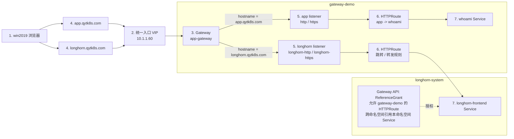
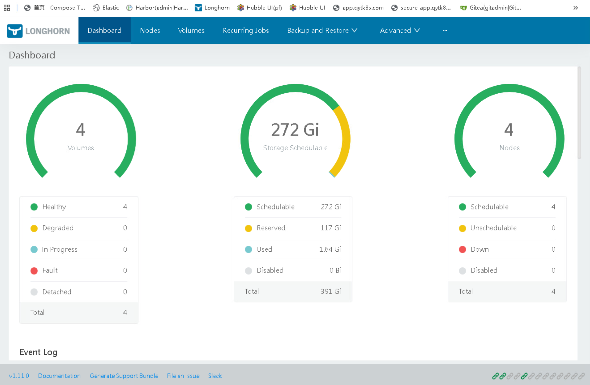
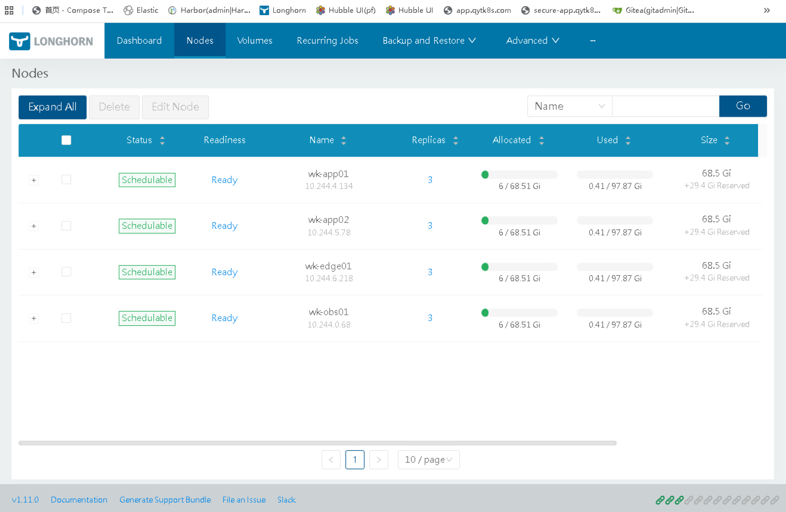
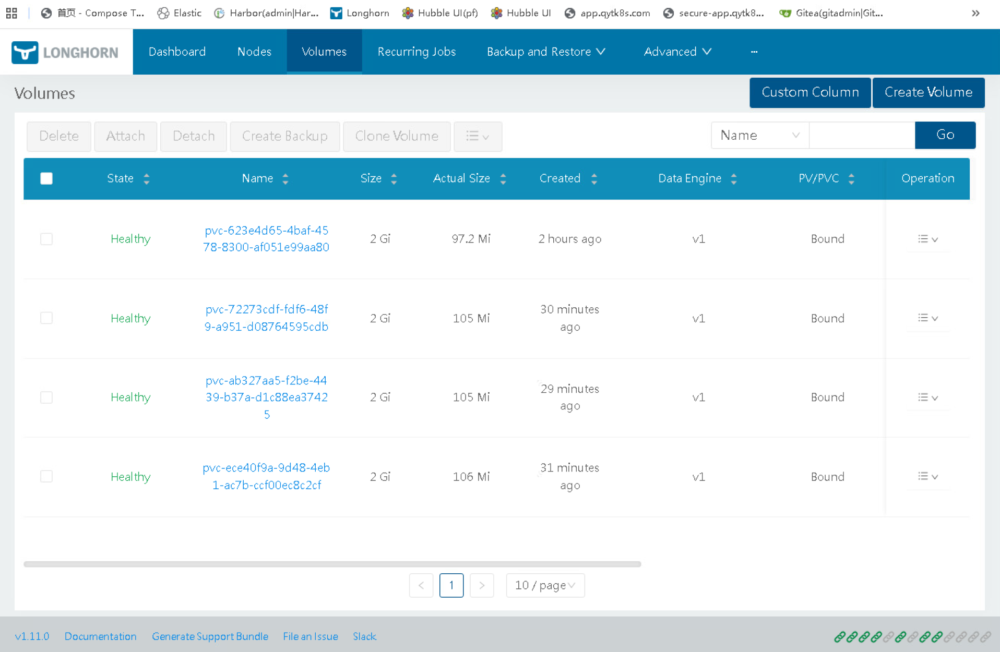

# 第 8 步：发布 Longhorn UI

## 本步目标

把 `Longhorn UI` 正式纳入课程统一北向访问方式：

- `win2019`
- `HTTPS`
- 域名访问
- 复用第三章已经跑通的 `MetalLB + Gateway API`

本章固定访问地址：

```text
https://longhorn.qytk8s.com
```

---

## 执行标记

- **执行标记：必须执行**

说明：

- 这一页不是再单独搞一套新的入口
- 而是把第四章的存储 GUI 也统一纳入整门课既有的北向 `HTTPS` 体系

---

## 问题背景

Longhorn UI 这一页的目标很简单：把第四章的存储 GUI 也统一纳入课程既有的“域名 + HTTPS”发布方式。

---

## 理论说明

### Longhorn UI 北向发布总关系图



> 说明：
> 只有 `Longhorn UI` 这条分支跨命名空间，因此需要 `ReferenceGrant`；`app.qytk8s.com -> whoami` 这条分支仍在 `gateway-demo` 内，不需要它。`ReferenceGrant` 是 `Gateway API` 的授权对象，不是流量转发节点。

图中要点：

- 第四章没有单独再分配一个新 VIP
- 而是继续复用第三章已经建立好的统一入口
- `app.qytk8s.com` 和 `longhorn.qytk8s.com` 都先进入同一个 VIP、同一个 Gateway
- 真正区分 `whoami` 和 `Longhorn UI` 的依据，不再是 IP，而是进入 `Gateway` 后的域名与 listener
- `ReferenceGrant` 是 `Gateway API` 的授权对象，用于允许 `gateway-demo` 里的 `HTTPRoute` 跨命名空间引用 `longhorn-system/longhorn-frontend`

### 本步关键 YAML

<div style="padding: 10px 14px; border: 1px solid #666; border-left: 4px solid #8ab4f8; border-radius: 6px; background: rgba(138,180,248,0.08); margin: 8px 0;">
<strong>YAML 文件：</strong><code>manifests/21_gateway_longhorn_ui.yaml</code><br/>
<strong>本页重点对象：</strong><code>HTTPRoute + ReferenceGrant</code><br/>
<strong>作用：</strong>为 <code>longhorn.qytk8s.com</code> 增加 <code>HTTP -> HTTPS</code> 跳转、<code>HTTPS -> longhorn-frontend</code> 转发，以及跨命名空间后端引用授权
</div>

这份清单只负责新增：

- `longhorn-http-redirect`
- `longhorn-https-backend`
- `allow-gateway-demo-to-longhorn-frontend`

它不直接定义最终的 `Gateway listener` 结构；`app-gateway` 上的 4 个 listener 由脚本里的 `reconcile_gateway_listeners` 动态收敛。

#### `HTTP -> HTTPS` 跳转规则

```yaml
kind: HTTPRoute
metadata:
  name: longhorn-http-redirect
spec:
  parentRefs:
    - name: app-gateway
      sectionName: longhorn-http
```

关键字段说明：

- Longhorn UI 使用自己的 `longhorn-http` listener
- 并遵循“80 只负责跳转，443 才承载正式内容”的统一入口模型

#### `HTTPS -> longhorn-frontend` 转发规则

```yaml
kind: HTTPRoute
metadata:
  name: longhorn-https-backend
spec:
  parentRefs:
    - name: app-gateway
      sectionName: longhorn-https
  rules:
    - backendRefs:
        - name: longhorn-frontend
          namespace: longhorn-system
          port: 80
```

关键字段说明：

- 后端 Service 位于 `longhorn-system`
- 因此这一页必须补 `ReferenceGrant`

#### 跨命名空间授权

```yaml
kind: ReferenceGrant
metadata:
  name: allow-gateway-demo-to-longhorn-frontend
  namespace: longhorn-system
spec:
  from:
    - group: gateway.networking.k8s.io
      kind: HTTPRoute
      namespace: gateway-demo
  to:
    - group: ""
      kind: Service
      name: longhorn-frontend
```

关键字段说明：

- `ReferenceGrant` 必须创建在被访问后端所在的命名空间，也就是 `longhorn-system`
- 没有这项授权，`gateway-demo` 里的 `HTTPRoute` 不能跨命名空间引用 `longhorn-frontend`

---

## 对应脚本

本步对应脚本：

- `k8s/04-storage-and-stateful/scripts/07_publish_longhorn_ui.sh`

脚本会直接消费：

- `manifests/21_gateway_longhorn_ui.yaml`

---

## 脚本关键任务

### 关键任务 1：为 `longhorn.qytk8s.com` 签发证书并创建 Secret

脚本原始代码：

<div style="padding: 10px 14px; border: 1px solid #666; border-left: 4px solid #8ab4f8; border-radius: 6px; background: rgba(138,180,248,0.08); margin: 8px 0;">
<strong>ℹ️ 可选查看代码</strong><br/>
下面代码为脚本原始逻辑，用于理解本步实现，不需要单独执行。
</div>

```bash
DOMAIN="longhorn.qytk8s.com"
SECRET_NAME="longhorn-qytk8s-com-tls"
SECRET_NAMESPACE="gateway-demo"
```

关键介绍：

- Longhorn UI 使用独立域名与独立证书
- Secret 创建在 `gateway-demo`，供现有 `app-gateway` 引用

### 关键任务 2：应用 Longhorn UI 清单

脚本原始代码：

<div style="padding: 10px 14px; border: 1px solid #666; border-left: 4px solid #8ab4f8; border-radius: 6px; background: rgba(138,180,248,0.08); margin: 8px 0;">
<strong>ℹ️ 可选查看代码</strong><br/>
下面代码为脚本原始逻辑，用于理解本步实现，不需要单独执行。
</div>

```bash
kubectl apply -f "${MANIFEST_URL}"
```

关键介绍：

- 这里应用的就是 `manifests/21_gateway_longhorn_ui.yaml`
- Longhorn 相关的 `HTTPRoute` 和 `ReferenceGrant` 都在这份清单里

### 关键任务 3：为 Longhorn UI 增加专用 listener

脚本原始代码：

<div style="padding: 10px 14px; border: 1px solid #666; border-left: 4px solid #8ab4f8; border-radius: 6px; background: rgba(138,180,248,0.08); margin: 8px 0;">
<strong>ℹ️ 可选查看代码</strong><br/>
下面代码为脚本原始逻辑，用于理解本步实现，不需要单独执行。
</div>

```bash
reconcile_gateway_listeners
```

关键介绍：

- 这里不是静态 YAML，而是脚本运行时动态改写 `gateway-demo/app-gateway`
- 脚本会把 `app-gateway` 的 listener 收敛成固定 4 个：
  - `http`
  - `https`
  - `longhorn-http`
  - `longhorn-https`
- 其中：
  - `app.qytk8s.com` 继续使用 `http/https`
  - `longhorn.qytk8s.com` 使用 `longhorn-http/longhorn-https`
- 两个域名继续复用同一个 VIP，但不共用同一个 HTTPS listener

脚本收敛后的最终 listener 结构可以概括成：

```yaml
listeners:
  - name: http
    hostname: app.qytk8s.com
  - name: https
    hostname: app.qytk8s.com
  - name: longhorn-http
    hostname: longhorn.qytk8s.com
  - name: longhorn-https
    hostname: longhorn.qytk8s.com
```

### 关键任务 4：检查并修正 `EndpointSlice` 标签

脚本原始代码：

<div style="padding: 10px 14px; border: 1px solid #666; border-left: 4px solid #8ab4f8; border-radius: 6px; background: rgba(138,180,248,0.08); margin: 8px 0;">
<strong>ℹ️ 可选查看代码</strong><br/>
下面代码为脚本原始逻辑，用于理解本步实现，不需要单独执行。
</div>

```bash
kubectl -n gateway-demo label endpointslice "${slice_name}" \
  kubernetes.io/service-name="${GATEWAY_SERVICE}" --overwrite
```

关键介绍：

- 这里继续保持 `Cilium Gateway` 与 `MetalLB` 的兼容标签链路

---

## 执行命令

<div style="padding: 10px 14px; border: 1px solid #666; border-left: 4px solid #8ab4f8; border-radius: 6px; background: rgba(138,180,248,0.08); margin: 8px 0;">
<strong>ℹ️ 可选预处理命令</strong><br/>
如果脚本已具备执行权限，这一步可以跳过。
</div>

```bash
chmod +x /docker_k8s_2026/k8s/04-storage-and-stateful/scripts/07_publish_longhorn_ui.sh
```

<div style="padding: 12px 14px; border: 1px solid #666; border-left: 6px solid #ea4335; border-radius: 6px; background: rgba(234,67,53,0.10); margin: 8px 0;">
<strong>❗ 本步必须粘贴执行</strong><br/>
下面命令是本步主线必跑命令。
</div>

```bash
bash /docker_k8s_2026/k8s/04-storage-and-stateful/scripts/07_publish_longhorn_ui.sh
```

---

## 验证方法

这一页里，发布脚本属于主线必跑；下面这些验证命令都按需查看即可。

<div style="padding: 10px 14px; border: 1px solid #666; border-left: 4px solid #8ab4f8; border-radius: 6px; background: rgba(138,180,248,0.08); margin: 8px 0;">
<strong>ℹ️ 可选查看命令</strong><br/>
下面命令用于验证网关与路由对象。
</div>

```bash
kubectl get gateway,httproute -n gateway-demo
```

关键看点：

- 重点不是把 `gateway-demo` 下所有对象都逐行看完
- 而是确认和 Longhorn UI 直接相关的对象已经出现：
  - `app-gateway`
  - `longhorn-http-redirect`
  - `longhorn-https-backend`
- 这说明第四章已经把 Longhorn UI 的北向入口对象补进现有网关体系

预期结果：

- `gateway-demo` 下能看到 `app-gateway`
- `gateway-demo` 下能看到：
  - `longhorn-http-redirect`
  - `longhorn-https-backend`

<div style="padding: 10px 14px; border: 1px solid #666; border-left: 4px solid #8ab4f8; border-radius: 6px; background: rgba(138,180,248,0.08); margin: 8px 0;">
<strong>ℹ️ 可选查看命令</strong><br/>
下面命令用于验证跨命名空间授权。
</div>

```bash
kubectl -n longhorn-system get referencegrant
```

关键看点：

- 重点看是否已经存在允许 `gateway-demo` 访问 `longhorn-frontend` 的授权对象
- 这是跨命名空间后端转发能成立的关键前提

预期结果：

- `longhorn-system` 下能看到：
  - `allow-gateway-demo-to-longhorn-frontend`

<div style="padding: 10px 14px; border: 1px solid #666; border-left: 4px solid #8ab4f8; border-radius: 6px; background: rgba(138,180,248,0.08); margin: 8px 0;">
<strong>ℹ️ 可选查看命令</strong><br/>
下面命令用于验证 HTTP 到 HTTPS 跳转。
</div>

```bash
curl -I --resolve longhorn.qytk8s.com:80:10.1.1.60 http://longhorn.qytk8s.com/
```

关键看点：

- 重点看 `HTTP` 是否已经不直接提供页面内容
- 第四章要求它像第三章一样，统一跳转到 `HTTPS`

预期结果：

- 返回状态应为 `301` 或等价的重定向结果
- 响应头里应能看到 `Location: https://longhorn.qytk8s.com/...`

<div style="padding: 10px 14px; border: 1px solid #666; border-left: 4px solid #8ab4f8; border-radius: 6px; background: rgba(138,180,248,0.08); margin: 8px 0;">
<strong>ℹ️ 可选查看命令</strong><br/>
下面命令用于验证 Longhorn UI HTTPS 访问。
</div>

```bash
curl -I --resolve longhorn.qytk8s.com:443:10.1.1.60 --cacert /docker_k8s_2026/k8s/01-k8s-architecture/pki/harbor/harbor-ca.crt https://longhorn.qytk8s.com/
```

关键看点：

- 重点看 `HTTPS` 是否已经能正常返回页面响应
- 这里同时也在验证：
  - `Gateway` 的 `443` listener
  - `TLS Secret`
  - 跨命名空间转发
  - Harbor CA 信任链

预期结果：

- 返回 `200 OK`
- 说明 `longhorn.qytk8s.com` 已经能够通过 HTTPS 正常访问

通过这一组验证后，应形成下面的判断：

- Longhorn UI 的北向入口对象已创建完成
- `app-gateway` 已同时承载：
  - `app.qytk8s.com`
  - `longhorn.qytk8s.com`
- 且两个域名使用的是各自独立的 listener
- 跨命名空间授权已生效
- `HTTP -> HTTPS` 跳转正常
- `longhorn.qytk8s.com` 已能作为第四章正式 GUI 入口使用

## win2019 侧要求

在 `win2019 DNS` 中新增：

```text
longhorn.qytk8s.com  ->  10.1.1.60
```

并确保把 Harbor CA 导入到：

```text
受信任的根证书颁发机构
```

之后即可从浏览器访问：

```text
https://longhorn.qytk8s.com
```

---

## GUI 页面示意

下面 3 张图用于帮助建立访问成功后的页面印象；重点不是逐项操作 `Longhorn UI`，而是确认已经能从浏览器看到：

- `Dashboard`
- `Nodes`
- `Volumes`

### Dashboard

<div style="margin: 10px 0 18px 0;">
  
</div>

关键看点：

- 能正常打开 `Longhorn Dashboard`
- 页面已经能显示卷、副本与节点相关汇总信息

### Nodes

<div style="margin: 10px 0 18px 0;">
  
</div>

关键看点：

- 能看到 `Longhorn` 已识别并管理的节点
- 能直接看到节点、磁盘与可调度状态

### Volumes

<div style="margin: 10px 0 18px 0;">
  
</div>

关键看点：

- 能看到当前已创建的卷对象
- 能把 `PVC / Longhorn Volume / 副本` 这条主线和前面章节内容对应起来

---

## 通过标准

- `longhorn.qytk8s.com` 已能通过 `HTTPS` 访问
- Longhorn UI 已可从 `win2019` 浏览器打开
- 本章 GUI 访问方式与第三章保持完全一致

---

## 下一步

进入第 9 步，执行第四章最终验收：

- `docs/10_verify.md`
