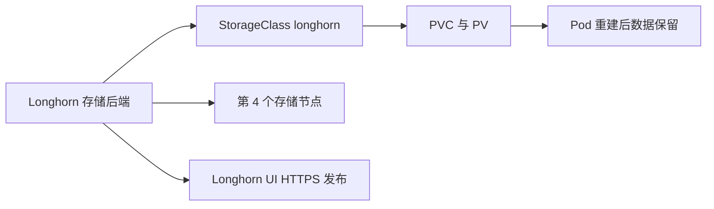

# 第 9 步：第四章最终验收

## 本步目标

只读验收第四章，确认这条主线已经闭环：

- `Longhorn` 正常
- `StorageClass` 正常
- `PVC` 动态供给正常
- Pod 重建后数据仍保留
- 第 4 个 Longhorn 节点已加入
- `Longhorn UI` 已能通过 `HTTPS` 域名访问

## 执行标记

- **执行标记：只读验证**

说明：

- 本页的目标不是重新执行第四章每一步
- 而是确认第四章是否已经达到标准结束状态

## 理论说明

### 第四章闭环关系图



这张图说明：

- 第四章不是只“装了 Longhorn”
- 而是围绕同一条有状态主线完成：
  - 存储后端
  - 动态卷
  - 数据保留
  - 存储扩容
  - GUI 发布

## 验收顺序

请按下面顺序检查：

1. Kubernetes 节点
2. Longhorn 组件
3. Longhorn 节点与磁盘
4. `StorageClass / PVC / PV`
5. Longhorn 卷
6. 有状态数据
7. Longhorn UI HTTPS 访问

## 对应脚本

本步对应脚本：

- `k8s/04-storage-and-stateful/scripts/06_verify_storage.sh`

## 执行命令

```bash
chmod +x /docker_k8s_2026/k8s/04-storage-and-stateful/scripts/06_verify_storage.sh
```

```bash
bash /docker_k8s_2026/k8s/04-storage-and-stateful/scripts/06_verify_storage.sh
```

## 验证方法

### 验证 1：Kubernetes 节点

```bash
kubectl get nodes -o wide
```

预期结果：

- 所有节点为 `Ready`

### 验证 2：Longhorn 组件

```bash
kubectl -n longhorn-system get pods -o wide
```

预期结果：

- `longhorn-manager` 正常
- `longhorn-driver-deployer` 正常
- `longhorn-ui` 正常
- CSI 相关组件正常

### 验证 3：Longhorn 节点与磁盘

```bash
kubectl -n longhorn-system get nodes.longhorn.io
```

预期结果：

- 能看到 4 个 Longhorn 节点
- `wk-edge01` 已被纳入

### 验证 4：StorageClass、PVC、PV

```bash
kubectl get sc
kubectl -n stateful-demo get pvc
kubectl get pv
```

预期结果：

- 存在 `longhorn` `StorageClass`
- `demo-pvc` 为 `Bound`
- 存在与之对应的 `PV`

### 验证 5：Longhorn 卷

```bash
kubectl -n longhorn-system get volumes.longhorn.io
```

预期结果：

- 能看到由 `demo-pvc` 触发创建的 Longhorn 卷

### 验证 6：有状态数据

```bash
kubectl -n stateful-demo exec deploy/volume-demo -- sh -c 'cat /data/hello.txt'
```

预期结果：

- 仍能读到之前写入的测试内容

### 验证 7：Longhorn UI HTTPS 访问

```bash
curl -I --resolve longhorn.qytk8s.com:443:10.1.1.60 --cacert /docker_k8s_2026/k8s/01-k8s-architecture/pki/harbor/harbor-ca.crt https://longhorn.qytk8s.com/
```

预期结果：

- 返回 `200 OK`
- 已能通过 `HTTPS` 正常访问 Longhorn UI

## 通过标准

满足下面条件后，第四章即可视为完成：

- Longhorn 已成功安装
- 首批 3 节点 Longhorn 存储池已可用
- `PVC` 动态供给已成功
- Pod 删除重建后数据仍保留
- 第 4 个 Longhorn 节点已成功加入
- `longhorn.qytk8s.com` 已能从 `win2019` 通过 `HTTPS` 打开
