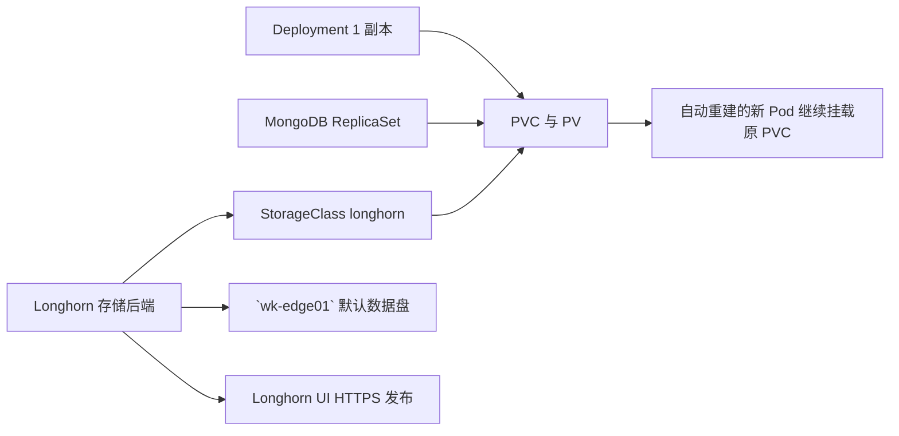

# 第 9 步：第四章最终验收

## 本步目标

只读验收第四章，确认这条主线已经闭环：

- `Longhorn` 正常
- `StorageClass` 正常
- `PVC` 动态供给正常
- 当前 Pod 被删除后，Deployment 自动拉起新 Pod，并继续挂载原来的 PVC
- `MongoDB ReplicaSet` StatefulSet 案例正常
- `wk-edge01` 默认数据盘已完成初始化
- `Longhorn UI` 已能通过 `HTTPS` 域名访问

---

## 执行标记

- **执行标记：只读验证**

说明：

- 本页的目标不是重新执行第四章每一步
- 而是确认第四章是否已经达到标准结束状态

---

## 理论说明

### 第四章闭环关系图



这张图说明：

- 第四章不是只“装了 Longhorn”
- 而是围绕同一条有状态主线完成：
  - 存储后端
  - 动态卷
  - 数据保留
  - 存储扩容
  - GUI 发布

---

## 验收顺序

请按下面顺序检查：

1. Kubernetes 节点
2. Longhorn 组件
3. Longhorn 节点与磁盘
4. `StorageClass / PVC / PV`
5. Longhorn 卷
6. Deployment 有状态数据
7. MongoDB ReplicaSet StatefulSet 案例
8. Longhorn UI HTTPS 访问

---

## 对应脚本

本步对应脚本：

- `k8s/04-storage-and-stateful/scripts/06_verify_storage.sh`

---

## 执行命令

<div style="padding: 10px 14px; border: 1px solid #666; border-left: 4px solid #8ab4f8; border-radius: 6px; background: rgba(138,180,248,0.08); margin: 8px 0;">
<strong>ℹ️ 可选预处理命令</strong><br/>
如果脚本已具备执行权限，这一步可以跳过。
</div>

```bash
chmod +x /docker_k8s_2026/k8s/04-storage-and-stateful/scripts/06_verify_storage.sh
```

<div style="padding: 12px 14px; border: 1px solid #666; border-left: 6px solid #ea4335; border-radius: 6px; background: rgba(234,67,53,0.10); margin: 8px 0;">
<strong>❗ 本步必须粘贴执行</strong><br/>
下面命令是本步主线必跑命令。
</div>

```bash
bash /docker_k8s_2026/k8s/04-storage-and-stateful/scripts/06_verify_storage.sh
```

---

## 验证方法

### 验证 1：Kubernetes 节点

<div style="padding: 12px 14px; border: 1px solid #666; border-left: 6px solid #ea4335; border-radius: 6px; background: rgba(234,67,53,0.10); margin: 8px 0;">
<strong>❗ 本步必须粘贴执行</strong><br/>
下面命令是最终验收必跑命令，用于检查节点状态。
</div>

```bash
kubectl get nodes -o wide
```

预期结果：

- 所有节点为 `Ready`

### 验证 2：Longhorn 组件

<div style="padding: 12px 14px; border: 1px solid #666; border-left: 6px solid #ea4335; border-radius: 6px; background: rgba(234,67,53,0.10); margin: 8px 0;">
<strong>❗ 本步必须粘贴执行</strong><br/>
下面命令是最终验收必跑命令，用于检查 Longhorn 组件。
</div>

```bash
kubectl -n longhorn-system get pods -o wide
```

预期结果：

- `longhorn-manager` 正常
- `longhorn-driver-deployer` 正常
- `longhorn-ui` 正常
- CSI 相关组件正常

### 验证 3：Longhorn 节点与磁盘

<div style="padding: 12px 14px; border: 1px solid #666; border-left: 6px solid #ea4335; border-radius: 6px; background: rgba(234,67,53,0.10); margin: 8px 0;">
<strong>❗ 本步必须粘贴执行</strong><br/>
下面命令是最终验收必跑命令，用于检查 Longhorn 节点与数据盘。
</div>

```bash
kubectl -n longhorn-system get nodes.longhorn.io
kubectl -n longhorn-system get nodes.longhorn.io wk-edge01 -o yaml
```

预期结果：

- 能看到 4 个 Longhorn 节点
- `wk-edge01` 已完成默认数据盘初始化
- `wk-edge01` 的 YAML 输出中能看到 `/var/lib/longhorn` 对应的数据盘信息

### 验证 4：StorageClass、PVC、PV

<div style="padding: 12px 14px; border: 1px solid #666; border-left: 6px solid #ea4335; border-radius: 6px; background: rgba(234,67,53,0.10); margin: 8px 0;">
<strong>❗ 本步必须粘贴执行</strong><br/>
下面命令是最终验收必跑命令，用于检查 StorageClass、PVC 与 PV。
</div>

```bash
kubectl get sc
kubectl -n qytang-stateful-demo get pvc
kubectl get pv
```

预期结果：

- 存在 `longhorn` `StorageClass`
- `qytang-pvc-demo` 为 `Bound`
- 存在与之对应的 `PV`

### 验证 5：Longhorn 卷

<div style="padding: 12px 14px; border: 1px solid #666; border-left: 6px solid #ea4335; border-radius: 6px; background: rgba(234,67,53,0.10); margin: 8px 0;">
<strong>❗ 本步必须粘贴执行</strong><br/>
下面命令是最终验收必跑命令，用于检查 Longhorn 卷对象。
</div>

```bash
kubectl -n longhorn-system get volumes.longhorn.io
```

预期结果：

- 能看到由 `qytang-pvc-demo` 触发创建的 Longhorn 卷

### 验证 6：Deployment 有状态数据

<div style="padding: 12px 14px; border: 1px solid #666; border-left: 6px solid #ea4335; border-radius: 6px; background: rgba(234,67,53,0.10); margin: 8px 0;">
<strong>❗ 本步必须粘贴执行</strong><br/>
下面命令是最终验收必跑命令，用于检查 Deployment 演示数据。
</div>

```bash
kubectl -n qytang-stateful-demo exec deploy/qytang-deployment-volume-demo -- sh -c 'cat /data/hello.txt'
```

预期结果：

- 仍能读到之前写入的测试内容

### 验证 7：MongoDB ReplicaSet StatefulSet 案例

先取出 root 密码，并查看基础对象：

<div style="padding: 12px 14px; border: 1px solid #666; border-left: 6px solid #ea4335; border-radius: 6px; background: rgba(234,67,53,0.10); margin: 8px 0;">
<strong>❗ 本步必须粘贴执行</strong><br/>
下面命令是最终验收必跑命令，用于检查 MongoDB 基础对象。
</div>

```bash
MONGO_ROOT_PASSWORD=$(kubectl -n qytang-mongodb-demo get secret qytang-statefulset-mongodb-demo -o jsonpath='{.data.mongodb-root-password}' | base64 -d)
kubectl -n qytang-mongodb-demo get pods
kubectl -n qytang-mongodb-demo get pvc
kubectl -n qytang-mongodb-demo get svc
```

这组命令的作用是：

- 先准备后面要复用的 `MONGO_ROOT_PASSWORD`
- 再确认固定编号的 Pod、独立 PVC、Headless Service 都还在

再检查副本集状态：

<div style="padding: 12px 14px; border: 1px solid #666; border-left: 6px solid #ea4335; border-radius: 6px; background: rgba(234,67,53,0.10); margin: 8px 0;">
<strong>❗ 本步必须粘贴执行</strong><br/>
下面命令是最终验收必跑命令，用于检查副本集状态。
</div>

```bash
kubectl -n qytang-mongodb-demo exec pod/qytang-statefulset-mongodb-demo-0 -- \
  mongosh admin -u root -p "${MONGO_ROOT_PASSWORD}" --quiet \
  --eval 'rs.status().members.map(function(m){return {name:m.name,stateStr:m.stateStr}})'
```

这条命令的作用是：

- 查看当前 MongoDB 副本集是否仍然健康
- 重点看是否仍然是 3 个成员

最后检查测试数据：

<div style="padding: 12px 14px; border: 1px solid #666; border-left: 6px solid #ea4335; border-radius: 6px; background: rgba(234,67,53,0.10); margin: 8px 0;">
<strong>❗ 本步必须粘贴执行</strong><br/>
下面命令是最终验收必跑命令，用于检查 MongoDB 测试数据。
</div>

```bash
kubectl -n qytang-mongodb-demo exec pod/qytang-statefulset-mongodb-demo-0 -- \
  mongosh admin -u root -p "${MONGO_ROOT_PASSWORD}" --quiet \
  --eval 'db.getSiblingDB("qytang").demo.find({_id:"statefulset-ok"}).toArray()'
```

预期结果：

- 能看到 `-0`、`-1`、`-2` 这 3 个固定命名的 MongoDB Pod
- 能看到和它们对应的独立 PVC
- 能看到 `qytang-statefulset-mongodb-demo-headless`
- 副本集状态里应能看到 3 个成员
- `qytang.demo` 集合里仍能读到 `_id=statefulset-ok` 这条测试数据

### 验证 8：Longhorn UI HTTPS 访问

先确认 `Gateway` listener 结构已经正确：

<div style="padding: 12px 14px; border: 1px solid #666; border-left: 6px solid #ea4335; border-radius: 6px; background: rgba(234,67,53,0.10); margin: 8px 0;">
<strong>❗ 本步必须粘贴执行</strong><br/>
下面命令是最终验收必跑命令，用于检查 Gateway listener。
</div>

```bash
kubectl -n gateway-demo get gateway app-gateway -o yaml
```

预期结果：

- `listeners` 中应同时存在：
  - `http`
  - `https`
  - `longhorn-http`
  - `longhorn-https`
- 其中：
  - `http/https` 对应 `app.qytk8s.com`
  - `longhorn-http/longhorn-https` 对应 `longhorn.qytk8s.com`

再验证 Longhorn UI 的 HTTPS 入口：

<div style="padding: 12px 14px; border: 1px solid #666; border-left: 6px solid #ea4335; border-radius: 6px; background: rgba(234,67,53,0.10); margin: 8px 0;">
<strong>❗ 本步必须粘贴执行</strong><br/>
下面命令是最终验收必跑命令，用于验证 Longhorn UI HTTPS 访问。
</div>

```bash
curl -I --resolve longhorn.qytk8s.com:443:10.1.1.60 --cacert /docker_k8s_2026/k8s/01-k8s-architecture/pki/harbor/harbor-ca.crt https://longhorn.qytk8s.com/
```

预期结果：

- 返回 `200 OK`
- 已能通过 `HTTPS` 正常访问 Longhorn UI

---

## 通过标准

满足下面条件后，第四章即可视为完成：

- Longhorn 已成功安装
- 首批 3 节点 Longhorn 存储池已可用
- `PVC` 动态供给已成功
- 当前 Pod 被删除后，Deployment 自动拉起新 Pod，并继续挂载原来的 PVC
- 已完成一个真实的 `MongoDB ReplicaSet` StatefulSet 案例
- `wk-edge01` 已完成默认数据盘初始化并进入 Longhorn 存储池
- `longhorn.qytk8s.com` 已能从 `win2019` 通过 `HTTPS` 打开
