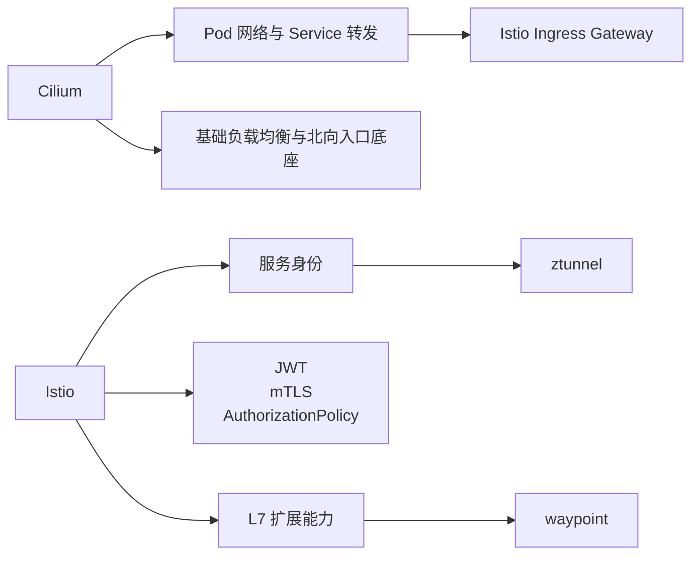
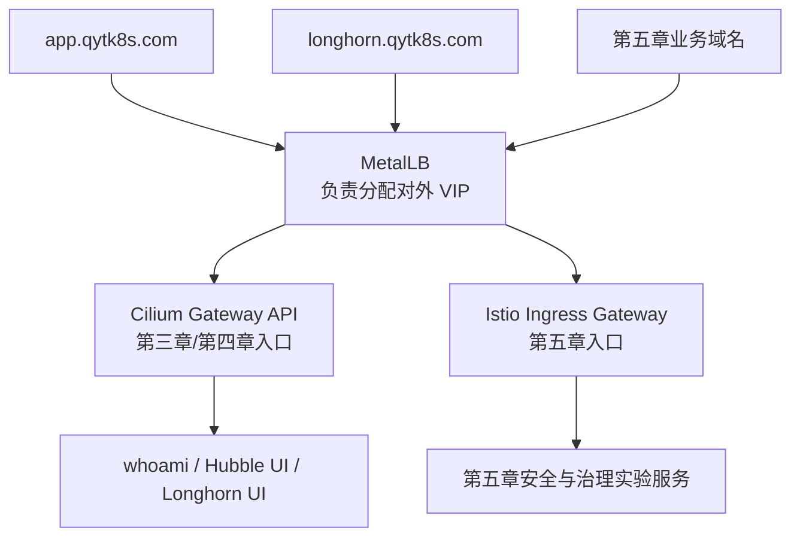
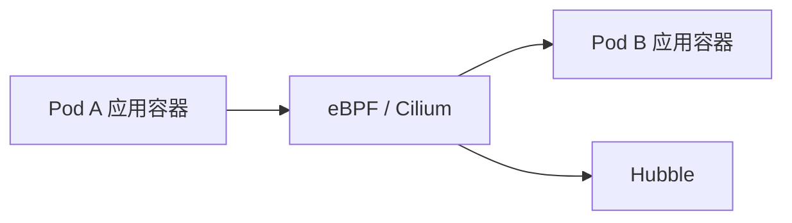
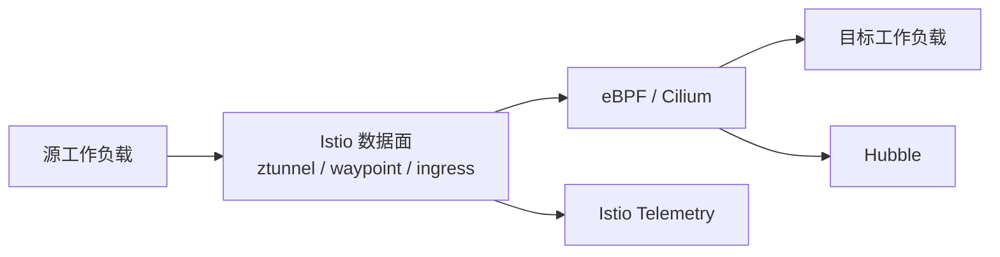
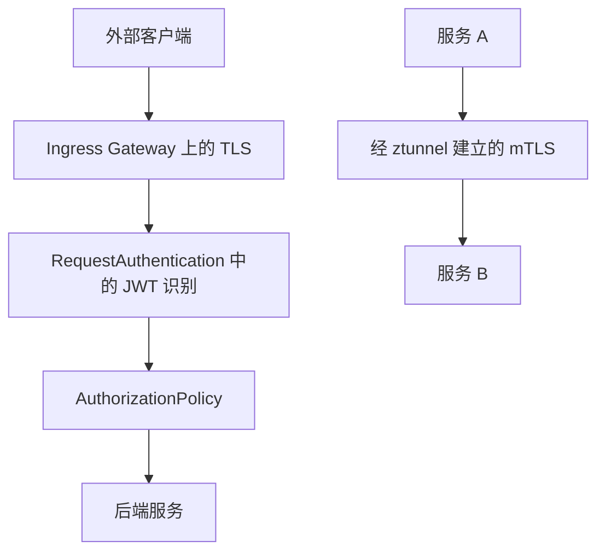
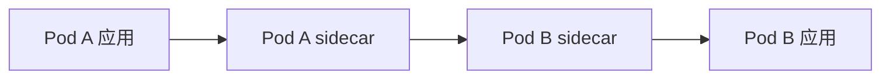
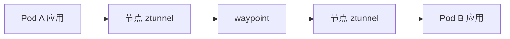
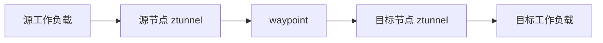

# Istio 安全与零信任理论导读

## 本步目标

在动手之前，先把第五章最容易混淆的概念讲清楚，避免“入口、网格、认证、授权”全部堆在一起。

## 第五章为什么要新增 Istio 入口

第三章已经完成了：

- `Cilium Gateway API`
- `MetalLB VIP`
- `HTTPS`
- 域名北向发布

这些能力已经足够说明“服务如何发布出去”。

第五章的目标不再是“发布”，而是补齐：

- 身份认证
- 服务间 `mTLS`
- L4/L7 授权
- 服务间零信任
- 故障演练

如果继续把这一章全部压在第三章的 `Cilium Gateway API` 上，教学主线会分散；因此第五章单独新增 `Istio Ingress Gateway`，专门承载安全与零信任能力。

## Cilium 和 Istio 的边界

这一章最重要的边界是：

- `Cilium` 继续负责网络底座、转发、底层策略和数据平面
- `Istio` 负责服务身份、安全、治理和 L7 能力

可以把它理解成：

- **第二章**：先把路修好
- **第三章**：先把门开出来
- **第五章**：再给门口加门禁、给楼内加安保、给车流加调度规则

### 边界关系图

这张图要表达的核心是：

- `Cilium` 没有被替换，仍然负责网络底座
- `Istio` 在这个底座之上补“身份、安全、治理”
- 第五章不是重做第三章，而是在第三章之上加能力

## `MetalLB`、`Cilium Gateway API`、`Istio Ingress Gateway` 的关系

第五章还有一个很容易混淆的问题：

- 第三章已经用了 `MetalLB + Gateway API`
- 第五章又要引入 `Istio Ingress Gateway`
- 那是不是等于“又来了一套入口”

答案是：

- 可以同时存在
- 但它们并不是互相替代 `MetalLB`

在这门课的裸机环境里，`MetalLB` 的角色始终比较稳定：

- 它负责给入口对象分配对外 VIP

而真正负责接住这个 VIP、再做七层转发的，可以是：

- 第三章的 `Cilium Gateway API`
- 第五章的 `Istio Ingress Gateway`

### 整体关系图

这张图要表达的核心是：

- `MetalLB` 负责“把外部 VIP 发出来”
- `Cilium Gateway API` 和 `Istio Ingress Gateway` 负责“拿到 VIP 后怎么接流量、怎么转发”
- 因此在同一个集群里，完全可以同时存在两套入口承载方式

### 应该怎么理解“是不是两套入口方案”

可以近似理解成：

- 对，是两套不同的入口方案并存

但更准确地说：

- `MetalLB`
  - 是裸机环境里的 VIP 提供者
- `Cilium Gateway API`
  - 是第三章、第四章主要使用的入口实现
- `Istio Ingress Gateway`
  - 是第五章为了讲安全、身份和治理而引入的入口实现

所以第五章不是推翻第三章，而是：

- 保留第三章已经跑通的裸机 VIP 能力
- 在这个基础上，再引入一套更适合讲安全与治理的入口承载者

一句话总结：

- `MetalLB` 负责“给入口一个对外地址”
- `Gateway API` 或 `Istio Ingress Gateway` 负责“拿到这个地址后怎么处理流量”

## 引入 Istio 之后，eBPF 和 Hubble 还能不能看流量

可以，但要分清它们看的不是同一层问题。

- `Cilium / eBPF / Hubble`
  - 更偏“流量实际上怎么走”
- `Istio`
  - 更偏“流量按什么规则被治理”

### 没有 Istio 时

这张图要表达的核心是：

- 应用直接和应用通信
- `eBPF/Cilium` 在内核侧看到这条流量
- `Hubble` 把它展示出来

### 有 Istio 时

这张图要表达的核心是：

- 流量不是“不见了”
- 而是路径中多了一层 `Istio` 数据面
- `eBPF/Cilium` 仍然能看到实际经过网络栈的流量
- `Hubble` 仍然能展示这些连接与通信事实
- 但 `Istio` 自己还会额外提供一套更偏身份、安全、治理、L7 遥测的视角

### 该怎么区分两者

| 维度 | `Cilium / eBPF / Hubble` | `Istio` |
| :--- | :--- | :--- |
| 主要位置 | 内核网络层 | 服务网格数据面 |
| 更擅长回答 | 流量到底有没有走、从哪到哪 | 流量按什么规则被治理 |
| 典型能力 | 包、连接、DNS、部分 L7 观测 | `mTLS`、认证、授权 |
| 引入 Istio 后 Hubble 是否还能看 | 能 | 不冲突 |
| 是否互相替代 | 不能 | 也不能 |

一句话总结：

- `Hubble` 负责看“流量事实”
- `Istio` 负责看“治理规则”

所以第五章引入 `Istio` 之后，不是 `eBPF/Hubble` 失效了，而是观测视角从“纯应用直连”变成了“应用与网格数据面共同参与的数据路径”。

## 四层安全模型

| 层次 | 关注点 | 本章落点 |
| :--- | :--- | :--- |
| 平台层 | 节点、Kubernetes、RBAC、控制平面 | 不展开 |
| 网络层 | 谁能和谁通信 | `Cilium` + `Ambient` 基础准入 |
| 传输层 | 流量是否加密、如何识别对端 | `TLS` / `mTLS` / `SPIFFE` |
| 应用层 | 谁能访问什么路径、什么方法 | `JWT` / `AuthorizationPolicy` |

## TLS、mTLS、JWT 各自解决什么

| 概念 | 作用 | 本章中的位置 |
| :--- | :--- | :--- |
| `TLS` | 客户端到入口的加密和服务端身份校验 | `Istio Ingress Gateway` |
| `mTLS` | 服务间双向认证与链路加密 | `ztunnel` |
| `JWT` | 表示“调用者是谁” | 入口认证与授权依据 |

要特别强调：

- `TLS` 解决“我连的是不是你”
- `mTLS` 解决“服务之间是否相互可信”
- `JWT` 解决“发请求的主体是谁”

### 认证与加密分工图

这张图要强调的是：

- `TLS` 是客户端到入口
- `JWT` 是入口识别“调用者是谁”
- `mTLS` 是服务到服务
- 这三者不是互斥关系，而是分布在不同链路位置

## Ambient 模式为什么适合这门课

先把版本边界说清楚，避免把 `Ambient` 讲成“很早就稳定可用”的能力。

### 版本演进

| Istio 版本 | Ambient 状态 | 适合怎么理解 |
| :--- | :--- | :--- |
| `1.18` | `Alpha` | 可以了解概念，但不适合作为稳定教学主线 |
| `1.22` | `Beta` | 能用于实验与验证，但仍处于快速演进阶段 |
| `1.24` 起 | `GA` | 可以作为正式课程主线来讲 |

第五章选择 `Ambient`，前提不是“它新”，而是：

- 到较新的 `Istio` 版本里，它已经进入正式可用阶段
- 可以用它来讲 `mTLS`、L4 身份、安全边界和 `waypoint` 的 L7 能力

### Sidecar 与 Ambient 适合讲什么

| 对比项 | Sidecar 模式 | Ambient 模式 |
| :--- | :--- | :--- |
| 数据面形态 | 每个 Pod 注入代理 | 节点级 `ztunnel`，按需引入 `waypoint` |
| 课堂观察成本 | 要同时解释应用容器和 sidecar 生命周期 | 先看工作负载本身，再看 `ztunnel/waypoint` 分工 |
| Pod 形态变化 | 注入后 Pod 结构会变复杂 | 应用 Pod 本身保持更直观 |
| 最适合先讲什么 | 完整服务网格历史模型 | 零信任主线、L4 到 L7 的分层模型 |
| 本章采用原因 | 成熟，但讲解负担更重 | 更容易先讲清“基础安全通道”和“按需 L7” |

### 两种数据面长什么样

#### Sidecar 模式

这张图要表达的核心是：

- 每个业务 Pod 旁边都带一个代理
- 流量先进入本地 sidecar，再到对端 sidecar，再进入对端应用

#### Ambient 模式

这张图要表达的核心是：

- 业务 Pod 本身不注入 sidecar
- 基础安全通道由节点级 `ztunnel` 提供
- 需要 `L7` 处理时，再额外经过 `waypoint`

这里一定要和传统 `sidecar` 模式区分开：

- `sidecar`
  - `1 Pod 1 proxy`
- `Ambient ztunnel`
  - `1 Node 1 proxy`

这正是 `Ambient` 一个很重要的特征：

- 传统 `Istio` 是“每个业务 Pod 自带代理”
- `Ambient` 是“每个节点先铺一个基础代理，再为整个节点上的工作负载提供基础安全通道”

这一章选择 `Ambient`，真正的优势不是“更新”，而是这三点：

- 工作负载本身更干净，学员更容易先看清业务对象
- `ztunnel` 和 `waypoint` 分层明显，更容易讲清 `L4` 与 `L7` 的边界
- 更适合把第五章主线收成：
  - 先建立服务间可信通道
  - 再逐步叠加认证和授权

## ztunnel 和 waypoint 各自负责什么

| 组件 | 主要职责 | 本章中的演示重点 |
| :--- | :--- | :--- |
| `ztunnel` | `mTLS`、L4 身份、L4 授权 | `PeerAuthentication`、基础零信任 |
| `waypoint` | L7 授权、HTTP 级策略 | `AuthorizationPolicy` |

所以第五章要强调：

- 不是一装 `Ambient` 就自动拥有全部 L7 能力
- 真正的 L7 策略和治理，要通过 `waypoint` 来体现

### Ambient 数据面关系图

- 只看 `ztunnel`，可以把它理解成 Ambient 的基础 L4 安全通道
- 需要 HTTP 级授权时，流量会在这条基础通道上额外经过 `waypoint`
- `waypoint` 不是绕开 `ztunnel`，而是插入到这条安全数据路径中的 L7 处理点
- 所以 `Ambient` 是“分层数据面”，不是“单一代理做完全部事情”

## 第五章的主线顺序

本章的推荐讲解顺序是：

1. 新入口与新域名
2. `JWT`
3. `mTLS`
4. 服务间授权
5. 最终验收

这个顺序的核心逻辑是：

- 先讲“谁能进门”
- 再讲“进门后谁能访问谁”
- 最后讲“即使能访问，也要如何稳定、可控地转发”

## 下一步

进入第 1 步，准备第五章所需制品：

- `docs/02_prepare_istio_artifacts.md`
