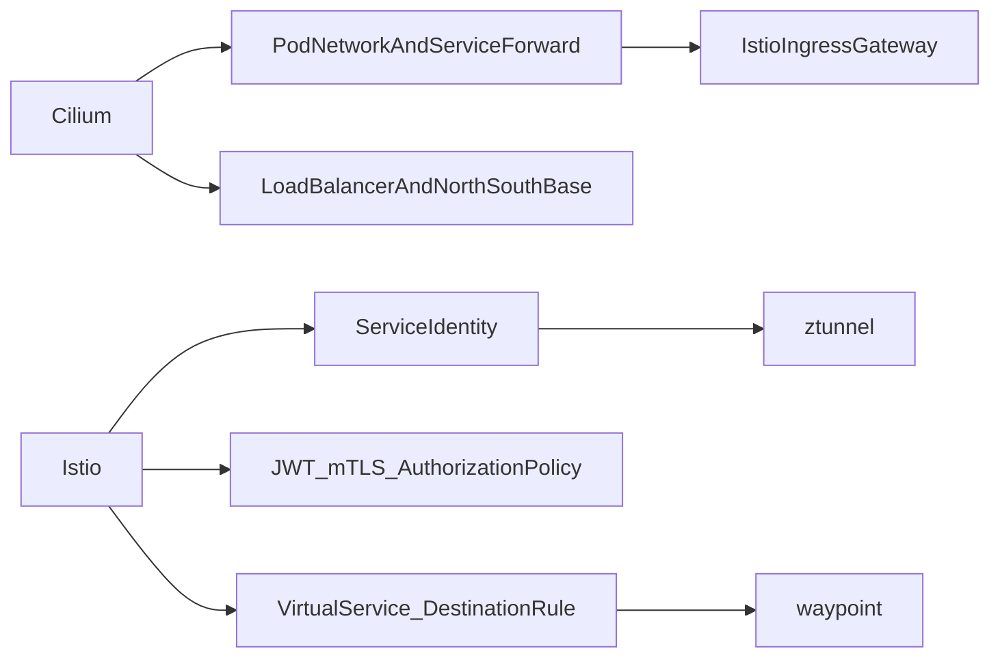
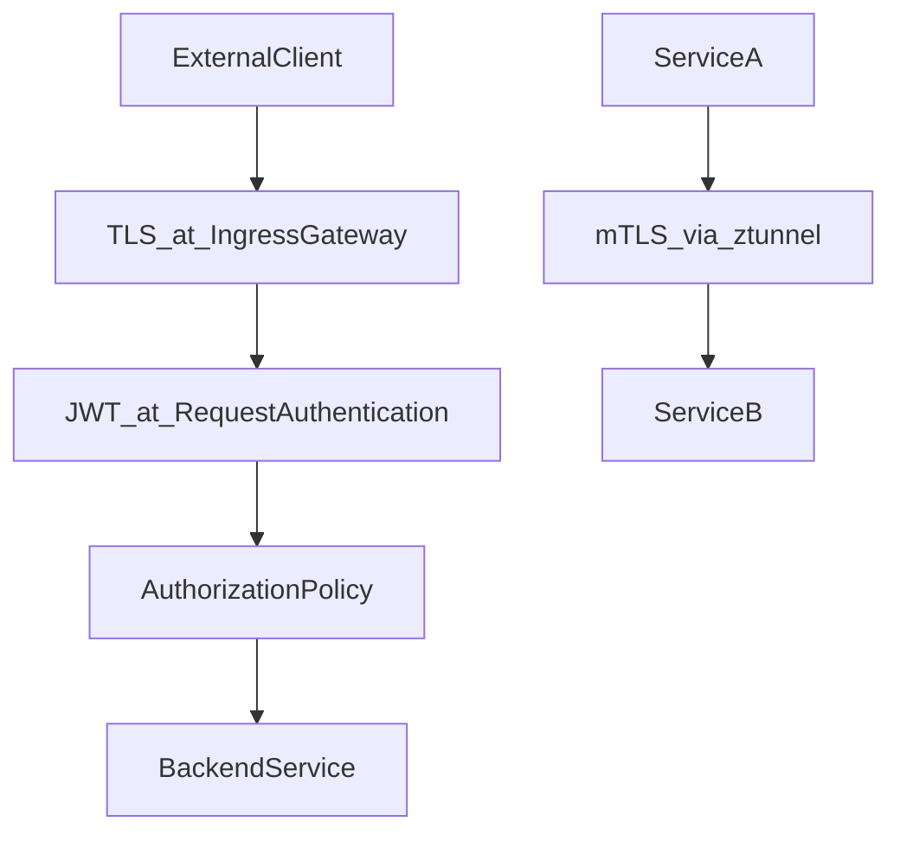
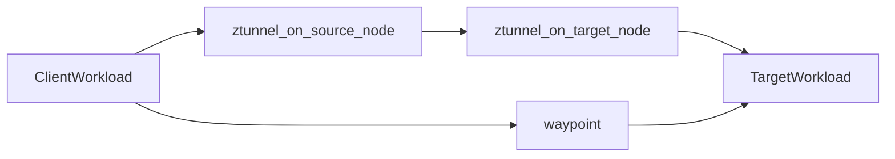

# Istio 安全、零信任与流量治理理论导读

## 本步目标

在动手之前，先把第五章最容易混淆的概念讲清楚，避免“入口、网格、认证、授权、路由、流量治理”全部堆在一起。

## 第五章为什么要新增 Istio 入口

第三章已经完成了：

- `Cilium Gateway API`
- `MetalLB VIP`
- `HTTPS`
- 域名北向发布

这些能力已经足够说明“服务如何发布出去”。

第五章的目标不再是“发布”，而是补齐：

- 身份认证
- 服务间 `mTLS`
- L4/L7 授权
- 流量治理
- 故障演练

如果继续把这一章全部压在第三章的 `Cilium Gateway API` 上，教学主线会分散；因此第五章单独新增 `Istio Ingress Gateway`，专门承载高级安全与治理能力。

## Cilium 和 Istio 的边界

这一章最重要的边界是：

- `Cilium` 继续负责网络底座、转发、底层策略和数据平面
- `Istio` 负责服务身份、安全、治理和 L7 能力

可以把它理解成：

- **第二章**：先把路修好
- **第三章**：先把门开出来
- **第五章**：再给门口加门禁、给楼内加安保、给车流加调度规则

### 边界关系图

这张图建议你这样讲：

- `Cilium` 不是被替换，而是继续做网络底座
- `Istio` 是在这个底座之上补“身份、安全、治理”
- 所以第五章不是重做第三章，而是在第三章之上加能力

## 四层安全模型

| 层次 | 关注点 | 本章落点 |
| :--- | :--- | :--- |
| 平台层 | 节点、Kubernetes、RBAC、控制平面 | 不展开 |
| 网络层 | 谁能和谁通信 | `Cilium` + `Ambient` 基础准入 |
| 传输层 | 流量是否加密、如何识别对端 | `TLS` / `mTLS` / `SPIFFE` |
| 应用层 | 谁能访问什么路径、什么方法 | `JWT` / `AuthorizationPolicy` |

## TLS、mTLS、JWT 各自解决什么

| 概念 | 作用 | 本章中的位置 |
| :--- | :--- | :--- |
| `TLS` | 客户端到入口的加密和服务端身份校验 | `Istio Ingress Gateway` |
| `mTLS` | 服务间双向认证与链路加密 | `ztunnel` |
| `JWT` | 表示“调用者是谁” | 入口认证与授权依据 |

要特别强调：

- `TLS` 解决“我连的是不是你”
- `mTLS` 解决“服务之间是否相互可信”
- `JWT` 解决“发请求的主体是谁”

### 认证与加密分工图

这张图要强调的是：

- `TLS` 是客户端到入口
- `JWT` 是入口识别“调用者是谁”
- `mTLS` 是服务到服务
- 这三者不是互斥关系，而是分布在不同链路位置

## Ambient 模式为什么适合这门课

传统 `Istio` 采用 sidecar 注入模型，优点是成熟，但课堂里会带来：

- Pod 数量明显变多
- 调度和资源开销变大
- 解释 sidecar 生命周期需要更多篇幅

`Ambient` 的好处是：

- 不注入 sidecar
- 每个节点由 `ztunnel` 提供 L4 安全能力
- 需要 L7 策略时，再通过 `waypoint` 处理

这样既能体现现代 `Istio` 的新架构，也更适合课程环境。

## ztunnel 和 waypoint 各自负责什么

| 组件 | 主要职责 | 本章中的演示重点 |
| :--- | :--- | :--- |
| `ztunnel` | `mTLS`、L4 身份、L4 授权 | `PeerAuthentication`、基础零信任 |
| `waypoint` | L7 授权、流量治理、HTTP 级策略 | `AuthorizationPolicy`、权重、超时、重试 |

所以第五章要强调：

- 不是一装 `Ambient` 就自动拥有全部 L7 能力
- 真正的 L7 策略和治理，要通过 `waypoint` 来体现

### Ambient 数据面关系图

推荐讲法：

- 只看 `ztunnel`，你可以把它理解成 Ambient 的 L4 安全通道
- 需要 HTTP 级授权、灰度、超时、重试时，就要把流量交给 `waypoint`
- 所以 `Ambient` 是“分层数据面”，不是“单一代理做完全部事情”

## 为什么还要保留手动测试脚本

这门课不是单纯运维交付，而是课堂教学。

因此每个关键概念都要分成两段：

1. **自动化脚本先把环境铺好**
2. **再用短小的手动测试脚本展示现象**

例如：

- 讲 `JWT` 时，现场分别测试“无 token / 错 token / 对 token”
- 讲 `mTLS` 时，测试“可信 client 能访问、不可信 client 被拒绝”
- 讲权重路由时，现场连续请求观察 `v1/v2` 分布
- 讲故障注入时，现场观察延迟和 `503`

这样理论和现象才能真正对上。

## 第五章的主线顺序

本章的推荐讲解顺序是：

1. 新入口与新域名
2. `JWT`
3. `mTLS`
4. 服务间授权
5. 权重路由和灰度
6. 超时、重试
7. 故障注入

这个顺序的核心逻辑是：

- 先讲“谁能进门”
- 再讲“进门后谁能访问谁”
- 最后讲“即使能访问，也要如何稳定、可控地转发”

## 下一步

进入第 1 步，准备第五章所需制品：

- `docs/02_prepare_istio_artifacts.md`
