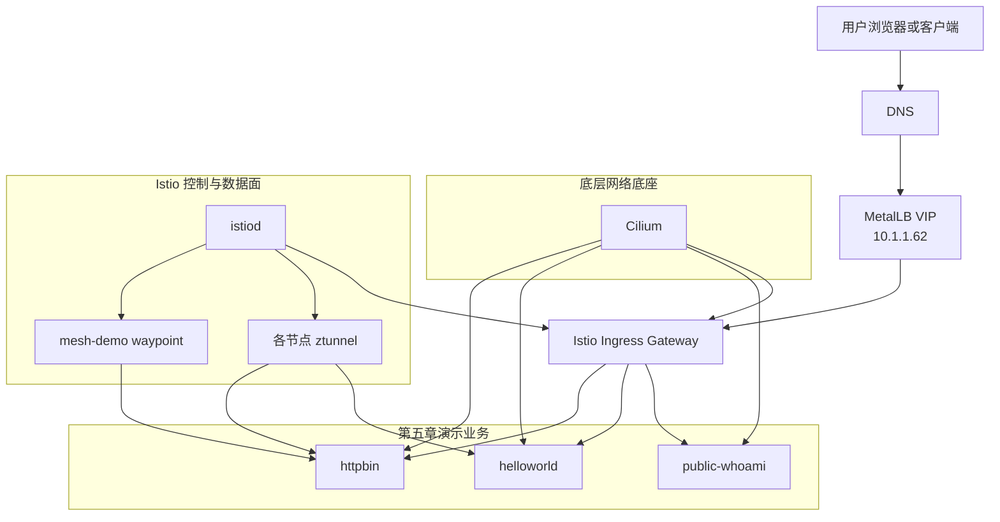

# 第五章总览：Istio 安全、零信任与流量治理

## 本章目标

第五章的目标，是把前 4 章已经具备网络、入口、HTTPS 和存储能力的集群，推进到 **具备 Istio 安全能力和流量治理能力** 的状态。

本章结束后，应达到下面状态：

- 保留第三章 `Cilium Gateway API` 作为基础发布入口
- 新增 `Istio Ingress Gateway` 作为第五章增强入口
- `secure-app.qytk8s.com` 已具备 `HTTPS + JWT` 认证能力
- `Istio Ambient` 已启用，目标业务命名空间具备 `mTLS`
- `waypoint` 已部署完成，并可承载后续 L7 治理演示
- 已完成权重路由、灰度、超时、重试、故障注入等演示
- 每一个关键知识点都配有手动测试脚本，便于课堂边讲边测

## 课前理论导读

正式操作前，建议先阅读：

- `docs/00_security_theory.md`

它负责把本章最容易混淆的几个点讲清楚：

- `Cilium` 和 `Istio` 的边界
- `MetalLB`、`Cilium Gateway API` 与 `Istio Ingress Gateway` 的关系
- 引入 `Istio` 之后，`eBPF` 与 `Hubble` 还能看到什么
- 北向 `TLS`、`JWT` 与服务间 `mTLS` 的职责
- `Ambient`、`ztunnel`、`waypoint` 各自做什么
- `Sidecar` 与 `Ambient` 的差别，以及为什么本章选择 `Ambient`
- 为什么第五章要新增 `Istio Ingress Gateway`

## 本章重点边界

第五章只聚焦：

- `Istio Ingress Gateway`
- `JWT`
- `RequestAuthentication`
- `AuthorizationPolicy`
- `PeerAuthentication`
- `Ambient`
- `waypoint`
- `VirtualService`
- `DestinationRule`
- 超时、重试、灰度、故障注入

还不展开：

- 完整 `OIDC / Keycloak` 认证体系
- 多集群网格
- 外部授权服务
- 证书自动轮换
- 复杂审计与策略编排

这些内容放到后续增强实验。

## 本章与前章的关系

- **第二章**：`Cilium` 继续负责底层网络和数据平面，不被替换
- **第三章**：`app.qytk8s.com` 和 `longhorn.qytk8s.com` 保持原状，继续作为上一章成果保留
- **第五章**：新增 `secure-app.qytk8s.com` 和 `Istio Ingress Gateway`，专门承载安全与流量治理

## 第五章总关系图

先看这张总关系图，再进入每一步细节：

这张图只需要先抓住 5 个点：

- `MetalLB` 负责把 `10.1.1.62` 这个 VIP 发布出来
- `Cilium` 继续作为底层网络底座存在，但不是这一章的讲解重点
- `Istio Ingress Gateway` 是第五章新增的北向增强入口
- `istiod` 是控制面，负责把配置和策略下发出去
- `ztunnel` 管 L4，`waypoint` 管后续要讲的 L7 治理能力

### 第五章几个演示服务分别做什么

| 服务 | 主要用途 |
| :--- | :--- |
| `public-whoami` | 用来验证第五章新入口是否已经发布成功 |
| `helloworld` | 用来配合 `JWT`、`mTLS`、服务间访问控制等安全实验 |
| `httpbin` | 用来演示请求头、状态码、延迟、超时、重试、故障注入等流量治理能力 |

可以先把它们记成：

- `public-whoami`
  - 入口验证用
- `helloworld`
  - 安全机制演示用
- `httpbin`
  - 流量治理演示用

## 本章脚本执行矩阵

| 步骤 | 文档 | 脚本 | 执行标记 | 说明 |
| :--- | :--- | :--- | :--- | :--- |
| 0 | `00_security_theory.md` | 无 | 建议先读 | 先理清 `Istio` 安全与治理主线 |
| 1 | `02_prepare_istio_artifacts.md` | `scripts/01_prepare_istio_artifacts.sh` | 必须执行 | 预热 `istioctl`、离线包、镜像与演示材料 |
| 2 | `03_install_istio_ambient.md` | `scripts/02_install_istio_ambient.sh` | 必须执行 | 安装 `istiod`、`ztunnel` 与 Ambient 基础能力 |
| 3 | `04_publish_istio_ingress.md` | `scripts/03_publish_istio_ingress_demo.sh` | 必须执行 | 部署新入口、TLS、演示应用与基础路由 |
| 4 | `05_enable_jwt_and_mesh_security.md` | `scripts/04_enable_jwt_and_mesh_security.sh` | 必须执行 | 开启 `JWT`、`mTLS`、`AuthorizationPolicy` |
| 5 | `06_apply_traffic_management.md` | `scripts/05_apply_traffic_management.sh` | 必须执行 | 配置 `DestinationRule`、基线路由与治理参数 |
| 6 | `07_fault_injection_and_canary.md` | 无 | 建议演示 | 先讲高级场景，再切到手动测试 |
| 7 | `08_manual_tests.md` | `manual_tests/*.sh` | 课堂演示 | 按理论点逐个跑手测脚本 |
| 8 | `09_verify.md` | `scripts/07_verify_istio_security.sh` | 只读验收 | 第五章最终验收 |

## 本章执行顺序

请严格按下面顺序执行：

0. `00_security_theory.md`
1. `02_prepare_istio_artifacts.md`
2. `03_install_istio_ambient.md`
3. `04_publish_istio_ingress.md`
4. `05_enable_jwt_and_mesh_security.md`
5. `06_apply_traffic_management.md`
6. `07_fault_injection_and_canary.md`
7. `08_manual_tests.md`
8. `09_verify.md`

## 第五章起点状态

第五章开始前，默认你已经完成第四章，并满足下面条件：

- 所有节点均为 `Ready`
- 第四章最终验收已通过
- `MetalLB` 正常
- `Cilium` 正常
- `app.qytk8s.com`、`longhorn.qytk8s.com` 已可通过 `HTTPS` 访问
- `ops` 已具备 `kubectl`、`helm`
- `ops` 已提供 `http://ops:9000/`
- Harbor 仍然保留

## 版本冻结

- Kubernetes：`v1.33.9`
- Istio：`1.29.0`
- Cilium：保持第二章版本
- 新入口域名：`secure-app.qytk8s.com`
- 新入口 VIP：`10.1.1.62`
- 演示命名空间：`mesh-demo`

## 关键设计冻结

- 第三章的 `Cilium Gateway API` 不迁移、不替换，只保留
- 第五章新增 `Istio Ingress Gateway` 作为增强入口
- `JWT`、入口授权、灰度、故障注入都统一放在 `Istio` 体系内演示
- 服务间 `mTLS` 与服务身份授权都在 `mesh-demo` 命名空间中完成

## 下一步

先进入第 1 步，准备第五章所需制品：

- `docs/02_prepare_istio_artifacts.md`
