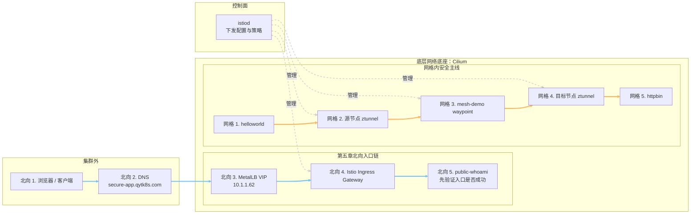

# 第五章总览：Istio 安全与零信任

## 本章目标

第五章的目标，是把前 4 章已经具备网络、入口、HTTPS 和存储能力的集群，推进到 **具备 Istio 安全能力和零信任能力** 的状态。

本章结束后，应达到下面状态：

- 保留第三章 `Cilium Gateway API` 作为基础发布入口
- 新增 `Istio Ingress Gateway` 作为第五章增强入口
- `secure-app.qytk8s.com` 已具备 `HTTPS + JWT` 认证能力
- `Istio Ambient` 已启用，目标业务命名空间具备 `mTLS`
- `waypoint` 已部署完成
- 已完成第五章主线安全验证

---

## 理论导读

先阅读 `docs/00_security_theory.md`。

这一页主要讲清：

- `Cilium` 和 `Istio` 的边界
- `MetalLB`、`Cilium Gateway API` 与 `Istio Ingress Gateway` 的关系
- 引入 `Istio` 之后，`eBPF` 与 `Hubble` 还能看到什么
- 北向 `TLS`、`JWT` 与服务间 `mTLS` 的职责
- `Ambient`、`ztunnel`、`waypoint` 各自做什么
- `Sidecar` 与 `Ambient` 的差别，以及为什么本章选择 `Ambient`
- 为什么第五章要新增 `Istio Ingress Gateway`

---

## 本章重点

- `Istio Ingress Gateway`
- `JWT`
- `RequestAuthentication`
- `AuthorizationPolicy`
- `PeerAuthentication`
- `Ambient`
- `waypoint`

---

## 本章与前章的关系

- **第二章**：`Cilium` 继续负责底层网络和数据平面，不被替换
- **第三章**：`app.qytk8s.com` 和 `longhorn.qytk8s.com` 保持原状，继续作为上一章成果保留
- **第五章**：新增 `secure-app.qytk8s.com` 和 `Istio Ingress Gateway`，专门承载安全与零信任

---

## 第五章总关系图

先看这张总关系图，再进入每一步细节：

这张图只需要先抓住 5 个点：

- 蓝色主线是第五章新增的北向入口链：`浏览器 -> DNS -> VIP -> Istio Ingress Gateway -> public-whoami`
- 橙色主线是网格内安全链：`helloworld -> ztunnel -> waypoint -> ztunnel -> httpbin`
- `MetalLB` 负责把 `10.1.1.62` 这个 VIP 发布出来
- `istiod` 是控制面，负责把配置和策略下发出去
- 外层背景框表示这些流量路径仍然运行在 `Cilium` 网络底座之上

### 第五章几个演示服务分别做什么

| 服务 | 主要用途 |
| :--- | :--- |
| `public-whoami` | 用来验证第五章新入口是否已经发布成功 |
| `helloworld` | 用来配合 `JWT`、`mTLS`、服务间访问控制等安全实验 |
| `httpbin` | 用来演示服务间访问控制，并作为后续扩展实验目标 |

---

## 本章小单元与对应脚本

| 步骤 | 文档 | 主要任务 | 对应脚本 | 执行标记 |
| :--- | :--- | :--- | :--- | :--- |
| 0 | `00_security_theory.md` | 先理清 `Istio` 安全与零信任主线 | 无 | 建议先读 |
| 1 | `02_prepare_istio_artifacts.md` | 预热 `istioctl`、离线包、镜像与演示材料 | `scripts/01_prepare_istio_artifacts.sh` | 必须执行 |
| 2 | `03_install_istio_ambient.md` | 安装 `istiod`、`ztunnel` 与 Ambient 基础能力 | `scripts/02_install_istio_ambient.sh` | 必须执行 |
| 3 | `04_publish_istio_ingress.md` | 部署新入口、TLS、演示应用与基础路由 | `scripts/03_publish_istio_ingress_demo.sh` | 必须执行 |
| 4 | `05_enable_jwt_and_mesh_security.md` | 开启 `JWT`、`mTLS`、`AuthorizationPolicy` | `scripts/04_enable_jwt_and_mesh_security.sh` | 必须执行 |
| 5 | `06_verify.md` | 完成第五章主线最终验收 | `scripts/07_verify_istio_security.sh` | 建议执行 |

---

## 本章执行顺序

按下面顺序执行：

0. `00_security_theory.md`
1. `02_prepare_istio_artifacts.md`
2. `03_install_istio_ambient.md`
3. `04_publish_istio_ingress.md`
4. `05_enable_jwt_and_mesh_security.md`
5. `06_verify.md`

---

## 版本冻结

- Kubernetes：`v1.33.9`
- Istio：`1.29.0`
- Cilium：保持第二章版本
- 新入口域名：`secure-app.qytk8s.com`
- 新入口 VIP：`10.1.1.62`
- 演示命名空间：`mesh-demo`

---

## 关键设计冻结

- 第三章的 `Cilium Gateway API` 不迁移、不替换，只保留
- 第五章新增 `Istio Ingress Gateway` 作为增强入口
- `JWT`、入口授权与服务间零信任都统一放在 `Istio` 体系内演示
- 服务间 `mTLS` 与服务身份授权都在 `mesh-demo` 命名空间中完成

---

## 下一步

先进入第 1 步：

- `docs/02_prepare_istio_artifacts.md`
