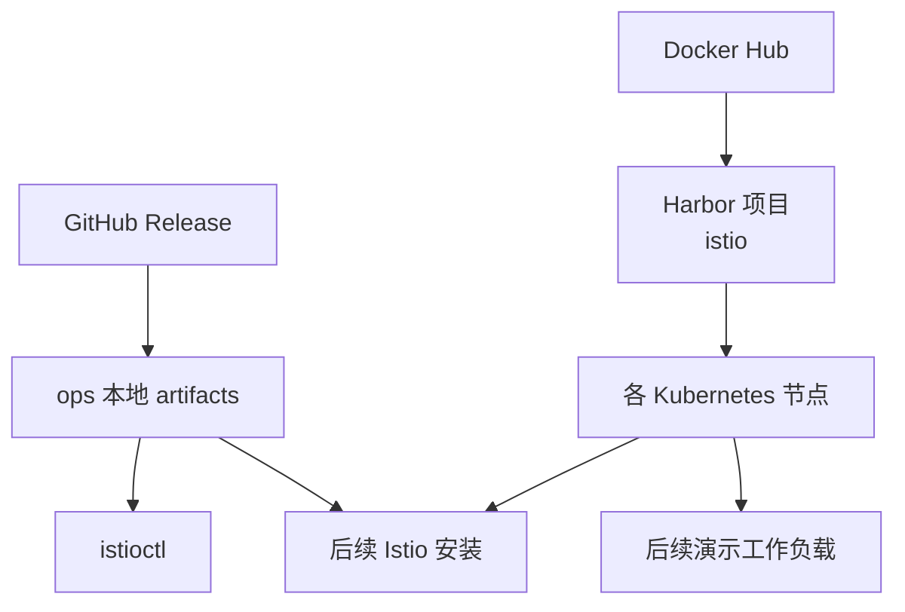

# 第 1 步：预热 Istio 制品与演示镜像

## 本步目标

在真正安装 `Istio` 之前，先把第五章所需制品准备好：

- `istioctl`
- `Istio 1.29.0` 离线安装包
- Harbor 中的 `istio` 项目
- `pilot`、`proxyv2`、`ztunnel`、`install-cni`
- `helloworld`、`httpbin`、`curl` 演示镜像

这样后续安装与课堂演示都会更稳定，不依赖临时公网状态。

## 执行标记

- **执行标记：必须执行**

## 问题背景

第五章后续步骤同时依赖：

- `Istio CLI`
- `Istio` 控制面镜像
- `Ambient` 相关镜像
- 演示业务镜像

如果这些制品不先冻结：

- 安装时会混入实时下载
- 课堂节奏会被公网抖动打断
- 前后两次刷课结果可能不一致

因此本步的意义不是“先做点准备工作”，而是把第五章的安装与演示基础固定下来。

## 理论说明

### 为什么第五章要先做制品预热

这一章和前几章不同，它同时依赖 3 类制品：

- CLI：`istioctl`
- 平台镜像：`pilot`、`proxyv2`、`ztunnel`、`install-cni`
- 业务演示镜像：`helloworld`、`httpbin`、`curl`

只有先把它们统一放进本地环境和 Harbor，后面才能做到：

- 安装命令稳定
- 版本固定
- 课堂现场重复性强

### 制品流转关系图



这张图说明：

- `GitHub Release` 只负责 `Istio` 离线包和 `istioctl`
- `Harbor` 这条链路来自镜像同步，不来自 `GitHub Release`
- `ops` 既是离线包落地点，也是 `istioctl` 安装点
- `Harbor` 负责统一承载第五章镜像
- 节点预拉镜像后，后面安装与演示都会更顺

## 对应脚本

- `k8s/05-security-and-zero-trust/scripts/01_prepare_istio_artifacts.sh`

## 脚本关键任务

### 关键任务 1：下载并安装 `istioctl`

脚本原始代码：

```bash
ISTIO_VERSION="1.29.0"
ISTIO_TAR="istio-${ISTIO_VERSION}-linux-amd64.tar.gz"
ISTIO_URL="https://github.com/istio/istio/releases/download/${ISTIO_VERSION}/${ISTIO_TAR}"
```

关键介绍：

- 第五章固定 `Istio 1.29.0`
- `istioctl` 不直接通过包管理器安装，而是和离线包一起冻结

### 关键任务 2：建立 Harbor 镜像项目

脚本原始代码：

```bash
HARBOR_PROJECT="istio"
```

关键介绍：

- 第五章镜像统一进入 `harbor.qytk8s.com/istio`
- 后续 `Istio` 安装、入口发布和演示应用都依赖这个项目

### 关键任务 3：整理源镜像与目标镜像映射

脚本原始代码：

```bash
cat >"${SOURCE_IMAGE_LIST}" <<'EOF'
docker.io/istio/pilot:1.29.0-distroless
docker.io/istio/proxyv2:1.29.0-distroless
docker.io/istio/ztunnel:1.29.0-distroless
docker.io/istio/install-cni:1.29.0-distroless
docker.io/istio/examples-helloworld-v1:1.0
docker.io/istio/examples-helloworld-v2:1.0
docker.io/mccutchen/go-httpbin:v2.15.0
docker.io/curlimages/curl:8.12.1
EOF
```

关键介绍：

- 这里同时冻结了平台镜像和演示镜像
- 第五章不是只装 `Istio`，还要保证后面 `JWT`、`mTLS`、流量治理演示有稳定工作负载

### 关键任务 4：把镜像推入 Harbor 并在节点预拉

脚本原始代码：

```bash
docker pull "\${src}"
docker tag "\${src}" "\${dst}"
docker push "\${dst}"
```

```bash
crictl --runtime-endpoint unix:///run/containerd/containerd.sock pull "\${image}"
```

关键介绍：

- 先推入 Harbor，再在所有节点预拉
- 这样后续步骤拉取镜像时会直接走内网仓库

## 执行命令

```bash
chmod +x /docker_k8s_2026/k8s/05-security-and-zero-trust/scripts/01_prepare_istio_artifacts.sh
```

```bash
bash /docker_k8s_2026/k8s/05-security-and-zero-trust/scripts/01_prepare_istio_artifacts.sh
```

## 验证方法

```bash
istioctl version --remote=false
```

关键看点：

- 重点看本地 `istioctl` 是否已经可用
- 这里不要求远端控制面版本，因为当前还没安装 `Istio`

预期结果：

- 能正常输出 `1.29.0`

```bash
ls -lh /docker_k8s_2026/k8s/05-security-and-zero-trust/artifacts
```

关键看点：

- 重点看是否已经出现：
  - `istio-1.29.0`
  - `istio-source-images-1.29.0.txt`
  - `istio-harbor-images-1.29.0.txt`

预期结果：

- 本地 `artifacts/` 目录中出现第五章所需离线包与镜像清单

```bash
curl -k -s -u 'admin:Harbor12345' \
  "https://harbor.qytk8s.com/api/v2.0/projects/istio/repositories?page=1&page_size=30" | jq -r '.[].name'
```

关键看点：

- 不需要读原始 JSON
- 重点看 Harbor 中是否已经出现：
  - `istio/pilot`
  - `istio/proxyv2`
  - `istio/ztunnel`
  - `istio/install-cni`
  - `istio/helloworld-v1`
  - `istio/helloworld-v2`
  - `istio/httpbin`
  - `istio/curl`

预期结果：

- Harbor 项目 `istio` 中能看到第五章所需关键仓库

## 通过标准

满足下面条件后，本步即可视为完成：

- `istioctl` 已可在 `ops` 上直接使用
- 本地 `artifacts/` 已具备离线包和镜像清单
- Harbor 中已具备第五章所需镜像

## 下一步

进入第 2 步，安装 `Istio Ambient`：

- `docs/03_install_istio_ambient.md`
