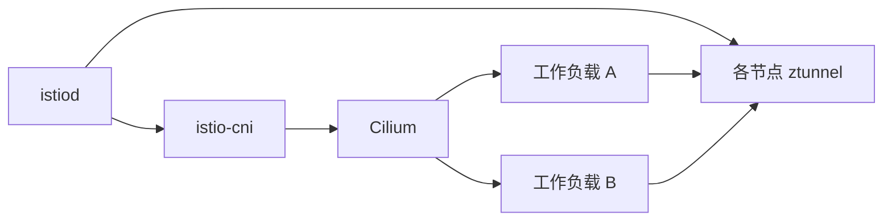

# 第 2 步：安装 Istio Ambient 基础能力

## 本步目标

在不替换现有 `Cilium` 数据平面的前提下，为集群新增：

- `istiod`
- `ztunnel`
- `istio-cni`

本步完成后，集群才真正具备第五章后续 `mTLS`、服务身份与 L4 零信任能力的运行基础。

## 执行标记

- **执行标记：必须执行**

## 问题背景

第五章后面要讲：

- `JWT`
- `PeerAuthentication`
- `AuthorizationPolicy`
- `waypoint`
- 流量治理

这些能力都不是凭空出现的，必须先有一套能够承载服务身份和安全通信的基础面。

因此本步不是“先把 Istio 装上”，而是要先把 Ambient 的底座铺好。

## 理论说明

### Ambient 基础能力关系图



这张图要讲清两个事实：

- `Cilium` 还在，底层网络没有被拔掉
- `Istio` 是以 `istiod + ztunnel + istio-cni` 的方式叠加进来

### 为什么这里要先调整 `cni-exclusive`

当前集群底层网络由 `Cilium` 负责。  
如果 `Cilium` 仍保持“只允许自己独占 CNI”的状态，后续 `Istio CNI` 无法正常参与 Ambient 模式链路。

所以这一步有一个非常关键的前提动作：

- 把 `cilium-config` 里的 `cni-exclusive` 改成 `false`

这个动作不是可选优化，而是第五章能在现有集群上叠加 `Istio Ambient` 的必要条件。

### 本步关键清单

本步核心配置来自：

- `manifests/90_ambient_profile.yaml`

关键内容示意：

```yaml
apiVersion: install.istio.io/v1alpha1
kind: IstioOperator
spec:
  profile: ambient
  hub: harbor.qytk8s.com/istio
  tag: 1.29.0
```

关键字段说明：

- `profile: ambient`
  - 明确告诉 `istioctl` 这一步安装的是 Ambient 架构
- `hub: harbor.qytk8s.com/istio`
  - 镜像全部改走课程自己的 Harbor
- `tag: 1.29.0`
  - 和第 1 步冻结的版本保持一致

## 对应脚本

- `k8s/05-security-and-zero-trust/scripts/02_install_istio_ambient.sh`

## 脚本关键任务

### 关键任务 1：检查 `istioctl`

脚本原始代码：

```bash
if ! command -v istioctl &>/dev/null; then
  echo "失败: 未找到 istioctl，请先执行 01_prepare_istio_artifacts.sh"
  exit 1
fi
```

关键介绍：

- 第 2 步严格依赖第 1 步
- 这里先把“制品没准备好”的情况挡在外面

### 关键任务 2：调整 `Cilium` 的 CNI 共享模式

脚本原始代码：

```bash
kubectl -n kube-system patch configmap cilium-config --type merge -p '{"data":{"cni-exclusive":"false"}}'
kubectl -n kube-system rollout restart daemonset/cilium
```

关键介绍：

- 这是第五章能在现有 `Cilium` 集群上叠加 Ambient 的关键动作
- 改完后会重启 `cilium` DaemonSet，让新配置生效

### 关键任务 3：按 Ambient Profile 安装 Istio

脚本原始代码：

```bash
istioctl install -f "${PROFILE_FILE}" -y
```

关键介绍：

- 这里消费的就是 `90_ambient_profile.yaml`
- `Istio` 安装并不是走默认公网镜像，而是走 Harbor 中的固定版本

### 关键任务 4：等待核心组件收敛

脚本原始代码：

```bash
kubectl -n istio-system rollout status deploy/istiod --timeout=300s
kubectl -n istio-system rollout status daemonset/ztunnel --timeout=300s
kubectl -n istio-system rollout status daemonset/istio-cni-node --timeout=300s
```

关键介绍：

- 第五章后续所有现象，都建立在这 3 组组件已经正常运行的前提上

## 执行命令

```bash
chmod +x /docker_k8s_2026/k8s/05-security-and-zero-trust/scripts/02_install_istio_ambient.sh
```

```bash
bash /docker_k8s_2026/k8s/05-security-and-zero-trust/scripts/02_install_istio_ambient.sh
```

## 验证方法

```bash
kubectl -n istio-system get pods -o wide
```

关键看点：

- 重点看：
  - `istiod`
  - `ztunnel`
  - `istio-cni-node`
- 不是只看 Pod 数量，而是看核心组件是否都已经进入 `Running`

预期结果：

- `istiod` 为 `Running`
- `ztunnel` 以 DaemonSet 形式覆盖各节点
- `istio-cni-node` 正常

```bash
kubectl get crd | grep istio.io
```

关键看点：

- 重点看 `Istio` 相关 CRD 是否已经出现
- 这说明控制面对象已经成功注册进集群

预期结果：

- 输出中能看到多个 `*.istio.io` CRD

```bash
istioctl version
```

关键看点：

- 重点看本地 CLI 与当前控制面已经能对上

预期结果：

- 能正常输出本地 `istioctl` 版本
- 已能读取集群中的控制面版本信息

## 通过标准

满足下面条件后，本步即可视为完成：

- `cni-exclusive` 已调整为可共享模式
- `istiod`、`ztunnel`、`istio-cni-node` 已正常运行
- `Istio` 相关 CRD 已就绪

## 下一步

进入第 3 步，发布新的 `Istio Ingress Gateway` 与演示应用：

- `docs/04_publish_istio_ingress.md`
