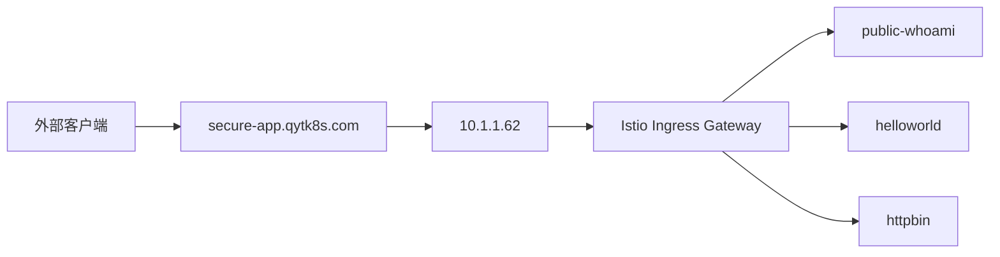

# 第 3 步：发布 Istio Ingress Gateway 与演示应用

## 本步目标

新增第五章专用北向入口，并保持第三章入口不动。

本步完成后，应达到下面状态：

- 新域名：`secure-app.qytk8s.com`
- 新 VIP：`10.1.1.62`
- 新入口：`Istio Ingress Gateway`
- 演示命名空间：`mesh-demo`
- 演示应用：`helloworld`、`httpbin`、`curl-trusted`、`curl-untrusted`、`public-whoami`

## 执行标记

- **执行标记：必须执行**

## 问题背景

第三章已经讲清楚了“服务如何发布出去”，第五章不应该把重点放在迁移旧入口上。

因此这里采用：

- 第三章入口继续保留
- 第五章新增独立入口

这样你上课时就可以明确对比：

- `Cilium Gateway API`：基础发布
- `Istio Ingress Gateway`：安全与治理增强

## 理论说明

### 北向入口流量图



这张图要配合下面 4 句话：

- 用户不是直接访问 Pod，而是先访问域名
- 域名解析到 `10.1.1.62`
- `MetalLB` 把 VIP 绑定给 `Istio Ingress Gateway`
- 真正转发到哪个后端，由后面的 `Gateway` 和 `VirtualService` 决定

### 为什么要保留 `/public` 这条路径

第五章后面会逐步引入：

- `JWT`
- 入口授权
- 服务间安全

如果一开始所有入口都直接加保护，课堂上就少了一个非常稳定的对照组。

因此这里保留：

- `/public`

它的作用是：

- 用来证明“入口和 HTTPS 本身已经正常”
- 作为后续 `JWT` 前后行为对照

### 本步关键清单

本步核心配置来自下面几份文件：

- `manifests/91_ingress_gateway_values.yaml`
- `manifests/20_secure_app_gateway.yaml`
- `manifests/21_virtualservice_baseline.yaml`

#### Ingress Gateway 的 Helm values

```yaml
global:
  hub: harbor.qytk8s.com/istio
  tag: 1.29.0

service:
  type: LoadBalancer
  annotations:
    metallb.io/address-pool: edge-pool
    metallb.io/loadBalancerIPs: 10.1.1.62
```

关键字段说明：

- `hub` / `tag`
  - 入口镜像仍然走 Harbor
- `type: LoadBalancer`
  - 让 `MetalLB` 为入口分配 VIP
- `metallb.io/loadBalancerIPs: 10.1.1.62`
  - 明确固定第五章入口地址

#### Istio Gateway

```yaml
kind: Gateway
spec:
  selector:
    istio: ingressgateway
  servers:
    - port:
        number: 80
      tls:
        httpsRedirect: true
    - port:
        number: 443
      tls:
        mode: SIMPLE
        credentialName: secure-app-qytk8s-com-tls
```

关键字段说明：

- `selector: istio: ingressgateway`
  - 说明这份 `Gateway` 绑定的是第五章新装的入口网关
- `httpsRedirect: true`
  - 让 `80` 只负责跳转
- `credentialName`
  - 指向本步脚本创建的 TLS Secret

#### 基线路由 `VirtualService`

```yaml
kind: VirtualService
spec:
  hosts:
    - secure-app.qytk8s.com
  gateways:
    - secure-app-gateway
  http:
    - name: public
    - name: hello
    - name: httpbin-get
```

关键字段说明：

- `public`
  - 作为“入口和 HTTPS 正常”的对照路径
- `hello`
  - 为后续灰度、版本路由准备入口
- `httpbin-get`
  - 为后续 `JWT`、授权、超时、重试和故障注入准备入口

## 对应脚本

- `k8s/05-security-and-zero-trust/scripts/03_publish_istio_ingress_demo.sh`

## 脚本关键任务

### 关键任务 1：为 `secure-app.qytk8s.com` 签发证书

脚本原始代码：

```bash
DOMAIN="secure-app.qytk8s.com"
SECRET_NAME="secure-app-qytk8s-com-tls"
SECRET_NAMESPACE="istio-ingress"
VIP="10.1.1.62"
```

关键介绍：

- 第五章入口使用自己的域名和独立证书
- TLS Secret 创建在 `istio-ingress`

### 关键任务 2：安装 `Istio Ingress Gateway`

脚本原始代码：

```bash
helm upgrade --install istio-ingressgateway "${chart_dir}" \
  -n istio-ingress \
  --create-namespace \
  -f "${INGRESS_VALUES}" \
  --wait
```

关键介绍：

- 这里消费的是 `91_ingress_gateway_values.yaml`
- 安装出来的是第五章专用入口，不影响第三章已有入口

### 关键任务 3：部署演示工作负载

脚本原始代码：

```bash
kubectl apply -f "${NAMESPACE_URL}"
kubectl apply -f "${CLIENTS_URL}"
kubectl apply -f "${HELLOWORLD_URL}"
kubectl apply -f "${HTTPBIN_URL}"
kubectl apply -f "${PUBLIC_WHOAMI_URL}"
```

关键介绍：

- 第五章不是只装入口，还要同时准备后续 `JWT`、`mTLS`、治理演示需要的工作负载

### 关键任务 4：应用入口 `Gateway` 和基线路由

脚本原始代码：

```bash
kubectl apply -f "${GATEWAY_URL}"
kubectl apply -f "${VIRTUALSERVICE_URL}"
```

关键介绍：

- 这里把第五章自己的域名监听和路径转发规则落到集群里

## 执行命令

```bash
chmod +x /docker_k8s_2026/k8s/05-security-and-zero-trust/scripts/03_publish_istio_ingress_demo.sh
```

```bash
bash /docker_k8s_2026/k8s/05-security-and-zero-trust/scripts/03_publish_istio_ingress_demo.sh
```

## 验证方法

```bash
kubectl -n istio-ingress get pods,svc -o wide
```

关键看点：

- 重点看 `istio-ingressgateway`
- Service 类型应为 `LoadBalancer`
- 外部地址应为 `10.1.1.62`

预期结果：

- `istio-ingressgateway` Pod 正常
- `istio-ingressgateway` Service 获得 `10.1.1.62`

```bash
kubectl -n mesh-demo get pods,svc
```

关键看点：

- 重点看演示工作负载是否都已就绪：
  - `helloworld-v1`
  - `helloworld-v2`
  - `httpbin`
  - `public-whoami`
  - `curl-trusted`
  - `curl-untrusted`

预期结果：

- `mesh-demo` 中相关 Pod 与 Service 都已出现

```bash
curl -I --resolve secure-app.qytk8s.com:80:10.1.1.62 http://secure-app.qytk8s.com/public
```

关键看点：

- 重点看 `HTTP -> HTTPS` 是否已经生效
- 不需要读取正文

预期结果：

- 返回 `301` 或 `302`

```bash
curl --resolve secure-app.qytk8s.com:443:10.1.1.62 \
  --cacert /docker_k8s_2026/k8s/01-k8s-architecture/pki/harbor/harbor-ca.crt \
  https://secure-app.qytk8s.com/public
```

关键看点：

- 重点看 `HTTPS` 是否可访问
- 返回正文里应能看到 `public-whoami`

预期结果：

- `HTTPS` 返回 `200`
- `/public` 路径能正常访问

## win2019 侧要求

在 `win2019 DNS` 中新增：

```text
secure-app.qytk8s.com  ->  10.1.1.62
```

并确保已经导入 Harbor CA 根证书。

## 通过标准

满足下面条件后，本步即可视为完成：

- `Istio Ingress Gateway` 已获得 `10.1.1.62`
- `mesh-demo` 演示环境已就绪
- `HTTP -> HTTPS` 跳转正常
- `HTTPS /public` 已能正常访问

## 下一步

进入第 4 步，开启 `JWT` 与服务间安全：

- `docs/05_enable_jwt_and_mesh_security.md`
