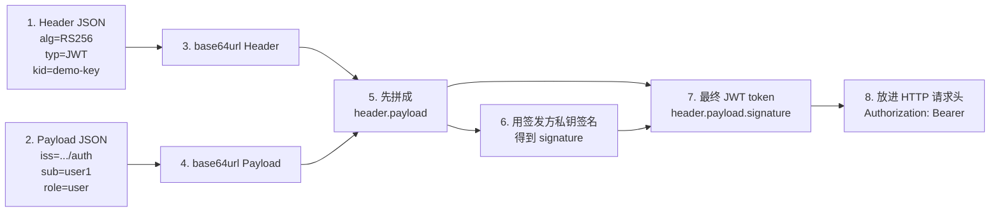
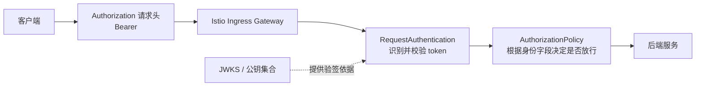
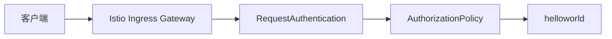
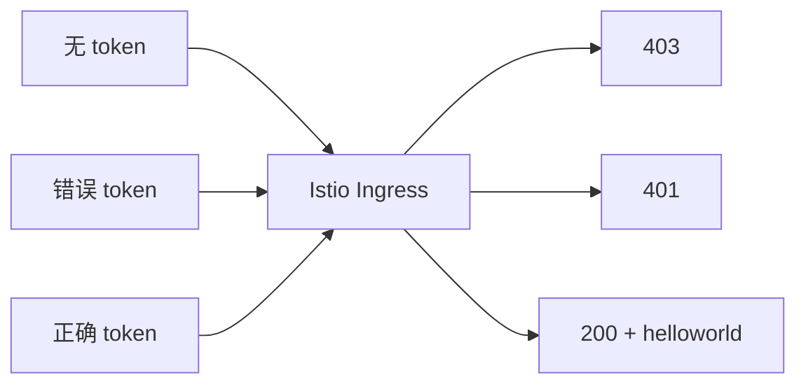
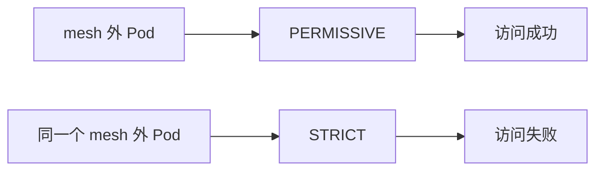
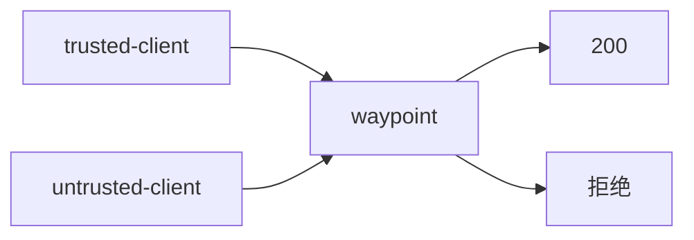

# 第 4 步：开启 JWT、mTLS 与服务间授权

## 本步目标

在新入口和演示应用已经就绪的基础上，补齐第五章的核心安全能力：

- 入口 `JWT`
- 命名空间 `mTLS`
- `waypoint`
- 服务间 `AuthorizationPolicy`

---

## 执行标记

- **执行标记：必须执行**

这一页的执行方式很简单：

1. 先执行主脚本
2. 再按下面 3 个测试依次观察现象

---

## 先把 JWT 讲清楚

`JWT` 是 `JSON Web Token` 的缩写。

### JWT、TLS、mTLS 各管什么

| 概念 | 解决的问题 | 第五章里的位置 |
| :--- | :--- | :--- |
| `TLS` | 客户端连到的入口是不是可信的 | 上一页 `04_publish_istio_ingress.md` 已完成 `HTTPS` 入口建立 |
| `JWT` | 发请求的人是谁 | 北向入口认证 |
| `mTLS` | 服务和服务之间是否相互可信 | 网格内部 `ztunnel` |

这里还要特别提醒：

- 上一页已经完成 `secure-app.qytk8s.com` 的 `HTTPS` 入口和证书
- 本页只在这个既有入口之上继续叠加 `JWT` 与授权控制

### JWT 里最值得先记住的 3 个词

| 术语 | 可以先粗略理解成 |
| :--- | :--- |
| `issuer` | token 里 `iss` 这个字段，表示谁签发了它 |
| `claim` | token 里真正携带身份信息的字段，例如 `sub`、`role` |
| `JWKS` | 服务端验签时要用到的公钥集合，对应后面的验签阶段 |

### JWT 是怎么拼出来的

先看两段最小 JSON。

`Header` 示例：

```json
{
  "alg": "RS256",
  "typ": "JWT",
  "kid": "demo-key"
}
```

`Payload` 示例：

```json
{
  "iss": "https://secure-app.qytk8s.com/auth",
  "sub": "user1",
  "role": "user"
}
```

这两段 JSON 不会原样发送，而是由签发方用私钥按下面顺序处理：



可以按下面顺序理解：

1. 先准备 `Header JSON`
2. 再准备 `Payload JSON`
3. 两段内容分别做 `base64url` 编码
4. 先拼成前两段：
   - `header.payload`
5. 再由签发方用私钥对这两段内容签名，得到第三段：
   - `signature`
6. 最终三段拼起来，形成：
   - `header.payload.signature`
7. 客户端发请求时，把这一整串 token 放进：
   - `Authorization: Bearer <token>`

这里先只抓住 `JWT` 的结构本身：

- 第一段来自 `Header`
- 第二段来自 `Payload`
- 第三段是签名结果
- 发送时放进 `Authorization` 请求头

最小请求示意：

```http
GET /hello HTTP/1.1
Host: secure-app.qytk8s.com
Authorization: Bearer <token>
```

也就是说：

- 客户端发出的仍然是普通 HTTP 请求
- 只是额外多了一个 `Authorization` 请求头
- 这个请求头里放的是整串 `JWT token`

### JWT 在入口上是怎么工作的



这张图要表达的核心是：

- 客户端把整段 `JWT token` 放进 `Authorization` 请求头
- `RequestAuthentication` 先识别并校验这张 token
- `JWKS` 为验签提供公钥依据
- `AuthorizationPolicy` 再根据 token 里的身份字段决定是否放行

一句最短总结：

- `RequestAuthentication`
  - 负责“你这个 token 是否可信”
- `AuthorizationPolicy`
  - 负责“就算 token 可信，你是否有权限访问”

---

## 安全链路关系图

### 北向入口安全



这张图表达的是北向入口上的认证与授权链。

### 东西向服务间安全


这张图表达的是网格内部的 `mTLS + AuthorizationPolicy` 链：

- `trusted-client` 和 `untrusted-client` 都会先进入 `ztunnel`
- `PeerAuthentication STRICT` 作用在 `ztunnel` 侧，建立基础 `L4 / mTLS` 可信通道
- `waypoint` 是额外插入的 `L7` 处理点，不是所有流量默认必经节点
- 需要 `L7` 授权时，流量才会额外经过 `waypoint`
- `L7 AuthorizationPolicy` 作用在 `waypoint` 路径上，不是流量终点

---

## 本步脚本

- `k8s/05-security-and-zero-trust/scripts/04_enable_jwt_and_mesh_security.sh`

执行前请确认：

- 上一页 `04_publish_istio_ingress.md` 已完成
- `secure-app.qytk8s.com` 已能通过 `HTTPS /public` 访问
- `istioctl` 已可在 `ops` 上直接使用

---

## 执行命令

<div style="padding: 10px 14px; border: 1px solid #666; border-left: 4px solid #8ab4f8; border-radius: 6px; background: rgba(138,180,248,0.08); margin: 8px 0;">
<strong>ℹ️ 可选预处理命令</strong><br/>
如果脚本已具备执行权限，这一步可以跳过。
</div>

```bash
chmod +x /docker_k8s_2026/k8s/05-security-and-zero-trust/scripts/04_enable_jwt_and_mesh_security.sh
```

<div style="padding: 12px 14px; border: 1px solid #666; border-left: 6px solid #ea4335; border-radius: 6px; background: rgba(234,67,53,0.10); margin: 8px 0;">
<strong>❗ 本步必须粘贴执行</strong><br/>
下面命令是本步主线必跑命令。
</div>

```bash
bash /docker_k8s_2026/k8s/05-security-and-zero-trust/scripts/04_enable_jwt_and_mesh_security.sh
```

---

## 这个脚本具体做了什么

### 动作 1：生成 JWT 演示材料

脚本原始代码：

<div style="padding: 10px 14px; border: 1px solid #666; border-left: 4px solid #8ab4f8; border-radius: 6px; background: rgba(138,180,248,0.08); margin: 8px 0;">
<strong>ℹ️ 可选查看代码</strong><br/>
下面代码为脚本原始逻辑，用于理解本步实现，不需要单独执行。
</div>

```bash
python3 "${JWT_GENERATOR}"
```

关键介绍：

- 生成本页后面要用到的私钥、公钥、`jwks.json` 和演示 token
- 没有这一步，后面的 `RequestAuthentication` 就没有稳定的验签材料

这个脚本运行后，主要会在：

- `k8s/05-security-and-zero-trust/pki`

目录里生成下面这些产物：

- `jwt-demo-private.pem`
  - 用来签发演示 token 的私钥
- `jwt-demo-public.pem`
  - 对应公钥
- `jwks.json`
  - 入口 `RequestAuthentication` 用来验签的公钥集合
- `user.jwt`
  - 普通用户演示 token
- `admin.jwt`
  - 管理员演示 token

可以先这样理解它们的关系：

- 私钥负责“签”
- 公钥 / `jwks.json` 负责“验”
- `user.jwt` / `admin.jwt` 是后面实际拿去发请求测试的 token

### 动作 2：为 mesh-demo 部署 waypoint

脚本原始代码：

<div style="padding: 10px 14px; border: 1px solid #666; border-left: 4px solid #8ab4f8; border-radius: 6px; background: rgba(138,180,248,0.08); margin: 8px 0;">
<strong>ℹ️ 可选查看代码</strong><br/>
下面代码为脚本原始逻辑，用于理解本步实现，不需要单独执行。
</div>

```bash
istioctl waypoint apply --namespace mesh-demo --enroll-namespace --overwrite --wait
```

关键介绍：

- 这一步会创建 `waypoint`
- 同时把 `mesh-demo` 纳入 `waypoint` 管理
- 后面需要经过 `waypoint` 的七层授权能力，都建立在这一步之上

### 动作 3：统一应用安全对象

脚本原始代码：

<div style="padding: 10px 14px; border: 1px solid #666; border-left: 4px solid #8ab4f8; border-radius: 6px; background: rgba(138,180,248,0.08); margin: 8px 0;">
<strong>ℹ️ 可选查看代码</strong><br/>
下面代码为脚本原始逻辑，用于理解本步实现，不需要单独执行。
</div>

```bash
kubectl apply -f "${REQUEST_AUTH_URL}"
kubectl apply -f "${INGRESS_AUTHZ_URL}"
kubectl apply -f "${PEER_AUTH_URL}"
kubectl apply -f "${HTTPBIN_AUTHZ_URL}"
```

关键介绍：

这一步会把下面 4 份安全清单一次性创建好：

#### 30_requestauthentication_ingress.yaml

<div style="padding: 10px 14px; border: 1px solid #666; border-left: 4px solid #8ab4f8; border-radius: 6px; background: rgba(138,180,248,0.08); margin: 8px 0;">
<strong>YAML 文件：</strong><code>manifests/30_requestauthentication_ingress.yaml</code><br/>
<strong>对象：</strong><code>RequestAuthentication</code><br/>
<strong>作用：</strong>让入口具备 JWT 验签与身份解析能力
</div>

- 详细配置放到下面“测试 1：入口 JWT 认证与授权”里结合请求一起看

#### 31_authorizationpolicy_ingress_jwt.yaml

<div style="padding: 10px 14px; border: 1px solid #666; border-left: 4px solid #8ab4f8; border-radius: 6px; background: rgba(138,180,248,0.08); margin: 8px 0;">
<strong>YAML 文件：</strong><code>manifests/31_authorizationpolicy_ingress_jwt.yaml</code><br/>
<strong>对象：</strong><code>AuthorizationPolicy</code><br/>
<strong>作用：</strong>在入口层按 JWT 身份决定谁能访问
</div>

- 详细配置放到下面“测试 1：入口 JWT 认证与授权”里结合结果一起看

#### 32_peerauthentication_mesh_demo.yaml

<div style="padding: 10px 14px; border: 1px solid #666; border-left: 4px solid #8ab4f8; border-radius: 6px; background: rgba(138,180,248,0.08); margin: 8px 0;">
<strong>YAML 文件：</strong><code>manifests/32_peerauthentication_mesh_demo.yaml</code><br/>
<strong>对象：</strong><code>PeerAuthentication</code><br/>
<strong>作用：</strong>把 <code>mesh-demo</code> 命名空间切到 <code>STRICT mTLS</code>，为服务间零信任打底
</div>

- 详细配置放到下面“测试 2：命名空间 mTLS 边界验证”里结合对照测试一起看

#### 33_authorizationpolicy_httpbin_waypoint.yaml

<div style="padding: 10px 14px; border: 1px solid #666; border-left: 4px solid #8ab4f8; border-radius: 6px; background: rgba(138,180,248,0.08); margin: 8px 0;">
<strong>YAML 文件：</strong><code>manifests/33_authorizationpolicy_httpbin_waypoint.yaml</code><br/>
<strong>对象：</strong><code>AuthorizationPolicy</code><br/>
<strong>作用：</strong>在 <code>waypoint</code> 路径上限制只有指定服务身份可以访问 <code>httpbin</code>
</div>

- 详细配置放到下面“测试 3：waypoint 上的 L7 服务身份授权”里结合访问结果一起看

### 动作 4：最后统一查看安全对象

脚本原始代码：

<div style="padding: 10px 14px; border: 1px solid #666; border-left: 4px solid #8ab4f8; border-radius: 6px; background: rgba(138,180,248,0.08); margin: 8px 0;">
<strong>ℹ️ 可选查看代码</strong><br/>
下面代码为脚本原始逻辑，用于理解本步实现，不需要单独执行。
</div>

```bash
kubectl get requestauthentication,authorizationpolicy,peerauthentication -A
```

关键介绍：

- 这一步不是最终验证全部现象
- 它只是先确认本页关键安全对象已经进入集群

示例输出：

```text
root@ops:/docker_k8s_2026# kubectl get requestauthentication,authorizationpolicy,peerauthentication -A
NAMESPACE       NAME                                                  AGE
istio-ingress   requestauthentication.security.istio.io/ingress-jwt   18s

NAMESPACE       NAME                                                        ACTION   AGE
istio-ingress   authorizationpolicy.security.istio.io/ingress-require-jwt   ALLOW    18s
mesh-demo       authorizationpolicy.security.istio.io/httpbin-waypoint-l7   ALLOW    17s

NAMESPACE   NAME                                                    MODE     AGE
mesh-demo   peerauthentication.security.istio.io/mesh-demo-strict   STRICT   18s
```

这份输出可以直接看出，本页已经出现了 3 类安全对象：

1. `RequestAuthentication`
- `istio-ingress/ingress-jwt`
- 表示第五章入口已经具备：
  - 识别 `JWT`
  - 验签
  - 解析身份信息

2. `AuthorizationPolicy`
- `istio-ingress/ingress-require-jwt`
  - 这是北向入口授权策略
  - 用来控制“哪些入口请求允许访问”
- `mesh-demo/httpbin-waypoint-l7`
  - 这是 `httpbin` 的服务间授权策略
  - 用来控制“哪些服务身份可以访问 `httpbin`”

3. `PeerAuthentication`
- `mesh-demo/mesh-demo-strict`
- `MODE=STRICT`
  - 表示 `mesh-demo` 命名空间已经进入严格 `mTLS`

所以这条命令的意义不是“把所有安全能力都验证完成”，而是先确认：

- 入口 `JWT` 认证对象已经存在
- 入口授权对象已经存在
- 服务间授权对象已经存在
- 命名空间级 `mTLS` 对象已经存在

---

## 后续讲解与验证方式

主脚本执行完成后，测试部分只看 3 个边界明确的验证块：

1. 入口 `JWT`
2. 命名空间 `mTLS`
3. `waypoint` 上的 `L7` 服务身份控制

这一段的阅读方式也直接改成：

- 先说明本测试对应哪些 `YAML`
- 再给出关键 `YAML` 配置
- 然后立刻执行测试命令
- 最后只看关键结果

---

## 测试总览

主线只做下面 3 个测试：

1. 测试 1：入口 `JWT` 认证与授权
2. 测试 2：`mTLS` 边界验证
3. 测试 3：`waypoint` 上的 `L7` 服务身份授权

这 3 个测试分别回答 3 个问题：

- 入口会不会拒绝无身份或伪造身份的请求
- 网格内部是不是已经进入严格 `mTLS`
- 就算都在网格里，是不是也只能按服务身份最小放行

---

## 测试 1：入口 JWT 认证与授权

<div style="padding: 10px 14px; border: 1px solid #666; border-left: 4px solid #f28b82; border-radius: 6px; background: rgba(242,139,130,0.10); margin: 8px 0;">
<strong>❗ 测试边界 1</strong><br/>
本测试只验证入口是否会根据 JWT 结果决定放行或拒绝，不讨论 mesh 内部通信。
</div>



<div style="padding: 12px 16px; border: 1px solid #666; border-left: 6px solid #fbbc04; border-radius: 6px; background: rgba(251,188,4,0.10); margin: 14px 0;">
<strong>本测试对应的 YAML</strong><br/>
本测试验证前面已经应用好的 `30_requestauthentication_ingress.yaml` 和 `31_authorizationpolicy_ingress_jwt.yaml` 是否真正生效。
</div>

开始状态：

- 主脚本已经把入口 `JWT` 配好
- 现在直接用 3 个请求看入口怎么处理

对应的关键 YAML 配置：

`30_requestauthentication_ingress.yaml`

<div style="padding: 10px 14px; border: 1px solid #666; border-left: 4px solid #8ab4f8; border-radius: 6px; background: rgba(138,180,248,0.08); margin: 8px 0;">
<strong>YAML 文件：</strong><code>manifests/30_requestauthentication_ingress.yaml</code><br/>
<strong>对象：</strong><code>RequestAuthentication</code><br/>
<strong>作用：</strong>让入口具备 JWT 验签与身份解析能力
</div>

```yaml
apiVersion: security.istio.io/v1
kind: RequestAuthentication
metadata:
  name: ingress-jwt
  namespace: istio-ingress
spec:
  selector:
    matchLabels:
      istio: ingressgateway
  jwtRules:
    - issuer: https://secure-app.qytk8s.com/auth
      jwksUri: http://10.1.1.201:9000/05-security-and-zero-trust/pki/jwks.json
      forwardOriginalToken: true
```

- `issuer`
  - 指定谁签发这个 token
- `jwksUri`
  - 指定入口到哪里拿公钥做验签

`31_authorizationpolicy_ingress_jwt.yaml`

<div style="padding: 10px 14px; border: 1px solid #666; border-left: 4px solid #8ab4f8; border-radius: 6px; background: rgba(138,180,248,0.08); margin: 8px 0;">
<strong>YAML 文件：</strong><code>manifests/31_authorizationpolicy_ingress_jwt.yaml</code><br/>
<strong>对象：</strong><code>AuthorizationPolicy</code><br/>
<strong>作用：</strong>在入口层按 JWT 身份决定谁能访问
</div>

```yaml
apiVersion: security.istio.io/v1
kind: AuthorizationPolicy
metadata:
  name: ingress-require-jwt
  namespace: istio-ingress
spec:
  selector:
    matchLabels:
      istio: ingressgateway
  action: ALLOW
  rules:
    - to:
        - operation:
            hosts:
              - secure-app.qytk8s.com
            paths:
              - /public
    - from:
        - source:
            requestPrincipals:
              - "https://secure-app.qytk8s.com/auth/*"
      to:
        - operation:
            hosts:
              - secure-app.qytk8s.com
```

- `/public`
  - 匿名放行，作为对照路径
- `requestPrincipals`
  - 要求请求必须带有通过验签后的身份

<div style="padding: 10px 14px; border: 1px solid #666; border-left: 6px solid #34a853; border-radius: 6px; background: rgba(52,168,83,0.08); margin: 8px 0;">
<strong>❗ 本测试必须执行的代码</strong><br/>
按顺序一条一条执行，每执行一步就看一次结果。
</div>

### 第 1 步：不带 token 访问一次

<div style="padding: 10px 14px; border: 1px solid #666; border-left: 6px solid #34a853; border-radius: 6px; background: rgba(52,168,83,0.08); margin: 8px 0;">
<strong>❗ 本条命令必须粘贴执行</strong><br/>
先看入口对“完全没有身份”的请求会怎么处理。
</div>

```bash
curl -s -o /tmp/ch5_jwt_no_token.txt -w '%{http_code}\n' \
  --resolve secure-app.qytk8s.com:443:10.1.1.62 \
  --cacert /docker_k8s_2026/k8s/01-k8s-architecture/pki/harbor/harbor-ca.crt \
  https://secure-app.qytk8s.com/hello
```

这一步看什么：

- 应返回 `403`
- 这说明入口没有拿到可用身份时，会直接拒绝访问

### 第 2 步：带错误 token 再访问一次

<div style="padding: 10px 14px; border: 1px solid #666; border-left: 6px solid #34a853; border-radius: 6px; background: rgba(52,168,83,0.08); margin: 8px 0;">
<strong>❗ 本条命令必须粘贴执行</strong><br/>
这次故意带一个错误 token，看是不是会在验签阶段失败。
</div>

```bash
curl -s -o /tmp/ch5_jwt_bad_token.txt -w '%{http_code}\n' \
  --resolve secure-app.qytk8s.com:443:10.1.1.62 \
  --cacert /docker_k8s_2026/k8s/01-k8s-architecture/pki/harbor/harbor-ca.crt \
  -H 'Authorization: Bearer bad.token.value' \
  https://secure-app.qytk8s.com/hello
```

这一步看什么：

- 应返回 `401`
- 这说明 token 在验签阶段就被判定为非法

### 第 3 步：带正确 token 访问一次

<div style="padding: 10px 14px; border: 1px solid #666; border-left: 6px solid #34a853; border-radius: 6px; background: rgba(52,168,83,0.08); margin: 8px 0;">
<strong>❗ 本条命令必须粘贴执行</strong><br/>
这次读取正确 token，看合法身份能不能通过入口。
</div>

```bash
USER_TOKEN="$(tr -d '\n' < /docker_k8s_2026/k8s/05-security-and-zero-trust/pki/user.jwt)"
curl -s -o /tmp/ch5_jwt_good_token.txt -w '%{http_code}\n' \
  --resolve secure-app.qytk8s.com:443:10.1.1.62 \
  --cacert /docker_k8s_2026/k8s/01-k8s-architecture/pki/harbor/harbor-ca.crt \
  -H "Authorization: Bearer ${USER_TOKEN}" \
  https://secure-app.qytk8s.com/hello
```

这一步看什么：

- 应返回 `200`
- 这说明正确 token 已经通过入口验签和授权判断

### 第 4 步：把成功响应正文读出来

<div style="padding: 10px 14px; border: 1px solid #666; border-left: 6px solid #34a853; border-radius: 6px; background: rgba(52,168,83,0.08); margin: 8px 0;">
<strong>❗ 本条命令必须粘贴执行</strong><br/>
最后确认返回的确实是后端业务内容，而不是中间层误判。
</div>

```bash
sed -n '1,20p' /tmp/ch5_jwt_good_token.txt
```

这一步看什么：

- 应能看到 `helloworld`
- 这说明请求已经真正到达后端服务

---

## 测试 2：命名空间 mTLS 边界验证

<div style="padding: 10px 14px; border: 1px solid #666; border-left: 4px solid #f28b82; border-radius: 6px; background: rgba(242,139,130,0.10); margin: 8px 0;">
<strong>❗ 测试边界 2</strong><br/>
本测试只验证 `mesh-demo` 命名空间是否已经具备严格 `mTLS` 边界，不讨论 JWT，也不讨论 L7 授权。
</div>



<div style="padding: 12px 16px; border: 1px solid #666; border-left: 6px solid #fbbc04; border-radius: 6px; background: rgba(251,188,4,0.10); margin: 14px 0;">
<strong>本测试对应的 YAML</strong><br/>
本测试验证前面已经应用好的 `32_peerauthentication_mesh_demo.yaml` 是否真正建立了 `mTLS` 边界。
</div>

开始状态：

- 这份 `YAML` 默认是 `STRICT`
- 为了让学员看懂边界，这里先临时改成 `PERMISSIVE`
- 对照测试结束后，再切回 `STRICT`

对应的关键 YAML 配置：

`32_peerauthentication_mesh_demo.yaml`

<div style="padding: 10px 14px; border: 1px solid #666; border-left: 4px solid #8ab4f8; border-radius: 6px; background: rgba(138,180,248,0.08); margin: 8px 0;">
<strong>YAML 文件：</strong><code>manifests/32_peerauthentication_mesh_demo.yaml</code><br/>
<strong>对象：</strong><code>PeerAuthentication</code><br/>
<strong>作用：</strong>把 <code>mesh-demo</code> 命名空间切到 <code>STRICT mTLS</code>，为服务间零信任打底
</div>

```yaml
apiVersion: security.istio.io/v1
kind: PeerAuthentication
metadata:
  name: mesh-demo-strict
  namespace: mesh-demo
spec:
  mtls:
    mode: STRICT
```

- `mtls.mode: STRICT`
  - 表示这个命名空间默认只接受严格 `mTLS`
- 为了课堂演示边界
  - 先临时切到 `PERMISSIVE`
  - 再切回 `STRICT`

<div style="padding: 10px 14px; border: 1px solid #666; border-left: 6px solid #34a853; border-radius: 6px; background: rgba(52,168,83,0.08); margin: 8px 0;">
<strong>❗ 本测试必须执行的代码</strong><br/>
按顺序一条一条执行，每执行一步就看一次结果。
</div>

### 第 1 步：先切到 `PERMISSIVE`

<div style="padding: 10px 14px; border: 1px solid #666; border-left: 6px solid #34a853; border-radius: 6px; background: rgba(52,168,83,0.08); margin: 8px 0;">
<strong>❗ 本条命令必须粘贴执行</strong><br/>
先把 `mesh-demo` 从严格模式切到允许明文通过的对照模式。
</div>

```bash
kubectl -n mesh-demo patch peerauthentication mesh-demo-strict \
  --type merge \
  -p '{"spec":{"mtls":{"mode":"PERMISSIVE"}}}'
```

这一步看什么：

- 只要 patch 成功即可
- 这表示接下来 mesh 外的明文访问有机会通过

### 第 2 步：在 `PERMISSIVE` 下测试一次

<div style="padding: 10px 14px; border: 1px solid #666; border-left: 6px solid #34a853; border-radius: 6px; background: rgba(52,168,83,0.08); margin: 8px 0;">
<strong>❗ 本条命令必须粘贴执行</strong><br/>
从 mesh 外的 `default` 命名空间访问 `public-whoami`。
</div>

```bash
kubectl delete pod mtls-check-permissive -n default --ignore-not-found
kubectl run mtls-check-permissive -n default \
  --image=harbor.qytk8s.com/istio/curl:8.12.1 \
  --restart=Never --rm -i \
  --command -- sh -c "curl -sS --max-time 5 http://public-whoami.mesh-demo"
```

这一步看什么：

- 应该能看到正常返回内容
- 这说明在 `PERMISSIVE` 下，mesh 外明文访问可以通过

### 第 3 步：切回 `STRICT`

<div style="padding: 10px 14px; border: 1px solid #666; border-left: 6px solid #34a853; border-radius: 6px; background: rgba(52,168,83,0.08); margin: 8px 0;">
<strong>❗ 本条命令必须粘贴执行</strong><br/>
把命名空间切回严格 `mTLS` 模式。
</div>

```bash
kubectl -n mesh-demo patch peerauthentication mesh-demo-strict \
  --type merge \
  -p '{"spec":{"mtls":{"mode":"STRICT"}}}'
```

这一步看什么：

- 只要 patch 成功即可
- 这表示接下来同一条 mesh 外明文访问应该被拒绝

### 第 4 步：在 `STRICT` 下再测一次

<div style="padding: 10px 14px; border: 1px solid #666; border-left: 6px solid #34a853; border-radius: 6px; background: rgba(52,168,83,0.08); margin: 8px 0;">
<strong>❗ 本条命令必须粘贴执行</strong><br/>
继续从 `default` 命名空间访问同一路径，观察结果是否发生变化。
</div>

```bash
kubectl delete pod mtls-check-strict -n default --ignore-not-found
kubectl run mtls-check-strict -n default \
  --image=harbor.qytk8s.com/istio/curl:8.12.1 \
  --restart=Never --rm -i \
  --command -- sh -c "curl -sS --max-time 5 -o /dev/null -w '%{http_code}\n' http://public-whoami.mesh-demo || true"
```

这一步看什么：

- 这里不应该成功
- 常见现象包括：
  - 返回 `000`
  - `Recv failure: Connection reset by peer`
  - 或其他非成功结果
- 这说明切回 `STRICT` 后，mesh 外明文访问已经被拒绝

---

## 测试 3：waypoint 上的 L7 服务身份授权

<div style="padding: 10px 14px; border: 1px solid #666; border-left: 4px solid #f28b82; border-radius: 6px; background: rgba(242,139,130,0.10); margin: 8px 0;">
<strong>❗ 测试边界 3</strong><br/>
本测试只验证 `waypoint` 路径上的 L7 服务身份控制，不再重复验证入口 JWT，也不再重复验证 mTLS 开关。
</div>



<div style="padding: 12px 16px; border: 1px solid #666; border-left: 6px solid #fbbc04; border-radius: 6px; background: rgba(251,188,4,0.10); margin: 14px 0;">
<strong>本测试对应的 YAML</strong><br/>
本测试验证前面已经应用好的 `33_authorizationpolicy_httpbin_waypoint.yaml` 是否真的把不同服务身份区分开了。
</div>

开始状态：

- `waypoint` 已经在主脚本里创建好了
- 这份策略已经把 `trusted-client` 放进允许名单
- `untrusted-client` 不在允许名单里

对应的关键 YAML 配置：

`33_authorizationpolicy_httpbin_waypoint.yaml`

<div style="padding: 10px 14px; border: 1px solid #666; border-left: 4px solid #8ab4f8; border-radius: 6px; background: rgba(138,180,248,0.08); margin: 8px 0;">
<strong>YAML 文件：</strong><code>manifests/33_authorizationpolicy_httpbin_waypoint.yaml</code><br/>
<strong>对象：</strong><code>AuthorizationPolicy</code><br/>
<strong>作用：</strong>在 <code>waypoint</code> 路径上限制只有指定服务身份可以访问 <code>httpbin</code>
</div>

```yaml
apiVersion: security.istio.io/v1
kind: AuthorizationPolicy
metadata:
  name: httpbin-waypoint-l7
  namespace: mesh-demo
spec:
  selector:
    matchLabels:
      app: httpbin
  action: ALLOW
  rules:
    - from:
        - source:
            principals:
              - cluster.local/ns/istio-ingress/sa/istio-ingressgateway
    - from:
        - source:
            principals:
              - cluster.local/ns/mesh-demo/sa/trusted-client
```

- `selector.matchLabels.app: httpbin`
  - 说明策略直接作用在 `httpbin`
- `principals`
  - 只允许 `istio-ingressgateway` 和 `trusted-client`

<div style="padding: 10px 14px; border: 1px solid #666; border-left: 6px solid #34a853; border-radius: 6px; background: rgba(52,168,83,0.08); margin: 8px 0;">
<strong>❗ 本测试必须执行的代码</strong><br/>
按顺序一条一条执行，每执行一步就看一次结果。
</div>

### 第 1 步：先让 `trusted-client` 访问

<div style="padding: 10px 14px; border: 1px solid #666; border-left: 6px solid #34a853; border-radius: 6px; background: rgba(52,168,83,0.08); margin: 8px 0;">
<strong>❗ 本条命令必须粘贴执行</strong><br/>
先看被允许的服务身份能不能正常访问 `httpbin`。
</div>

```bash
kubectl -n mesh-demo exec deploy/curl-trusted -- \
  curl -s -o /dev/null -w '%{http_code}\n' \
  http://httpbin.mesh-demo:8000/get
```

这一步看什么：

- 应返回 `200`
- 这说明 `trusted-client` 的服务身份命中了允许规则

### 第 2 步：再让 `untrusted-client` 访问

<div style="padding: 10px 14px; border: 1px solid #666; border-left: 6px solid #34a853; border-radius: 6px; background: rgba(52,168,83,0.08); margin: 8px 0;">
<strong>❗ 本条命令必须粘贴执行</strong><br/>
再看不在允许名单里的服务身份会不会被拒绝。
</div>

```bash
kubectl -n mesh-demo exec deploy/curl-untrusted -- \
  curl -s -o /dev/null -w '%{http_code}\n' \
  http://httpbin.mesh-demo:8000/get
```

这一步看什么：

- 这里不应该返回 `200`
- 常见现象包括：
  - `000`
  - `command terminated with exit code 56`
  - 或其他非 `200` 结果
- 这说明 `untrusted-client` 没有命中允许规则，`waypoint` 已按服务身份拒绝访问

---

## 本节通过标准

- 测试 1 已验证入口 `JWT` 认证与授权生效
- 测试 2 已验证 `mesh-demo` 命名空间 `mTLS` 边界生效
- 测试 3 已验证 `waypoint` 上的 `L7` 服务身份授权生效

---

## 下一步

进入第 5 步，执行第五章主线最终验收：

- `docs/06_verify.md`
