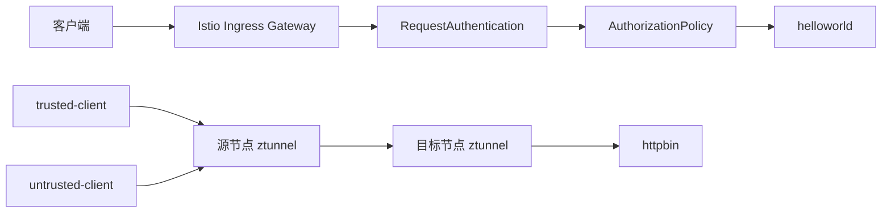
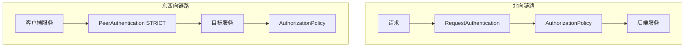

# 第 4 步：开启 JWT、mTLS 与服务间授权

## 本步目标

在新入口和演示应用已经就绪的基础上，补齐第五章的核心安全能力：

- 入口 `JWT`
- 命名空间 `mTLS`
- `waypoint`
- 服务间 `AuthorizationPolicy`

## 执行标记

- **执行标记：必须执行**

说明：

- 本步先用主脚本把安全对象一次性铺好
- 课堂上再按下面 6 个功能单元逐个讲现象

## 安全链路关系图



这张图最适合先把“入口安全”和“服务间安全”拆开讲：

- 上半段讲 `JWT`
- 下半段讲 `mTLS` 和服务身份授权

## 本步脚本

- `k8s/05-security-and-zero-trust/scripts/04_enable_jwt_and_mesh_security.sh`

## 执行方式

本节有两种使用方式：

### 方式 1：环境铺设

用于提前把课堂环境一次性铺好：

```bash
chmod +x /docker_k8s_2026/k8s/05-security-and-zero-trust/scripts/04_enable_jwt_and_mesh_security.sh
```

```bash
bash /docker_k8s_2026/k8s/05-security-and-zero-trust/scripts/04_enable_jwt_and_mesh_security.sh
```

### 方式 2：课堂讲解

本节内容应拆成 6 个功能单元依次讲解。每个单元均采用统一结构：

1. 问题背景
2. 理论说明
3. 验证方法
4. 预期结果

也就是说：

- 主脚本负责把安全对象铺到位
- 下面的小节负责解释每个对象到底解决什么问题

## 讲解顺序

推荐按下面顺序讲：

1. 生成 `JWT` 演示材料
2. 应用 `RequestAuthentication`
3. 应用入口 `AuthorizationPolicy`
4. 将 `mesh-demo` 纳入 `waypoint`
5. 应用 `PeerAuthentication STRICT`
6. 应用 `httpbin` 服务身份授权

这一顺序对应的逻辑是：

- 先讲“入口如何识别身份”
- 再讲“入口如何拒绝未授权请求”
- 再讲“网格内部如何建立零信任”

## 4.1 生成 JWT 演示材料

### 问题背景

如果没有固定的私钥、公钥、`jwks.json` 和示例 token，后面的 `JWT` 认证无法稳定复现。

### 理论说明

本小节需要先明确：

- `JWT` 本身只是一个身份声明
- 网关不能凭空相信 token
- 必须先有一套“谁签发、用什么公钥校验”的材料

### 验证方法

```bash
ls -lh /docker_k8s_2026/k8s/05-security-and-zero-trust/pki
```

### 预期结果

这一阶段的重点不是访问返回值，而是确认认证材料已经生成：

- `jwt-demo-private.pem`
- `jwt-demo-public.pem`
- `jwks.json`
- `user.jwt`
- `admin.jwt`

- 当前只完成认证材料准备
- 尚未形成业务访问控制闭环

## 4.2 应用 RequestAuthentication

### 问题背景

入口必须先具备“识别 token”的能力，否则后面根本谈不上按身份控制访问。

### 理论说明

本小节应明确：

- `RequestAuthentication` 只负责“验 token”
- 它负责解析 issuer、签名、公钥信息
- 它本身不直接决定“放不放行”

### 验证方法

```bash
kubectl -n istio-ingress get requestauthentication
```

### 预期结果

- 入口已经具备解析和校验 token 的能力
- 认证能力已经建立，但访问控制尚未生效
- “身份识别”和“访问放行”仍然属于两个独立阶段

## 4.3 应用入口 AuthorizationPolicy

### 问题背景

只有识别 token 还不够，还必须明确规定：

- 没 token 能不能访问
- 错 token 能不能访问
- 正确 token 能不能访问

### 理论说明

本小节的核心关系如下：

- `RequestAuthentication` 负责完成 token 校验
- `AuthorizationPolicy` 负责完成访问控制决策

### 验证方法

```bash
kubectl -n istio-ingress get authorizationpolicy
```

```bash
bash /docker_k8s_2026/k8s/05-security-and-zero-trust/manual_tests/02_test_jwt_auth.sh
```

### 预期结果

重点观察以下 3 个结果：

- 无 token：`403`
- 错 token：`401`
- 正确 token：`200`

- 入口不再对所有请求默认放行
- 受保护路径已经与调用者身份建立绑定关系

## 4.4 将 mesh-demo 纳入 waypoint

### 问题背景

第五章后面要讲更细的 HTTP 级治理和 L7 能力，必须先把业务纳入 `waypoint`。

### 理论说明

本小节强调的是能力边界，而不是立即展示拦截现象：

- `ztunnel` 主要负责 L4
- `waypoint` 才是后续承载 L7 治理能力的关键位置

### 验证方法

```bash
kubectl -n mesh-demo get gateway
```

```bash
kubectl -n mesh-demo get pods,svc | grep waypoint
```

### 预期结果

- `waypoint` 资源和对应 Pod 已成功创建
- `mesh-demo` 已具备承载后续 L7 治理能力的运行基础
- 本小节不以访问阻断现象作为主要判断标准

## 4.5 应用 PeerAuthentication STRICT

### 问题背景

如果网格内部不要求 `mTLS`，服务之间就没有“默认只信任内部可信链路”的底线。

### 理论说明

本小节需要明确：

- `PeerAuthentication STRICT` 的目标不是控制业务路径
- 而是强制服务间通信走可信的 `mTLS` 链路

### 验证方法

```bash
kubectl -n mesh-demo get peerauthentication
```

### 预期结果

- `mesh-demo` 命名空间已经进入严格 `mTLS` 模式
- 网格内部通信具备可信身份与链路加密基础
- 后续服务身份授权建立在可信通信前提之上

## 4.6 应用 httpbin 服务身份授权

### 问题背景

即使都在网格里，也不能默认谁都能访问谁。

### 理论说明

本小节需要明确：

- `mTLS` 解决“你是不是网格里的可信对象”
- 服务身份授权解决“你虽然在网格里，但你有没有权限访问我”

### 验证方法

```bash
kubectl -n mesh-demo get authorizationpolicy
```

```bash
bash /docker_k8s_2026/k8s/05-security-and-zero-trust/manual_tests/03_test_mesh_authz.sh
```

### 预期结果

重点观察以下两组结果：

- `trusted-client` 访问成功
- `untrusted-client` 被拒绝

- 第五章的安全模型不仅作用于入口，也作用于服务间访问
- 网格内部访问同样遵循按身份最小授权的原则

## 本节汇总检查

```bash
kubectl get requestauthentication,authorizationpolicy,peerauthentication -A
```

```bash
kubectl -n mesh-demo get gateway
```

```bash
ls -lh /docker_k8s_2026/k8s/05-security-and-zero-trust/pki
```

## 本节通过标准

- `JWT` 材料已经生成
- 入口 `RequestAuthentication` 已存在
- 入口 `AuthorizationPolicy` 已存在
- `mesh-demo` 已纳入 `waypoint`
- `PeerAuthentication STRICT` 已生效
- `httpbin` 服务身份授权已生效

### JWT 与服务间安全分工图



这张图体现的核心关系是：

- 北向链路首先解决“调用者身份识别”
- 东西向链路进一步解决“服务间访问授权”

## 下一步

进入第 5 步，配置流量治理基线：

- `docs/06_apply_traffic_management.md`
