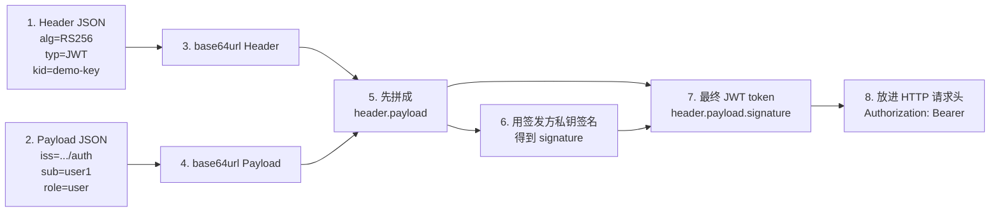
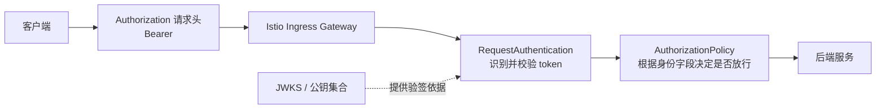
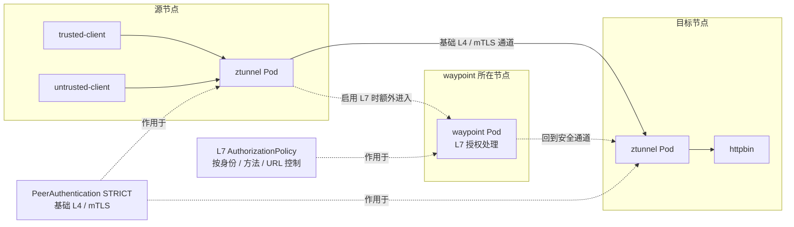
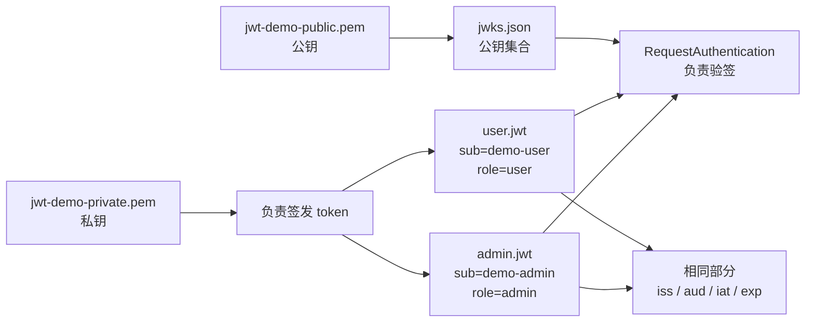
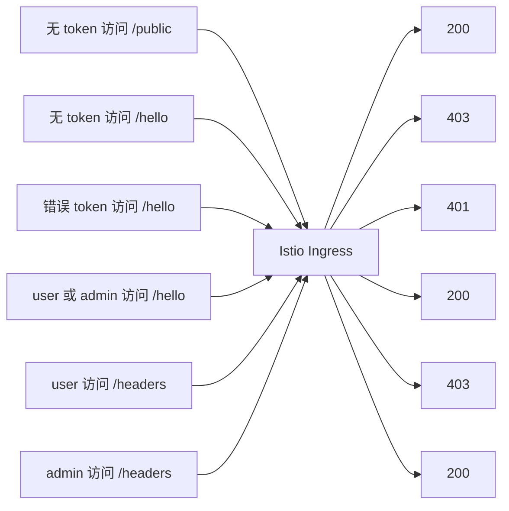
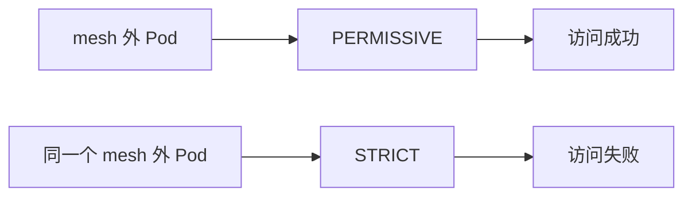
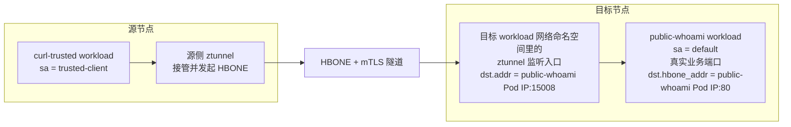
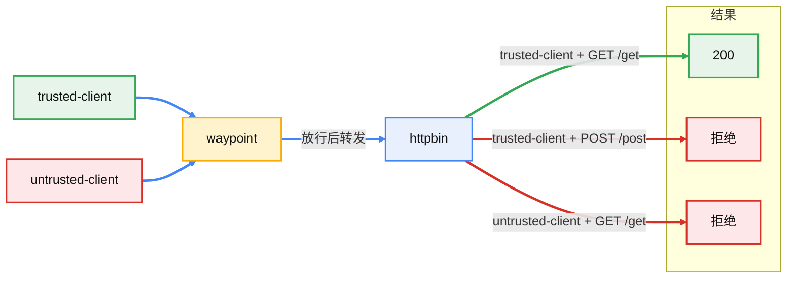

# 第 4 步：开启 JWT、mTLS 与服务间授权

## 本步目标

在新入口和演示应用已经就绪的基础上，补齐第五章的核心安全能力：

- 入口 `JWT`
- 命名空间 `mTLS`
- `waypoint`
- 服务间 `AuthorizationPolicy`

---

## 执行标记

- **执行标记：必须执行**

这一页的执行方式很简单：

1. 先执行主脚本
2. 再按下面 3 个测试依次观察现象

---

## 先把 JWT 讲清楚

`JWT` 是 `JSON Web Token` 的缩写。

### JWT、TLS、mTLS 各管什么

| 概念 | 解决的问题 | 第五章里的位置 |
| :--- | :--- | :--- |
| `TLS` | 客户端连到的入口是不是可信的 | 上一页 `04_publish_istio_ingress.md` 已完成 `HTTPS` 入口建立 |
| `JWT` | 发请求的人是谁 | 北向入口认证 |
| `mTLS` | 服务和服务之间是否相互可信 | 网格内部 `ztunnel` |

这里还要特别提醒：

- 上一页已经完成 `secure-app.qytk8s.com` 的 `HTTPS` 入口和证书
- 本页只在这个既有入口之上继续叠加 `JWT` 与授权控制

### JWT 里最值得先记住的 3 个词

| 术语 | 可以先粗略理解成 |
| :--- | :--- |
| `issuer` | token 里 `iss` 这个字段，表示谁签发了它 |
| `claim` | token 里真正携带身份信息的字段，例如 `sub`、`role` |
| `JWKS` | 服务端验签时要用到的公钥集合（`JSON Web Key Set`），对应后面的验签阶段 |

### JWT 是怎么拼出来的

先看两段最小 JSON。

`Header` 示例：

```json
{
  "alg": "RS256",
  "typ": "JWT",
  "kid": "demo-key"
}
```

`Payload` 示例：

```json
{
  "iss": "https://secure-app.qytk8s.com/auth",
  "sub": "user1",
  "role": "user"
}
```

这两段 JSON 不会原样发送，而是由签发方用私钥按下面顺序处理：



可以按下面顺序理解：

1. 先准备 `Header JSON`
2. 再准备 `Payload JSON`
3. 两段内容分别做 `base64url` 编码
4. 先拼成前两段：
   - `header.payload`
5. 再由签发方用私钥对这两段内容签名，得到第三段：
   - `signature`
6. 最终三段拼起来，形成：
   - `header.payload.signature`
7. 客户端发请求时，把这一整串 token 放进：
   - `Authorization: Bearer <token>`

这里先只抓住 `JWT` 的结构本身：

- 第一段来自 `Header`
- 第二段来自 `Payload`
- 第三段是签名结果
- 发送时放进 `Authorization` 请求头

最小请求示意：

```http
GET /hello HTTP/1.1
Host: secure-app.qytk8s.com
Authorization: Bearer <token>
```

也就是说：

- 客户端发出的仍然是普通 HTTP 请求
- 只是额外多了一个 `Authorization` 请求头
- 这个请求头里放的是整串 `JWT token`

### JWT 在入口上是怎么工作的



这张图要表达的核心是：

- 客户端把整段 `JWT token` 放进 `Authorization` 请求头
- `RequestAuthentication` 先识别并校验这张 token
- `JWKS` 为验签提供公钥依据
- `AuthorizationPolicy` 再根据 token 里的身份字段决定是否放行

一句最短总结：

- `RequestAuthentication`
  - 负责“你这个 token 是否可信”
- `AuthorizationPolicy`
  - 负责“就算 token 可信，你是否有权限访问”

---

上面这张图已经把北向入口上的 `JWT` 认证与授权链讲清楚了。

下面把视角切到网格内部，再看东西向服务之间的安全链路。

## 东西向服务间安全



这张图表达的是网格内部的 `mTLS + AuthorizationPolicy` 链：

- `trusted-client` 和 `untrusted-client` 都会先进入 `ztunnel`
- `PeerAuthentication STRICT` 作用在 `ztunnel` 侧，建立基础 `L4 / mTLS` 可信通道
- `waypoint` 是额外插入的 `L7` 处理点，不是所有流量默认必经节点
- 需要 `L7` 授权时，流量才会额外经过 `waypoint`
- `L7 AuthorizationPolicy` 作用在 `waypoint` 路径上，不是流量终点

---

## 本步脚本

- `k8s/05-security-and-zero-trust/scripts/04_enable_jwt_and_mesh_security.sh`

执行前请确认：

- 上一页 `04_publish_istio_ingress.md` 已完成
- `secure-app.qytk8s.com` 已能通过 `HTTPS /public` 访问
- `istioctl` 已可在 `ops` 上直接使用

---

## 执行命令

<div style="padding: 10px 14px; border: 1px solid #666; border-left: 4px solid #8ab4f8; border-radius: 6px; background: rgba(138,180,248,0.08); margin: 8px 0;">
<strong>ℹ️ 可选预处理命令</strong><br/>
如果脚本已具备执行权限，这一步可以跳过。
</div>

```bash
chmod +x /docker_k8s_2026/k8s/05-security-and-zero-trust/scripts/04_enable_jwt_and_mesh_security.sh
```

<div style="padding: 12px 14px; border: 1px solid #666; border-left: 6px solid #ea4335; border-radius: 6px; background: rgba(234,67,53,0.10); margin: 8px 0;">
<strong>❗ 本步必须粘贴执行</strong><br/>
下面命令是本步主线必跑命令。
</div>

```bash
bash /docker_k8s_2026/k8s/05-security-and-zero-trust/scripts/04_enable_jwt_and_mesh_security.sh
```

<div style="padding: 12px 14px; border: 1px solid #666; border-left: 6px solid #34a853; border-radius: 6px; background: rgba(52,168,83,0.08); margin: 12px 0;">
<strong>主脚本会自动完成这些动作</strong><br/>
你在课堂上只需要执行上面这一条命令，下面这些动作都会由主脚本自动完成。
</div>

1. 检查 `istioctl`
2. 检查并修正 `Cilium` 的 `bpf-lb-sock-hostns-only=true`
3. 如有需要自动滚动重启 `cilium`
4. 生成 `JWT` 演示材料
5. 用 `--for service` 部署 `waypoint`
6. 应用 `JWT`、`mTLS`、`L7` 策略
7. 查看安全对象

---

## 这个脚本具体做了什么

### 动作 1：检查 istioctl

脚本原始代码：

<div style="padding: 10px 14px; border: 1px solid #666; border-left: 4px solid #8ab4f8; border-radius: 6px; background: rgba(138,180,248,0.08); margin: 8px 0;">
<strong>ℹ️ 可选查看代码</strong><br/>
下面代码为脚本原始逻辑，用于理解本步实现，不需要单独执行。
</div>

```bash
command -v istioctl
```

关键介绍：

- 主脚本会先确认 `ops` 节点上已经可以直接使用 `istioctl`
- 如果这里就失败，后面的 `waypoint` 部署和 `Istio` 相关检查都无法继续

### 动作 2：处理 Cilium 下 waypoint 的常见前置项

脚本原始代码：

<div style="padding: 10px 14px; border: 1px solid #666; border-left: 4px solid #8ab4f8; border-radius: 6px; background: rgba(138,180,248,0.08); margin: 8px 0;">
<strong>ℹ️ 可选查看代码</strong><br/>
下面代码为脚本原始逻辑，用于理解本步实现，不需要单独执行。
</div>

```bash
kubectl -n kube-system get cm cilium-config -o jsonpath='{.data.kube-proxy-replacement}'
kubectl -n kube-system get cm cilium-config -o jsonpath='{.data.bpf-lb-sock-hostns-only}'
kubectl -n kube-system patch cm cilium-config --type merge \
  -p '{"data":{"bpf-lb-sock-hostns-only":"true"}}'
kubectl -n kube-system rollout restart ds/cilium
kubectl -n kube-system rollout status ds/cilium --timeout=600s
```

关键介绍：

- 如果底层使用的是 `Cilium + kube-proxy replacement`，而 `socket LB` 没有收敛到 `Hostns-only`
- 发往 `Service` 的流量可能会绕过 `waypoint`
- 结果就是：
  - `waypoint` 配置已经存在
  - 但后面的 `L7` 方法和路径控制看起来“不生效”
- 所以主脚本会自动：
  - 检查这个前置项
  - 不满足时自动修正
  - 如有需要自动滚动重启 `cilium`

### 动作 3：生成 JWT 演示材料

脚本原始代码：

<div style="padding: 10px 14px; border: 1px solid #666; border-left: 4px solid #8ab4f8; border-radius: 6px; background: rgba(138,180,248,0.08); margin: 8px 0;">
<strong>ℹ️ 可选查看代码</strong><br/>
下面代码为脚本原始逻辑，用于理解本步实现，不需要单独执行。
</div>

```bash
python3 /docker_k8s_2026/k8s/05-security-and-zero-trust/scripts/98_generate_demo_jwt.py
```

关键介绍：

- 生成本页后面要用到的私钥、公钥、`jwks.json` 和演示 token
- 没有这一步，后面的 `RequestAuthentication` 就没有稳定的验签材料

这个脚本运行后，主要会在：

- `k8s/05-security-and-zero-trust/pki`

目录里生成下面这些产物：

- `jwt-demo-private.pem`
  - 用来签发演示 token 的私钥
- `jwt-demo-public.pem`
  - 对应公钥
- `jwks.json`
  - 入口 `RequestAuthentication` 用来验签的公钥集合
- `user.jwt`
  - 普通用户演示 token
- `admin.jwt`
  - 管理员演示 token

它们的关系可以直接看下面这张图：



一句话理解：

- 私钥负责“签”
- 公钥 / `jwks.json` 负责“验”
- `user.jwt` 和 `admin.jwt` 用的是同一套验签材料，但代表两种不同身份

### 动作 4：为 mesh-demo 部署 waypoint

脚本原始代码：

<div style="padding: 10px 14px; border: 1px solid #666; border-left: 4px solid #8ab4f8; border-radius: 6px; background: rgba(138,180,248,0.08); margin: 8px 0;">
<strong>ℹ️ 可选查看代码</strong><br/>
下面代码为脚本原始逻辑，用于理解本步实现，不需要单独执行。
</div>

```bash
istioctl waypoint apply --namespace mesh-demo --enroll-namespace --for service --overwrite --wait
```

关键介绍：

- 这一步会创建 `waypoint`
- 同时把 `mesh-demo` 纳入 `waypoint` 管理
- 后面需要经过 `waypoint` 的七层授权能力，都建立在这一步之上

> 在 `Cilium + kube-proxy replacement` 的环境里，主脚本会在前面的“动作 2”自动处理这个常见前置项。这个前置项没有满足时，发往 `Service` 的流量可能会绕过 `waypoint`，导致后面的 `L7` 方法和路径控制看起来“配置了但不生效”。

### 动作 5：统一应用安全对象

脚本原始代码：

<div style="padding: 10px 14px; border: 1px solid #666; border-left: 4px solid #8ab4f8; border-radius: 6px; background: rgba(138,180,248,0.08); margin: 8px 0;">
<strong>ℹ️ 可选查看代码</strong><br/>
下面代码为脚本原始逻辑，用于理解本步实现，不需要单独执行。
</div>

```bash
kubectl apply -f "${REQUEST_AUTH_URL}"
kubectl apply -f "${INGRESS_AUTHZ_URL}"
kubectl apply -f "${PEER_AUTH_URL}"
kubectl apply -f "${HTTPBIN_AUTHZ_URL}"
```

关键介绍：

这一步会把下面 4 份安全清单一次性创建好：

#### 30_requestauthentication_ingress.yaml

<div style="padding: 10px 14px; border: 1px solid #666; border-left: 4px solid #8ab4f8; border-radius: 6px; background: rgba(138,180,248,0.08); margin: 8px 0;">
<strong>YAML 文件：</strong><code>manifests/30_requestauthentication_ingress.yaml</code><br/>
<strong>对象：</strong><code>RequestAuthentication</code><br/>
<strong>作用：</strong>让入口具备 JWT 验签与身份解析能力
</div>

- 详细配置见：[测试 1：入口 JWT 认证与授权](#test-1-jwt)

#### 31_authorizationpolicy_ingress_jwt.yaml

<div style="padding: 10px 14px; border: 1px solid #666; border-left: 4px solid #8ab4f8; border-radius: 6px; background: rgba(138,180,248,0.08); margin: 8px 0;">
<strong>YAML 文件：</strong><code>manifests/31_authorizationpolicy_ingress_jwt.yaml</code><br/>
<strong>对象：</strong><code>AuthorizationPolicy</code><br/>
<strong>作用：</strong>在入口层按 JWT 身份决定谁能访问
</div>

- 详细配置见：[测试 1：入口 JWT 认证与授权](#test-1-jwt)

#### 32_peerauthentication_mesh_demo.yaml

<div style="padding: 10px 14px; border: 1px solid #666; border-left: 4px solid #8ab4f8; border-radius: 6px; background: rgba(138,180,248,0.08); margin: 8px 0;">
<strong>YAML 文件：</strong><code>manifests/32_peerauthentication_mesh_demo.yaml</code><br/>
<strong>对象：</strong><code>PeerAuthentication</code><br/>
<strong>作用：</strong>把 <code>mesh-demo</code> 命名空间切到 <code>STRICT mTLS</code>，为服务间零信任打底
</div>

- 详细配置见：[测试 2：命名空间 mTLS 边界验证](#test-2-mtls)

#### 33_authorizationpolicy_httpbin_waypoint.yaml

<div style="padding: 10px 14px; border: 1px solid #666; border-left: 4px solid #8ab4f8; border-radius: 6px; background: rgba(138,180,248,0.08); margin: 8px 0;">
<strong>YAML 文件：</strong><code>manifests/33_authorizationpolicy_httpbin_waypoint.yaml</code><br/>
<strong>对象：</strong><code>AuthorizationPolicy</code><br/>
<strong>作用：</strong>在 <code>waypoint</code> 路径上按来源身份、HTTP 方法和 URL 路径控制 <code>httpbin</code> 访问
</div>

- 详细配置见：[测试 3：waypoint 上的 L7 方法、URL 与服务身份控制](#test-3-l7-authz)

### 动作 6：最后统一查看安全对象

脚本原始代码：

<div style="padding: 10px 14px; border: 1px solid #666; border-left: 4px solid #8ab4f8; border-radius: 6px; background: rgba(138,180,248,0.08); margin: 8px 0;">
<strong>ℹ️ 可选查看代码</strong><br/>
下面代码为脚本原始逻辑，用于理解本步实现，不需要单独执行。
</div>

```bash
kubectl get requestauthentication,authorizationpolicy,peerauthentication -A
```

关键介绍：

- 这一步不是最终验证全部现象
- 它只是先确认本页关键安全对象已经进入集群

示例输出：

```text
root@ops:/docker_k8s_2026# kubectl get requestauthentication,authorizationpolicy,peerauthentication -A
NAMESPACE       NAME                                                  AGE
istio-ingress   requestauthentication.security.istio.io/ingress-jwt   18s

NAMESPACE       NAME                                                        ACTION   AGE
istio-ingress   authorizationpolicy.security.istio.io/ingress-require-jwt   ALLOW    18s
mesh-demo       authorizationpolicy.security.istio.io/httpbin-waypoint-l7   ALLOW    17s

NAMESPACE   NAME                                                    MODE     AGE
mesh-demo   peerauthentication.security.istio.io/mesh-demo-strict   STRICT   18s
```

这份输出可以直接看出，本页已经出现了 3 类安全对象：

1. `RequestAuthentication`
- `istio-ingress/ingress-jwt`
- 表示第五章入口已经具备：
  - 识别 `JWT`
  - 验签
  - 解析身份信息

2. `AuthorizationPolicy`
- `istio-ingress/ingress-require-jwt`
  - 这是北向入口授权策略
  - 用来控制“哪些入口请求允许访问”
- `mesh-demo/httpbin-waypoint-l7`
  - 这是 `httpbin` 的服务间授权策略
  - 用来控制“哪些来源身份、方法和 URL 可以访问 `httpbin`”

3. `PeerAuthentication`
- `mesh-demo/mesh-demo-strict`
- `MODE=STRICT`
  - 表示 `mesh-demo` 命名空间已经进入严格 `mTLS`

所以这条命令的意义不是“把所有安全能力都验证完成”，而是先确认：

- 入口 `JWT` 认证对象已经存在
- 入口授权对象已经存在
- 服务间授权对象已经存在
- 命名空间级 `mTLS` 对象已经存在

---

## 测试总览

主线只做下面 3 个测试：

1. 测试 1：入口 `JWT` 认证与授权
2. 测试 2：`mTLS` 边界验证
3. 测试 3：`waypoint` 上的 `L7` 方法、URL 与服务身份控制

这 3 个测试分别回答 3 个问题：

- 入口会不会拒绝无身份或伪造身份的请求
- 网格内部是不是已经进入严格 `mTLS`
- 就算都在网格里，是不是也只能按来源身份、方法和 URL 最小放行

---

<a id="test-1-jwt"></a>
## 测试 1：入口 JWT 认证与授权

<div style="padding: 10px 14px; border: 1px solid #666; border-left: 4px solid #f28b82; border-radius: 6px; background: rgba(242,139,130,0.10); margin: 8px 0;">
<strong>❗ 测试边界 1</strong><br/>
本测试只验证入口是否会根据 JWT 结果决定放行或拒绝，不讨论 mesh 内部通信。
</div>



<div style="padding: 12px 16px; border: 1px solid #666; border-left: 6px solid #fbbc04; border-radius: 6px; background: rgba(251,188,4,0.10); margin: 14px 0;">
<strong>本测试对应的 YAML</strong><br/>
本测试验证前面已经应用好的 `30_requestauthentication_ingress.yaml` 和 `31_authorizationpolicy_ingress_jwt.yaml` 是否真正生效。
</div>

开始状态：

- 主脚本已经把入口 `JWT` 配好
- 现在只看两条入口路径：
  - `/public`
    - 用来做匿名访问对照
  - `/hello`
    - 用来演示“合法 token 都能访问”
  - `/headers`
    - 用来演示“只有 admin 能访问”

对应的关键 YAML 配置：

`30_requestauthentication_ingress.yaml`

<div style="padding: 10px 14px; border: 1px solid #666; border-left: 4px solid #8ab4f8; border-radius: 6px; background: rgba(138,180,248,0.08); margin: 8px 0;">
<strong>YAML 文件：</strong><code>manifests/30_requestauthentication_ingress.yaml</code><br/>
<strong>对象：</strong><code>RequestAuthentication</code><br/>
<strong>作用：</strong>让入口具备 JWT 验签与身份解析能力
</div>

```yaml
apiVersion: security.istio.io/v1
kind: RequestAuthentication
metadata:
  name: ingress-jwt
  namespace: istio-ingress
spec:
  selector:
    matchLabels:
      istio: ingressgateway
  jwtRules:
    - issuer: https://secure-app.qytk8s.com/auth
      jwksUri: http://10.1.1.201:9000/05-security-and-zero-trust/pki/jwks.json
      forwardOriginalToken: true
```

- `issuer`
  - 指定谁签发这个 token
- `jwksUri`
  - 指定入口到哪里拿公钥做验签

`31_authorizationpolicy_ingress_jwt.yaml`

<div style="padding: 10px 14px; border: 1px solid #666; border-left: 4px solid #8ab4f8; border-radius: 6px; background: rgba(138,180,248,0.08); margin: 8px 0;">
<strong>YAML 文件：</strong><code>manifests/31_authorizationpolicy_ingress_jwt.yaml</code><br/>
<strong>对象：</strong><code>AuthorizationPolicy</code><br/>
<strong>作用：</strong>在入口层按 JWT 身份决定谁能访问
</div>

```yaml
apiVersion: security.istio.io/v1
kind: AuthorizationPolicy
metadata:
  name: ingress-require-jwt
  namespace: istio-ingress
spec:
  selector:
    matchLabels:
      istio: ingressgateway
  action: ALLOW
  rules:
    - to:
        - operation:
            hosts:
              - secure-app.qytk8s.com
            paths:
              - /public
    - from:
        - source:
            requestPrincipals:
              - "https://secure-app.qytk8s.com/auth/*"
      to:
        - operation:
            hosts:
              - secure-app.qytk8s.com
            paths:
              - /hello
    - from:
        - source:
            requestPrincipals:
              - "https://secure-app.qytk8s.com/auth/*"
      to:
        - operation:
            hosts:
              - secure-app.qytk8s.com
            paths:
              - /headers
      when:
        - key: request.auth.claims[role]
          values:
            - admin
```

- `/public`
  - 匿名放行，作为对照路径
- `requestPrincipals`
  - 要求请求必须带有通过验签后的身份
- `/hello`
  - 只要 token 合法，`user` 和 `admin` 都可以访问
- `/headers`
  - 只有 `role=admin` 才允许访问
- `request.auth.claims[role]`
  - 用来继续区分 `user` 和 `admin`

<div style="padding: 10px 14px; border: 1px solid #666; border-left: 6px solid #34a853; border-radius: 6px; background: rgba(52,168,83,0.08); margin: 8px 0;">
<strong>❗ 本测试必须执行的代码</strong><br/>
按顺序一条一条执行，每执行一步就看一次结果。
</div>

### 第 1 步：不带 token 访问 `/public`

<div style="padding: 10px 14px; border: 1px solid #666; border-left: 6px solid #34a853; border-radius: 6px; background: rgba(52,168,83,0.08); margin: 8px 0;">
<strong>❗ 本条命令必须粘贴执行</strong><br/>
先建立一个对照基线，确认匿名路径 `/public` 仍然可以正常访问。
</div>

```bash
curl -s -o /tmp/ch5_jwt_public.txt -w '%{http_code}\n' \
  --resolve secure-app.qytk8s.com:443:10.1.1.62 \
  --cacert /docker_k8s_2026/k8s/01-k8s-architecture/pki/harbor/harbor-ca.crt \
  https://secure-app.qytk8s.com/public
```

这一步看什么：

- 应返回 `200`
- 这说明入口、HTTPS 和匿名对照路径都正常

### 第 2 步：不带 token 访问 `/hello`

<div style="padding: 10px 14px; border: 1px solid #666; border-left: 6px solid #34a853; border-radius: 6px; background: rgba(52,168,83,0.08); margin: 8px 0;">
<strong>❗ 本条命令必须粘贴执行</strong><br/>
再看入口对“完全没有身份”的受保护路径会怎么处理。
</div>

```bash
curl -s -o /tmp/ch5_jwt_no_token.txt -w '%{http_code}\n' \
  --resolve secure-app.qytk8s.com:443:10.1.1.62 \
  --cacert /docker_k8s_2026/k8s/01-k8s-architecture/pki/harbor/harbor-ca.crt \
  https://secure-app.qytk8s.com/hello
```

这一步看什么：

- 应返回 `403`
- 这说明入口没有拿到可用身份时，会直接拒绝访问

### 第 3 步：带错误 token 访问 `/hello`

<div style="padding: 10px 14px; border: 1px solid #666; border-left: 6px solid #34a853; border-radius: 6px; background: rgba(52,168,83,0.08); margin: 8px 0;">
<strong>❗ 本条命令必须粘贴执行</strong><br/>
这次故意带一个错误 token，看是不是会在验签阶段失败。
</div>

```bash
curl -s -o /tmp/ch5_jwt_bad_token.txt -w '%{http_code}\n' \
  --resolve secure-app.qytk8s.com:443:10.1.1.62 \
  --cacert /docker_k8s_2026/k8s/01-k8s-architecture/pki/harbor/harbor-ca.crt \
  -H 'Authorization: Bearer bad.token.value' \
  https://secure-app.qytk8s.com/hello
```

这一步看什么：

- 应返回 `401`
- 这说明 token 在验签阶段就被判定为非法

### 第 4 步：带 `user.jwt` 访问 `/hello`

<div style="padding: 10px 14px; border: 1px solid #666; border-left: 6px solid #34a853; border-radius: 6px; background: rgba(52,168,83,0.08); margin: 8px 0;">
<strong>❗ 本条命令必须粘贴执行</strong><br/>
先验证普通用户是否可以访问共享路径 `/hello`。
</div>

```bash
USER_TOKEN="$(tr -d '\n' < /docker_k8s_2026/k8s/05-security-and-zero-trust/pki/user.jwt)"
curl -s -o /tmp/ch5_jwt_user_hello.txt -w '%{http_code}\n' \
  --resolve secure-app.qytk8s.com:443:10.1.1.62 \
  --cacert /docker_k8s_2026/k8s/01-k8s-architecture/pki/harbor/harbor-ca.crt \
  -H "Authorization: Bearer ${USER_TOKEN}" \
  https://secure-app.qytk8s.com/hello
```

这一步看什么：

- 应返回 `200`
- 这说明 `user` 身份可以正常访问 `/hello`

### 第 5 步：把 `/hello` 成功响应正文读出来

<div style="padding: 10px 14px; border: 1px solid #666; border-left: 6px solid #34a853; border-radius: 6px; background: rgba(52,168,83,0.08); margin: 8px 0;">
<strong>❗ 本条命令必须粘贴执行</strong><br/>
确认 `user.jwt` 访问 `/hello` 返回的确实是后端业务内容。
</div>

```bash
sed -n '1,20p' /tmp/ch5_jwt_user_hello.txt
```

这一步看什么：

- 应能看到 `helloworld`
- 这说明请求已经真正到达后端服务

### 第 6 步：带 `user.jwt` 访问 `/headers`

<div style="padding: 10px 14px; border: 1px solid #666; border-left: 6px solid #34a853; border-radius: 6px; background: rgba(52,168,83,0.08); margin: 8px 0;">
<strong>❗ 本条命令必须粘贴执行</strong><br/>
再验证普通用户虽然是合法 token，但不能访问 admin 专属路径。
</div>

```bash
USER_TOKEN="$(tr -d '\n' < /docker_k8s_2026/k8s/05-security-and-zero-trust/pki/user.jwt)"
curl -s -o /tmp/ch5_jwt_user_headers.txt -w '%{http_code}\n' \
  --resolve secure-app.qytk8s.com:443:10.1.1.62 \
  --cacert /docker_k8s_2026/k8s/01-k8s-architecture/pki/harbor/harbor-ca.crt \
  -H "Authorization: Bearer ${USER_TOKEN}" \
  https://secure-app.qytk8s.com/headers
```

这一步看什么：

- 应返回 `403`
- 这说明 `user` 虽然通过了验签，但没有命中 admin 路径授权规则

### 第 7 步：带 `admin.jwt` 访问 `/headers`

<div style="padding: 10px 14px; border: 1px solid #666; border-left: 6px solid #34a853; border-radius: 6px; background: rgba(52,168,83,0.08); margin: 8px 0;">
<strong>❗ 本条命令必须粘贴执行</strong><br/>
最后验证 admin 身份是否可以访问 admin 专属路径。
</div>

```bash
ADMIN_TOKEN="$(tr -d '\n' < /docker_k8s_2026/k8s/05-security-and-zero-trust/pki/admin.jwt)"
curl -s -o /tmp/ch5_jwt_admin_headers.txt -w '%{http_code}\n' \
  --resolve secure-app.qytk8s.com:443:10.1.1.62 \
  --cacert /docker_k8s_2026/k8s/01-k8s-architecture/pki/harbor/harbor-ca.crt \
  -H "Authorization: Bearer ${ADMIN_TOKEN}" \
  https://secure-app.qytk8s.com/headers
```

这一步看什么：

- 应返回 `200`
- 这说明 `admin` 身份可以访问 `/headers`

### 第 8 步：把 `/headers` 成功响应正文读出来

<div style="padding: 10px 14px; border: 1px solid #666; border-left: 6px solid #34a853; border-radius: 6px; background: rgba(52,168,83,0.08); margin: 8px 0;">
<strong>❗ 本条命令必须粘贴执行</strong><br/>
确认 admin 请求已经真正到达 `/headers` 对应的后端服务。
</div>

```bash
sed -n '1,20p' /tmp/ch5_jwt_admin_headers.txt
```

这一步看什么：

- 应能看到 `headers` 相关返回内容
- 这说明 admin 请求已经真正到达后端服务

---

<a id="test-2-mtls"></a>
## 测试 2：命名空间 mTLS 边界验证

<div style="padding: 10px 14px; border: 1px solid #666; border-left: 4px solid #f28b82; border-radius: 6px; background: rgba(242,139,130,0.10); margin: 8px 0;">
<strong>❗ 测试边界 2</strong><br/>
本测试只验证 `mesh-demo` 命名空间是否已经具备严格 `mTLS` 边界，不讨论 JWT，也不讨论 L7 授权。
</div>



<div style="padding: 12px 16px; border: 1px solid #666; border-left: 6px solid #fbbc04; border-radius: 6px; background: rgba(251,188,4,0.10); margin: 14px 0;">
<strong>本测试对应的 YAML</strong><br/>
本测试验证前面已经应用好的 `32_peerauthentication_mesh_demo.yaml` 是否真正建立了 `mTLS` 边界。
</div>

开始状态：

- 这份 `YAML` 默认是 `STRICT`
- 为了让学员看懂边界，这里先临时改成 `PERMISSIVE`
- 对照测试结束后，再切回 `STRICT`

对应的关键 YAML 配置：

`32_peerauthentication_mesh_demo.yaml`

<div style="padding: 10px 14px; border: 1px solid #666; border-left: 4px solid #8ab4f8; border-radius: 6px; background: rgba(138,180,248,0.08); margin: 8px 0;">
<strong>YAML 文件：</strong><code>manifests/32_peerauthentication_mesh_demo.yaml</code><br/>
<strong>对象：</strong><code>PeerAuthentication</code><br/>
<strong>作用：</strong>把 <code>mesh-demo</code> 命名空间切到 <code>STRICT mTLS</code>，为服务间零信任打底
</div>

```yaml
apiVersion: security.istio.io/v1
kind: PeerAuthentication
metadata:
  name: mesh-demo-strict
  namespace: mesh-demo
spec:
  mtls:
    mode: STRICT
```

- `mtls.mode: STRICT`
  - 表示这个命名空间默认只接受严格 `mTLS`
- 为了课堂演示边界
  - 先临时切到 `PERMISSIVE`
  - 再切回 `STRICT`

> note
> 命名空间上的 label 主要解决“是否纳入 mesh / waypoint / ambient 管理”；真正把服务间通信切到 `STRICT mTLS` 的核心对象，还是这里的 `PeerAuthentication`。

<div style="padding: 10px 14px; border: 1px solid #666; border-left: 6px solid #34a853; border-radius: 6px; background: rgba(52,168,83,0.08); margin: 8px 0;">
<strong>❗ 本测试必须执行的代码</strong><br/>
按顺序一条一条执行，每执行一步就看一次结果。
</div>

### 第 1 步：先切到 `PERMISSIVE`

<div style="padding: 10px 14px; border: 1px solid #666; border-left: 6px solid #34a853; border-radius: 6px; background: rgba(52,168,83,0.08); margin: 8px 0;">
<strong>❗ 本条命令必须粘贴执行</strong><br/>
先把 `mesh-demo` 从严格模式切到允许明文通过的对照模式。
</div>

```bash
kubectl -n mesh-demo patch peerauthentication mesh-demo-strict \
  --type merge \
  -p '{"spec":{"mtls":{"mode":"PERMISSIVE"}}}'
```

这一步看什么：

- 只要 patch 成功即可
- 这表示接下来 mesh 外的明文访问有机会通过

### 第 2 步：在 `PERMISSIVE` 下测试一次

<div style="padding: 10px 14px; border: 1px solid #666; border-left: 6px solid #34a853; border-radius: 6px; background: rgba(52,168,83,0.08); margin: 8px 0;">
<strong>❗ 本条命令必须粘贴执行</strong><br/>
从 mesh 外的 `default` 命名空间访问 `public-whoami`。
</div>

```bash
kubectl delete pod mtls-check-permissive -n default --ignore-not-found
kubectl run mtls-check-permissive -n default \
  --image=harbor.qytk8s.com/istio/curl:8.12.1 \
  --restart=Never --rm -i \
  --command -- sh -c "curl -sS --max-time 5 http://public-whoami.mesh-demo"
```

这一步看什么：

- 应该能看到正常返回内容
- 这说明在 `PERMISSIVE` 下，mesh 外明文访问可以通过

### 第 3 步：切回 `STRICT`

<div style="padding: 10px 14px; border: 1px solid #666; border-left: 6px solid #34a853; border-radius: 6px; background: rgba(52,168,83,0.08); margin: 8px 0;">
<strong>❗ 本条命令必须粘贴执行</strong><br/>
把命名空间切回严格 `mTLS` 模式。
</div>

```bash
kubectl -n mesh-demo patch peerauthentication mesh-demo-strict \
  --type merge \
  -p '{"spec":{"mtls":{"mode":"STRICT"}}}'
```

这一步看什么：

- 只要 patch 成功即可
- 这表示接下来同一条 mesh 外明文访问应该被拒绝

### 第 4 步：在 `STRICT` 下再测一次

<div style="padding: 10px 14px; border: 1px solid #666; border-left: 6px solid #34a853; border-radius: 6px; background: rgba(52,168,83,0.08); margin: 8px 0;">
<strong>❗ 本条命令必须粘贴执行</strong><br/>
继续从 `default` 命名空间访问同一路径，观察结果是否发生变化。
</div>

```bash
kubectl delete pod mtls-check-strict -n default --ignore-not-found
kubectl run mtls-check-strict -n default \
  --image=harbor.qytk8s.com/istio/curl:8.12.1 \
  --restart=Never --rm -i \
  --command -- sh -c "curl -sS --max-time 5 -o /dev/null -w '%{http_code}\n' http://public-whoami.mesh-demo || true"
```

这一步看什么：

- 这里不应该成功
- 常见现象包括：
  - 返回 `000`
  - `Recv failure: Connection reset by peer`
  - 或其他非成功结果
- 这说明切回 `STRICT` 后，mesh 外明文访问已经被拒绝

### 第 5 步：在 `STRICT` 下，从 mesh 内再测一次

<div style="padding: 10px 14px; border: 1px solid #666; border-left: 6px solid #34a853; border-radius: 6px; background: rgba(52,168,83,0.08); margin: 8px 0;">
<strong>❗ 本条命令必须粘贴执行</strong><br/>
这一步专门证明：`STRICT` 不是把服务彻底打挂，而是只拒绝 mesh 外明文访问；已经纳入 mesh 的客户端仍然可以通过。
</div>

```bash
kubectl -n mesh-demo exec deploy/curl-trusted -- \
  curl -sS --max-time 5 http://public-whoami.mesh-demo
```

这一步看什么：

- 应该能看到正常返回内容
- 这说明 `STRICT` 下 mesh 内客户端访问仍然成功
- 也就是说，前面失败的不是“服务坏了”，而是“mesh 外明文访问被拒绝了”

### 第 6 步：从 `ztunnel` 日志里确认走的是 mTLS / HBONE

<div style="padding: 10px 14px; border: 1px solid #666; border-left: 6px solid #34a853; border-radius: 6px; background: rgba(52,168,83,0.08); margin: 8px 0;">
<strong>❗ 本条命令必须粘贴执行</strong><br/>
这一步用日志做一个更直接的证明：不是“刚好访问成功”，而是流量确实经过了 `ztunnel` 的安全通道。
</div>

```bash
kubectl -n mesh-demo exec deploy/curl-trusted -- \
  curl -sS --max-time 5 http://public-whoami.mesh-demo >/dev/null

kubectl -n istio-system logs -l app=ztunnel --since=2m --prefix=true | \
  grep 'public-whoami' | grep 'connection complete' | tail -n 2 | \
  awk '{
    for (i=1; i<=NF; i++) {
      if ($i ~ /^src.identity=/ ||
          $i ~ /^dst.identity=/ ||
          $i ~ /^dst.addr=/ ||
          $i ~ /^dst.hbone_addr=/ ||
          $i ~ /^direction=/) print $i
    }
    print "---"
  }'
```

这一步里看到的 `sa = trusted-client`，来源于第五章前面已经部署好的 mesh 内客户端清单：

<div style="padding: 10px 14px; border: 1px solid #666; border-left: 4px solid #8ab4f8; border-radius: 6px; background: rgba(138,180,248,0.08); margin: 8px 0;">
<strong>YAML 文件：</strong><code>manifests/01_mesh_clients.yaml</code><br/>
<strong>对象：</strong><code>ServiceAccount</code> + <code>Deployment</code><br/>
<strong>作用：</strong>定义 mesh 内测试客户端，以及它绑定的服务身份
</div>

```yaml
apiVersion: v1
kind: ServiceAccount
metadata:
  name: trusted-client
  namespace: mesh-demo
---
apiVersion: apps/v1
kind: Deployment
metadata:
  name: curl-trusted
  namespace: mesh-demo
spec:
  template:
    spec:
      serviceAccountName: trusted-client
```

也就是说：

- `curl-trusted` 这个 Pod
- 绑定的服务身份就是 `trusted-client`

下面这张图只表达一件事：

- 这条 mesh 内流量不是工作负载自己直接明文互访
- 而是先进入源侧 `ztunnel`
- 再经过 `HBONE + mTLS`
- 最后到达目标侧 `ztunnel` 和目标 workload



这一步看什么：

- 日志里应能看到：
  - `src.identity=spiffe://cluster.local/ns/mesh-demo/sa/trusted-client`
  - `dst.identity=spiffe://cluster.local/ns/mesh-demo/sa/default`
  - `dst.addr=...:15008`
  - `dst.hbone_addr=...`
- 这里主要抓 3 个点：
  - `identity`
    - 说明双方都带着网格身份
  - `dst.addr=...:15008`
    - 对应图里的目标侧 `HBONE` 监听入口
  - `dst.hbone_addr=...:80`
    - 对应图里最终交给 workload 的真实业务端口
- 看到这 3 组字段同时出现，就可以判断这条 mesh 内流量确实经过了 `ztunnel`，并走了 `HBONE / mTLS` 通道。

---

<a id="test-3-l7-authz"></a>
## 测试 3：waypoint 上的 L7 方法、URL 与服务身份控制

<div style="padding: 10px 14px; border: 1px solid #666; border-left: 4px solid #f28b82; border-radius: 6px; background: rgba(242,139,130,0.10); margin: 8px 0;">
<strong>❗ 测试边界 3</strong><br/>
本测试只验证 `waypoint` 路径上的 L7 控制：来源身份、HTTP 方法与 URL 路径。
</div>



<div style="padding: 12px 16px; border: 1px solid #666; border-left: 6px solid #fbbc04; border-radius: 6px; background: rgba(251,188,4,0.10); margin: 14px 0;">
<strong>本测试对应的 YAML</strong><br/>
本测试验证前面已经应用好的 `33_authorizationpolicy_httpbin_waypoint.yaml` 是否真的把来源身份、HTTP 方法和 URL 区分开了。
</div>

开始状态：

- `waypoint` 已经在主脚本里创建好了
- 这份策略不再只是区分“谁能访问”
- 而是继续区分：
  - 哪个来源身份
  - 什么方法
  - 什么 URL

对应的关键 YAML 配置：

`33_authorizationpolicy_httpbin_waypoint.yaml`

<div style="padding: 10px 14px; border: 1px solid #666; border-left: 4px solid #8ab4f8; border-radius: 6px; background: rgba(138,180,248,0.08); margin: 8px 0;">
<strong>YAML 文件：</strong><code>manifests/33_authorizationpolicy_httpbin_waypoint.yaml</code><br/>
<strong>对象：</strong><code>AuthorizationPolicy</code><br/>
<strong>作用：</strong>在 <code>waypoint</code> 路径上按来源身份、HTTP 方法和 URL 路径控制 <code>httpbin</code> 访问
</div>

```yaml
apiVersion: security.istio.io/v1
kind: AuthorizationPolicy
metadata:
  name: httpbin-waypoint-l7
  namespace: mesh-demo
spec:
  targetRefs:
    - group: ""
      kind: Service
      name: httpbin
  action: ALLOW
  rules:
    - from:
        - source:
            principals:
              - cluster.local/ns/istio-ingress/sa/istio-ingressgateway
    - from:
        - source:
            principals:
              - cluster.local/ns/mesh-demo/sa/trusted-client
      to:
        - operation:
            methods:
              - GET
            paths:
              - /get
```

- `targetRefs -> Service/httpbin`
  - 说明这条 L7 策略挂在 `httpbin` 服务对应的 `waypoint` 路径上
- `principals`
  - 先按来源身份区分
- `methods`
  - 再按 HTTP 方法区分
- `paths`
  - 再按访问路径区分
- 这份规则最终表达的是：
  - `istio-ingressgateway`
    - 继续保留访问能力
  - `trusted-client`
    - 只允许 `GET /get`
  - 其他来源
    - 不放行
  - `trusted-client` 的其他方法或路径
    - 也不放行

<div style="padding: 10px 14px; border: 1px solid #666; border-left: 6px solid #34a853; border-radius: 6px; background: rgba(52,168,83,0.08); margin: 8px 0;">
<strong>❗ 本测试必须执行的代码</strong><br/>
按顺序一条一条执行，每执行一步就看一次结果。
</div>

### 第 1 步：先让 `trusted-client` 执行 `GET /get`

<div style="padding: 10px 14px; border: 1px solid #666; border-left: 6px solid #34a853; border-radius: 6px; background: rgba(52,168,83,0.08); margin: 8px 0;">
<strong>❗ 本条命令必须粘贴执行</strong><br/>
先验证被允许的来源身份，访问被允许的方法和路径时，是否可以通过。
</div>

```bash
kubectl -n mesh-demo exec deploy/curl-trusted -- \
  curl -s -o /dev/null -w '%{http_code}\n' \
  http://httpbin.mesh-demo:8000/get
```

这一步看什么：

- 应返回 `200`
- 这说明 `trusted-client + GET + /get` 命中了允许规则

示例输出：

```text
root@ops:/docker_k8s_2026# kubectl -n mesh-demo exec deploy/curl-trusted -- \
  curl -s -o /dev/null -w '%{http_code}\n' \
  http://httpbin.mesh-demo:8000/get
200
```

### 第 2 步：再让 `trusted-client` 执行 `POST /post`

<div style="padding: 10px 14px; border: 1px solid #666; border-left: 6px solid #34a853; border-radius: 6px; background: rgba(52,168,83,0.08); margin: 8px 0;">
<strong>❗ 本条命令必须粘贴执行</strong><br/>
再验证同一个来源身份，如果方法和 URL 不匹配，会不会被拒绝。
</div>

```bash
kubectl -n mesh-demo exec deploy/curl-trusted -- \
  curl -s -o /dev/null -w '%{http_code}\n' -X POST \
  http://httpbin.mesh-demo:8000/post
```

这一步看什么：

- 这里应返回 `403`
- 这说明即使来源身份正确，只要方法和 URL 不匹配，`waypoint` 也会拒绝

示例输出：

```text
root@ops:/docker_k8s_2026# kubectl -n mesh-demo exec deploy/curl-trusted -- \
  curl -s -o /dev/null -w '%{http_code}\n' -X POST \
  http://httpbin.mesh-demo:8000/post
403
```

### 第 3 步：最后让 `untrusted-client` 执行 `GET /get`

<div style="padding: 10px 14px; border: 1px solid #666; border-left: 6px solid #34a853; border-radius: 6px; background: rgba(52,168,83,0.08); margin: 8px 0;">
<strong>❗ 本条命令必须粘贴执行</strong><br/>
最后验证不在允许名单里的来源身份，即使访问同一条 URL，也会被拒绝。
</div>

```bash
kubectl -n mesh-demo exec deploy/curl-untrusted -- \
  curl -s -o /dev/null -w '%{http_code}\n' \
  http://httpbin.mesh-demo:8000/get
```

这一步看什么：

- 这里应返回 `403`
- 这说明 `untrusted-client` 没有命中允许规则，`waypoint` 已按来源身份拒绝访问

示例输出：

```text
root@ops:/docker_k8s_2026# kubectl -n mesh-demo exec deploy/curl-untrusted -- \
  curl -s -o /dev/null -w '%{http_code}\n' \
  http://httpbin.mesh-demo:8000/get
403
```

---

## 本节通过标准

- 测试 1 已验证入口 `JWT` 认证与授权生效
- 测试 2 已验证 `mesh-demo` 命名空间 `mTLS` 边界生效
- 测试 3 已验证 `waypoint` 上按来源身份、方法和 URL 的 `L7` 控制生效

---

## 下一步

进入第 5 步，执行第五章主线最终验收：

- `docs/06_verify.md`
