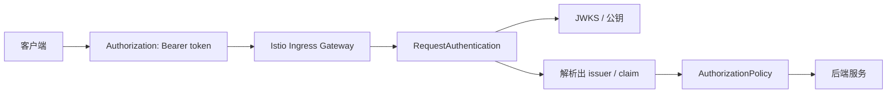
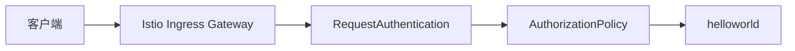
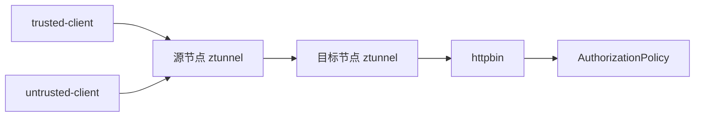

# 第 4 步：开启 JWT、mTLS 与服务间授权

## 本步目标

在新入口和演示应用已经就绪的基础上，补齐第五章的核心安全能力：

- 入口 `JWT`
- 命名空间 `mTLS`
- `waypoint`
- 服务间 `AuthorizationPolicy`

---

## 执行标记

- **执行标记：必须执行**

说明：

- 本步先用主脚本把安全对象一次性铺好
- 课堂上再按下面 6 个功能单元逐个讲现象

也就是说，这一页的正确执行方式是：

1. 先执行主脚本  
2. 再按下面 4.1 到 4.6 的顺序，一个一个验证现象

不是“脚本可刷可不刷”，而是：

- 主脚本负责把这一页需要的安全对象统一准备好
- 后面的 4.1 到 4.6 负责把每个知识点拆开讲清楚

---

## 先把 JWT 讲清楚

很多学员第一次接触 `JWT` 时，最容易混淆三件事：

- `JWT` 是什么
- `JWT` 和 `TLS`、`mTLS` 有什么区别
- `RequestAuthentication` 和 `AuthorizationPolicy` 谁负责什么

### JWT 最短理解

`JWT` 可以先理解成：

- 调用者随请求一起带来的一张“身份说明书”

但这张“身份说明书”不是随便写一段 JSON 就行，而是要满足两点：

- 里面写了“我是谁、我属于什么角色、谁签发了我”
- 还要带签名，服务端才能验证它有没有被伪造

所以它不是：

- 传输加密协议
- 服务间双向认证协议

它解决的问题是：

- “发请求的人是谁”

### JWT、TLS、mTLS 各管什么

| 概念 | 解决的问题 | 第五章里的位置 |
| :--- | :--- | :--- |
| `TLS` | 客户端连到的入口是不是可信的 | 上一页 `04_publish_istio_ingress.md` 已完成 `HTTPS` 入口建立 |
| `JWT` | 发请求的人是谁 | 北向入口认证 |
| `mTLS` | 服务和服务之间是否相互可信 | 网格内部 `ztunnel` |

所以第五章这里要把三者分开：

- `TLS`
  - 保护客户端到入口
- `JWT`
  - 表示客户端身份
- `mTLS`
  - 保护服务到服务

这里还要特别提醒：

- 本页不再重新建立 `TLS` 入口
- 上一页 `04_publish_istio_ingress.md` 已经完成了：
  - `secure-app.qytk8s.com`
  - `HTTPS`
  - 证书
- 本页是在这个已经建立好的 `HTTPS` 入口之上，再继续叠加 `JWT` 和授权控制

### JWT 里最值得先记住的 4 个词

| 术语 | 可以先粗略理解成 |
| :--- | :--- |
| `issuer` | 谁签发这个 token |
| `claim` | token 里携带的身份字段 |
| `JWKS` | 服务端用来验签的一组公钥信息 |
| `Authorization: Bearer ...` | 客户端把 token 放进 HTTP 请求头的常见方式 |

### JWT 在入口上是怎么工作的



这张图要表达的核心是：

- 客户端把 token 放进请求头
- `RequestAuthentication` 负责验签、解析 token
- `AuthorizationPolicy` 再根据解析出来的身份字段决定放不放行

一句最短总结：

- `RequestAuthentication`
  - 负责“你这个 token 是否可信”
- `AuthorizationPolicy`
  - 负责“就算 token 可信，你是否有权限访问”

---

## 安全链路关系图

### 北向入口安全



这张图适合先讲北向入口这条链：

- 客户端先访问 `Istio Ingress Gateway`
- `RequestAuthentication` 负责识别和校验 token
- `AuthorizationPolicy` 再决定是否放行到后端

### 东西向服务间安全



这张图适合再讲网格内部这条链：

- 服务间通信先经过 `ztunnel`
- `mTLS` 负责建立可信链路
- `AuthorizationPolicy` 再限制“谁可以访问 `httpbin`”

---

## 本步脚本

- `k8s/05-security-and-zero-trust/scripts/04_enable_jwt_and_mesh_security.sh`

执行前请确认：

- 上一页 `04_publish_istio_ingress.md` 已完成
- `secure-app.qytk8s.com` 已能通过 `HTTPS /public` 访问
- `istioctl` 已可在 `ops` 上直接使用

---

## 执行命令

<div style="padding: 10px 14px; border: 1px solid #666; border-left: 4px solid #8ab4f8; border-radius: 6px; background: rgba(138,180,248,0.08); margin: 8px 0;">
<strong>ℹ️ 可选预处理命令</strong><br/>
如果脚本已具备执行权限，这一步可以跳过。
</div>

```bash
chmod +x /docker_k8s_2026/k8s/05-security-and-zero-trust/scripts/04_enable_jwt_and_mesh_security.sh
```

<div style="padding: 12px 14px; border: 1px solid #666; border-left: 6px solid #ea4335; border-radius: 6px; background: rgba(234,67,53,0.10); margin: 8px 0;">
<strong>❗ 本步必须粘贴执行</strong><br/>
下面命令是本步主线必跑命令。
</div>

```bash
bash /docker_k8s_2026/k8s/05-security-and-zero-trust/scripts/04_enable_jwt_and_mesh_security.sh
```

---

## 这个脚本具体做了什么

### 动作 1：生成 JWT 演示材料

脚本原始代码：

<div style="padding: 10px 14px; border: 1px solid #666; border-left: 4px solid #8ab4f8; border-radius: 6px; background: rgba(138,180,248,0.08); margin: 8px 0;">
<strong>ℹ️ 可选查看代码</strong><br/>
下面代码为脚本原始逻辑，用于理解本步实现，不需要单独执行。
</div>

```bash
python3 "${JWT_GENERATOR}"
```

关键介绍：

- 生成本页后面要用到的私钥、公钥、`jwks.json` 和演示 token
- 没有这一步，后面的 `RequestAuthentication` 就没有稳定的验签材料

这个脚本运行后，主要会在：

- `k8s/05-security-and-zero-trust/pki`

目录里生成下面这些产物：

- `jwt-demo-private.pem`
  - 用来签发演示 token 的私钥
- `jwt-demo-public.pem`
  - 对应公钥
- `jwks.json`
  - 入口 `RequestAuthentication` 用来验签的公钥集合
- `user.jwt`
  - 普通用户演示 token
- `admin.jwt`
  - 管理员演示 token

可以先这样理解它们的关系：

- 私钥负责“签”
- 公钥 / `jwks.json` 负责“验”
- `user.jwt` / `admin.jwt` 是后面实际拿去发请求测试的 token

### 动作 2：为 mesh-demo 部署 waypoint

脚本原始代码：

<div style="padding: 10px 14px; border: 1px solid #666; border-left: 4px solid #8ab4f8; border-radius: 6px; background: rgba(138,180,248,0.08); margin: 8px 0;">
<strong>ℹ️ 可选查看代码</strong><br/>
下面代码为脚本原始逻辑，用于理解本步实现，不需要单独执行。
</div>

```bash
istioctl waypoint apply --namespace mesh-demo --enroll-namespace --wait
```

关键介绍：

- 这一步会创建 `waypoint`
- 同时把 `mesh-demo` 纳入 `waypoint` 管理
- 后面需要经过 `waypoint` 的七层授权能力，都建立在这一步之上

### 动作 3：统一应用安全对象

脚本原始代码：

<div style="padding: 10px 14px; border: 1px solid #666; border-left: 4px solid #8ab4f8; border-radius: 6px; background: rgba(138,180,248,0.08); margin: 8px 0;">
<strong>ℹ️ 可选查看代码</strong><br/>
下面代码为脚本原始逻辑，用于理解本步实现，不需要单独执行。
</div>

```bash
kubectl apply -f "${REQUEST_AUTH_URL}"
kubectl apply -f "${INGRESS_AUTHZ_URL}"
kubectl apply -f "${PEER_AUTH_URL}"
kubectl apply -f "${HTTPBIN_AUTHZ_URL}"
```

关键介绍：

这一步会把下面 4 份安全清单一次性创建好：

#### 30_requestauthentication_ingress.yaml

<div style="padding: 10px 14px; border: 1px solid #666; border-left: 4px solid #8ab4f8; border-radius: 6px; background: rgba(138,180,248,0.08); margin: 8px 0;">
<strong>YAML 文件：</strong><code>manifests/30_requestauthentication_ingress.yaml</code><br/>
<strong>本页重点对象：</strong><code>RequestAuthentication</code><br/>
<strong>作用：</strong>让第五章入口网关具备 JWT 验签与身份解析能力
</div>

对应变量：

- `REQUEST_AUTH_URL`

实际 URL：

- `http://ops:9000/05-security-and-zero-trust/manifests/30_requestauthentication_ingress.yaml`

来源文件：

- `k8s/05-security-and-zero-trust/manifests/30_requestauthentication_ingress.yaml`

对象类型：

- `RequestAuthentication`

关键原文：

```yaml
apiVersion: security.istio.io/v1
kind: RequestAuthentication
metadata:
  name: ingress-jwt
  namespace: istio-ingress
spec:
  selector:
    matchLabels:
      istio: ingressgateway
  jwtRules:
    - issuer: https://secure-app.qytk8s.com/auth
      jwksUri: http://10.1.1.201:9000/05-security-and-zero-trust/pki/jwks.json
      forwardOriginalToken: true
```

关键解释：

- `selector.matchLabels.istio: ingressgateway`
  - 这说明 JWT 验证规则是挂在第五章入口网关上的
- `issuer`
  - 指定“谁签发这个 token”
- `jwksUri`
  - 指定入口到哪里下载公钥，用来验证签名
- `forwardOriginalToken: true`
  - 表示验证通过后，原始 token 还能继续向后传递

#### 31_authorizationpolicy_ingress_jwt.yaml

<div style="padding: 10px 14px; border: 1px solid #666; border-left: 4px solid #8ab4f8; border-radius: 6px; background: rgba(138,180,248,0.08); margin: 8px 0;">
<strong>YAML 文件：</strong><code>manifests/31_authorizationpolicy_ingress_jwt.yaml</code><br/>
<strong>本页重点对象：</strong><code>AuthorizationPolicy</code><br/>
<strong>作用：</strong>在入口层按 JWT 身份控制访问，保留 <code>/public</code> 作为匿名对照路径
</div>

对应变量：

- `INGRESS_AUTHZ_URL`

实际 URL：

- `http://ops:9000/05-security-and-zero-trust/manifests/31_authorizationpolicy_ingress_jwt.yaml`

来源文件：

- `k8s/05-security-and-zero-trust/manifests/31_authorizationpolicy_ingress_jwt.yaml`

对象类型：

- `AuthorizationPolicy`

关键原文：

```yaml
apiVersion: security.istio.io/v1
kind: AuthorizationPolicy
metadata:
  name: ingress-require-jwt
  namespace: istio-ingress
spec:
  selector:
    matchLabels:
      istio: ingressgateway
  action: ALLOW
  rules:
    - to:
        - operation:
            hosts:
              - secure-app.qytk8s.com
            paths:
              - /public
    - from:
        - source:
            requestPrincipals:
              - "https://secure-app.qytk8s.com/auth/*"
      to:
        - operation:
            hosts:
              - secure-app.qytk8s.com
```

关键解释：

- 第一条规则只放行 `/public`
  - 这就是为什么 `/public` 可以作为匿名访问对照路径
- 第二条规则要求：
  - 请求里必须带有通过验证后的 `requestPrincipals`
- `requestPrincipals: "https://secure-app.qytk8s.com/auth/*"`
  - 表示只有这个签发方签出来、并被入口成功识别的 token 才能满足条件

#### 32_peerauthentication_mesh_demo.yaml

<div style="padding: 10px 14px; border: 1px solid #666; border-left: 4px solid #8ab4f8; border-radius: 6px; background: rgba(138,180,248,0.08); margin: 8px 0;">
<strong>YAML 文件：</strong><code>manifests/32_peerauthentication_mesh_demo.yaml</code><br/>
<strong>本页重点对象：</strong><code>PeerAuthentication</code><br/>
<strong>作用：</strong>把 <code>mesh-demo</code> 命名空间切到 <code>STRICT mTLS</code>，为服务间零信任打底
</div>

对应变量：

- `PEER_AUTH_URL`

实际 URL：

- `http://ops:9000/05-security-and-zero-trust/manifests/32_peerauthentication_mesh_demo.yaml`

来源文件：

- `k8s/05-security-and-zero-trust/manifests/32_peerauthentication_mesh_demo.yaml`

对象类型：

- `PeerAuthentication`

关键原文：

```yaml
apiVersion: security.istio.io/v1
kind: PeerAuthentication
metadata:
  name: mesh-demo-strict
  namespace: mesh-demo
spec:
  mtls:
    mode: STRICT
```

关键解释：

- 这份对象作用在 `mesh-demo` 命名空间
- `mtls.mode: STRICT`
  - 表示该命名空间里的服务间通信必须走严格 `mTLS`
  - 不再接受普通明文方式的网格内访问

#### 33_authorizationpolicy_httpbin_waypoint.yaml

<div style="padding: 10px 14px; border: 1px solid #666; border-left: 4px solid #8ab4f8; border-radius: 6px; background: rgba(138,180,248,0.08); margin: 8px 0;">
<strong>YAML 文件：</strong><code>manifests/33_authorizationpolicy_httpbin_waypoint.yaml</code><br/>
<strong>本页重点对象：</strong><code>AuthorizationPolicy</code><br/>
<strong>作用：</strong>在 <code>waypoint</code> 路径上限制只有指定服务身份可以访问 <code>httpbin</code>
</div>

对应变量：

- `HTTPBIN_AUTHZ_URL`

实际 URL：

- `http://ops:9000/05-security-and-zero-trust/manifests/33_authorizationpolicy_httpbin_waypoint.yaml`

来源文件：

- `k8s/05-security-and-zero-trust/manifests/33_authorizationpolicy_httpbin_waypoint.yaml`

对象类型：

- `AuthorizationPolicy`

关键原文：

```yaml
apiVersion: security.istio.io/v1
kind: AuthorizationPolicy
metadata:
  name: httpbin-waypoint-l7
  namespace: mesh-demo
spec:
  selector:
    matchLabels:
      app: httpbin
  action: ALLOW
  rules:
    - from:
        - source:
            principals:
              - cluster.local/ns/istio-ingress/sa/istio-ingressgateway
    - from:
        - source:
            principals:
              - cluster.local/ns/mesh-demo/sa/trusted-client
```

关键解释：

- `selector.matchLabels.app: httpbin`
  - 说明这份授权策略是专门打在 `httpbin` 身上的
- 第一条允许：
  - 来自 `istio-ingressgateway` 这个服务账号的访问
- 第二条允许：
  - 来自 `trusted-client` 这个服务账号的访问
- 也就是说，不满足这两类身份的来源，即使已经在网格里，也不会被放行

### 动作 4：最后统一查看安全对象

脚本原始代码：

<div style="padding: 10px 14px; border: 1px solid #666; border-left: 4px solid #8ab4f8; border-radius: 6px; background: rgba(138,180,248,0.08); margin: 8px 0;">
<strong>ℹ️ 可选查看代码</strong><br/>
下面代码为脚本原始逻辑，用于理解本步实现，不需要单独执行。
</div>

```bash
kubectl get requestauthentication,authorizationpolicy,peerauthentication -A
```

关键介绍：

- 这一步不是最终验证全部现象
- 它只是先确认本页关键安全对象已经进入集群

示例输出：

```text
root@ops:/docker_k8s_2026# kubectl get requestauthentication,authorizationpolicy,peerauthentication -A
NAMESPACE       NAME                                                  AGE
istio-ingress   requestauthentication.security.istio.io/ingress-jwt   18s

NAMESPACE       NAME                                                        ACTION   AGE
istio-ingress   authorizationpolicy.security.istio.io/ingress-require-jwt   ALLOW    18s
mesh-demo       authorizationpolicy.security.istio.io/httpbin-waypoint-l7   ALLOW    17s

NAMESPACE   NAME                                                    MODE     AGE
mesh-demo   peerauthentication.security.istio.io/mesh-demo-strict   STRICT   18s
```

这份输出可以直接看出，本页已经出现了 3 类安全对象：

1. `RequestAuthentication`
- `istio-ingress/ingress-jwt`
- 表示第五章入口已经具备：
  - 识别 `JWT`
  - 验签
  - 解析身份信息

2. `AuthorizationPolicy`
- `istio-ingress/ingress-require-jwt`
  - 这是北向入口授权策略
  - 用来控制“哪些入口请求允许访问”
- `mesh-demo/httpbin-waypoint-l7`
  - 这是 `httpbin` 的服务间授权策略
  - 用来控制“哪些服务身份可以访问 `httpbin`”

3. `PeerAuthentication`
- `mesh-demo/mesh-demo-strict`
- `MODE=STRICT`
  - 表示 `mesh-demo` 命名空间已经进入严格 `mTLS`

所以这条命令的意义不是“把所有安全能力都验证完成”，而是先确认：

- 入口 `JWT` 认证对象已经存在
- 入口授权对象已经存在
- 服务间授权对象已经存在
- 命名空间级 `mTLS` 对象已经存在

---

## 后续讲解与验证方式

主脚本执行完成后，本节内容再拆成 6 个功能单元依次讲解。每个单元均采用统一结构：

1. 问题背景
2. 理论说明
3. 验证方法
4. 预期结果

也就是说：

- 主脚本负责把安全对象铺到位
- 下面的小节负责解释每个对象到底解决什么问题

---

## 讲解顺序

推荐按下面顺序讲：

1. 生成 `JWT` 演示材料
2. 应用 `RequestAuthentication`
3. 应用入口 `AuthorizationPolicy`
4. 将 `mesh-demo` 纳入 `waypoint`
5. 应用 `PeerAuthentication STRICT`
6. 应用 `httpbin` 服务身份授权

这一顺序对应的逻辑是：

- 先讲“入口如何识别身份”
- 再讲“入口如何拒绝未授权请求”
- 再讲“网格内部如何建立零信任”

---

## 4.1 生成 JWT 演示材料

### 问题背景

如果没有固定的私钥、公钥、`jwks.json` 和示例 token，后面的 `JWT` 认证无法稳定复现。

### 理论说明

本小节需要先明确：

- `JWT` 本身只是一个身份声明
- 网关不能凭空相信 token
- 必须先有一套“谁签发、用什么公钥校验”的材料

### 验证方法

<div style="padding: 10px 14px; border: 1px solid #666; border-left: 4px solid #8ab4f8; border-radius: 6px; background: rgba(138,180,248,0.08); margin: 8px 0;">
<strong>ℹ️ 可选查看命令</strong><br/>
下面命令用于查看当前状态。
</div>

```bash
ls -lh /docker_k8s_2026/k8s/05-security-and-zero-trust/pki
```

### 预期结果

这一阶段的重点不是访问返回值，而是确认认证材料已经生成：

- `jwt-demo-private.pem`
- `jwt-demo-public.pem`
- `jwks.json`
- `user.jwt`
- `admin.jwt`

这 5 个文件分别代表：

- `jwt-demo-private.pem`
  - 演示环境里的签名私钥
  - 用来生成 `user.jwt` 和 `admin.jwt`
  - 这个文件不应该给验证方使用，而是由“签发方”持有

- `jwt-demo-public.pem`
  - 和私钥对应的公钥
  - 它本身不负责签发，只负责让别人验证签名
  - 可以把它理解成“给验证方看的那把钥匙”

- `jwks.json`
  - `JWT` 验签时更常见的公钥发布格式
  - 第五章里的 `RequestAuthentication` 就是通过它来拿到公钥信息
  - 它是入口网关后面真正用来验签的材料

- `user.jwt`
  - 普通用户身份的演示 token
  - 后面用它来验证“普通用户带合法 token 时，哪些请求可以通过”

- `admin.jwt`
  - 管理员身份的演示 token
  - 后面用它来验证“不同身份的 claim，是否会触发不同访问结果”

---

## 4.2 应用 RequestAuthentication

### 问题背景

入口必须先具备“识别 token”的能力，否则后面根本谈不上按身份控制访问。

### 理论说明

本小节应明确：

- `RequestAuthentication` 只负责“验 token”
- 它负责解析 issuer、签名、公钥信息
- 它本身不直接决定“放不放行”

### 验证方法

<div style="padding: 10px 14px; border: 1px solid #666; border-left: 4px solid #8ab4f8; border-radius: 6px; background: rgba(138,180,248,0.08); margin: 8px 0;">
<strong>ℹ️ 可选查看命令</strong><br/>
下面命令用于查看当前状态。
</div>

```bash
kubectl -n istio-ingress get requestauthentication
```

### 预期结果

- 输出中应能看到：
  - `ingress-jwt`
- 这说明入口 `RequestAuthentication` 对象已经创建到集群中
- 它的职责是：
  - 识别 `JWT`
  - 验签
  - 解析身份信息
- 但这些能力是否已经按预期真正生效，仍要结合后面的实际访问测试再确认

---

## 4.3 应用入口 AuthorizationPolicy

### 问题背景

只有识别 token 还不够，还必须明确规定：

- 没 token 能不能访问
- 错 token 能不能访问
- 正确 token 能不能访问

### 理论说明

本小节的核心关系如下：

- `RequestAuthentication` 负责完成 token 校验
- `AuthorizationPolicy` 负责完成访问控制决策

### 验证方法

<div style="padding: 10px 14px; border: 1px solid #666; border-left: 4px solid #8ab4f8; border-radius: 6px; background: rgba(138,180,248,0.08); margin: 8px 0;">
<strong>ℹ️ 可选查看命令</strong><br/>
下面命令用于查看当前状态。
</div>

```bash
kubectl -n istio-ingress get authorizationpolicy
```

再把后面要用到的正确 token 先读出来：

<div style="padding: 10px 14px; border: 1px solid #666; border-left: 4px solid #8ab4f8; border-radius: 6px; background: rgba(138,180,248,0.08); margin: 8px 0;">
<strong>ℹ️ 可选查看命令</strong><br/>
下面命令用于查看当前状态。
</div>

```bash
cat /docker_k8s_2026/k8s/05-security-and-zero-trust/pki/user.jwt
```

### 预期结果

- 输出中应能看到：
  - `ingress-require-jwt`
- `ACTION=ALLOW`
  - 说明入口授权对象已经创建到集群中
- 但这条命令本身只能说明“对象存在”
  - 不能单独证明访问结果已经完全符合预期
- 真实访问效果，还要用下面 3 组请求逐个验证

#### 测试 1：不带 token 访问 `/hello`

<div style="padding: 10px 14px; border: 1px solid #666; border-left: 4px solid #8ab4f8; border-radius: 6px; background: rgba(138,180,248,0.08); margin: 8px 0;">
<strong>ℹ️ 可选查看命令</strong><br/>
下面命令用于查看当前状态。
</div>

```bash
curl -s -o /tmp/ch5_jwt_no_token.txt -w '%{http_code}\n' \
  --resolve secure-app.qytk8s.com:443:10.1.1.62 \
  --cacert /docker_k8s_2026/k8s/01-k8s-architecture/pki/harbor/harbor-ca.crt \
  https://secure-app.qytk8s.com/hello
```

预期结果：

- 返回 `403`

#### 测试 2：带错误 token 访问 `/hello`

<div style="padding: 10px 14px; border: 1px solid #666; border-left: 4px solid #8ab4f8; border-radius: 6px; background: rgba(138,180,248,0.08); margin: 8px 0;">
<strong>ℹ️ 可选查看命令</strong><br/>
下面命令用于查看当前状态。
</div>

```bash
curl -s -o /tmp/ch5_jwt_bad_token.txt -w '%{http_code}\n' \
  --resolve secure-app.qytk8s.com:443:10.1.1.62 \
  --cacert /docker_k8s_2026/k8s/01-k8s-architecture/pki/harbor/harbor-ca.crt \
  -H 'Authorization: Bearer bad.token.value' \
  https://secure-app.qytk8s.com/hello
```

预期结果：

- 返回 `401`

#### 测试 3：带正确 token 访问 `/hello`

<div style="padding: 10px 14px; border: 1px solid #666; border-left: 4px solid #8ab4f8; border-radius: 6px; background: rgba(138,180,248,0.08); margin: 8px 0;">
<strong>ℹ️ 可选查看命令</strong><br/>
下面命令用于查看当前状态。
</div>

```bash
USER_TOKEN="$(tr -d '\n' < /docker_k8s_2026/k8s/05-security-and-zero-trust/pki/user.jwt)"
curl -s -o /tmp/ch5_jwt_good_token.txt -w '%{http_code}\n' \
  --resolve secure-app.qytk8s.com:443:10.1.1.62 \
  --cacert /docker_k8s_2026/k8s/01-k8s-architecture/pki/harbor/harbor-ca.crt \
  -H "Authorization: Bearer ${USER_TOKEN}" \
  https://secure-app.qytk8s.com/hello
```

<div style="padding: 10px 14px; border: 1px solid #666; border-left: 4px solid #8ab4f8; border-radius: 6px; background: rgba(138,180,248,0.08); margin: 8px 0;">
<strong>ℹ️ 可选查看命令</strong><br/>
下面命令用于查看当前状态。
</div>

```bash
sed -n '1,20p' /tmp/ch5_jwt_good_token.txt
```

预期结果：

- 返回 `200`
- 正文里能看到 `helloworld` 返回内容

---

## 4.4 将 mesh-demo 纳入 waypoint

### 问题背景

第五章后面要讲更细的 HTTP 级治理和 L7 能力，必须先把业务纳入 `waypoint`。

### 理论说明

本小节强调的是能力边界，而不是立即展示拦截现象：

- `ztunnel` 主要负责 L4
- `waypoint` 才是后续承载 L7 授权能力的关键位置

### 验证方法

先执行第一条命令：

<div style="padding: 10px 14px; border: 1px solid #666; border-left: 4px solid #8ab4f8; border-radius: 6px; background: rgba(138,180,248,0.08); margin: 8px 0;">
<strong>ℹ️ 可选查看命令</strong><br/>
下面命令用于查看当前状态。
</div>

```bash
kubectl -n mesh-demo get gateway
```

再执行第二条命令：

<div style="padding: 10px 14px; border: 1px solid #666; border-left: 4px solid #8ab4f8; border-radius: 6px; background: rgba(138,180,248,0.08); margin: 8px 0;">
<strong>ℹ️ 可选查看命令</strong><br/>
下面命令用于查看当前状态。
</div>

```bash
kubectl -n mesh-demo get pods,svc | grep waypoint
```

### 预期结果

第一条命令的原始输出示例：

```text
root@ops:/docker_k8s_2026# kubectl -n mesh-demo get gateway
NAME       CLASS            ADDRESS        PROGRAMMED   AGE
waypoint   istio-waypoint   10.97.132.53   True         11m
```

这条输出可以直接说明：

1. `Gateway/waypoint` 已经创建成功
- `CLASS=istio-waypoint`
  - 说明这不是普通入口 `Gateway`，而是 `Istio waypoint`
- `PROGRAMMED=True`
  - 说明这份 `waypoint` 配置已经被控制面成功接收并下发生效

第二条命令的原始输出示例：

```text
root@ops:/docker_k8s_2026# kubectl -n mesh-demo get pods,svc | grep waypoint
pod/waypoint-6848584f99-86bjd        1/1     Running   0          12m
service/waypoint        ClusterIP   10.97.132.53     <none>        15021/TCP,15008/TCP   12m
```

这条输出可以直接说明：

2. `waypoint` 对应的实际运行实例已经起来了
- `pod/waypoint-... 1/1 Running`
  - 说明 `waypoint` Pod 已正常运行

3. `waypoint` 对应的服务也已经创建完成
- `service/waypoint ClusterIP 10.97.132.53`
  - 说明 `waypoint` 已经拥有自己的集群内服务地址
- `15021/TCP`
  - 一般用于健康检查等管理端口
- `15008/TCP`
  - 是 Ambient / HBONE 相关通信端口

> note
> `waypoint` 本质上也是一个 Pod 形式的网格代理；当流量需要 L7 处理时，它会位于两端 `ztunnel` 之间，承担七层授权逻辑。

所以这一步真正确认的是：

- `mesh-demo` 已经成功纳入 `waypoint`
- 后续 L7 授权已经有了承载点
- 本小节的重点不是立即观察拦截现象，而是先确认 `waypoint` 运行基础已经就绪

---

## 4.5 应用 PeerAuthentication STRICT

### 问题背景

如果网格内部不要求 `mTLS`，服务之间就没有“默认只信任内部可信链路”的底线。

### 理论说明

本小节需要明确：

- `PeerAuthentication STRICT` 的目标不是控制业务路径
- 而是强制服务间通信走可信的 `mTLS` 链路

### 验证方法

先确认策略对象已经存在：

<div style="padding: 10px 14px; border: 1px solid #666; border-left: 4px solid #8ab4f8; border-radius: 6px; background: rgba(138,180,248,0.08); margin: 8px 0;">
<strong>ℹ️ 可选查看命令</strong><br/>
下面命令用于查看当前状态。
</div>

```bash
kubectl -n mesh-demo get peerauthentication
```

再做一个更接近“是否真的走了加密链路”的简单验证：

<div style="padding: 10px 14px; border: 1px solid #666; border-left: 4px solid #8ab4f8; border-radius: 6px; background: rgba(138,180,248,0.08); margin: 8px 0;">
<strong>ℹ️ 可选查看命令</strong><br/>
下面命令用于查看当前状态。
</div>

```bash
istioctl ztunnel-config workloads | grep mesh-demo
```

### 预期结果

原始输出示例：

```text
root@ops:/docker_k8s_2026# kubectl -n mesh-demo get peerauthentication
NAME               MODE     AGE
mesh-demo-strict   STRICT   16m
```

这条输出可以直接说明：

- `mesh-demo-strict`
  - 这份 `PeerAuthentication` 对象已经创建成功
- `MODE=STRICT`
  - 表示 `mesh-demo` 命名空间已经进入严格 `mTLS` 模式

这份对象是什么时候配置进去的，也要说清楚：

- 它不是在这一小节单独创建的
- 而是在本页主脚本 `04_enable_jwt_and_mesh_security.sh` 的“动作 3：统一应用安全对象”里一起 apply 进去的
- 对应清单文件是：
  - `32_peerauthentication_mesh_demo.yaml`

所以这一小节的重点是：

- 通过 `get peerauthentication` 确认这份对象已经存在
- 再理解它代表 `mesh-demo` 已经具备严格 `mTLS` 基础
- 后续服务身份授权，都是建立在这个可信通信前提之上

但只看对象存在还不够，最好再补一个更接近“链路是否真的进入加密通道”的验证。

参考官方在 Ambient 场景里的做法，可以用：

<div style="padding: 10px 14px; border: 1px solid #666; border-left: 4px solid #8ab4f8; border-radius: 6px; background: rgba(138,180,248,0.08); margin: 8px 0;">
<strong>ℹ️ 可选查看命令</strong><br/>
下面命令用于查看当前状态。
</div>

```bash
istioctl ztunnel-config workloads | grep mesh-demo
```

原始输出示例：

```text
root@ops:/docker_k8s_2026# istioctl ztunnel-config workloads | grep mesh-demo
mesh-demo            curl-trusted-57f8485cbd-l5wvx                     10.244.6.58     wk-app01  None     HBONE
mesh-demo            curl-untrusted-b57ffdb67-8htj8                    10.244.1.62     wk-edge01 None     HBONE
mesh-demo            helloworld-v1-5fd96c594-72bkz                     10.244.0.55     wk-app02  None     HBONE
mesh-demo            helloworld-v2-7ccd5697d8-nc6lq                    10.244.6.209    wk-app01  None     HBONE
mesh-demo            httpbin-855b99578f-p7w2j                          10.244.1.184    wk-edge01 None     HBONE
mesh-demo            public-whoami-d4747f567-cm972                     10.244.0.56     wk-app02  None     HBONE
mesh-demo            waypoint-6848584f99-86bjd                         10.244.6.175    wk-app01  None     TCP
```

这里重点看输出里的 `PROTOCOL` 列：

- `PROTOCOL=HBONE`
  - 说明该工作负载的服务间通信已经进入 Ambient 的 `HBONE` 通道
  - 而 `HBONE` 正是 Ambient 模式下承载 `mTLS` 加密通信的协议

所以对课堂来说，可以直接把它理解成：

- 看到 `PROTOCOL=HBONE`
  - 就可以说明这类流量已经不是普通明文直连
  - 而是已经进入 Ambient 的加密通信路径

对这份输出可以这样读：

- `curl-trusted`
- `curl-untrusted`
- `helloworld-v1`
- `helloworld-v2`
- `httpbin`
- `public-whoami`
  - 它们的 `PROTOCOL` 都是 `HBONE`
  - 这说明这些业务工作负载已经进入 Ambient 的加密通信通道

- `waypoint`
  - 显示为 `TCP`
  - 这并不表示 Ambient 失效
  - 因为 `waypoint` 本身就是承担七层代理逻辑的特殊工作负载，不按普通业务 Pod 的 `HBONE` 视角展示

所以课堂上真正要抓住的是：

- 业务工作负载看到 `HBONE`
  - 就足以说明 `mesh-demo` 里相关服务流量已经进入加密链路
- 不要因为 `waypoint` 这一行显示 `TCP`，就误以为 `mTLS` 没有生效

也就是说，这一小节更完整的理解应该是：

- `kubectl get peerauthentication`
  - 证明严格 `mTLS` 策略对象已经存在
- `istioctl ztunnel-config workloads`
  - 更进一步证明相关工作负载已经进入 Ambient 的加密传输通道

---

## 4.6 应用 httpbin 服务身份授权

### 问题背景

即使都在网格里，也不能默认谁都能访问谁。

### 理论说明

本小节需要明确：

- `mTLS` 解决“你是不是网格里的可信对象”
- 服务身份授权解决“你虽然在网格里，但你有没有权限访问我”

### 验证方法

先确认服务间授权对象已经存在：

<div style="padding: 10px 14px; border: 1px solid #666; border-left: 4px solid #8ab4f8; border-radius: 6px; background: rgba(138,180,248,0.08); margin: 8px 0;">
<strong>ℹ️ 可选查看命令</strong><br/>
下面命令用于查看当前状态。
</div>

```bash
kubectl -n mesh-demo get authorizationpolicy
```

如果看到类似输出：

```text
root@ops:/docker_k8s_2026# kubectl -n mesh-demo get authorizationpolicy
NAME                  ACTION   AGE
httpbin-waypoint-l7   ALLOW    25m
```

就说明：

- `httpbin-waypoint-l7`
  - 这份 `AuthorizationPolicy` 对象已经创建成功
- `ACTION=ALLOW`
  - 表示它采用“只允许命中规则的来源通过”这种白名单授权方式

这份对象不是在这一小节单独创建的，而是：

- 在本页主脚本 `04_enable_jwt_and_mesh_security.sh` 的“动作 3：统一应用安全对象”里一起 apply 进去的
- 对应清单文件是：
  - `33_authorizationpolicy_httpbin_waypoint.yaml`

它的关键原文在前面已经展开过，重点看的是：

- `selector.matchLabels.app: httpbin`
  - 说明策略直接作用在 `httpbin`
- `principals`
  - 只允许指定服务身份访问它

确认对象存在之后，再分别做 `trusted-client` 和 `untrusted-client` 的访问测试。

#### 测试 1：trusted-client 访问 `httpbin`

<div style="padding: 10px 14px; border: 1px solid #666; border-left: 4px solid #8ab4f8; border-radius: 6px; background: rgba(138,180,248,0.08); margin: 8px 0;">
<strong>ℹ️ 可选查看命令</strong><br/>
下面命令用于查看当前状态。
</div>

```bash
kubectl -n mesh-demo exec deploy/curl-trusted -- \
  curl -s -o /dev/null -w '%{http_code}\n' \
  http://httpbin.mesh-demo:8000/get
```

预期结果：

- 应返回 `200`

#### 测试 2：untrusted-client 访问 `httpbin`

<div style="padding: 10px 14px; border: 1px solid #666; border-left: 4px solid #8ab4f8; border-radius: 6px; background: rgba(138,180,248,0.08); margin: 8px 0;">
<strong>ℹ️ 可选查看命令</strong><br/>
下面命令用于查看当前状态。
</div>

```bash
kubectl -n mesh-demo exec deploy/curl-untrusted -- \
  curl -s -o /dev/null -w '%{http_code}\n' \
  http://httpbin.mesh-demo:8000/get
```

预期结果：

- 应返回拒绝结果
- 常见表现是：
  - `000`
  - `command terminated with exit code 56`
  - 或者其他非 `200` 的拒绝现象

- 第五章的安全模型不仅作用于入口，也作用于服务间访问
- 网格内部访问同样遵循按身份最小授权的原则

---

## 本节通过标准

- `JWT` 材料已经生成
- 入口 `RequestAuthentication` 已存在
- 入口 `AuthorizationPolicy` 已存在
- `mesh-demo` 已纳入 `waypoint`
- `PeerAuthentication STRICT` 已生效
- `httpbin` 服务身份授权已生效

---

## 下一步

进入第 5 步，执行第五章主线最终验收：

- `docs/06_verify.md`
