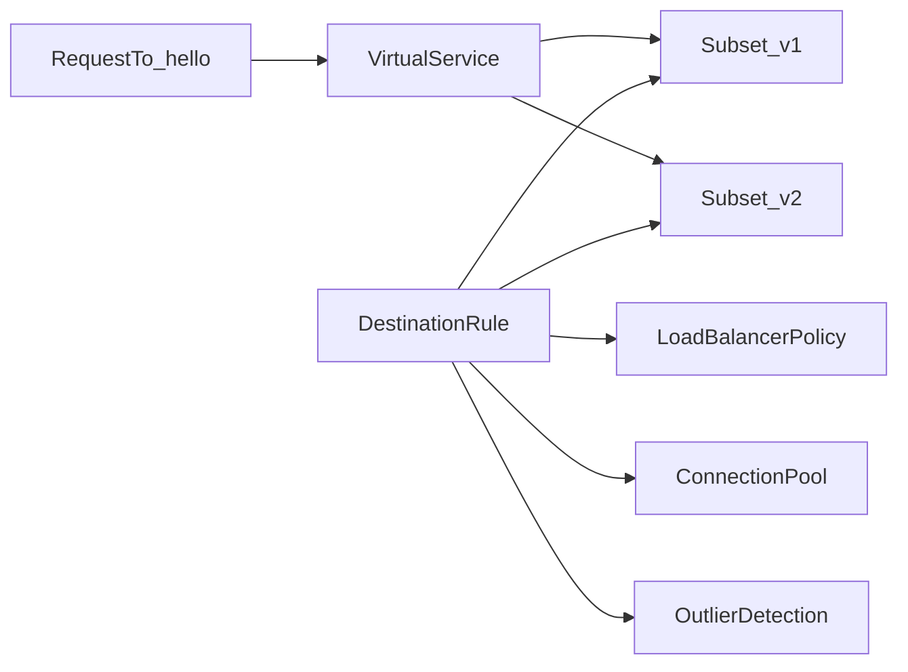
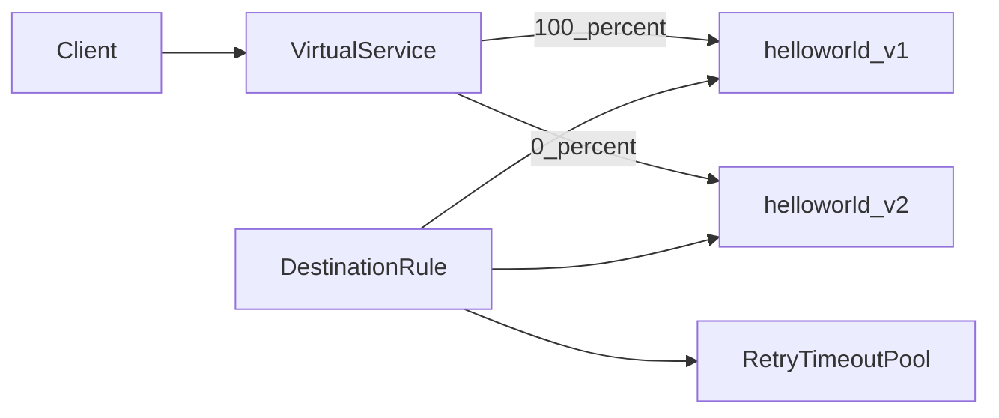

# 第 5 步：配置流量治理基线

## 本步目标

把第五章从“只讲安全”进一步推进到“安全 + 治理”。

本步会建立下面这些基线能力：

- `DestinationRule`
- `subset`
- 基线版本路由
- 负载均衡策略
- 连接池与异常实例剔除参数

## 流量治理关系图



这张图建议你重点讲清：

- `VirtualService` 决定“先分到哪条路”
- `DestinationRule` 决定“每条路上的目标怎么定义、怎么调度”

## 本步脚本

- `k8s/05-security-and-zero-trust/scripts/05_apply_traffic_management.sh`

## 执行命令

```bash
chmod +x /docker_k8s_2026/k8s/05-security-and-zero-trust/scripts/05_apply_traffic_management.sh
```

```bash
bash /docker_k8s_2026/k8s/05-security-and-zero-trust/scripts/05_apply_traffic_management.sh
```

## 功能拆分说明

本节不应只理解为“执行一个脚本”，而应拆成 4 个功能单元依次理解：

1. 为 `helloworld` 建立 `subset`
2. 建立 `100% -> v1` 的稳定基线
3. 定义负载均衡与连接治理参数
4. 为后续灰度、超时、重试、故障注入保留切换基础

每个功能单元均采用统一结构：

1. 问题背景
2. 理论说明
3. 验证方法
4. 预期结果

## 6.1 为 helloworld 建立 subset

### 问题背景

如果业务只有一个逻辑服务名，而没有进一步划分版本子集，则后续无法表达 `v1`、`v2` 的灰度发布和版本治理。

### 理论说明

`subset` 是 `DestinationRule` 中对目标服务版本的进一步定义。  
在本章中，`helloworld` 通过标签区分为 `v1` 与 `v2` 两个子集，为后续的权重分流与灰度发布提供基础。

### 验证方法

```bash
kubectl -n mesh-demo get deploy -l app=helloworld --show-labels
```

```bash
kubectl -n mesh-demo get destinationrule helloworld -o yaml
```

关键字段示意：

```yaml
spec:
  host: helloworld.mesh-demo.svc.cluster.local
  subsets:
    - name: v1
      labels:
        version: v1
    - name: v2
      labels:
        version: v2
```

关键看点：

- 看 `spec.host`
  - 确认目标服务是 `helloworld.mesh-demo.svc.cluster.local`
- 看 `spec.subsets`
  - 确认已经定义 `v1` 和 `v2`
- 看 `subsets[].labels.version`
  - 确认 `v1`、`v2` 子集分别绑定到正确版本标签

### 预期结果

- `helloworld-v1` 与 `helloworld-v2` 的标签能够明确区分版本
- `DestinationRule` 中可以看到 `v1`、`v2` 两个子集定义

## 6.2 建立 100% -> v1 的稳定基线

### 问题背景

如果课程环境一开始就处于 `50/50` 或故障注入状态，后续所有教学现象都会失去统一基准，不利于比较“修改前”和“修改后”的差异。

### 理论说明

稳定基线的作用，是为后续所有治理演示提供一个确定的起点。  
本章约定基线路由为：

- `/hello` 默认 `100% -> v1`
- `public` 路径始终保持可访问
- `httpbin` 路径保持普通转发

### 验证方法

```bash
kubectl -n mesh-demo get virtualservice secure-app -o yaml
```

关键字段示意：

```yaml
spec:
  http:
    - name: hello
      match:
        - uri:
            prefix: /hello
      route:
        - destination:
            host: helloworld.mesh-demo.svc.cluster.local
            subset: v1
          weight: 100
```

关键看点：

- 看 `spec.http`
  - 确认存在 `/hello` 相关路由规则
- 看 `/hello` 对应的 `route`
  - 确认流量当前 `100% -> v1`
- 看是否还存在 `50/50`、`90/10`、`fault` 相关字段
  - 基线状态下不应存在这些临时治理配置

### 预期结果

- `VirtualService` 已存在
- `/hello` 的流量默认全部指向 `v1`
- 当前环境不包含 `50/50`、`90/10`、`fault injection` 等临时场景

## 6.3 定义负载均衡与连接治理参数

### 问题背景

流量治理并不只包含“流量分给谁”，还包括“连接如何建立、异常实例如何处理、请求如何调度”。

### 理论说明

`DestinationRule` 在本章中承担三类职责：

- 定义版本子集
- 定义负载均衡算法
- 定义连接池与异常实例剔除参数

这也是为什么 `VirtualService` 和 `DestinationRule` 必须配合使用，而不是只配置其一。

### 验证方法

```bash
kubectl -n mesh-demo get destinationrule helloworld -o yaml
```

关键字段示意：

```yaml
spec:
  trafficPolicy:
    loadBalancer:
      simple: ROUND_ROBIN
    connectionPool:
      tcp:
        maxConnections: 20
    outlierDetection:
      consecutive5xxErrors: 3
```

关键看点：

- 看 `spec.trafficPolicy.loadBalancer`
  - 确认负载均衡算法，例如 `ROUND_ROBIN`
- 看 `spec.trafficPolicy.connectionPool`
  - 确认已设置连接池参数
- 看 `spec.trafficPolicy.outlierDetection`
  - 确认已设置异常实例剔除参数
- 本命令的重点不是完整阅读 YAML，而是确认治理参数是否存在

### 预期结果

- 可以看到 `ROUND_ROBIN`
- 可以看到连接池相关参数
- 可以看到 `outlierDetection` 配置

## 6.4 为后续高级治理场景提供基础

### 问题背景

后续要演示 `50/50`、`90/10`、`timeout`、`retry`、`fault injection`，必须先有一套稳定且可切换的治理基础。

### 理论说明

本节完成后，并不会立即把环境切到高级场景，而是先把：

- 版本子集
- 稳定基线
- 治理参数

全部准备完成。  
后续高级场景由 `manual_tests/` 中的脚本临时切换，讲解完成后再恢复基线。

### 验证方法

```bash
bash /docker_k8s_2026/k8s/05-security-and-zero-trust/manual_tests/99_reset_baseline.sh
```

### 预期结果

- 课程环境始终可以回到统一基线
- 后续高级治理演示具备可重复切换条件

## 脚本执行内容

脚本执行时会：

1. 对 `helloworld` 定义 `v1`、`v2` 两个 `subset`
2. 设置默认基线路由为 `100% -> v1`
3. 配置 `ROUND_ROBIN`、连接池与 `outlierDetection`
4. 保留 50/50、90/10、超时重试、故障注入等场景清单，供手动测试脚本切换

## 执行后的检查

```bash
kubectl -n mesh-demo get destinationrule,virtualservice
```

```bash
kubectl -n mesh-demo get deploy -l app=helloworld --show-labels
```

## 执行结果

- `DestinationRule` 已出现
- `VirtualService` 已出现
- 当前基线路由稳定指向 `v1`

## 理论总结

- `VirtualService` 负责描述流量转发路径
- `DestinationRule` 负责描述目标版本与治理参数
- `subset` 是灰度发布和版本治理的基础
- 稳定基线是后续高级场景演示的前提

### 灰度和治理演示图



这张图说明的顺序如下：

- 基线首先固定为 `100% -> v1`
- 后续再临时切换到 `50/50`
- 再切换到 `90/10`
- 最后进入 `timeout`、`retry` 和 `fault injection`

## 下一步

进入课堂手动测试阶段：

- `docs/08_manual_tests.md`
