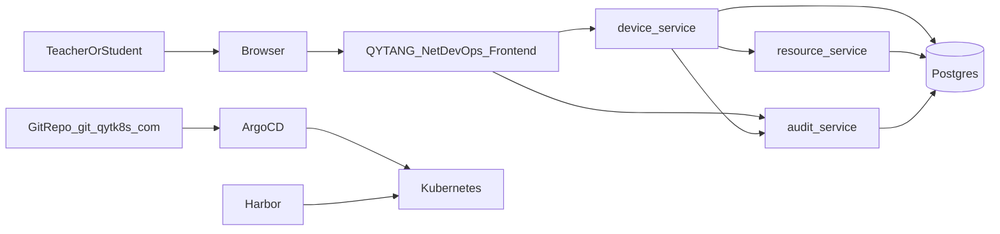

# 第六章理论导读：GitOps、持续交付与样板工程

## 本章定位

前五章完成的是平台能力建设：

- 第一章准备基础节点、Harbor、LB 与 Kubernetes 基础设施
- 第二章完成 `Cilium` 网络与服务互联
- 第三章完成北向入口、VIP、HTTPS 与 Gateway API
- 第四章完成存储与有状态基础
- 第五章完成 `Istio` 安全、零信任与流量治理

第六章开始，课程主线从“平台建设”切换到“应用上线”。

这一章不再只关心某个组件能不能跑起来，而是要把下面这条链路讲完整：

`代码 -> Git -> CI -> Harbor -> Git(values) -> Argo CD -> Kubernetes`

## 为什么需要 GitOps

传统课堂里，应用上线常见方式是：

1. 改代码
2. 手工构建镜像
3. 手工推送镜像
4. 手工 `kubectl apply`
5. 手工确认 Pod 是否 Running

这种方式虽然能把应用发出去，但存在明显问题：

- 发布动作分散，无法准确追溯
- 配置变更和代码变更混在一起
- 学员容易只记住命令，不理解交付链路
- 回滚依赖人工记忆，课堂复现成本高

GitOps 的核心思想，就是把“期望状态”写进 Git，并让系统持续把集群拉回到 Git 描述的状态。

你讲课时可以把它压缩成一句话：

> Git 里写的是“我希望集群变成什么样”，Argo CD 负责把集群变成那个样子。

## GitOps 的 4 个关键角色

### 1. 源码仓

保存应用源码、Dockerfile、测试脚本等内容。

### 2. 镜像仓

保存构建好的镜像，本课程统一使用 `harbor.qytk8s.com`。

### 3. 配置事实源

保存 Helm Chart、`values.yaml`、Argo CD Application 等声明式配置。

这里要特别强调：

- 镜像可以先被构建出来
- 但只有当新的 tag 被写回 Git
- `Argo CD` 才会按新的目标状态发布

### 4. 同步控制器

本课程使用 `Argo CD`，负责从 Git 拉取配置并同步到 Kubernetes。

## 当前已落地流程与推荐流程

第六章当前已经真实落地的是：

- 手工拆解版 GitOps
- 也就是老师手工演示改代码、构建镜像、修改 values、再看 Argo CD 同步

这样做的教学价值是：

- 每一层动作都能被学员看到
- 学员不会把 `Argo CD` 误解成“自动帮你编译代码”

第六章后续更推荐的工程化表达是：

- 人只 `push` 一次
- `Git` 触发 `CI`
- `CI` 自动构建镜像并推送到 `Harbor`
- `CI` 自动把新的 tag 回写到 Git
- `Argo CD` 按 Git 最终状态同步

你上课时可以把它压缩成一句话：

> 人只 push 一次，CI 补全镜像构建和 values 回写，Argo CD 按 Git 最终状态发布。

## 本章为什么先做本地样板工程

这一章虽然主题是 GitOps，但不应该一开始就只讲 Argo CD。

先做 `QYTANG NetDevOps` 样板工程，有 3 个教学价值：

- 先让学员看到一个真实可用、界面像样的微服务系统
- 先讲清楚前端、后端、数据库、接口和审计日志的关系
- 后面再引入 GitOps，学员才能理解“它到底在交付什么”

所以第六章分成两个层次：

- 第一层：先把应用做出来并本地联调
- 第二层：再把应用工程化、镜像化并接入 GitOps

## 为什么选择 `QYTANG NetDevOps`

本章演示应用不是通用商城，也不是博客，而是一个简单的网络设备资源管理系统。

它的价值在于：

- 主题和整门课程一致，贴近网络/云原生运维场景
- 数据结构简单，学员容易理解
- 页面上天然有设备、接口、状态、审计等信息，方便后续讲可观测性
- 内部调用链明确，方便后续讲 `metrics`、日志和 `trace`

## 本章样板应用主线

### 核心对象

- `Device`
- `Interface`
- `AuditLog`

### 一期功能

- 新增设备
- 编辑设备
- 删除设备
- 查看设备列表
- 查看设备详情
- 查看设备接口列表
- 查看操作审计日志
- 提供初始化演示数据

### 服务拆分

- `frontend`
- `device-service`
- `resource-service`
- `audit-service`
- `postgres`

## 第六章全景图

## 你上课时可以先讲清楚的 5 句话

1. `QYTANG NetDevOps` 是这一章的微服务样板工程。
2. 前半段先讲应用结构和本地联调，后半段再讲 GitOps。
3. 镜像继续统一走 `Harbor`，Git 继续统一走 `git.qytk8s.com`。
4. Argo CD 不关心你怎么写代码，它只关心 Git 里声明的目标状态。
5. 本章结束后，学员要能理解“一个应用怎么从代码进入集群”。

## 本章边界

第六章聚焦：

- 微服务样板工程
- 本地开发联调
- 镜像构建与发布
- Git 仓库管理
- Helm Chart
- Argo CD
- GitOps 发布、更新与回滚

暂不展开：

- 完整 CI 平台落地实现
- 多环境晋级流水线
- 多租户 Argo CD
- 复杂 Secret 管理体系
- 多集群 GitOps

## 下一步

先进入第六章总览：

- `docs/01_chapter_guide.md`
