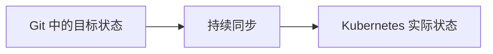
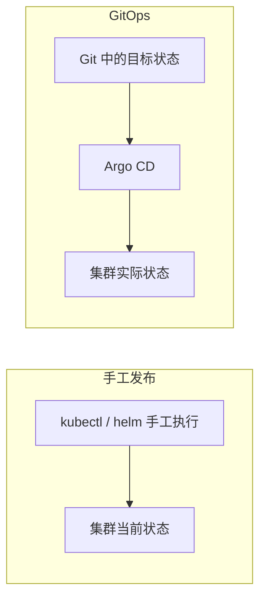
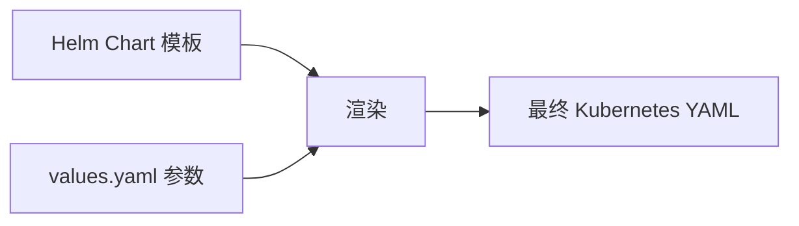
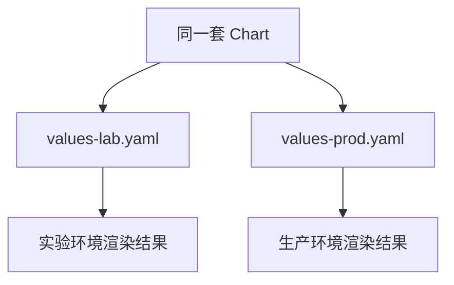
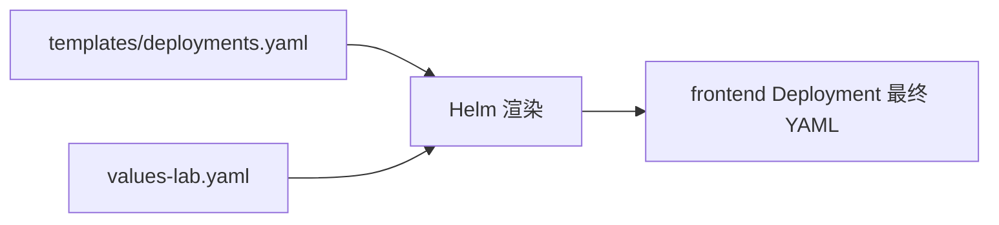
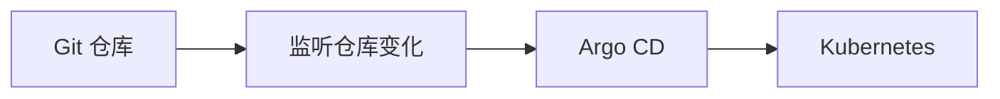
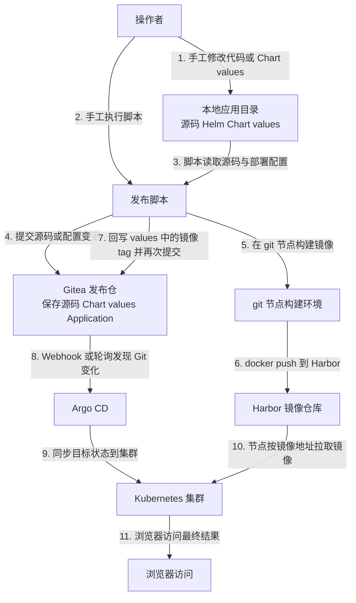
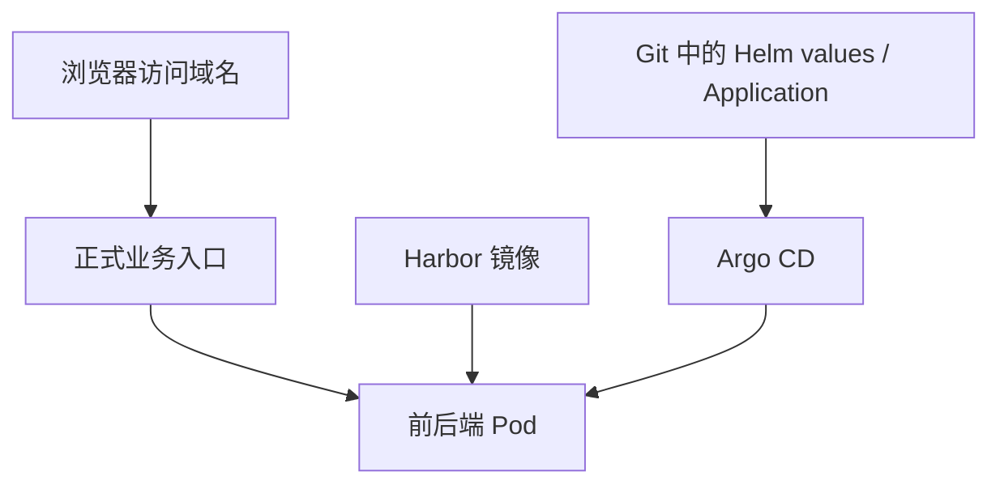

# 第六章理论：GitOps、Helm 与 Argo CD

## 本节目标

完成这一节后，应该先建立下面几个最基础的认识：

- 什么是 `GitOps`
- 什么是 `Helm`
- 什么是 `values.yaml`
- 什么是 `Argo CD`
- 第六章要打通的完整交付链路是什么

## 什么是 GitOps

`GitOps` 可以先记成一句最短的话：

**用 Git 中声明的目标状态，持续驱动集群达到这个状态。**



这里有两个关键词：

- `Git`
  - 负责保存目标状态
- `持续同步`
  - 负责把目标状态落实到集群

所以 `GitOps` 关注的不是：

- 人刚刚手工执行过什么命令

而是：

- 集群最终应该长成什么样

例如：

- 前端镜像应使用哪个 tag
- 前端副本数应该是多少
- 应用应该部署到哪个命名空间

### GitOps 和手工发布的区别



这张图要表达的核心是：

- 手工发布更关注“人刚刚执行了什么命令”
- GitOps 更关注“Git 里声明的目标状态是什么”

## 什么是 Helm

`Helm` 可以先理解成：

**Kubernetes 的应用打包与模板化工具。**

它解决的问题是：

- 一个应用往往不只一份 YAML
- 同一套应用在不同环境里，只有少数字段不同
- 这些差异不应该靠复制很多份 YAML 来维护

所以 `Helm` 的作用是：

- 把一组 Kubernetes 资源打成一个 `Chart`
- 把可变化的部分抽成参数
- 再根据参数渲染出最终 YAML



## 什么是 values.yaml

`values.yaml` 是 `Helm Chart` 的参数文件。

它可以先理解成：

**这套应用部署时要填入的配置值。**

例如常见内容有：

- 镜像仓库
- 镜像 tag
- 副本数
- Service 类型
- Ingress / Gateway 域名
- 资源限制

所以关系可以先记成：

```text
Chart = 模板骨架
values.yaml = 具体参数
最终渲染结果 = 真正提交到 Kubernetes 的 YAML
```

### `Chart` 和 `values.yaml` 为什么要分开



这张图要表达的核心是：

- 应用模板通常是一套
- 环境差异主要放在不同的 `values` 文件里

## 一个真实的 Chart 与 values 案例

第六章直接用本章自己的 `QYT NetDevOps` 来看最容易理解。

来源文件：

- [deployments.yaml](/docker_k8s_2026/apps/qytang-netdevops/deploy/helm/qytang-netdevops/templates/deployments.yaml)
- [values-lab.yaml](/docker_k8s_2026/apps/qytang-netdevops/deploy/helm/qytang-netdevops/values-lab.yaml)

文件类型：

- `deployments.yaml`
  - `Helm` 模板文件
- `values-lab.yaml`
  - `Helm values` 参数文件

例如前端 `Deployment` 模板里写的是：

```yaml
kind: Deployment
metadata:
  name: frontend
  namespace: {{ .Values.namespace }}
spec:
  replicas: {{ .Values.frontend.replicaCount }}
  template:
    spec:
      containers:
        - name: frontend
          image: "{{ .Values.frontend.image.repository }}:{{ .Values.frontend.image.tag }}"
```

而实验环境的 `values-lab.yaml` 里写的是：

```yaml
namespace: qytang-netdevops

frontend:
  replicaCount: 1
  image:
    repository: harbor.qytk8s.com/qytang-netdevops/frontend
    tag: v0.2.3
```

这两份文件结合起来后，学员最应该看懂的是：

- `{{ .Values.namespace }}`
  - 会被替换成 `qytang-netdevops`
- `{{ .Values.frontend.replicaCount }}`
  - 会被替换成 `1`
- `{{ .Values.frontend.image.repository }}`
  - 会被替换成 `harbor.qytk8s.com/qytang-netdevops/frontend`
- `{{ .Values.frontend.image.tag }}`
  - 会被替换成 `v0.2.3`

也就是说，最后渲染出来的结果更像这样：

```yaml
kind: Deployment
metadata:
  name: frontend
  namespace: qytang-netdevops
spec:
  replicas: 1
  template:
    spec:
      containers:
        - name: frontend
          image: harbor.qytk8s.com/qytang-netdevops/frontend:v0.2.3
```

这就是 `Helm` 在这一章里最核心的作用：

- 模板里先写“可变化的位置”
- `values` 里再填“这次部署到底用什么值”
- 最后得到真正提交到 Kubernetes 的 YAML



## 什么是 Argo CD

`Argo CD` 是 GitOps 控制器。

它最核心的职责只有一句：

**盯住 Git 中声明的目标状态，并把它同步到 Kubernetes。**

它主要负责：

- 拉取 Git 仓库
- 识别其中的 `Helm` / YAML / Kustomize 内容
- 渲染并应用到集群
- 持续比较 Git 与集群的差异

它不负责：

- 编写业务代码
- 构建镜像
- 推送镜像到仓库



所以可以先把 `Argo CD` 记成：

- 它不是“代码仓库”
- 它也不是“镜像仓库”
- 它是“把 Git 里的部署目标同步到集群”的控制器

在这一章里，`Argo CD` 的触发可以先理解成两种常见方式：

- 仓库轮询
  - 定时检查 Git 是否发生变化
- Webhook
  - Git 仓库在提交后主动通知 `Argo CD`

对课堂来说，先记住一句最短的话就够了：

**`Argo CD` 的触发点来自 Git 变化，而不是来自 Harbor。**

## Git、Harbor、Helm、Argo CD 各自做什么

| 组件 | 主要职责 | 不负责什么 |
|---|---|---|
| Git 仓库 | 保存源码与部署目标状态 | 不保存镜像二进制 |
| Harbor | 保存镜像本体 | 不负责同步集群 |
| Helm | 组织模板与参数 | 不持续监控集群 |
| Argo CD | 把 Git 里的目标状态同步到集群 | 不编译代码、不构建镜像 |

## 第六章最终要打通的完整链路



这张图可以直接按图中的序号来理解：

1. 操作者先修改本地应用目录里的内容  
   这里可能改的是业务代码，也可能改的是 `Helm Chart` 或 `values`
2. 操作者手工执行发布脚本  
   当前第六章不是全自动 `CI`，而是人手工触发脚本
3. 脚本读取本地应用目录中的源码与部署配置  
   也就是读取本地应用目录里的代码、`Chart` 和 `values`
4. 脚本先把源码或配置变更提交到 `Gitea`  
   `Gitea` 里保存的是发布所需的声明式内容
5. 脚本在 `git` 节点构建镜像
6. 构建完成后把镜像推送到 `Harbor`  
   `Harbor` 保存的是镜像本体
7. 脚本回写 `values` 中的镜像 `tag`，再提交一次到 `Gitea`  
   这一步会把“这次发布到底用哪个镜像版本”写进 Git
8. `Argo CD` 通过 `Webhook` 或轮询发现 Git 变化  
   `Argo CD` 的触发点来自 Git，而不是来自 `Harbor`
9. `Argo CD` 把 Git 中声明的目标状态同步到集群
10. 集群里的节点按新的镜像地址从 `Harbor` 拉取镜像并完成更新
11. 浏览器访问最终发布结果

这里最关键的边界只有两条：

- 脚本既会提交 Git，也会构建并推送镜像
- 真正触发集群更新的，仍然是 Git 中目标状态发生变化

## 第六章最终发布结果长什么样



这张图要表达的核心是：

- 用户最终看到的是业务入口和页面
- 但页面背后同时依赖两类交付输入：
  - 来自 Harbor 的镜像
  - 来自 Git 的部署配置
- `Argo CD` 负责把 Git 中的部署配置落实成集群状态

## 第六章里的 GitOps 到底是什么形态

这一章里的 GitOps，先落地成一条适合课堂理解的主线：

- 先准备应用与部署资产
- 再把应用目录同步到 `Gitea`
- 再构建镜像并推送到 `Harbor`
- 再由 `Argo CD` 从 Git 拉取并同步到集群
- 最后通过正式域名访问结果

这一章先要讲清楚的是：

- Git 保存什么
- Harbor 保存什么
- Helm 负责什么
- Argo CD 负责什么

后面各节不再重复展开这些基础定义，而是直接进入实际对象、脚本和发布链路。

## 这一页先记住的最短结论

- `GitOps`
  - 用 Git 中声明的目标状态驱动集群
- `Helm`
  - 用模板和参数组织一套应用部署资源
- `values.yaml`
  - 给 `Helm` 提供具体部署参数
- `Argo CD`
  - 把 Git 中声明的部署目标同步到 Kubernetes
- 第六章主线
  - 代码进 Git
  - 镜像进 Harbor
  - 配置经 Helm 组织
  - 由 Argo CD 同步到集群

## 下一步

进入应用设计、本地联调与工程化资产：

- `docs/02_app_design_and_local_preview.md`
