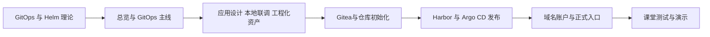

# 第六章总览：GitOps 与自动化

## 本章目标

第六章的目标不是单独安装某一个工具，而是把一条完整交付链路讲清楚：

- 应用设计
- 本地联调
- 容器化
- Git 事实源
- 镜像仓库
- Argo CD 同步
- 正式业务入口
- 课堂现场演示

## 第六章主线图

如果你要从头到尾顺刷，第六章主线就是下面这条链路：

## 第六章主线目录

请按下面顺序阅读与执行：

1. `docs/00_gitops_theory.md`
2. `docs/02_overview_and_gitops_flow.md`
3. `docs/03_app_design_and_local_preview.md`
4. `docs/04_gitea_setup_and_repo_bootstrap.md`
5. `docs/05_harbor_argocd_and_e2e_verification.md`
6. `docs/06_domains_accounts_and_classroom_demo.md`
7. `docs/07_gitops_demo_and_testing.md`

## 主线说明

### 1. GitOps 与 Helm 理论

- 对应文档：[00_gitops_theory.md](/docker_k8s_2026/k8s/06-gitops-and-automation/docs/00_gitops_theory.md)
- 什么是 `GitOps`
- 什么是 `Helm`
- 什么是 `values.yaml`
- 什么是 `Argo CD`
- 第六章最终要打通的完整交付链路

### 2. 总览与 GitOps 主线

- 对应文档：[02_overview_and_gitops_flow.md](/docker_k8s_2026/k8s/06-gitops-and-automation/docs/02_overview_and_gitops_flow.md)
- 第六章到底解决什么问题
- 主仓、`Gitea`、`Harbor`、`Argo CD` 的角色边界
- 第六章这条实际交付链路如何闭环

### 3. 应用设计、本地联调与工程化资产

- 对应文档：[03_app_design_and_local_preview.md](/docker_k8s_2026/k8s/06-gitops-and-automation/docs/03_app_design_and_local_preview.md)
- `QYT NetDevOps` 为什么这样设计
- 微服务职责边界
- 本地联调与第一阶段验收
- `Dockerfile`
- `docker compose`
- `Helm Chart`
- `values`
- `Argo CD Application`

### 4. Gitea 落地与仓库初始化

- 对应文档：[04_gitea_setup_and_repo_bootstrap.md](/docker_k8s_2026/k8s/06-gitops-and-automation/docs/04_gitea_setup_and_repo_bootstrap.md)
- `git.qytk8s.com` 的安装与信任链
- 应用仓库创建
- 首次把应用目录同步到 `Gitea`

### 5. Harbor、Argo CD 与发布闭环

- 对应文档：[05_harbor_argocd_and_e2e_verification.md](/docker_k8s_2026/k8s/06-gitops-and-automation/docs/05_harbor_argocd_and_e2e_verification.md)
- 远程构建镜像
- 推送到 `Harbor`
- 安装 `Argo CD`
- 同步应用
- 端到端验收

### 6. 域名、账户与正式入口

- 对应文档：[06_domains_accounts_and_classroom_demo.md](/docker_k8s_2026/k8s/06-gitops-and-automation/docs/06_domains_accounts_and_classroom_demo.md)
- 正式业务入口
- 域名与账户速查
- Git 边界

### 7. GitOps 课堂测试与演示

- 对应文档：[07_gitops_demo_and_testing.md](/docker_k8s_2026/k8s/06-gitops-and-automation/docs/07_gitops_demo_and_testing.md)
- 改代码发布
- 改 YAML 扩缩容
- 课堂现场观察点

## 第六章起点状态

进入第六章前，默认满足下面条件：

- 第五章最终验收已通过
- 所有节点为 `Ready`
- `ops` 已具备 `kubectl`
- 当前工作目录可正常访问
- `apps/qytang-netdevops` 已存在
- 统一 CA 文件存在
- `root@git` 可 SSH
- 课堂域名解析或 `hosts` 已提前准备

## 下一步

先读理论页，再进入总览页：

- `docs/00_gitops_theory.md`
