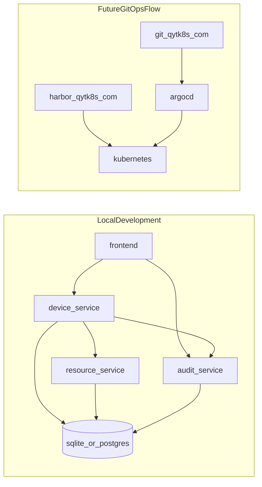

# 第六章总览：微服务发布、自动化与 GitOps

## 本章目标

第六章的目标，是把前五章已经具备网络、安全、入口与存储能力的集群，推进到 **具备现代应用交付能力** 的状态。

本章结束后，应达到下面状态：

- 已拥有一个可讲、可演示、可继续扩展的样板应用 `QYT NetDevOps`
- 学员能够本地运行并理解它的前后端、服务拆分与数据模型
- 样板应用已经预留 Docker、Helm 与 GitOps 所需目录
- 样板应用已经完成 `git.qytk8s.com`、`Harbor` 与 `Argo CD` 真实串联
- 学员能够区分“当前已落地的拆解版 GitOps”和“后续推荐的单次 push 顺滑流程”
- 第七章可继续复用该应用做观测、指标、日志和 Trace 展示

## 本章学习方式

这一章继续采用“文档主导 + 脚本辅助 + 课堂讲解”的方式：

1. 登录 `ops`
2. 先看理论和系统设计文档
3. 再运行本地预览与验证脚本
4. 先把应用本体讲清楚，再接容器化、镜像推送与 GitOps
5. 课堂上保留完整的命令块和源码块，方便学员贴贴贴

## 课前理论导读

正式操作前，建议先阅读：

- `docs/00_gitops_theory.md`

它负责把本章主线讲清楚：

- 什么是 GitOps
- 为什么第六章不能只讲 Argo CD
- 为什么要先做 `QYTANG NetDevOps`
- 代码、镜像、Git、集群之间是什么关系

## 本章重点边界

第六章聚焦：

- `QYT NetDevOps` 样板应用
- 本地联调
- 应用目录结构
- 服务拆分
- Docker / Helm / Harbor / Argo CD 落位

第六章当前不展开：

- CI 系统自动构建流水线
- 多环境 Promotion 策略
- Argo Rollouts 渐进式发布

这些内容可以在后续章节继续扩展。

## 当前落地与推荐流程

第六章当前已经真实跑通的是：

- 手工拆解版 GitOps
- 也就是老师手工演示改代码、构建镜像、改 values、再观察 Argo CD 同步

第六章后续更推荐的工程化表达是：

- 人只 `push` 一次
- `Git` 触发 `CI`
- `CI` 自动构建镜像并回写 `values`
- `Argo CD` 按 Git 最终状态发布

所以你在上课时要明确区分：

- 当前教材已经落地的内容
- 后续推荐但尚未在本章实现的顺滑版流程

## 本章与前章的关系

- **第一章**：继续复用 `ops`、`Harbor` 与后续的 `git.qytk8s.com`
- **第三章**：继续复用北向访问和 `HTTPS` 基础思路
- **第五章**：后续可继续复用 `Istio` 安全与流量治理为新应用提供发布能力
- **第七章**：直接复用本章应用做可观测性展示

## 第六章总关系图



## 本章脚本执行矩阵

| 步骤 | 文档 | 脚本 | 执行标记 | 说明 |
| :--- | :--- | :--- | :--- | :--- |
| 0 | `00_gitops_theory.md` | 无 | 建议先读 | 先建立 GitOps 与样板工程整体认知 |
| 1 | `02_design_qytang_netdevops.md` | 无 | 必须阅读 | 先讲系统设计、页面、服务和数据模型 |
| 2 | `03_local_preview_and_debug.md` | `scripts/01_run_local_preview.sh` | 必须执行 | 启动本地预览与 API |
| 3 | `04_git_repo_and_delivery_plan.md` | `scripts/02_verify_local_preview.sh` | 建议执行 | 确认本地链路闭环，并讲后续仓库规划 |
| 4 | `05_next_phase_gitops_plan.md` | 无 | 讲解为主 | 说明接下来如何引入 Docker / Gitea / Argo CD |
| 5 | `06_verify.md` | `scripts/03_verify_chapter6.sh` | 只读验收 | 验证第六章第一阶段完成情况 |
| 6 | `07_containerize_qytang_netdevops.md` | `scripts/04_verify_docker_assets.sh` | 必须阅读 | 补齐 Dockerfile 与 docker compose，建立镜像化认知 |
| 7 | `08_git_service_and_gitea_plan.md` | 无 | 必须阅读 | 讲清楚 `git.qytk8s.com`、单仓与后续 Git 仓库布局 |
| 8 | `09_helm_and_argocd_layout.md` | `scripts/05_verify_gitops_assets.sh` | 必须阅读 | 讲 Helm、values、Argo CD Application 的目录关系 |
| 9 | `10_verify_phase2.md` | `scripts/06_verify_phase2_assets.sh` | 只读验收 | 验证第六章第二阶段素材已就绪 |
| 10 | `11_install_gitea.md` | `scripts/07_install_gitea_remote.sh` | 必须执行 | 在 `git` 节点落地 Gitea |
| 11 | `12_prepare_gitea_repo_and_push.md` | `scripts/08_create_gitea_repo.sh` | 必须执行 | 创建 `qytang-netdevops.git` |
| 12 | `13_verify_gitea.md` | `scripts/09_verify_gitea.sh` | 只读验收 | 验证 Git 服务与仓库环境 |
| 13 | `14_push_qytang_netdevops_to_gitea.md` | `scripts/10_push_qytang_netdevops_repo.sh` | 必须执行 | 把应用目录独立初始化并首推到 Gitea |
| 14 | `15_build_and_push_images.md` | `scripts/11_build_and_push_images_remote.sh` | 必须执行 | 在 `git` 节点构建并推送四个镜像到 Harbor |
| 15 | `16_install_argocd_and_sync.md` | `scripts/12_install_argocd_and_sync.sh` | 必须执行 | 安装 Argo CD、信任 Gitea CA 并同步应用 |
| 16 | `17_verify_gitops_e2e.md` | `scripts/13_verify_gitops_e2e.sh` | 只读验收 | 验证 Git -> Harbor -> Argo CD -> K8s 全链路 |
| 17 | `18_publish_netdevops_domain.md` | `scripts/14_publish_netdevops_https_domain.sh` | 必须执行 | 将业务入口收口为 `https://netdevops.qytk8s.com` |
| 18 | `19_configure_argocd_domain.md` | `scripts/15_configure_argocd_domain.sh` | 必须执行 | 将 Argo CD 收口为 `https://argocd.qytk8s.com` |
| 19 | `20_domains_and_accounts.md` | 无 | 建议收尾阅读 | 汇总域名、IP、账户和名称映射 |
| 20 | `21_gitops_demo_playbook.md` | `scripts/16_release_frontend_gitops.sh`<br>`scripts/17_scale_frontend_gitops.sh` | 强烈建议收尾阅读 | 课堂现场演示改代码发布与改 yaml 扩缩容 |

## 本章执行顺序

请严格按下面顺序执行：

0. `00_gitops_theory.md`
1. `02_design_qytang_netdevops.md`
2. `03_local_preview_and_debug.md`
3. `04_git_repo_and_delivery_plan.md`
4. `05_next_phase_gitops_plan.md`
5. `06_verify.md`
6. `07_containerize_qytang_netdevops.md`
7. `08_git_service_and_gitea_plan.md`
8. `09_helm_and_argocd_layout.md`
9. `10_verify_phase2.md`
10. `11_install_gitea.md`
11. `12_prepare_gitea_repo_and_push.md`
12. `13_verify_gitea.md`
13. `14_push_qytang_netdevops_to_gitea.md`
14. `15_build_and_push_images.md`
15. `16_install_argocd_and_sync.md`
16. `17_verify_gitops_e2e.md`
17. `18_publish_netdevops_domain.md`
18. `19_configure_argocd_domain.md`
19. `20_domains_and_accounts.md`
20. `21_gitops_demo_playbook.md`

## 贴贴贴顺序

在 `ops` 上按下面顺序执行即可：

```bash
bash /docker_k8s_2026/k8s/06-gitops-and-automation/scripts/00_check_and_recover_cluster.sh
```

```bash
bash /docker_k8s_2026/k8s/06-gitops-and-automation/scripts/01_run_local_preview.sh
```

```bash
bash /docker_k8s_2026/k8s/06-gitops-and-automation/scripts/02_verify_local_preview.sh
```

```bash
bash /docker_k8s_2026/k8s/06-gitops-and-automation/scripts/03_verify_chapter6.sh
```

```bash
bash /docker_k8s_2026/k8s/06-gitops-and-automation/scripts/04_verify_docker_assets.sh
```

```bash
bash /docker_k8s_2026/k8s/06-gitops-and-automation/scripts/05_verify_gitops_assets.sh
```

```bash
bash /docker_k8s_2026/k8s/06-gitops-and-automation/scripts/06_verify_phase2_assets.sh
```

```bash
bash /docker_k8s_2026/k8s/06-gitops-and-automation/scripts/07_install_gitea_remote.sh
```

```bash
bash /docker_k8s_2026/k8s/06-gitops-and-automation/scripts/08_create_gitea_repo.sh
```

```bash
bash /docker_k8s_2026/k8s/06-gitops-and-automation/scripts/09_verify_gitea.sh
```

```bash
bash /docker_k8s_2026/k8s/06-gitops-and-automation/scripts/10_push_qytang_netdevops_repo.sh
```

```bash
bash /docker_k8s_2026/k8s/06-gitops-and-automation/scripts/11_build_and_push_images_remote.sh
```

```bash
bash /docker_k8s_2026/k8s/06-gitops-and-automation/scripts/12_install_argocd_and_sync.sh
```

```bash
bash /docker_k8s_2026/k8s/06-gitops-and-automation/scripts/13_verify_gitops_e2e.sh
```

```bash
bash /docker_k8s_2026/k8s/06-gitops-and-automation/scripts/14_publish_netdevops_https_domain.sh
```

```bash
bash /docker_k8s_2026/k8s/06-gitops-and-automation/scripts/15_configure_argocd_domain.sh
```

课堂演示“改代码发布”时执行：

```bash
bash /docker_k8s_2026/k8s/06-gitops-and-automation/scripts/16_release_frontend_gitops.sh
```

课堂演示“改 yaml 扩缩容”时执行：

```bash
bash /docker_k8s_2026/k8s/06-gitops-and-automation/scripts/17_scale_frontend_gitops.sh
```

如果希望一次性把当前第六章阶段环境铺好，可直接执行：

```bash
bash /docker_k8s_2026/k8s/06-gitops-and-automation/scripts/99_bootstrap_chapter6.sh
```

## 第六章起点状态

第六章开始前，默认你已经满足下面条件：

- 所有节点均为 `Ready`
- 第五章最终验收已通过
- `ops` 已具备 `kubectl`
- `ops` 可以访问当前工作目录
- `apps/qytang-netdevops` 已存在

## 当前阶段设计冻结

- 应用名固定为：`QYT NetDevOps`
- 当前先使用本地预览与轻量服务联调方式
- 当前样板应用已经补齐 Docker、Helm 与 GitOps 骨架
- 当前章节按“本地联调 -> 容器化 -> Git 仓库 -> 镜像仓库 -> Argo CD”递进展开
- 最终业务入口为：`https://netdevops.qytk8s.com`
- 最终控制面入口为：`https://argocd.qytk8s.com`
- 当前前端显示名为：`QYT NetDevOps`
- 当前仓库目录与镜像仓库仍保持：`qytang-netdevops`
- 当前已落地的是手工拆解版 GitOps
- 当前未落地但推荐的是单次 push 触发 CI 的顺滑版 GitOps

## 下一步

先进入系统设计文档：

- `docs/02_design_qytang_netdevops.md`
