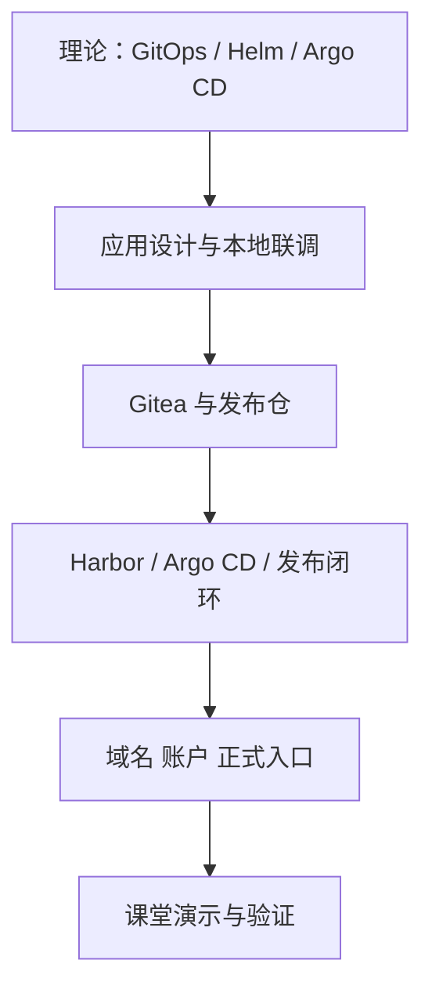

# 第六章总览：GitOps 与自动化

## 本章目标

第六章的目标，是把前 5 章已经具备集群、网络、入口、HTTPS 和安全能力的环境，推进到**具备 GitOps 交付闭环能力**的状态。

本章结束后，应达到下面状态：

- 样板应用已经具备本地联调与工程化资产
- `Gitea` 已作为第六章 Git 事实源上线
- `Harbor` 中已经有可发布的业务镜像
- `Argo CD` 已安装并能从 Git 同步目标状态
- `QYT NetDevOps` 已通过正式入口发布
- 已完成一次课堂可演示的 GitOps 发布与验证

---

## 问题背景

前 5 章已经解决：

- 集群基础能力
- 云原生网络
- 北向入口与 `HTTPS`
- 存储与有状态能力
- `JWT`、`mTLS` 与零信任

但如果还没有一条可重复、可追溯、可演示的交付链路，这个集群仍然更像“已经装好很多组件的实验环境”。

第六章要继续补齐：

- 应用应该以什么工程化骨架进入集群
- 代码、部署配置、镜像分别放在哪里
- `Helm` 和 `values` 在交付链路里各负责什么
- `Argo CD` 到底是从哪里发现变更、又如何把目标状态同步到集群
- 课堂上如何演示一次完整的 GitOps 发布闭环

因此第六章的重点不是“单独安装某一个工具”，而是“把 Git、镜像仓库、Helm 和 Argo CD 组织成一条完整交付链路”。

---

## 理论导读

正式操作前，建议先阅读：

- `docs/00_gitops_theory.md`

它负责先讲清：

- 什么是 `GitOps`
- 什么是 `Helm`
- 什么是 `values.yaml`
- 什么是 `Argo CD`
- 第六章最终要打通的完整交付链路

---

## 本章重点边界

第六章只聚焦：

- `GitOps`
- `Helm`
- `values.yaml`
- `Gitea`
- `Harbor`
- `Argo CD`
- 发布脚本与交付闭环

---

## 本章与前章的关系

- **第三章**：继续复用已有北向入口与域名发布基础
- **第五章**：继续复用已建立的安全体系、入口证书和集群信任链
- **第六章**：在这些基础上补齐“从代码与配置到集群发布”的 GitOps 交付主线

---

## 第六章总关系图

这张图表达的是第六章的完整主线：

- 先把 `GitOps / Helm / Argo CD` 的边界讲清楚
- 再把样板应用整理到可联调、可容器化、可发布的工程化状态
- 随后把应用目录同步到 `Gitea`，建立 Git 事实源
- 再把镜像构建、`Harbor`、`Argo CD` 和集群同步打通
- 最后补齐正式入口、账户与课堂演示动作

---

## 本章学习方式

第六章继续采用“文档主导 + 脚本辅助 + 资产独立管理”的方式：

1. 先读理论与步骤说明，再执行脚本
2. 代码、`Helm` 与 `GitOps` 资产统一放在 `apps/qytang-netdevops`
3. 构建与发布脚本统一放在 `k8s/06-gitops-and-automation/scripts`
4. 课堂最终观察结果以页面访问、Git 仓库、Argo CD 同步状态为主

---

## 执行标记说明

为了便于在 `ops` 上直接执行，第六章继续采用统一执行标记：

- **建议先读**：这一项以建立认知为主，默认先阅读
- **必须执行**：从第六章标准起点开始时，默认需要实际执行
- **建议执行**：这一项主要用于演示或补充验证，建议执行

---

## 本章小单元与对应脚本

| 步骤 | 文档 | 主要任务 | 对应脚本 | 执行标记 |
| :--- | :--- | :--- | :--- | :--- |
| 0 | `00_gitops_theory.md` | 先理清 `GitOps`、`Helm`、`values` 与 `Argo CD` 主线 | 无 | 建议先读 |
| 1 | `02_app_design_and_local_preview.md` | 讲清样板应用结构、本地联调与工程化资产 | 见文档内分步脚本 | 必须执行 |
| 2 | `03_gitea_setup_and_repo_bootstrap.md` | 安装 `Gitea`、创建应用仓并完成首推同步 | `scripts/07_install_gitea_remote.sh` 等 | 必须执行 |
| 3 | `04_harbor_argocd_and_e2e_verification.md` | 构建镜像、推送到 `Harbor`、安装 `Argo CD` 并完成同步 | 见文档内分步脚本 | 必须执行 |
| 4 | `05_publish_netdevops_https_domain.md` | 发布正式业务入口，并整理域名、账户与课堂操作边界 | 无 | 建议执行 |
| 5 | `06_gitops_demo_and_testing.md` | 完成第六章最终演示与验证 | 见文档内分步脚本 | 建议执行 |

---

## 本章执行顺序

请按下面顺序执行：

0. `00_gitops_theory.md`
1. `02_app_design_and_local_preview.md`
2. `03_gitea_setup_and_repo_bootstrap.md`
3. `04_harbor_argocd_and_e2e_verification.md`
4. `05_publish_netdevops_https_domain.md`
5. `06_gitops_demo_and_testing.md`

---

## 版本冻结

- Kubernetes：`v1.33.9`
- `Gitea`：由本章脚本固定部署版本
- `Argo CD`：由本章脚本固定部署版本
- Git 服务域名：`git.qytk8s.com`
- 样板应用：`QYT NetDevOps`
- 应用发布仓：`gitadmin/qytang-netdevops`

---

## 关键设计冻结

- Git 事实源使用课程内自建 `Gitea`
- 镜像统一推送到课程内 `Harbor`
- 应用部署资产统一用 `Helm Chart + values` 组织
- 集群发布统一由 `Argo CD` 根据 Git 中目标状态完成
- 第六章当前不是完整 CI 平台，而是“人手工触发脚本 + GitOps 同步到集群”的课堂形态

---

## 下一步

先进入理论页：

- `docs/00_gitops_theory.md`
