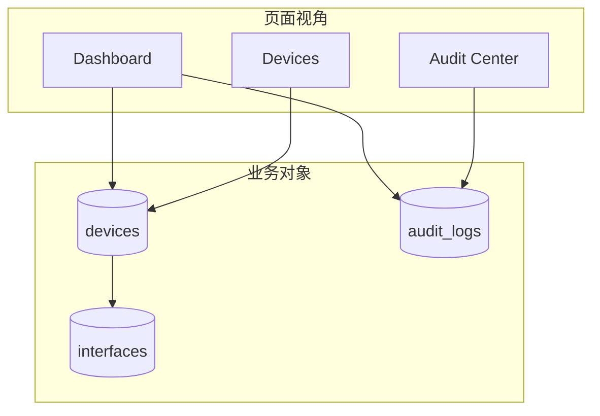
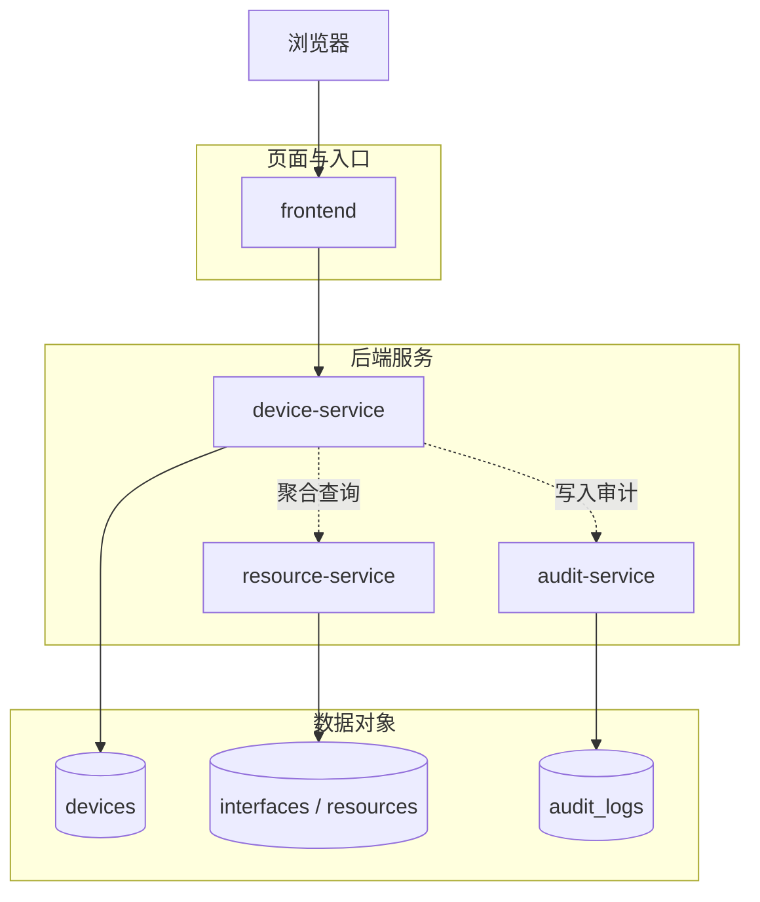
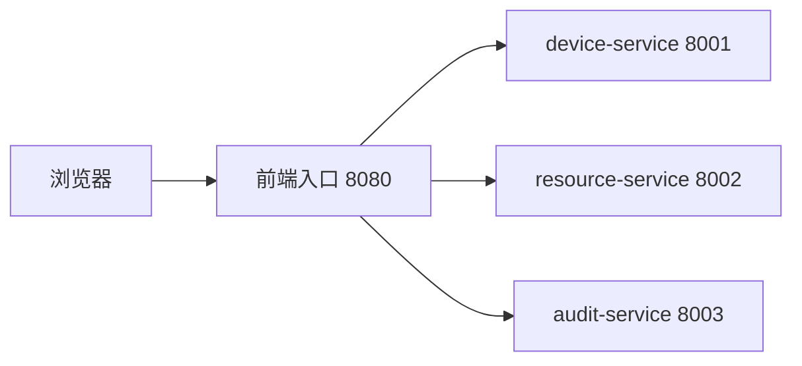
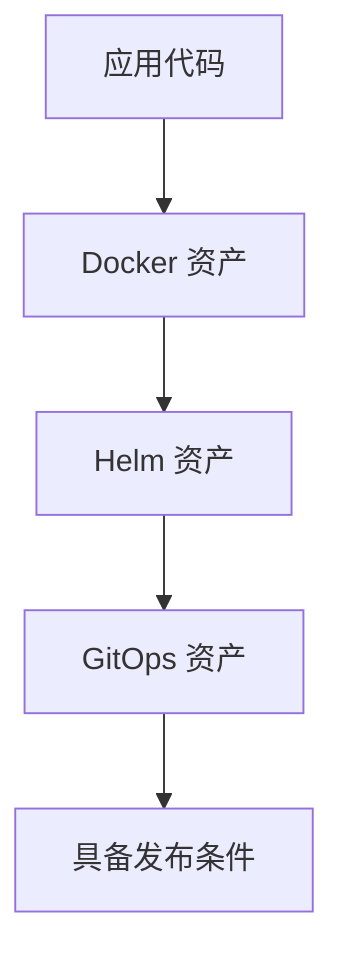

# QYT NetDevOps：应用设计、本地联调与工程化资产

## 本节目标

这一节先把样板应用本身讲清楚，并确认它已经同时具备：

- 本地联调能力
- Docker 工程化骨架
- Helm 与 GitOps 资产骨架

完成这一节后，应能回答：

- `QYT NetDevOps` 是什么应用
- 它拆成了哪些服务
- 页面上能看到什么
- 本地联调为什么是第六章的必要起点
- 为什么这一节之后就已经具备进入 GitOps 的工程化基础

## 执行标记

- **执行标记：必须执行**

## 样板应用定位

`QYT NetDevOps` 不是生产系统，而是第六章到第七章的教学载体。

它承载的不是复杂业务，而是清晰的教学场景：

- 设备资源管理
- 设备接口信息查看
- 审计日志回放
- 指标与后续可观测性展示

这套设计适合教学，是因为它同时具备：

- 前端页面可见
- 后端服务拆分清楚
- 数据模型简单但足够完整
- 后续方便延伸到镜像、Helm、GitOps、指标、日志、Trace

## 页面与业务对象

当前前端页面重点围绕 3 个视角组织：

- `Dashboard`
- `Devices`
- `Audit Center`

其中设备详情不是独立导航页，而是 `Devices` 页面中的详情区域。

核心业务对象有 3 类：

- `devices`
- `interfaces`
- `audit_logs`

教学上可以这样理解：

- `devices` 是主业务对象
- `interfaces` 是设备的子资源
- `audit_logs` 是所有管理动作留下的记录



## 微服务拆分

当前样板应用拆为 4 个主要组件：

- `frontend`
- `device-service`
- `resource-service`
- `audit-service`

职责边界如下：

### `frontend`

- 负责页面展示
- 负责把浏览器请求统一代理到后端服务

### `device-service`

- 负责设备 CRUD
- 负责设备详情聚合
- 负责 Dashboard 汇总入口

### `resource-service`

- 负责接口与资源信息查询
- 负责提供接口统计数据

### `audit-service`

- 负责审计日志写入与查询

这里最容易混的是：

- `device-service`
  - 更像设备主业务服务
  - 它关心“设备本身”
  - 例如设备列表、设备详情、设备增删改、Dashboard 汇总
- `resource-service`
  - 更像设备资源查询服务
  - 它关心“设备下面的资源”
  - 例如接口列表、接口状态、资源统计

可以先记成一句最短的话：

- `device-service` 管设备
- `resource-service` 管设备下面的资源

## 典型调用链

这一页最值得讲清楚的是“页面动作如何落到微服务调用链”。



课堂上最适合举这 3 类动作：

1. `Dashboard`
- `frontend -> device-service`
- `device-service` 汇总全局设备信息
- `device-service -> resource-service`
  - 取全局接口与资源统计
- `device-service -> audit-service`
  - 取全局审计统计或最近操作记录

2. 设备详情
- `frontend -> device-service`
- `device-service` 先返回某一台设备的主体信息
- `device-service -> resource-service`
  - 补充这台设备的接口与资源详情
- `device-service -> audit-service`
  - 补充这台设备相关的审计记录

3. 增删改设备
- `frontend -> device-service`
- `device-service` 直接处理设备变更
- `device-service -> audit-service`
  - 记录审计日志

这里最关键的区别可以先记成一句话：

- `Dashboard`
  - 看全局总览
- 设备详情
  - 看单台设备下钻

也就是说，这两条链路虽然都会经过：

- `device-service`
- `resource-service`
- `audit-service`

但它们查询的粒度并不一样：

- `Dashboard`
  - 返回的是全局汇总与统计结果
- 设备详情
  - 返回的是单台设备的明细结果

## 为什么要先做本地联调

在进入 `Docker`、`Helm`、`Gitea`、`Argo CD` 之前，先做本地联调有两个价值：

1. 先证明应用本身是活的。
2. 把“业务问题”和“交付问题”分开。

如果应用在本地都没跑通，那么后面任何镜像、Chart、GitOps 问题都会被混在一起，课堂会非常乱。

## 实验环境示例地址

在当前课程环境中，本地联调阶段常用这些地址：

- 页面入口：`http://10.1.1.201:8080`
- `device-service` Swagger：`http://10.1.1.201:8001/docs`
- `resource-service` Swagger：`http://10.1.1.201:8002/docs`
- `audit-service` Swagger：`http://10.1.1.201:8003/docs`

## 前端为什么能被远程浏览器正常访问

这一点在课堂上必须讲清楚，否则学员会疑惑：

- 为什么浏览器打开的是 `10.1.1.201:8080`
- 但前端还能同时访问 `8001/8002/8003`

当前实现的关键不是“浏览器直接跨端口请求所有后端”，而是：

- 浏览器统一访问前端入口
- 前端再通过本地代理把请求转发到后端服务

可以把它理解为：



这样做的教学意义是：

- 浏览器侧入口更统一
- 课堂演示更接近后续网关统一入口的思路
- 不需要在页面里到处写死不同后端地址

## 本节脚本顺序

这一节建议按下面顺序执行：

1. 先启动本地联调环境
2. 再验证本地联调是否正常

<div style="padding: 12px 14px; border: 1px solid #666; border-left: 6px solid #34a853; border-radius: 6px; background: rgba(52,168,83,0.08); margin: 12px 0;">
<strong>本节执行方式</strong><br/>
这一节先把本地联调环境拉起来，再做自动化验证；页面观察放到最后人工确认。
</div>

### 1. 启动本地联调

<div style="padding: 12px 14px; border: 1px solid #666; border-left: 6px solid #ea4335; border-radius: 6px; background: rgba(234,67,53,0.10); margin: 8px 0;">
<strong>❗ 本条命令必须粘贴执行</strong><br/>
先启动本地 <code>docker compose</code> 联调环境。
</div>

```bash
bash /docker_k8s_2026/k8s/06-gitops-and-automation/scripts/01_run_local_preview.sh
```

这一步的作用是：

- 启动本地 `docker compose` 联调环境
- 拉起前端、三个后端和本地 `Postgres`
- 让样板应用先在本地跑起来

课堂上要先讲清楚：

- 这一节不是直接发布到 Kubernetes
- 而是先证明应用本身可以在本地跑通

### 2. 验证本地联调

<div style="padding: 12px 14px; border: 1px solid #666; border-left: 6px solid #ea4335; border-radius: 6px; background: rgba(234,67,53,0.10); margin: 8px 0;">
<strong>❗ 本条命令必须粘贴执行</strong><br/>
启动完成后立刻验证本地联调是否已经正常。
</div>

```bash
bash /docker_k8s_2026/k8s/06-gitops-and-automation/scripts/02_verify_local_preview.sh
```

这一步的作用是：

- 检查页面入口是否可访问
- 检查三个后端健康状态
- 检查 Dashboard 汇总接口和指标接口

也就是说，这一步重点验证的是：

- 本地联调环境已经可用
- 当前问题如果存在，更可能是应用本身问题，而不是后面的交付问题

所以这 2 个脚本的关系可以先记成：

- `01`
  - 负责把环境拉起来
- `02`
  - 负责验证本地联调是否正常

## 本节测试方式

这一节的接口与健康检查，默认由：

- `02_verify_local_preview.sh`

自动完成。

也就是说，下面这些检查不需要学员手工逐条执行：

- 页面入口是否可达
- 三个后端健康检查是否正常
- `Dashboard` 汇总接口是否可用
- 指标接口是否可用
- 应用目录是否存在

这一节更适合保留给学员手工观察的，是 `win2019` 远程打开页面后的实际效果。

## 建议人工观察

<div style="padding: 10px 14px; border: 1px solid #666; border-left: 4px solid #8ab4f8; border-radius: 6px; background: rgba(138,180,248,0.08); margin: 8px 0;">
<strong>ℹ️ 建议人工观察</strong><br/>
下面不是主线必跑命令，而是建议在浏览器中辅助观察的内容。
</div>

建议在 `win2019` 浏览器中直接打开：

- `http://10.1.1.201:8080`

课堂上重点观察：

- `Dashboard` 是否能正常加载
- `Devices` 是否能显示设备列表
- `Audit Center` 是否能看到审计时间线
- 设备详情区域是否能显示接口列表与最近审计

## 本节通过标准

这一节不要求把应用本身讲得很深。

更重要的是确认两件事：

- 这个样板应用现在能够正常工作
- 它已经具备后续进入容器化、`Helm` 和 `GitOps` 的基础

满足下面条件即可继续下一节：

- `win2019` 可以正常打开页面
- 页面里的核心视图能够正常加载
- 本地联调验证脚本通过
- 已经知道这套应用由哪些服务组成

## 本地联调通过后要不要一直保留

不用。

这一节里的本地联调，只是先证明样板应用本身可以正常工作。

验证通过后，这套本地预览环境就不再是后面主线的长期依赖。后面的重点会切换到：

- `Gitea`
- `Harbor`
- `Argo CD`
- 正式业务入口

也就是说：

- 本地联调是一个前置验证步骤
- 不是第六章后半段需要长期维持的发布环境

如果这一阶段验证已经完成，也可以主动收掉本地预览进程：

<div style="padding: 10px 14px; border: 1px solid #666; border-left: 4px solid #8ab4f8; border-radius: 6px; background: rgba(138,180,248,0.08); margin: 8px 0;">
<strong>ℹ️ 可选执行</strong><br/>
下面这条不是主线必跑命令；如果本地联调已经验证完成，可以主动停止本地预览环境。
</div>

```bash
bash /docker_k8s_2026/k8s/06-gitops-and-automation/scripts/18_stop_local_preview.sh
```

## 本节后半段看什么

这一节后半段不再继续展开业务功能，而是直接看后续发布要用到的三类资产：

- `Docker` 资产
- `Helm` 资产
- `GitOps` 资产

## 当前关键目录

### Docker 资产

- `apps/qytang-netdevops/deploy/docker/`

这里应包含：

- `frontend` 的 `Dockerfile`
- 3 个后端服务的 `Dockerfile`
- `docker-compose.yaml`

这一层的作用是：

- 把应用拆成可独立构建的镜像
- 保留本地多服务联调入口

### Helm 资产

- `apps/qytang-netdevops/deploy/helm/qytang-netdevops/`

这里应包含：

- `Chart.yaml`
- `values.yaml`
- `values-lab.yaml`
- `templates/`

这一层的作用是：

- 把应用整理成可部署到 Kubernetes 的 `Chart`
- 把实验环境参数单独放进 `values` 文件

<div style="padding: 12px 14px; border: 1px solid #666; border-left: 6px solid #fbbc04; border-radius: 6px; background: rgba(251,188,4,0.10); margin: 10px 0;">
<strong>YAML 卡片</strong><br/>
YAML 文件：<code>apps/qytang-netdevops/deploy/helm/qytang-netdevops/values-lab.yaml</code><br/>
对象：<code>Helm values</code><br/>
作用：保存实验环境下的副本数、镜像标签等参数；后面“改 YAML 扩缩容”演示就是直接改这里。
</div>

### GitOps 资产

- `apps/qytang-netdevops/deploy/gitops/lab/`

这里应包含：

- `application.yaml`
- `values-lab.yaml`

这一层的作用是：

- 把 `Argo CD` 真正要同步的入口单独整理出来
- 让后面发布时不需要再从应用目录里临时拼装对象

<div style="padding: 12px 14px; border: 1px solid #666; border-left: 6px solid #fbbc04; border-radius: 6px; background: rgba(251,188,4,0.10); margin: 10px 0;">
<strong>YAML 卡片</strong><br/>
YAML 文件：<code>apps/qytang-netdevops/deploy/gitops/lab/application.yaml</code><br/>
对象：<code>Argo CD Application</code><br/>
作用：告诉 <code>Argo CD</code> 应该从哪个 Git 仓、哪个 Chart 路径、用哪份 <code>values</code>，把应用同步到哪个命名空间。
</div>

## 从应用到 GitOps 资产的过渡图



## 本节整体完成标准

满足下面条件即可进入 Git 服务与发布仓初始化阶段：

- 本地页面可正常访问
- Docker 目录存在且结构齐全
- Helm Chart 目录存在且结构齐全
- GitOps 目录存在且结构齐全
- 已知道这三类资产分别是做什么的

## 下一步

进入 Git 事实源准备阶段，在 `git` 节点落地 `Gitea`，创建仓库并把应用目录同步进去：

- `docs/03_gitea_setup_and_repo_bootstrap.md`
