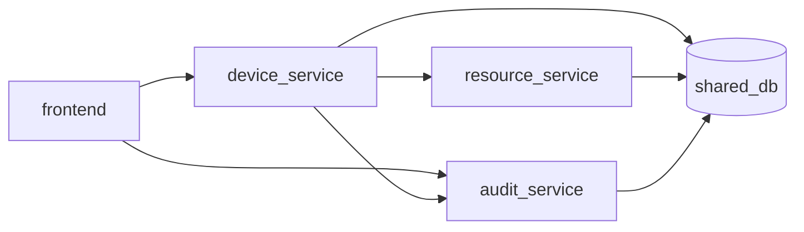

# 第 1 步：设计 `QYTANG NetDevOps`

## 本步目标

在真正讲容器化和 GitOps 之前，先把第六章样板应用本身讲清楚：

- 它为什么存在
- 它解决什么问题
- 它拆成了哪些服务
- 页面长什么样
- 数据模型如何设计
- 为什么它适合后续做 GitOps 和可观测性演示

## 样板应用定位

`QYTANG NetDevOps` 是一个面向课堂演示的轻量网络设备资源管理系统。

它不是为了做一个复杂完整的生产系统，而是为了让学员在一套主题统一的业务场景中，同时学到：

- 微服务拆分
- 前后端联调
- 资源建模
- 审计日志
- 未来的镜像构建与 GitOps 发布
- 未来的指标、日志和 Trace

## 页面设计

当前第一阶段页面包含 4 个区域：

### 1. Dashboard

展示：

- 设备总数
- 在线设备数
- 接口 Up 数
- 最近变更数
- 厂商分布图
- 站点分布图
- 状态分布
- 最近操作列表
- 服务矩阵

### 2. Devices

展示：

- 设备列表
- 搜索与筛选
- 新增设备
- 编辑设备
- 删除设备

### 3. Device Detail

展示：

- 基础信息
- 接口列表
- 最近审计

### 4. Audit Center

展示：

- 新增、修改、删除动作
- 操作者
- 审计说明
- 时间线

## 服务拆分

第一阶段采用 3 个后端服务 + 1 个前端：

- `frontend`
- `device-service`
- `resource-service`
- `audit-service`

## 为什么这样拆

这样拆的优点是：

- 比“单体后端”更像微服务
- 比“拆成很多服务”更容易讲清楚
- 已经足够产生后续 `metrics`、日志和 `trace` 所需信息
- 每个服务职责边界清晰，适合课堂说明

## 服务职责

### `frontend`

负责：

- 页面渲染
- 调用后端 API
- 展示统计、列表、详情和审计

### `device-service`

负责：

- 设备 CRUD
- 设备详情聚合
- Dashboard 统计入口

### `resource-service`

负责：

- 接口列表查询
- 接口统计

### `audit-service`

负责：

- 审计日志写入
- 审计日志查询

## 服务调用图

## 典型调用链

### Dashboard

`frontend -> device-service -> resource-service -> audit-service`

这是后续最适合做 Trace 演示的入口。

### 查看设备详情

`frontend -> device-service -> resource-service`

### 新增设备

`frontend -> device-service -> audit-service`

### 删除设备

`frontend -> device-service -> audit-service`

### 查看审计

`frontend -> audit-service`

## 数据模型

### `devices`

- `id`
- `hostname`
- `mgmt_ip`
- `vendor`
- `model`
- `version`
- `site`
- `role`
- `status`
- `created_at`
- `updated_at`

### `interfaces`

- `id`
- `device_id`
- `name`
- `ip_address`
- `speed_mbps`
- `admin_status`
- `oper_status`
- `description`

### `audit_logs`

- `id`
- `action`
- `entity_type`
- `entity_id`
- `operator`
- `detail`
- `created_at`

## 为什么这个模型适合上课

因为它同时具备：

- 业务对象：设备
- 子资源对象：接口
- 管理动作对象：审计日志

这三类对象非常适合讲“资源模型”和“微服务职责边界”。

## 目录结构

当前应用目录：

- `apps/qytang-netdevops/frontend`
- `apps/qytang-netdevops/backend/device_service`
- `apps/qytang-netdevops/backend/resource_service`
- `apps/qytang-netdevops/backend/audit_service`
- `apps/qytang-netdevops/backend/common`
- `apps/qytang-netdevops/scripts`
- `apps/qytang-netdevops/data`

这套结构已经为后续内容预留了位置：

- Docker
- Helm
- GitOps
- 文档补充

## 课堂讲解建议

你讲这一页时，建议按下面顺序：

1. 先讲页面长什么样
2. 再讲用户点一个按钮会经过哪些服务
3. 再讲为什么要单独拆审计服务
4. 最后讲这套应用为什么特别适合接 GitOps 和 Observability

## 当前代码位置

### 前端

- `apps/qytang-netdevops/frontend/index.html`
- `apps/qytang-netdevops/frontend/app.js`
- `apps/qytang-netdevops/frontend/styles.css`

### 后端

- `apps/qytang-netdevops/backend/device_service/main.py`
- `apps/qytang-netdevops/backend/resource_service/main.py`
- `apps/qytang-netdevops/backend/audit_service/main.py`
- `apps/qytang-netdevops/backend/common/models.py`
- `apps/qytang-netdevops/backend/common/schemas.py`

## 下一步

继续进入本地预览与联调：

- `docs/03_local_preview_and_debug.md`
