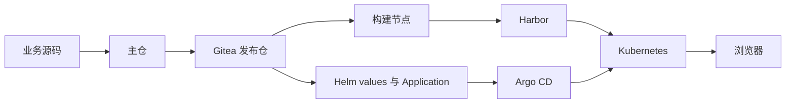
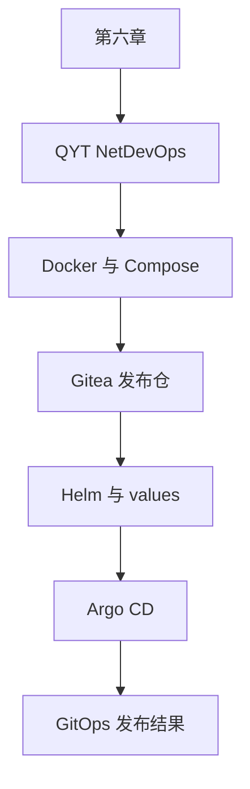

# 第六章总览：GitOps 主线与交付边界

## 本节目标

完成这一节后，你应该能明确下面 4 件事：

1. 第六章到底在解决什么问题。
2. `QYT NetDevOps` 为什么适合作为 GitOps 教学样板。
3. 当前第六章已经真实落地的 GitOps 流程是什么。
4. 主仓、`Gitea`、`Harbor`、`Argo CD` 分别扮演什么角色。

## 执行标记

- **执行标记：建议先读**

## 为什么第六章要这样讲

前五章的重点是平台能力：

- 集群
- 网络
- 存储
- 安全
- 网关

第六章开始，重点切换为：

- 应用如何进入集群
- 版本如何被持续交付
- 目标状态如何由 Git 驱动

所以这一章不能只讲某个工具怎么安装，而必须讲清楚一条完整链路：



## GitOps 的核心概念

### 什么是目标状态

在这一章里，Git 里保存的不是“刚刚做过什么动作”，而是“集群最终应该长成什么样”。

例如：

- 前端镜像应该是哪个 tag
- 每个服务应该有几个副本
- 应用应该部署到哪个命名空间

### `Argo CD` 负责什么

`Argo CD` 只负责一件事：

- 把 Git 中声明的目标状态，持续同步到 Kubernetes

它不负责：

- 改业务代码
- 构建镜像
- 推送镜像

### `Harbor` 负责什么

`Harbor` 负责保存镜像本体。

也就是说：

- Git 里保存“我要什么镜像”
- Harbor 里保存“这个镜像文件本身”

### 为什么要先用样板应用承载这一章

如果只讲 YAML、Chart、Application，学员看到的是一堆抽象配置。

而 `QYT NetDevOps` 这个样板应用能把交付对象变得具体：

- 有前端页面
- 有设备服务、资源服务、审计服务
- 有数据库
- 有后续可观测性扩展空间

所以第六章不是“先讲 Argo CD，再找个应用凑进去”，而是“先有一个可见应用，再把它一步一步推进到 GitOps”。

## 当前真实落地的 GitOps 形态

这一章当前已经真实跑通的是：

- 手工改代码
- 手工触发脚本
- 脚本同步源码到 `Gitea`
- 脚本构建镜像并推送到 `Harbor`
- 脚本回写 Git 中的镜像 tag
- `Argo CD` 自动同步到集群

这是一种“脚本化拆解版 GitOps”。

它的优点是：

- 教学路径清楚
- 每一步都能观察
- 学员容易理解源码、镜像、配置、集群状态之间的关系

它还不是：

- 人只 `push` 一次
- `CI` 自动构建并回写
- 完整企业流水线版本

这一点必须在课堂上讲清楚，避免把“推荐目标态”和“当前已实现态”混为一谈。

## 当前仓库边界

这一章现在最重要的边界如下：

- 主仓：`/docker_k8s_2026`
- 应用目录：`/docker_k8s_2026/apps/qytang-netdevops`
- GitOps 发布仓：`https://git.qytk8s.com/gitadmin/qytang-netdevops.git`

这里要特别强调：

- 主仓才是真正的源码维护与备份边界
- `apps/qytang-netdevops` 只是主仓中的普通目录
- `Gitea` 中的 `qytang-netdevops` 仓库是第六章 GitOps 发布目标

也就是说：

- 你在主仓里维护代码
- 你通过脚本把应用目录同步到 `Gitea`
- `Argo CD` 再从 `Gitea` 拉取状态

## 第六章主线结构

当前第六章主线收口为 5 个大文档：

1. 本页：总览、理论、边界、执行主线
2. 应用设计、本地联调与工程化资产
3. Gitea 落地与仓库初始化
4. Harbor、Argo CD 与端到端发布验证
5. 域名、账户与课堂现场演示

## 课堂统一关系图



## 本节测试与观察

建议至少确认下面几项：

```bash
kubectl get nodes -o wide
```

```bash
git -C /docker_k8s_2026 status --short --branch
```

```bash
ls -la /docker_k8s_2026/apps/qytang-netdevops
```

观察重点：

- 所有节点应为 `Ready`
- 主仓路径应存在
- 应用目录应存在
- 当前主仓应能正常读写

## 本节完成标准

满足下面条件即可进入下一节：

- 已理解第六章不是“装工具”，而是“打通交付链路”
- 已理解主仓、`Gitea`、`Harbor`、`Argo CD` 的角色分工
- 已理解当前真实落地的是“脚本化拆解版 GitOps”
- 当前环境与应用目录已处于可继续推进状态

## 常见误区

### 误区 1：`Argo CD` 会自动帮我构建镜像

不会。`Argo CD` 只负责同步声明式状态，不负责编译源码。

### 误区 2：`Gitea` 仓库就是主仓的唯一备份

不是。当前课程里，主仓才是真正的源码维护边界；`Gitea` 是 GitOps 发布仓。

### 误区 3：只要 GitOps 概念讲清楚，就可以不需要样板应用

不合适。没有一个可见的业务样板，GitOps 会变成纯配置教学，课堂可感知度很差。

## 下一步

进入样板应用本身，先把应用设计、本地联调与工程化资产彻底讲清楚：

- `docs/03_app_design_and_local_preview.md`
