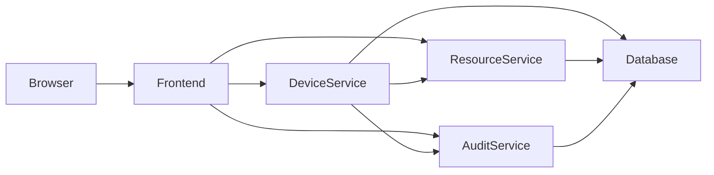
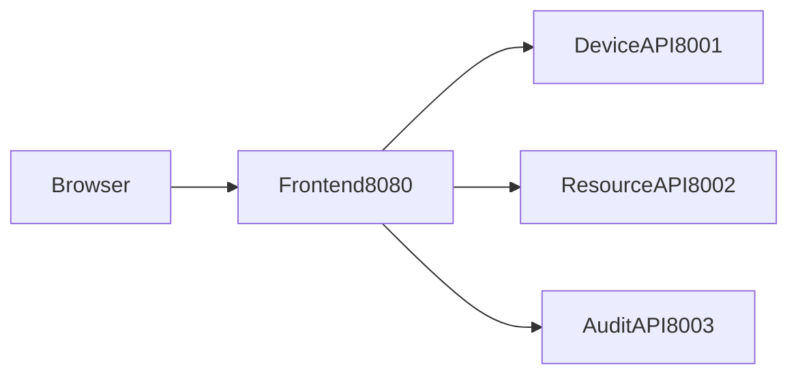

# QYT NetDevOps：应用设计、本地联调与阶段验收

## 本节目标

这一节的目标不是直接讲 `Docker` 或 `Argo CD`，而是先把样板应用本身讲透，并确认它在本地联调阶段已经跑通。

完成这一节后，应能回答：

- `QYT NetDevOps` 是什么应用
- 它拆成了哪些服务
- 页面上能看到什么
- 本地联调为什么是第六章的必要起点

## 样板应用定位

`QYT NetDevOps` 不是生产系统，而是第六章到第七章的教学载体。

它承载的不是复杂业务，而是清晰的教学场景：

- 设备资源管理
- 设备接口信息查看
- 审计日志回放
- 指标与后续可观测性展示

这套设计适合教学，是因为它同时具备：

- 前端页面可见
- 后端服务拆分清楚
- 数据模型简单但足够完整
- 后续方便延伸到镜像、Helm、GitOps、指标、日志、Trace

## 页面与业务对象

当前前端页面重点围绕 3 个视角组织：

- `Dashboard`
- `Devices`
- `Audit Center`

其中设备详情不是独立导航页，而是 `Devices` 页面中的详情区域。

核心业务对象有 3 类：

- `devices`
- `interfaces`
- `audit_logs`

教学上可以这样理解：

- `devices` 是主业务对象
- `interfaces` 是设备的子资源
- `audit_logs` 是所有管理动作留下的记录

## 微服务拆分

当前样板应用拆为 4 个主要组件：

- `frontend`
- `device-service`
- `resource-service`
- `audit-service`

职责边界如下：

### `frontend`

- 负责页面展示
- 负责把浏览器请求统一代理到后端服务

### `device-service`

- 负责设备 CRUD
- 负责设备详情聚合
- 负责 Dashboard 汇总入口

### `resource-service`

- 负责接口与资源信息查询
- 负责提供接口统计数据

### `audit-service`

- 负责审计日志写入与查询

## 典型调用链

这一页最值得讲清楚的是“页面动作如何落到微服务调用链”。



课堂上最适合举这 3 类动作：

1. `Dashboard`
- `frontend -> device-service`
- `device-service -> resource-service + audit-service`

2. 设备详情
- `frontend -> device-service`
- `device-service -> resource-service + audit-service`

3. 增删改设备
- `frontend -> device-service`
- `device-service -> audit-service`

## 为什么要先做本地联调

在进入 `Docker`、`Helm`、`Gitea`、`Argo CD` 之前，先做本地联调有两个价值：

1. 先证明应用本身是活的。
2. 把“业务问题”和“交付问题”分开。

如果应用在本地都没跑通，那么后面任何镜像、Chart、GitOps 问题都会被混在一起，课堂会非常乱。

## 实验环境示例地址

在当前课程环境中，本地联调阶段常用这些地址：

- 页面入口：`http://10.1.1.201:8080`
- `device-service` Swagger：`http://10.1.1.201:8001/docs`
- `resource-service` Swagger：`http://10.1.1.201:8002/docs`
- `audit-service` Swagger：`http://10.1.1.201:8003/docs`

## 前端为什么能被远程浏览器正常访问

这一点在课堂上必须讲清楚，否则学员会疑惑：

- 为什么浏览器打开的是 `10.1.1.201:8080`
- 但前端还能同时访问 `8001/8002/8003`

当前实现的关键不是“浏览器直接跨端口请求所有后端”，而是：

- 浏览器统一访问前端入口
- 前端再通过本地代理把请求转发到后端服务

可以把它理解为：



这样做的教学意义是：

- 浏览器侧入口更统一
- 课堂演示更接近后续网关统一入口的思路
- 不需要在页面里到处写死不同后端地址

## !!! 本节必刷脚本

### 启动本地联调

```bash
bash /docker_k8s_2026/k8s/06-gitops-and-automation/scripts/01_run_local_preview.sh
```

### 验证本地联调

```bash
bash /docker_k8s_2026/k8s/06-gitops-and-automation/scripts/02_verify_local_preview.sh
```

### 第一阶段统一验收

```bash
bash /docker_k8s_2026/k8s/06-gitops-and-automation/scripts/03_verify_chapter6.sh
```

## 本节测试与校验

### 页面可达性

```bash
curl -I http://127.0.0.1:8080
```

### 三个后端健康检查

```bash
curl http://127.0.0.1:8001/healthz
curl http://127.0.0.1:8002/healthz
curl http://127.0.0.1:8003/healthz
```

### Dashboard 汇总接口

```bash
curl http://127.0.0.1:8001/api/v1/dashboard/summary
```

### 指标接口

```bash
curl http://127.0.0.1:8001/metrics
```

### 目录存在性

```bash
ls -la /docker_k8s_2026/apps/qytang-netdevops
```

## 课堂观察点

建议把“能不能访问”与“为什么这样设计”一起讲。

### 页面层

- `Dashboard` 是否能加载
- `Devices` 是否能显示设备列表
- `Audit Center` 是否能看到审计时间线
- 设备详情区域是否能显示接口列表与最近审计
- 服务矩阵是否能显示当前服务状态

### 接口层

- 三个后端 `healthz` 是否正常
- Dashboard 汇总接口是否返回 JSON
- `/metrics` 是否能正常输出
- 设备 CRUD 动作是否正常
- 设备详情聚合接口是否正常

### 结构层

- 学员是否能说清 4 个组件的职责
- 学员是否能说清 3 类核心数据对象
- 学员是否能说明 `devices`、`interfaces`、`audit_logs` 的关键字段作用

## 建议在课堂上点出的关键字段

为了让“资源建模”更具体，建议至少让学员看到下面这些字段：

- `devices`
  - `hostname`
  - `mgmt_ip`
  - `vendor`
  - `site`
- `interfaces`
  - `name`
  - `ip_address`
  - `status`
  - `speed_mbps`
- `audit_logs`
  - `action`
  - `operator`
  - `created_at`

## 本节完成标准

满足下面条件即可进入容器化阶段：

- 本地页面可正常访问
- 三个后端服务健康检查正常
- Dashboard 汇总接口可用
- 指标接口可用
- 设备 CRUD 可正常操作
- 设备详情里的接口与最近审计可正常展示
- 已理解应用职责边界与调用链

## 常见误区

### 误区 1：前端页面能打开，就代表应用已经没问题

不够。必须同时验证：

- 后端健康
- 聚合接口
- 指标接口

### 误区 2：设备详情是单独的主页面

不是。当前实现中，它属于 `Devices` 视图里的详情区域。

### 误区 3：本地联调只是“简单跑一下”

不是。这一步是在为后面的容器化与 GitOps 切断干扰项。

## 下一步

进入工程化阶段，把这套应用的 Docker、Helm、GitOps 骨架准备完整：

- `docs/04_containerize_and_gitops_assets.md`
