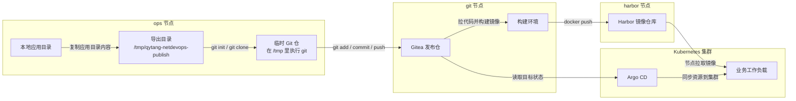
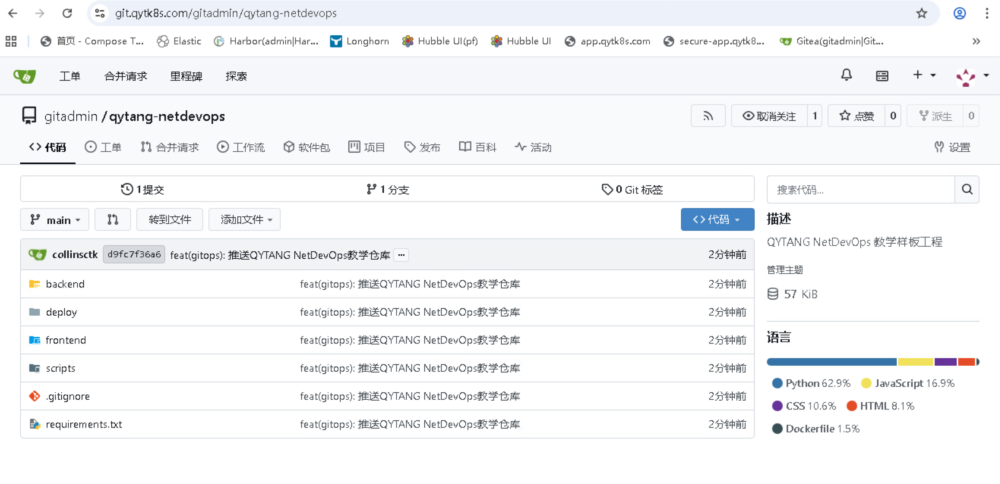

# Gitea 落地、应用仓创建与首推同步

## 本节目标

这一节要完成的是 GitOps 的“事实源准备”。

## 执行标记

- **执行标记：必须执行**

完成后应具备下面能力：

- `git.qytk8s.com` 可访问
- `gitadmin` 管理员可登录
- `qytang-netdevops` 仓库已创建
- `apps/qytang-netdevops` 已同步到 `Gitea`

## 为什么这一节很关键

`Argo CD` 不是直接从你当前机器上的工作目录读取文件，而是从 Git 仓库读取目标状态。

所以在第六章里，必须先把企业内 Git 服务与应用发布仓准备好。

这里要明确区分 2 个对象：

- 本地应用目录：`/docker_k8s_2026/apps/qytang-netdevops`
- `Gitea` 发布仓：`https://git.qytk8s.com/gitadmin/qytang-netdevops.git`

### 本地应用目录负责什么

- 承载第六章真正参与发布的应用内容
- 包含源码、`Docker` 资产、`Helm` 资产、`GitOps` 资产
- 后续同步脚本只会导出这部分内容

### `Gitea` 发布仓负责什么

- 承载从本地应用目录同步过去的发布内容
- 被后续构建节点与 `Argo CD` 拉取

## 统一信任链

这一节的证书设计不是“再建一套新的 CA”，而是复用课程已有统一 CA。

这样做的好处是：

- `Harbor`
- `Gitea`
- `Argo CD`

都可以纳入同一条课堂信任链，减少证书复杂度。

## 当前主线关系



按这张图理解即可：

- `ops` 节点上保存的是本地应用目录，课堂脚本也是从这里发起
- 脚本会先把 `apps/qytang-netdevops` 导出到 `/tmp/qytang-netdevops-publish`
- 真正的 `git add / commit / push` 是在这个 `/tmp` 临时仓里完成的，不是在原目录里做嵌套 Git 仓库
- `git` 节点同时承担两件事：提供 `Gitea` 发布仓，并作为后续镜像构建环境
- `Argo CD` 读取的是 `Gitea` 发布仓里的目标状态
- `Harbor` 提供镜像，`Argo CD` 提供声明式配置，这两条线最后都在 `Kubernetes` 集群里汇合

## 当前固定信息

- Git 服务域名：`https://git.qytk8s.com`
- Git 节点：`git`
- Git 服务入口 IP：`10.1.1.202`
- 管理员账号：`gitadmin`
- 管理员密码：`Gitea12345`
- 应用发布仓：`https://git.qytk8s.com/gitadmin/qytang-netdevops.git`

## 应用目录概览

先看目录树：

```text
apps/qytang-netdevops/
├── frontend/
├── backend/
├── deploy/
│   ├── docker/
│   ├── helm/
│   └── gitops/
├── scripts/
└── requirements.txt
```

再看各目录分别放什么：

- `frontend/`
  - 前端页面代码
- `backend/`
  - 后端服务代码
- `deploy/docker/`
  - 各服务的 `Dockerfile` 与本地 `docker compose` 资产
- `deploy/helm/`
  - `Helm Chart`、`values`、`templates`
- `deploy/gitops/`
  - 给 `Argo CD` 使用的发布清单
- `scripts/`
  - 本地辅助脚本与演示数据脚本

这一节最重要的是看懂：

- 源码、镜像构建资产、`Helm` 资产和 `GitOps` 发布清单，都统一放在这一套应用目录里

## 本节必刷脚本

这一节建议按下面顺序执行：

<div style="padding: 12px 14px; border: 1px solid #666; border-left: 6px solid #34a853; border-radius: 6px; background: rgba(52,168,83,0.08); margin: 12px 0;">
<strong>本节执行方式</strong><br/>
这一节按下面 4 条主线脚本顺序执行，每条执行完再做对应验证。
</div>

### 1. 安装 Gitea

<div style="padding: 12px 14px; border: 1px solid #666; border-left: 6px solid #ea4335; border-radius: 6px; background: rgba(234,67,53,0.10); margin: 8px 0;">
<strong>❗ 本条命令必须粘贴执行</strong><br/>
先完成 <code>Gitea</code> 安装、证书签发和管理员初始化。
</div>

```bash
bash /docker_k8s_2026/k8s/06-gitops-and-automation/scripts/07_install_gitea_remote.sh
```

<div style="padding: 12px 14px; border: 1px solid #666; border-left: 6px solid #fbbc04; border-radius: 6px; background: rgba(251,188,4,0.10); margin: 10px 0;">
<strong>YAML 卡片</strong><br/>
来源：<code>k8s/06-gitops-and-automation/scripts/07_install_gitea_remote.sh</code> 里的 <code>write_local_compose_file()</code><br/>
生成文件：<code>k8s/06-gitops-and-automation/tmp/docker-compose-gitea.yaml</code><br/>
对象：<code>Docker Compose</code><br/>
作用：脚本先在本地临时生成这份 <code>Compose</code> 清单，再下发到 <code>git</code> 节点拉起 <code>gitea</code> 和 <code>gitea-postgres</code>。
</div>

关键内容示例：

```yaml
services:
  postgres:
    image: harbor.qytk8s.com/library/postgres:17
    container_name: gitea-postgres
    environment:
      POSTGRES_DB: gitea
      POSTGRES_USER: gitea
    volumes:
      - /data/gitea/postgres:/var/lib/postgresql/data

  gitea:
    image: harbor.qytk8s.com/library/gitea:1.25.4
    container_name: gitea
    depends_on:
      postgres:
        condition: service_healthy
    environment:
      GITEA__server__DOMAIN: git.qytk8s.com
      GITEA__server__ROOT_URL: https://git.qytk8s.com/
      GITEA__server__PROTOCOL: https
    ports:
      - "443:3000"
      - "2222:22"
```

这几个字段最关键：

- `services.postgres`
  - `Gitea` 使用的数据库服务
- `services.gitea`
  - 真正对外提供 Git Web 界面和 Git 协议服务的主体
- `depends_on.postgres.condition: service_healthy`
  - 先等数据库健康，再启动 `gitea`
- `GITEA__server__DOMAIN`
  - 对外发布使用的域名
- `GITEA__server__ROOT_URL`
  - `Gitea` 自己生成链接和回调时使用的根地址
- `ports: "443:3000"`
  - 宿主机用 `443` 对外提供 HTTPS，容器内部是 `3000`
- `ports: "2222:22"`
  - 预留 Git SSH 访问入口

脚本主要任务：

- 检查统一 CA
- 为 `git.qytk8s.com` 签发证书
- 在 `git` 节点写入 `docker compose` 部署文件
- 在 `git` 节点安装 `Docker` 与 `docker compose`
- 启动 `gitea` 与 `gitea-postgres`
- 创建 `gitadmin`

### 2. 创建应用仓库

<div style="padding: 12px 14px; border: 1px solid #666; border-left: 6px solid #ea4335; border-radius: 6px; background: rgba(234,67,53,0.10); margin: 8px 0;">
<strong>❗ 本条命令必须粘贴执行</strong><br/>
在 <code>Gitea</code> 中创建第六章要用的应用发布仓。
</div>

```bash
bash /docker_k8s_2026/k8s/06-gitops-and-automation/scripts/08_create_gitea_repo.sh
```

脚本主要任务：

- 使用 Gitea API 创建 `qytang-netdevops` 仓库

### 3. 验证 Gitea

<div style="padding: 12px 14px; border: 1px solid #666; border-left: 6px solid #ea4335; border-radius: 6px; background: rgba(234,67,53,0.10); margin: 8px 0;">
<strong>❗ 本条命令必须粘贴执行</strong><br/>
安装完成后立刻验证 <code>Gitea</code> 是否已经可用。
</div>

```bash
bash /docker_k8s_2026/k8s/06-gitops-and-automation/scripts/09_verify_gitea.sh
```

脚本主要任务：

- 验证首页
- 验证版本接口
- 验证容器状态
- 验证管理员用户是否存在

### 4. 首次同步应用目录

<div style="padding: 12px 14px; border: 1px solid #666; border-left: 6px solid #ea4335; border-radius: 6px; background: rgba(234,67,53,0.10); margin: 8px 0;">
<strong>❗ 本条命令必须粘贴执行</strong><br/>
最后把本地应用目录首次同步到 <code>Gitea</code> 发布仓。
</div>

```bash
bash /docker_k8s_2026/k8s/06-gitops-and-automation/scripts/10_push_qytang_netdevops_repo.sh
```

脚本主要任务：

- 从本地目录中的 `apps/qytang-netdevops` 导出应用目录
- 生成临时仓库提交
- 同步到 `Gitea`

这里最关键的是：

- 脚本不会在 `apps/qytang-netdevops` 里直接执行 `git init`
- 它会先把内容导出到 `/tmp/qytang-netdevops-publish`
- 然后只在这个 `/tmp` 临时仓里做 `git add / commit / push`

来源文件：

- [10_push_qytang_netdevops_repo.sh](/docker_k8s_2026/k8s/06-gitops-and-automation/scripts/10_push_qytang_netdevops_repo.sh)
- [lib_sync_qytang_netdevops_to_gitea.sh](/docker_k8s_2026/k8s/06-gitops-and-automation/scripts/lib_sync_qytang_netdevops_to_gitea.sh)

脚本原始代码里最关键的是这一组：

```bash
TMP_REPO_DIR="/tmp/qytang-netdevops-publish"

prepare_temp_repo() {
  rm -rf "${TMP_REPO_DIR}"
  if git -c http.sslCAInfo="${CA_CERT}" ls-remote "${REPO_URL}" >/dev/null 2>&1; then
    git -c http.sslCAInfo="${CA_CERT}" clone "${PUSH_URL}" "${TMP_REPO_DIR}" >/dev/null 2>&1
  else
    mkdir -p "${TMP_REPO_DIR}"
    git -C "${TMP_REPO_DIR}" init -b main >/dev/null
    git -C "${TMP_REPO_DIR}" remote add origin "${REPO_URL}"
  fi
}
```

这段代码表达的是：

- 先准备 `/tmp/qytang-netdevops-publish`
- 远端有内容就先 `clone`
- 远端是空仓就在 `/tmp` 里 `git init`

然后脚本再执行这组逻辑：

```bash
clean_export_tree
copy_app_tree

git -C "${TMP_REPO_DIR}" add .
git -C "${TMP_REPO_DIR}" commit -m "..."
git -C "${TMP_REPO_DIR}" -c http.sslCAInfo="${CA_CERT}" push -u "${PUSH_URL}" main
```

真正发生的是：

- 先清理临时仓里的旧文件
- 再把 `apps/qytang-netdevops` 的内容复制进去
- 最后只在 `/tmp/qytang-netdevops-publish` 里执行 `git add / commit / push`

一句最短的话：

- 本地应用目录负责提供内容，临时仓库负责提交和推送

## 本节测试与校验

### 浏览器验证

在实验环境浏览器中访问：

- `https://git.qytk8s.com`

登录信息：

- 用户名：`gitadmin`
- 密码：`Gitea12345`

### 浏览器确认应用仓

登录 `https://git.qytk8s.com` 后，直接确认：

- `gitadmin` 名下已经出现 `qytang-netdevops`
- 仓库首页能看到应用目录内容

页面示意如下：



## 本节完成标准

满足下面条件即可进入镜像与 GitOps 控制面落地阶段：

- `https://git.qytk8s.com` 可访问
- `gitadmin` 可登录
- `qytang-netdevops` 仓库存在
- 仓库里已有完整应用内容
- 已理解本地应用目录与 `Gitea` 发布仓的职责分离

## 常见误区

### 误区 1：创建仓库就等于应用内容已经在里面

不对。创建仓库只是空仓存在，首次同步才说明内容到位。

### 误区 2：应用目录自己应该带独立 `.git`

当前课程已经明确不采用这种做法，避免本地目录边界被破坏。

### 误区 3：`Gitea` 仓库就是唯一源码备份

不是。第六章里真正参与发布的是本地应用目录；`Gitea` 只是它的发布仓。

## 下一步

进入镜像构建、`Argo CD` 同步与端到端验收阶段：

- `docs/04_harbor_argocd_and_e2e_verification.md`
