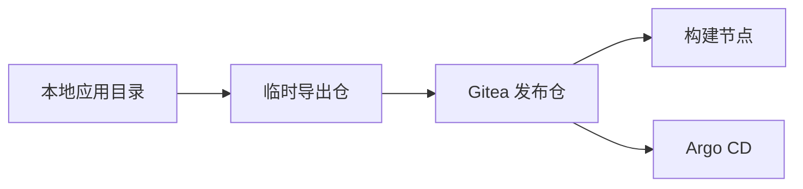

# Gitea 落地、应用仓创建与首推同步

## 本节目标

这一节要完成的是 GitOps 的“事实源准备”。

## 执行标记

- **执行标记：必须执行**

完成后应具备下面能力：

- `git.qytk8s.com` 可访问
- `gitadmin` 管理员可登录
- `qytang-netdevops` 仓库已创建
- `apps/qytang-netdevops` 已同步到 `Gitea`

## 为什么这一节很关键

`Argo CD` 不是直接从你当前机器上的工作目录读取文件，而是从 Git 仓库读取目标状态。

所以在第六章里，必须先把企业内 Git 服务与应用发布仓准备好。

这里要明确区分 2 个对象：

- 本地应用目录：`/docker_k8s_2026/apps/qytang-netdevops`
- `Gitea` 发布仓：`https://git.qytk8s.com/gitadmin/qytang-netdevops.git`

### 本地应用目录负责什么

- 承载第六章真正参与发布的应用内容
- 包含源码、`Docker` 资产、`Helm` 资产、`GitOps` 资产
- 后续同步脚本只会导出这部分内容

### `Gitea` 发布仓负责什么

- 承载从本地应用目录同步过去的发布内容
- 被后续构建节点与 `Argo CD` 拉取

## 统一信任链

这一节的证书设计不是“再建一套新的 CA”，而是复用课程已有统一 CA。

这样做的好处是：

- `Harbor`
- `Gitea`
- `Argo CD`

都可以纳入同一条课堂信任链，减少证书复杂度。

## 当前主线关系



这里要特别强调：

- `Argo CD` 读取的是 `Gitea` 发布仓
- 第六章真正参与发布的，只是其中的 `apps/qytang-netdevops`
- 课堂脚本不是在 `apps/qytang-netdevops` 里直接做嵌套 Git 仓库
- 当前采用的是“导出应用目录 -> 临时仓库 -> 同步到 Gitea”的方式

## 当前固定信息

- Git 服务域名：`https://git.qytk8s.com`
- Git 节点：`git`
- Git 服务入口 IP：`10.1.1.202`
- 管理员账号：`gitadmin`
- 管理员密码：`Gitea12345`
- 应用发布仓：`https://git.qytk8s.com/gitadmin/qytang-netdevops.git`

## 这一套目录里分别放了什么

- `frontend/`
  - 前端页面代码
- `backend/`
  - 后端服务代码
- `deploy/docker/`
  - 各服务的 `Dockerfile` 与本地 `docker compose` 资产
- `deploy/helm/`
  - `Helm Chart`、`values`、`templates`
- `deploy/gitops/`
  - 给 `Argo CD` 使用的发布清单
- `scripts/`
  - 本地辅助脚本与演示数据脚本

所以这一节最重要的不是记目录名字，而是理解：

- 源码在这里
- 镜像构建资产也在这里
- `Helm` 资产也在这里
- `GitOps` 发布清单也在这里

## 本节必刷脚本

这一节建议按下面顺序执行：

<div style="padding: 12px 14px; border: 1px solid #666; border-left: 6px solid #34a853; border-radius: 6px; background: rgba(52,168,83,0.08); margin: 12px 0;">
<strong>本节执行方式</strong><br/>
这一节按下面 4 条主线脚本顺序执行，每条执行完再做对应验证。
</div>

### 1. 安装 Gitea

<div style="padding: 12px 14px; border: 1px solid #666; border-left: 6px solid #ea4335; border-radius: 6px; background: rgba(234,67,53,0.10); margin: 8px 0;">
<strong>❗ 本条命令必须粘贴执行</strong><br/>
先完成 <code>Gitea</code> 安装、证书签发和管理员初始化。
</div>

```bash
bash /docker_k8s_2026/k8s/06-gitops-and-automation/scripts/07_install_gitea_remote.sh
```

<div style="padding: 12px 14px; border: 1px solid #666; border-left: 6px solid #fbbc04; border-radius: 6px; background: rgba(251,188,4,0.10); margin: 10px 0;">
<strong>YAML 卡片</strong><br/>
YAML 文件：<code>k8s/06-gitops-and-automation/tmp/docker-compose-gitea.yaml</code><br/>
对象：<code>Docker Compose</code><br/>
作用：在 <code>git</code> 节点拉起 <code>gitea</code> 和 <code>gitea-postgres</code>；这一节的 Git 服务本体就是由这份清单启动的。
</div>

脚本主要任务：

- 检查统一 CA
- 为 `git.qytk8s.com` 签发证书
- 在 `git` 节点写入 `docker compose` 部署文件
- 在 `git` 节点安装 `Docker` 与 `docker compose`
- 启动 `gitea` 与 `gitea-postgres`
- 创建 `gitadmin`

### 2. 创建应用仓库

<div style="padding: 12px 14px; border: 1px solid #666; border-left: 6px solid #ea4335; border-radius: 6px; background: rgba(234,67,53,0.10); margin: 8px 0;">
<strong>❗ 本条命令必须粘贴执行</strong><br/>
在 <code>Gitea</code> 中创建第六章要用的应用发布仓。
</div>

```bash
bash /docker_k8s_2026/k8s/06-gitops-and-automation/scripts/08_create_gitea_repo.sh
```

脚本主要任务：

- 使用 Gitea API 创建 `qytang-netdevops` 仓库

### 3. 验证 Gitea

<div style="padding: 12px 14px; border: 1px solid #666; border-left: 6px solid #ea4335; border-radius: 6px; background: rgba(234,67,53,0.10); margin: 8px 0;">
<strong>❗ 本条命令必须粘贴执行</strong><br/>
安装完成后立刻验证 <code>Gitea</code> 是否已经可用。
</div>

```bash
bash /docker_k8s_2026/k8s/06-gitops-and-automation/scripts/09_verify_gitea.sh
```

脚本主要任务：

- 验证首页
- 验证版本接口
- 验证容器状态
- 验证管理员用户是否存在

### 4. 首次同步应用目录

<div style="padding: 12px 14px; border: 1px solid #666; border-left: 6px solid #ea4335; border-radius: 6px; background: rgba(234,67,53,0.10); margin: 8px 0;">
<strong>❗ 本条命令必须粘贴执行</strong><br/>
最后把本地应用目录首次同步到 <code>Gitea</code> 发布仓。
</div>

```bash
bash /docker_k8s_2026/k8s/06-gitops-and-automation/scripts/10_push_qytang_netdevops_repo.sh
```

脚本主要任务：

- 从本地目录中的 `apps/qytang-netdevops` 导出应用目录
- 生成临时仓库提交
- 同步到 `Gitea`

这一段最容易让学员困惑的是：

- 什么叫“临时仓库”
- 为什么这样做不会影响本地目录

这里要先明确：

- 脚本并不会在 `apps/qytang-netdevops` 里面直接执行 `git init`
- 它会在：
  - `/tmp/qytang-netdevops-publish`
  - 这个临时目录里准备一个独立 Git 仓库
- 然后把本地应用目录里的内容复制进去，再提交到 `Gitea`

来源文件：

- [10_push_qytang_netdevops_repo.sh](/docker_k8s_2026/k8s/06-gitops-and-automation/scripts/10_push_qytang_netdevops_repo.sh)
- [lib_sync_qytang_netdevops_to_gitea.sh](/docker_k8s_2026/k8s/06-gitops-and-automation/scripts/lib_sync_qytang_netdevops_to_gitea.sh)

脚本原始代码里最关键的是这一组：

```bash
TMP_REPO_DIR="/tmp/qytang-netdevops-publish"

prepare_temp_repo() {
  rm -rf "${TMP_REPO_DIR}"
  if git -c http.sslCAInfo="${CA_CERT}" ls-remote "${REPO_URL}" >/dev/null 2>&1; then
    git -c http.sslCAInfo="${CA_CERT}" clone "${PUSH_URL}" "${TMP_REPO_DIR}" >/dev/null 2>&1
  else
    mkdir -p "${TMP_REPO_DIR}"
    git -C "${TMP_REPO_DIR}" init -b main >/dev/null
    git -C "${TMP_REPO_DIR}" remote add origin "${REPO_URL}"
  fi
}
```

这段的意思是：

- 先准备一个临时目录：
  - `/tmp/qytang-netdevops-publish`
- 如果远端仓库已经存在内容
  - 就先把远端仓库 clone 到这个临时目录
- 如果远端还是空仓
  - 就在这个临时目录里执行 `git init`
  - 再把远端 `origin` 指过去

所以这里的“临时仓库”本质上就是：

- 一个只用于发布的中转 Git 工作目录

然后脚本再执行这组逻辑：

```bash
clean_export_tree
copy_app_tree

git -C "${TMP_REPO_DIR}" add .
git -C "${TMP_REPO_DIR}" commit -m "..."
git -C "${TMP_REPO_DIR}" -c http.sslCAInfo="${CA_CERT}" push -u "${PUSH_URL}" main
```

这里真正发生的是：

1. 先把临时仓库里的旧文件清理掉
2. 再把 `apps/qytang-netdevops` 里的内容复制进去
3. 然后只在临时仓库里做：
   - `git add`
   - `git commit`
   - `git push`

所以为什么不会影响本地目录？

因为：

- 本地应用目录只是“复制源”
- 真正执行 Git 提交和推送的是：
  - `/tmp/qytang-netdevops-publish`
- 脚本不会往 `apps/qytang-netdevops` 里写 `.git`
- 也不会把本地应用目录改造成嵌套仓库

一句最短的话：

- 本地应用目录负责提供内容
- 临时仓库负责提交和推送

## 本节测试与校验

### 访问首页

```bash
curl --cacert /docker_k8s_2026/k8s/01-k8s-architecture/pki/harbor/harbor-ca.crt -I https://git.qytk8s.com
```

### 查看版本接口

```bash
curl --cacert /docker_k8s_2026/k8s/01-k8s-architecture/pki/harbor/harbor-ca.crt https://git.qytk8s.com/api/v1/version
```

### 查看远端容器

```bash
ssh -o BatchMode=yes -o StrictHostKeyChecking=no root@git "docker ps --format 'table {{.Names}}\t{{.Status}}\t{{.Ports}}'"
```

### 浏览器验证

在实验环境浏览器中访问：

- `https://git.qytk8s.com`

登录信息：

- 用户名：`gitadmin`
- 密码：`Gitea12345`

### 浏览器确认应用仓

在浏览器登录 `https://git.qytk8s.com` 后，直接确认：

- `gitadmin` 名下已经出现 `qytang-netdevops`
- 仓库首页能看到应用目录内容

## 本节完成标准

满足下面条件即可进入镜像与 GitOps 控制面落地阶段：

- `https://git.qytk8s.com` 可访问
- `gitadmin` 可登录
- `qytang-netdevops` 仓库存在
- 仓库里已有完整应用内容
- 已理解本地应用目录与 `Gitea` 发布仓的职责分离

## 常见误区

### 误区 1：创建仓库就等于应用内容已经在里面

不对。创建仓库只是空仓存在，首次同步才说明内容到位。

### 误区 2：应用目录自己应该带独立 `.git`

当前课程已经明确不采用这种做法，避免本地目录边界被破坏。

### 误区 3：`Gitea` 仓库就是唯一源码备份

不是。第六章里真正参与发布的是本地应用目录；`Gitea` 只是它的发布仓。

## 下一步

进入镜像构建、`Argo CD` 同步与端到端验收阶段：

- `docs/04_harbor_argocd_and_e2e_verification.md`
