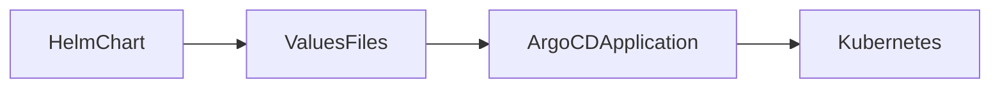
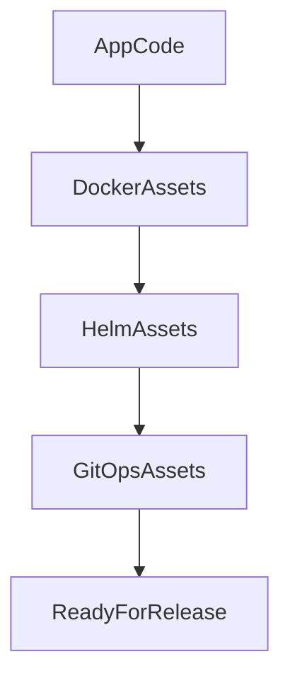

# 容器化、Helm 与 GitOps 资产准备

## 本节目标

这一节的目标是把 `QYT NetDevOps` 从“本地联调可运行”，推进到“具备进入 GitOps 的工程化骨架”。

本节完成后，应明确下面 4 件事：

1. 为什么要把应用拆成多个镜像。
2. `docker compose` 在第六章里承担什么教学作用。
3. `Helm Chart`、`values`、`Argo CD Application` 三者是什么关系。
4. 当前仓库中的 GitOps 资产是否已经齐备。

## 为什么本节不能跳过

如果直接去讲：

- `Gitea`
- `Harbor`
- `Argo CD`

但应用本身没有 `Dockerfile`、没有 `compose`、没有 `Chart`、没有 `Application`，那么 GitOps 就没有承载对象。

所以这一节的本质是：

- 把应用整理成可构建、可编排、可声明式交付的工程形态

## 理论主线

### 为什么拆成多个镜像

把 `frontend`、`device-service`、`resource-service`、`audit-service` 分成独立镜像，教学意义在于：

- 职责边界清楚
- 可以独立构建
- 可以独立发布
- 后续容易映射到 Kubernetes 的 `Deployment` 与 `Service`

### `docker compose` 的作用

这一节里，`docker compose` 不是最终部署手段，而是教学过渡层。

它帮助学员建立下面这些认知：

- 多服务编排
- 服务名互访
- 环境变量注入
- 数据库依赖
- 数据持久化

### 为什么要引入 PostgreSQL

本地预览阶段可以接受轻量化运行方式，但到了工程化阶段，就要让应用结构更贴近后续 Kubernetes 落地。

因此这里要明确：

- 后续交付以 PostgreSQL 为主
- 后续有状态部署将通过 PVC 与存储类承载

### `Chart`、`values`、`Application` 的关系

这一节必须讲透这一层关系：



可以这样理解：

- `Chart`：资源模板
- `values`：参数
- `Application`：从哪个仓库、哪个目录、用哪组参数同步到哪个集群

## 当前关键目录

### Docker 资产

- `apps/qytang-netdevops/deploy/docker/`

这里应包含：

- 前端 Dockerfile
- 三个后端服务 Dockerfile
- `docker-compose.yaml`

这里课堂上建议额外观察几个典型点：

- `WORKDIR` 如何设置
- 为什么先复制依赖文件再安装依赖
- Python 服务为什么以 `uvicorn` 作为入口
- 为什么前端与后端被拆成独立镜像

### Helm 资产

- `apps/qytang-netdevops/deploy/helm/qytang-netdevops/`

这里应包含：

- `Chart.yaml`
- `values.yaml`
- `values-lab.yaml`
- `templates/`

当前 `templates/` 里至少应重点看这些模板：

- `namespace.yaml`
- `postgres.yaml`
- `services.yaml`
- `deployments.yaml`

### GitOps 资产

- `apps/qytang-netdevops/deploy/gitops/lab/`

这里应包含：

- `application.yaml`
- `values-lab.yaml`

## docker compose 在这一节里的具体角色

这一节里，`docker compose` 不只是“把服务跑起来”，更是为了帮助学员看清服务编排关系。

建议把下面这些角色讲出来：

- `postgres`：数据库服务
- `frontend`：统一页面入口
- `device-service`、`resource-service`、`audit-service`：业务微服务
- `seed-data`：一次性初始化演示数据

## 数据持久化与状态演进

这一节还应该讲清楚一条状态演进路线：

- 本地联调阶段先把应用跑通
- `docker compose` 阶段用 PostgreSQL 与命名卷承载数据
- Kubernetes 阶段再切换到 PVC 与存储类

也就是说：

- 这一节不是在追求“最终生产部署”
- 而是在逐步把状态管理方式推向更真实的交付模型

## 读懂 application.yaml 时要重点看什么

`Application` 不是一个抽象名词，课堂上至少要让学员能读懂这几个关键字段：

- `repoURL`
- `targetRevision`
- `path`
- `destination`
- `syncPolicy`

它们分别回答的是：

- 从哪个 Git 仓库拉
- 拉哪个分支或 revision
- 用仓库里的哪个目录
- 同步到哪个集群与命名空间
- 是否自动同步、自动修复、自动清理

## 当前实验环境事实

这一节只强调“骨架齐备”，不等于已经正式完成 Argo CD 同步。

也就是说，本节的完成标准是：

- 素材齐
- 结构对
- 验证脚本通过

而不是：

- 已上线
- 已自动同步

## !!! 本节必刷脚本

### Docker 资产验证

```bash
bash /docker_k8s_2026/k8s/06-gitops-and-automation/scripts/04_verify_docker_assets.sh
```

### Helm 与 GitOps 资产验证

```bash
bash /docker_k8s_2026/k8s/06-gitops-and-automation/scripts/05_verify_gitops_assets.sh
```

### 第二阶段统一验收

```bash
bash /docker_k8s_2026/k8s/06-gitops-and-automation/scripts/06_verify_phase2_assets.sh
```

## 本节测试与校验

### Docker 目录检查

```bash
ls -la /docker_k8s_2026/apps/qytang-netdevops/deploy/docker
```

### Helm 目录检查

```bash
ls -la /docker_k8s_2026/apps/qytang-netdevops/deploy/helm/qytang-netdevops
```

### GitOps 目录检查

```bash
ls -la /docker_k8s_2026/apps/qytang-netdevops/deploy/gitops/lab
```

### 重点观察点

建议至少看清楚下面几类文件：

- 4 个业务镜像 Dockerfile
- `docker-compose.yaml`
- `Chart.yaml`
- `values.yaml`
- `values-lab.yaml`
- `templates/`
- `application.yaml`

建议额外观察：

- `docker-compose.yaml` 中服务之间的依赖关系
- `application.yaml` 中 `repoURL/path/valueFiles/destination/syncPolicy`
- `templates/` 中数据库、Service、Deployment 的对应关系

## 课堂图示：从应用到 GitOps 资产



## 本节完成标准

满足下面条件即可进入 Git 服务与发布仓初始化阶段：

- Docker 目录存在且结构齐全
- Helm Chart 目录存在且结构齐全
- GitOps 目录存在且结构齐全
- 第二阶段验收脚本通过
- 已理解 `Chart -> values -> Application` 的关系

## 常见误区

### 误区 1：有 `values-lab.yaml` 就等于已经 GitOps 落地

不对。这里只说明参数文件已经准备好了，不等于控制器已经在同步。

### 误区 2：`docker compose` 就是课程最终部署方式

不是。它在这一节里是教学过渡层，帮助建立多服务编排认知。

### 误区 3：只要 Dockerfile 存在，就说明后面一定能发布

不够。还必须有：

- Chart
- values
- Application

### 误区 4：`Helm` 就等于 `GitOps`

不是。

- `Helm` 解决的是模板化与参数化
- `GitOps` 解决的是如何用 Git 中的目标状态驱动集群收敛

### 误区 5：`Argo CD` 理解的是业务逻辑

不是。

`Argo CD` 不理解你的业务页面长什么样，也不理解设备资源管理流程，它只理解 Git 中的声明式配置。

## 下一步

进入 Git 事实源准备阶段，在 `git` 节点落地 `Gitea`，创建仓库并把应用目录同步进去：

- `docs/05_gitea_setup_and_repo_bootstrap.md`
