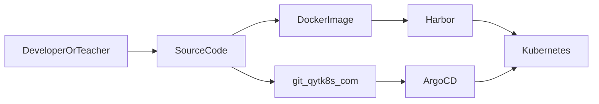
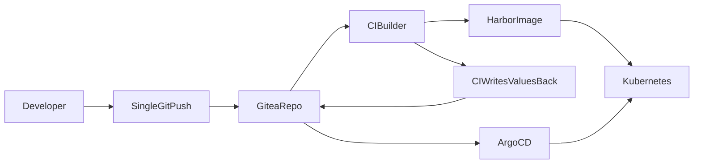

# 第 3 步：Git 仓库与交付规划

## 本步目标

虽然第六章第一阶段先讲本地联调，但从这一页开始，要把后续交付路径讲清楚：

- 这个项目放在哪里维护
- 以后准备推到哪个 Git 仓库
- 为什么后续可以自然切到 GitOps

## 当前项目维护方式

当前样板应用放在总项目目录中：

- `apps/qytang-netdevops`

这样做的好处是：

- 方便你统一维护教案、代码和脚本
- 方便课程文档直接引用应用源码
- 方便后续第六章和第七章共用这套应用

## 后续 Git 仓库规划

后续计划在 `git.qytk8s.com` 上使用：

- `qytang-netdevops.git`

推荐逻辑：

- 本地仍在总项目中维护
- 应用目录后续可独立初始化为单独 Git 仓库
- 远端推送到 `git.qytk8s.com`

## 为什么这里先用单仓

当前阶段推荐单仓，是因为它更适合教学：

- 学员更容易看懂
- 代码、Chart、GitOps 目录放在一起更直观
- 课堂上讲“从代码到发布”的链路更容易串起来

后续如需更像生产，再拆成源码仓和配置仓也不迟。

## 后续仓库建议结构

```text
qytang-netdevops/
├── frontend/
├── backend/
├── deploy/
│   ├── docker/
│   ├── helm/
│   └── gitops/
├── scripts/
└── docs/
```

## 交付主线

这一页建议你明确分成两层来讲：

### 第 1 层：当前已落地的拆解版流程

这一层适合教学拆解：

1. 本地修改代码
2. 构建镜像
3. 推送到 `harbor.qytk8s.com`
4. 修改 Helm 或 GitOps 配置
5. 提交到 `git.qytk8s.com`
6. `Argo CD` 发现变更并同步
7. Kubernetes 完成发布

### 第 2 层：后续推荐的顺滑版流程

这一层更接近工程实践：

1. 本地修改代码
2. 提交并 `push` 到 `git.qytk8s.com`
3. `Git` 触发 `CI`
4. `CI` 构建镜像并推送到 `harbor.qytk8s.com`
5. `CI` 自动回写 `values.yaml` 中的 tag
6. `Argo CD` 发现 Git 最终状态变更并同步
7. Kubernetes 完成发布

这里要特别强调：

- 人只需要手工 `push` 一次
- Git 历史里通常仍会出现第二次提交
- 这第二次提交是 `CI` 自动补上的配置回写

## 流程图

### 当前拆解版



### 推荐顺滑版



## 课堂讲解建议

你讲这一页时，建议强调：

- 本地联调和 GitOps 不是两个相互冲突的阶段
- 本地联调解决“应用长什么样”
- GitOps 解决“应用怎么稳定进入集群”
- 第六章的重点是把这两个层次串起来
- 当前课堂先用拆解版跑通，再介绍顺滑版更接近生产

## 当前阶段可执行验证

当前可以先验证本地预览链路：

```bash
bash /docker_k8s_2026/k8s/06-gitops-and-automation/scripts/02_verify_local_preview.sh
```

## 下一步

继续看本章下一阶段规划：

- `docs/05_next_phase_gitops_plan.md`
