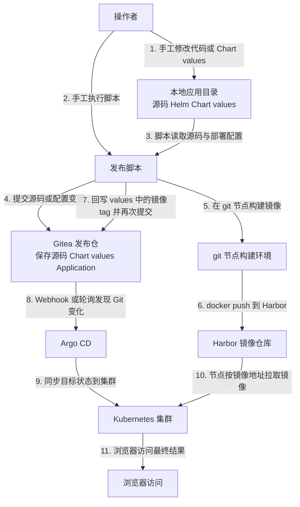

# Harbor、Argo CD 与端到端发布验证

## 本节目标

这一节要把发布闭环真正打通：

完成这一节后，应能确认：

- `Gitea` 里有仓库
- `Harbor` 里有镜像
- `Argo CD` 能同步应用
- 集群里 Pod 与 Service 正常
- 前端 Service 能返回真实业务数据

## 为什么这一节是第六章的核心落地点

到前一节为止，我们只是准备好了：

- 应用目录
- Git 仓库
- Docker 资产
- Helm 资产
- GitOps 资产

但真正让第六章“立起来”的，是这一节：

- 镜像被构建出来
- 声明式配置被同步到集群
- 应用真的在 Kubernetes 中跑起来

## 角色分工



到了这一节，课堂上最应该重新强调的还是下面 3 个职责边界：

- `Gitea` 保存源码与声明式配置
- `Harbor` 保存镜像
- `Argo CD` 负责把 Git 中的目标状态同步到集群

## 当前构建位置

这一节里：

- 脚本在 `ops` 上执行
- 真正的 `docker build` 在 `git` 节点完成
- 构建后的镜像再从 `git` 节点推送到 `Harbor`

## 为什么这一节现在要坚持 Harbor-first

这一节如果大量依赖外部仓库，课堂上最容易出现两类问题：

- 构建节点临时拉不到基础镜像
- Kubernetes 节点第一次启动 `Argo CD` 时外部镜像拉取很慢

所以当前主线已经收成：

- `11_build_and_push_images_remote.sh` 优先使用 `Harbor` 中的 Python 基础镜像
- `12_install_argocd_and_sync.sh` 使用本地安装清单 `30_argocd_install_v3.3.3_harbor.yaml`
- `12_install_argocd_and_sync.sh` 会先在各节点预拉 `argocd/dex/redis` 的 Harbor 镜像，再安装控制面

## 为什么安装 `Argo CD` 不能只看官方 YAML

这一节最容易被忽略的问题是：

- 浏览器能打开私有 Git
- 不代表 `argocd-repo-server` 一定信任该证书链

所以本节不仅是“安装 Argo CD”，更是在补齐：

- 私有 Git HTTPS 信任
- `argocd.qytk8s.com` 正式入口
- 固定 VIP
- Application 自动同步

## 本节必刷脚本

### 1. 远程构建并推送业务镜像

```bash
bash /docker_k8s_2026/k8s/06-gitops-and-automation/scripts/11_build_and_push_images_remote.sh
```

脚本主要任务：

- 确保 `Harbor` 项目存在
- 在 `git` 节点配置 Docker 对统一 CA 的信任
- 从 `Gitea` 拉取应用仓
- 在 `git` 节点构建 4 个业务镜像
- 把镜像推送到 `Harbor`

脚本原始代码里最关键的是这一段：

```bash
ssh -o BatchMode=yes -o StrictHostKeyChecking=no root@git \
  "cd /opt/qytang-netdevops-src && \
   docker build -f deploy/docker/frontend/Dockerfile -t harbor.qytk8s.com/qytang-netdevops/frontend:${IMAGE_TAG} . && \
   docker build -f deploy/docker/device-service/Dockerfile -t harbor.qytk8s.com/qytang-netdevops/device-service:${IMAGE_TAG} . && \
   docker build -f deploy/docker/resource-service/Dockerfile -t harbor.qytk8s.com/qytang-netdevops/resource-service:${IMAGE_TAG} . && \
   docker build -f deploy/docker/audit-service/Dockerfile -t harbor.qytk8s.com/qytang-netdevops/audit-service:${IMAGE_TAG} . && \
   docker push harbor.qytk8s.com/qytang-netdevops/frontend:${IMAGE_TAG} && \
   docker push harbor.qytk8s.com/qytang-netdevops/device-service:${IMAGE_TAG} && \
   docker push harbor.qytk8s.com/qytang-netdevops/resource-service:${IMAGE_TAG} && \
   docker push harbor.qytk8s.com/qytang-netdevops/audit-service:${IMAGE_TAG}"
```

这段要表达的核心就是：

- 构建发生在 `git` 节点
- 推送也发生在 `git` 节点

### 2. 安装 Argo CD 并同步应用

```bash
bash /docker_k8s_2026/k8s/06-gitops-and-automation/scripts/12_install_argocd_and_sync.sh
```

脚本主要任务：

- 使用第六章本地 Harbor 版安装清单安装 `Argo CD`
- 让 `Argo CD` 信任 `git.qytk8s.com`
- 为 `argocd.qytk8s.com` 签发并配置正式证书
- 固定 `argocd-server` VIP 为 `10.1.1.50`
- 创建 `Application`
- 等待 `Synced` 与 `Healthy`

脚本原始代码里最关键的是这一组：

```bash
kubectl apply -n "${ARGOCD_NS}" --server-side --force-conflicts -f "${INSTALL_FILE}"

kubectl -n "${ARGOCD_NS}" create configmap argocd-tls-certs-cm \
  --from-file=git.qytk8s.com="${CA_CERT}" \
  --dry-run=client -o yaml | kubectl apply -f -

kubectl apply -f "${APP_FILE}"
```

这几行对应的就是：

- 安装 `Argo CD`
- 配置私有 Git 信任
- 创建 `Application`

当前课堂登录信息：

- 地址：`https://argocd.qytk8s.com`
- 用户名：`admin`
- 密码：`Cisc0123`

### 3. 端到端只读验收

```bash
bash /docker_k8s_2026/k8s/06-gitops-and-automation/scripts/13_verify_gitops_e2e.sh
```

脚本主要任务：

- 查看 `Gitea` 仓库
- 查看 `Harbor` 项目与制品
- 查看 `Argo CD Application`
- 查看业务命名空间资源
- 通过 `port-forward` 验证前端 Service 返回业务数据
- 输出 `Argo CD` 访问验证信息

脚本原始代码里最关键的是这一段：

```bash
kubectl -n "${APP_NS}" port-forward svc/frontend "${LOCAL_FRONTEND_PORT}:8080" >/tmp/qytang_netdevops_frontend_pf.log 2>&1 &
curl -s "http://127.0.0.1:${LOCAL_FRONTEND_PORT}/api/device/api/v1/dashboard/summary"
```

这段的意思是：

- 先把集群里的 `frontend Service` 转发到本地
- 再直接访问业务接口
- 用返回结果证明这条 GitOps 发布链已经真正打通

## 本节测试与校验

这一节的检查，主要由：

- `13_verify_gitops_e2e.sh`

自动完成。

## 本节完成标准

满足下面条件即可进入正式业务入口收口与课堂演示阶段：

- `Harbor` 中存在应用镜像
- `Application` 状态为 `Synced`
- `Application` 状态为 `Healthy`
- `qytang-netdevops` 命名空间资源正常
- 前端 Service 返回真实业务数据
- `https://argocd.qytk8s.com` 可作为正式控制面入口

## 常见误区

### 误区 1：`Application=Synced` 就等于业务一定可用

不够。还要继续验证：

- Pod
- Service
- 前端接口返回数据

### 误区 2：镜像推到 `Harbor` 就等于应用已经完成发布

不是。镜像存在只是条件之一，还需要 Git 中的声明式状态与 `Argo CD` 同步一起完成。

### 误区 3：业务正式域名应该在这一节一起验证

不对。当前顺序下，这一节先验证前端 Service 与控制面入口，业务正式域名发布在下一节完成。

## 下一步

进入正式业务入口、账户速查与 Git 边界说明：

- `docs/05_domains_accounts_and_classroom_demo.md`
