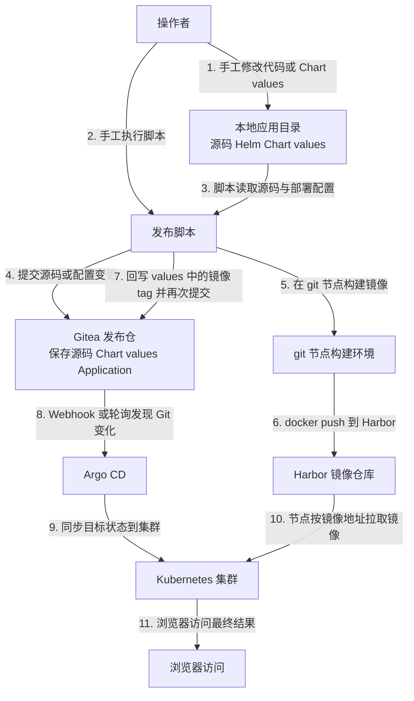
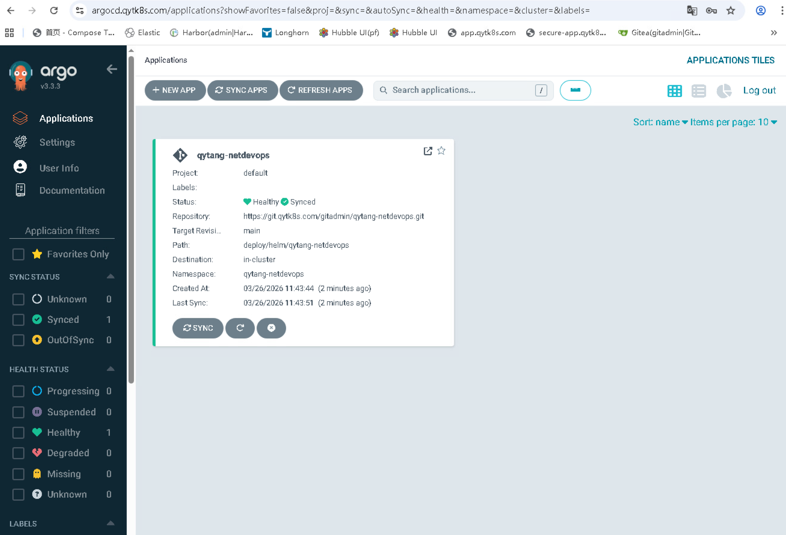

# Harbor、Argo CD 与端到端发布验证

## 本节目标

这一节要把发布闭环真正打通：

完成这一节后，应能确认：

- `Gitea` 里有仓库
- `Harbor` 里有镜像
- `Argo CD` 能同步应用
- 集群里 Pod 与 Service 正常
- 前端 Service 能返回真实业务数据

## 执行标记

- **执行标记：必须执行**

## 为什么这一节是第六章的核心落地点

到前一节为止，我们只是准备好了：

- 应用目录
- Git 仓库
- Docker 资产
- Helm 资产
- GitOps 资产

但真正让第六章“立起来”的，是这一节：

- 镜像被构建出来
- 声明式配置被同步到集群
- 应用真的在 Kubernetes 中跑起来

## 角色分工



到了这一节，课堂上最应该重新强调的还是下面 3 个职责边界：

- `Gitea` 保存源码与声明式配置
- `Harbor` 保存镜像
- `Argo CD` 负责把 Git 中的目标状态同步到集群

## 当前构建位置

这一节里：

- 脚本在 `ops` 上执行
- 真正的 `docker build` 在 `git` 节点完成
- 构建后的镜像再从 `git` 节点推送到 `Harbor`

## 为什么这一节优先使用课程内 Harbor

这里的意思很简单：

- 这一节构建镜像和安装 `Argo CD` 时，尽量都从课程内的 `Harbor` 拉取
- 不再把主线建立在外部公共镜像仓库之上

这样做主要是为了避开课堂环境里最常见的两类问题：

- 构建节点临时拉不到基础镜像
- Kubernetes 节点第一次启动 `Argo CD` 时外部镜像拉取很慢

所以当前主线已经收成：

- `11_build_and_push_images_remote.sh` 优先使用 `Harbor` 中的 Python 基础镜像
- `12_install_argocd_and_sync.sh` 使用本地安装清单 `30_argocd_install_v3.3.3_harbor.yaml`
- `12_install_argocd_and_sync.sh` 会先在各节点预拉 `argocd/dex/redis` 的 Harbor 镜像，再安装控制面

## 安装后还要补齐的 4 件事

这一节不是把 `Argo CD` 装上就结束了，还要把下面 4 件事一起补齐：

- 让 `Argo CD` 信任私有 Git 的 HTTPS 证书
- 给 `Argo CD` 配好正式访问域名 `argocd.qytk8s.com`
- 把 `argocd-server` 固定到课程里的对外访问地址 `10.1.1.50`
- 创建 `Application`，让它开始自动同步业务应用

这里最容易忽略的是第一件事：

- 你的浏览器能打开 `https://git.qytk8s.com`
- 不代表 `Argo CD` 里的 `argocd-repo-server` 组件也已经信任这张 HTTPS 证书

也就是说：

- 人工访问 Git 页面成功
- 还不等于 `Argo CD` 自己就一定能用 HTTPS 正常拉取这个 Git 仓库

所以这一节真正要完成的是：

- `Argo CD` 能装起来
- `Argo CD` 能访问私有 Git
- `Argo CD` 能通过 `argocd.qytk8s.com -> 10.1.1.50` 这个固定入口对外提供控制面
- `Argo CD` 能把应用自动同步到集群

## 本节必刷脚本

<div style="padding: 12px 14px; border: 1px solid #666; border-left: 6px solid #34a853; border-radius: 6px; background: rgba(52,168,83,0.08); margin: 12px 0;">
<strong>本节执行方式</strong><br/>
这一节按下面 3 条主线脚本顺序执行：先构建推镜像，再安装并同步 <code>Argo CD</code>，最后做端到端只读验收。
</div>

### 1. 远程构建并推送业务镜像

<div style="padding: 12px 14px; border: 1px solid #666; border-left: 6px solid #ea4335; border-radius: 6px; background: rgba(234,67,53,0.10); margin: 8px 0;">
<strong>❗ 本条命令必须粘贴执行</strong><br/>
先在 <code>git</code> 节点完成远程构建，并把业务镜像推送到 <code>Harbor</code>。
</div>

```bash
bash /docker_k8s_2026/k8s/06-gitops-and-automation/scripts/11_build_and_push_images_remote.sh
```

脚本主要任务：

- 确保 `Harbor` 项目存在
- 在 `git` 节点配置 Docker 对统一 CA 的信任
- 从 `Gitea` 拉取应用仓
- 在 `git` 节点构建 4 个业务镜像
- 把镜像推送到 `Harbor`

脚本原始代码里最关键的是这一段：

```bash
ssh -o BatchMode=yes -o StrictHostKeyChecking=no root@git \
  "cd /opt/qytang-netdevops-src && \
   docker build -f deploy/docker/frontend/Dockerfile -t harbor.qytk8s.com/qytang-netdevops/frontend:${IMAGE_TAG} . && \
   docker build -f deploy/docker/device-service/Dockerfile -t harbor.qytk8s.com/qytang-netdevops/device-service:${IMAGE_TAG} . && \
   docker build -f deploy/docker/resource-service/Dockerfile -t harbor.qytk8s.com/qytang-netdevops/resource-service:${IMAGE_TAG} . && \
   docker build -f deploy/docker/audit-service/Dockerfile -t harbor.qytk8s.com/qytang-netdevops/audit-service:${IMAGE_TAG} . && \
   docker push harbor.qytk8s.com/qytang-netdevops/frontend:${IMAGE_TAG} && \
   docker push harbor.qytk8s.com/qytang-netdevops/device-service:${IMAGE_TAG} && \
   docker push harbor.qytk8s.com/qytang-netdevops/resource-service:${IMAGE_TAG} && \
   docker push harbor.qytk8s.com/qytang-netdevops/audit-service:${IMAGE_TAG}"
```

这段要表达的核心就是：

- 构建发生在 `git` 节点
- 推送也发生在 `git` 节点

### 2. 安装 Argo CD 并同步应用

<div style="padding: 12px 14px; border: 1px solid #666; border-left: 6px solid #ea4335; border-radius: 6px; background: rgba(234,67,53,0.10); margin: 8px 0;">
<strong>❗ 本条命令必须粘贴执行</strong><br/>
完成镜像准备后，安装 <code>Argo CD</code> 并把应用同步到集群。
</div>

```bash
bash /docker_k8s_2026/k8s/06-gitops-and-automation/scripts/12_install_argocd_and_sync.sh
```

<div style="padding: 12px 14px; border: 1px solid #666; border-left: 6px solid #fbbc04; border-radius: 6px; background: rgba(251,188,4,0.10); margin: 10px 0;">
<strong>YAML 卡片</strong><br/>
YAML 文件：<code>k8s/06-gitops-and-automation/manifests/30_argocd_install_v3.3.3_harbor.yaml</code><br/>
对象：<code>Argo CD 安装清单</code><br/>
作用：使用课程内 <code>Harbor</code> 镜像源安装 <code>Argo CD</code> 控制面，避免课堂环境大量依赖外部拉取。
</div>

```yaml
apiVersion: v1
kind: Service
metadata:
  name: argocd-server
spec:
  ports:
    - name: http
      port: 80
      targetPort: 8080
    - name: https
      port: 443
      targetPort: 8080
  selector:
    app.kubernetes.io/name: argocd-server
---
apiVersion: apps/v1
kind: Deployment
metadata:
  name: argocd-server
spec:
  template:
    spec:
      containers:
        - name: argocd-server
          image: harbor.qytk8s.com/library/argocd:v3.3.3
          ports:
            - containerPort: 8080
            - containerPort: 8083
```

这张安装清单很大，课堂上先抓这一段即可：

- `image: harbor.qytk8s.com/library/argocd:v3.3.3`
  - 说明这一版安装不再走外部默认镜像源，而是统一改用课程内 `Harbor`
- `Service argocd-server`
  - 说明控制面正式入口对应的是 `argocd-server` 这个 Service
- `port: 443 -> targetPort: 8080`
  - 说明外部访问 `HTTPS 443` 后，最终进的是 `argocd-server` 容器里的 `8080`
- `containerPort: 8083`
  - 这是 `argocd-server` 的指标端口，不是浏览器访问入口

<div style="padding: 12px 14px; border: 1px solid #666; border-left: 6px solid #fbbc04; border-radius: 6px; background: rgba(251,188,4,0.10); margin: 10px 0;">
<strong>YAML 卡片</strong><br/>
YAML 文件：<code>apps/qytang-netdevops/deploy/gitops/lab/application.yaml</code><br/>
对象：<code>Application</code><br/>
作用：告诉 <code>Argo CD</code> 从 <code>Gitea</code> 的哪个仓库和路径读取 <code>Helm Chart</code>，并把它同步到 <code>qytang-netdevops</code> 命名空间。
</div>

```yaml
apiVersion: argoproj.io/v1alpha1
kind: Application
metadata:
  name: qytang-netdevops
  namespace: argocd
spec:
  project: default
  source:
    repoURL: https://git.qytk8s.com/gitadmin/qytang-netdevops.git
    targetRevision: main
    path: deploy/helm/qytang-netdevops
    helm:
      valueFiles:
        - values-lab.yaml
  destination:
    server: https://kubernetes.default.svc
    namespace: qytang-netdevops
  syncPolicy:
    automated:
      prune: true
      selfHeal: true
    syncOptions:
      - CreateNamespace=true
```

课堂上只抓这几个关键字段：

- `repoURL`
  - `Argo CD` 从哪个 Git 仓库拉取发布内容
- `targetRevision: main`
  - 读取哪个分支
- `path: deploy/helm/qytang-netdevops`
  - 这是 Git 仓库里的 Chart 相对路径
- `valueFiles: values-lab.yaml`
  - 这是 Chart 目录里的 values 相对路径，不是宿主机本地路径
- `destination.namespace: qytang-netdevops`
  - 渲染后的业务资源最终落到哪个命名空间
- `automated.prune` / `selfHeal`
  - 开启自动同步、自动清理和自动回正

脚本主要任务：

- 使用第六章本地 Harbor 版安装清单安装 `Argo CD`
- 让 `Argo CD` 信任 `git.qytk8s.com`
- 为 `argocd.qytk8s.com` 签发并配置正式证书
- 固定 `argocd-server` 的对外访问地址为 `10.1.1.50`
- 创建 `Application`
- 等待 `Synced` 与 `Healthy`

脚本原始代码里最关键的是这一组：

```bash
kubectl apply -n "${ARGOCD_NS}" --server-side --force-conflicts -f "${INSTALL_FILE}"

kubectl -n "${ARGOCD_NS}" create configmap argocd-tls-certs-cm \
  --from-file=git.qytk8s.com="${CA_CERT}" \
  --dry-run=client -o yaml | kubectl apply -f -

kubectl apply -f "${APP_FILE}"
```

这几行对应的就是：

- 安装 `Argo CD`
- 配置私有 Git 信任
- 创建 `Application`

当前课堂登录信息：

- 地址：`https://argocd.qytk8s.com`
- 用户名：`admin`
- 密码：`Cisc0123`

### 3. 端到端只读验收

<div style="padding: 12px 14px; border: 1px solid #666; border-left: 6px solid #ea4335; border-radius: 6px; background: rgba(234,67,53,0.10); margin: 8px 0;">
<strong>❗ 本条命令必须粘贴执行</strong><br/>
最后从 Git、镜像仓、<code>Argo CD</code> 和业务接口四个方向做一次端到端只读验收。
</div>

```bash
bash /docker_k8s_2026/k8s/06-gitops-and-automation/scripts/13_verify_gitops_e2e.sh
```

脚本主要任务：

- 查看 `Gitea` 仓库
- 查看 `Harbor` 项目与制品
- 查看 `Argo CD Application`
- 查看业务命名空间资源
- 通过 `port-forward` 验证前端 Service 返回业务数据
- 输出 `Argo CD` 访问验证信息

脚本原始代码里最关键的是这一段：

```bash
kubectl -n "${APP_NS}" port-forward svc/frontend "${LOCAL_FRONTEND_PORT}:8080" >/tmp/qytang_netdevops_frontend_pf.log 2>&1 &
curl -s "http://127.0.0.1:${LOCAL_FRONTEND_PORT}/api/device/api/v1/dashboard/summary"
```

这段的意思是：

- 先把集群里的 `frontend Service` 转发到本地
- 再直接访问业务接口
- 用返回结果证明这条 GitOps 发布链已经真正打通

### 4. Win2019 浏览器确认 Argo CD 状态

<div style="padding: 12px 14px; border: 1px solid #666; border-left: 6px solid #fbbc04; border-radius: 6px; background: rgba(251,188,4,0.10); margin: 10px 0;">
<strong>可选观察</strong><br/>
脚本验收通过后，可以再用 <code>Win2019</code> 浏览器确认控制面状态和应用同步结果。
</div>

- 浏览器访问：`https://argocd.qytk8s.com`
- 如果实验环境没有独立 DNS，就先在 `Win2019` 的 `hosts` 里把 `argocd.qytk8s.com` 解析到 `10.1.1.50`
- 登录后重点看：
  - `qytang-netdevops` 应用是否已经出现
  - 应用状态是否为 `Synced` 和 `Healthy`
  - 左侧资源树里是否已经看到 `frontend`、3 个后端和对应 `Service`



## 本节测试与校验

这一节的检查，主要由：

- `13_verify_gitops_e2e.sh`

自动完成。

## 本节完成标准

满足下面条件即可进入正式业务入口收口与课堂演示阶段：

- `Harbor` 中存在应用镜像
- `Application` 状态为 `Synced`
- `Application` 状态为 `Healthy`
- `qytang-netdevops` 命名空间资源正常
- 前端 Service 返回真实业务数据
- `https://argocd.qytk8s.com` 可作为正式控制面入口

## 常见误区

### 误区 1：`Application=Synced` 就等于业务一定可用

不够。还要继续验证：

- Pod
- Service
- 前端接口返回数据

### 误区 2：镜像推到 `Harbor` 就等于应用已经完成发布

不是。镜像存在只是条件之一，还需要 Git 中的声明式状态与 `Argo CD` 同步一起完成。

### 误区 3：业务正式域名应该在这一节一起验证

不对。当前顺序下，这一节先验证前端 Service 与控制面入口，业务正式域名发布在下一节完成。

## 下一步

进入正式业务入口、账户速查与 Git 边界说明：

- `docs/05_domains_accounts_and_classroom_demo.md`
