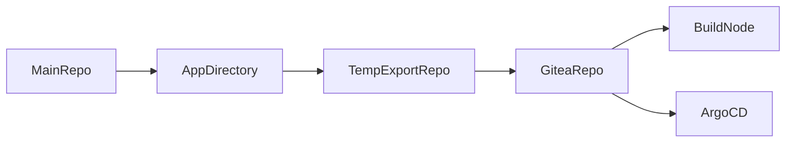

# Gitea 落地、应用仓创建与首推同步

## 本节目标

这一节要完成的是 GitOps 的“事实源准备”。

完成后应具备下面能力：

- `git.qytk8s.com` 可访问
- `gitadmin` 管理员可登录
- `qytang-netdevops` 仓库已创建
- `apps/qytang-netdevops` 已同步到 `Gitea`

## 为什么这一节很关键

`Argo CD` 不是直接从你的主仓工作目录读取文件，而是从 Git 仓库读取目标状态。

所以在第六章里，必须先把企业内 Git 服务与应用发布仓准备好。

这里要明确区分两类仓库角色：

- 主仓：`/docker_k8s_2026`
- GitOps 发布仓：`https://git.qytk8s.com/gitadmin/qytang-netdevops.git`

### 主仓负责什么

- 长期维护课程全量素材
- 作为真实源码维护与备份边界

### `Gitea` 发布仓负责什么

- 承载第六章 GitOps 发布所需的应用目录
- 被后续构建节点与 `Argo CD` 拉取

## 统一信任链

这一节的证书设计不是“再建一套新的 CA”，而是复用课程已有统一 CA。

这样做的好处是：

- `Harbor`
- `Gitea`
- `Argo CD`

都可以纳入同一条课堂信任链，减少证书复杂度。

## 当前主线关系



这里要特别强调：

- 课堂脚本不是在 `apps/qytang-netdevops` 里直接做嵌套 Git 仓库
- 当前采用的是“导出应用目录 -> 临时仓库 -> 同步到 Gitea”的方式

## 当前固定信息

- Git 服务域名：`https://git.qytk8s.com`
- Git 节点：`git`
- Git 服务入口 IP：`10.1.1.202`
- 管理员账号：`gitadmin`
- 管理员密码：`Gitea12345`
- 应用发布仓：`https://git.qytk8s.com/gitadmin/qytang-netdevops.git`

## 这一套仓库结构为什么适合做 GitOps 事实源

当前应用目录里同时包含：

- `frontend/`
- `backend/`
- `deploy/docker/`
- `deploy/helm/`
- `deploy/gitops/`
- `scripts/`

这套结构适合教学，是因为学员能在同一个上下文中同时看到：

- 源码
- 镜像构建资产
- Helm 模板
- GitOps 清单

这样更容易理解“GitOps 并不是只维护几份 YAML”，而是要依托一套完整工程化仓库。

## !!! 本节必刷脚本

### 安装 Gitea

```bash
bash /docker_k8s_2026/k8s/06-gitops-and-automation/scripts/07_install_gitea_remote.sh
```

### 创建应用仓库

```bash
bash /docker_k8s_2026/k8s/06-gitops-and-automation/scripts/08_create_gitea_repo.sh
```

### 验证 Gitea

```bash
bash /docker_k8s_2026/k8s/06-gitops-and-automation/scripts/09_verify_gitea.sh
```

### 首次同步应用目录

```bash
bash /docker_k8s_2026/k8s/06-gitops-and-automation/scripts/10_push_qytang_netdevops_repo.sh
```

## 每个脚本在做什么

### `07_install_gitea_remote.sh`

负责：

- 检查统一 CA
- 为 `git.qytk8s.com` 签发证书
- 在 `git` 节点写入 `docker compose` 部署文件
- 在 `git` 节点安装 `Docker` 与 `docker compose`
- 启动 `gitea` 与 `gitea-postgres`
- 创建 `gitadmin`

### `08_create_gitea_repo.sh`

负责：

- 使用 Gitea API 创建 `qytang-netdevops` 仓库

### `09_verify_gitea.sh`

负责：

- 验证首页
- 验证版本接口
- 验证容器状态
- 验证管理员用户是否存在

### `10_push_qytang_netdevops_repo.sh`

负责：

- 从主仓中的 `apps/qytang-netdevops` 导出应用目录
- 生成临时仓库提交
- 同步到 `Gitea`

## 本节测试与校验

### 访问首页

```bash
curl --cacert /docker_k8s_2026/k8s/01-k8s-architecture/pki/harbor/harbor-ca.crt -I https://git.qytk8s.com
```

### 查看版本接口

```bash
curl --cacert /docker_k8s_2026/k8s/01-k8s-architecture/pki/harbor/harbor-ca.crt https://git.qytk8s.com/api/v1/version
```

### 查看远端容器

```bash
ssh -o BatchMode=yes -o StrictHostKeyChecking=no root@git "docker ps --format 'table {{.Names}}\t{{.Status}}\t{{.Ports}}'"
```

### 浏览器验证

在实验环境浏览器中访问：

- `https://git.qytk8s.com`

登录信息：

- 用户名：`gitadmin`
- 密码：`Gitea12345`

### 验证应用仓存在

```bash
curl --cacert /docker_k8s_2026/k8s/01-k8s-architecture/pki/harbor/harbor-ca.crt https://git.qytk8s.com/api/v1/repos/gitadmin/qytang-netdevops
```

## 为什么当前同步方式不会破坏主仓

这套同步方式的核心是：

- 主仓保持普通目录结构
- 同步脚本把应用目录导出到临时仓库
- 有变更才提交并 push

这样可以避免：

- 应用目录嵌套 `.git`
- 主仓与子仓边界混乱
- 快照恢复后误以为代码已经自动双重备份

## 本节完成标准

满足下面条件即可进入镜像与 GitOps 控制面落地阶段：

- `https://git.qytk8s.com` 可访问
- `gitadmin` 可登录
- `qytang-netdevops` 仓库存在
- 仓库里已有完整应用内容
- 已理解主仓与 `Gitea` 发布仓的职责分离

## 常见误区

### 误区 1：创建仓库就等于应用内容已经在里面

不对。创建仓库只是空仓存在，首次同步才说明内容到位。

### 误区 2：应用目录自己应该带独立 `.git`

当前课程已经明确不采用这种做法，避免主仓边界被破坏。

### 误区 3：`Gitea` 仓库就是唯一源码备份

不是。主仓才是课程全量源码的真实维护边界。

## 下一步

进入镜像构建、`Argo CD` 同步与端到端验收阶段：

- `docs/06_harbor_argocd_and_e2e_verification.md`
