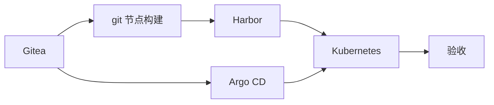

# Harbor、Argo CD 与端到端发布验证

## 本节目标

这一节要把发布闭环真正打通：

## 执行标记

- **执行标记：必须执行**

- `Gitea` 里有仓库
- `Harbor` 里有镜像
- `Argo CD` 能同步应用
- 集群里 Pod 与 Service 正常
- 前端 Service 能返回真实业务数据

## 为什么这一节是第六章的核心落地点

到前一节为止，我们只是准备好了：

- 应用目录
- Git 仓库
- Docker 资产
- Helm 资产
- GitOps 资产

但真正让第六章“立起来”的，是这一节：

- 镜像被构建出来
- 声明式配置被同步到集群
- 应用真的在 Kubernetes 中跑起来

## 角色分工



这一节要特别强调下面 3 个职责边界：

- `Gitea` 保存源码与声明式配置
- `Harbor` 保存镜像
- `Argo CD` 负责把 Git 中的目标状态同步到集群

## 为什么镜像构建放在 `git` 节点

这里的设计不是“所有环境都必须这样做”，而是为了贴近企业里常见的构建节点模式。

当前教学路径是：

- 在 `ops` 发起脚本
- 在 `git` 节点远程构建镜像
- 推送到 `Harbor`

这样做的教学价值是：

- 学员更容易理解“源码位置”和“构建位置”可以分离
- 后续更容易过渡到 CI/CD 概念

## 为什么这一节现在要坚持 Harbor-first

这一节如果大量依赖外部仓库，课堂上最容易出现两类问题：

- 构建节点临时拉不到基础镜像
- Kubernetes 节点第一次启动 `Argo CD` 时外部镜像拉取很慢

所以当前主线已经收成：

- `11_build_and_push_images_remote.sh` 优先使用 `Harbor` 中的 Python 基础镜像
- `12_install_argocd_and_sync.sh` 使用本地安装清单 `30_argocd_install_v3.3.3_harbor.yaml`
- `12_install_argocd_and_sync.sh` 会先在各节点预拉 `argocd/dex/redis` 的 Harbor 镜像，再安装控制面

## 为什么安装 `Argo CD` 不能只看官方 YAML

这一节最容易被忽略的问题是：

- 浏览器能打开私有 Git
- 不代表 `argocd-repo-server` 一定信任该证书链

所以本节不仅是“安装 Argo CD”，更是在补齐：

- 私有 Git HTTPS 信任
- `argocd.qytk8s.com` 正式入口
- 固定 VIP
- Application 自动同步

## 当前实验环境事实

这里以当前已验证路径为准：

- `11_build_and_push_images_remote.sh` 默认构建基础镜像 tag
- `12_install_argocd_and_sync.sh` 已直接完成 `argocd.qytk8s.com` 正式证书配置
- `13_verify_gitops_e2e.sh` 当前验证的是前端 Service 与整条链路，不提前验证业务正式域名

也就是说：

- `argocd.qytk8s.com` 的证书问题，已经在 `12` 解决
- `netdevops.qytk8s.com` 的正式业务域名发布，属于下一节

## 本节必刷脚本

### 远程构建并推送业务镜像

```bash
bash /docker_k8s_2026/k8s/06-gitops-and-automation/scripts/11_build_and_push_images_remote.sh
```

### 安装 Argo CD 并同步应用

```bash
bash /docker_k8s_2026/k8s/06-gitops-and-automation/scripts/12_install_argocd_and_sync.sh
```

### 端到端只读验收

```bash
bash /docker_k8s_2026/k8s/06-gitops-and-automation/scripts/13_verify_gitops_e2e.sh
```

## 每个脚本在做什么

### `11_build_and_push_images_remote.sh`

负责：

- 确保 `Harbor` 项目存在
- 在 `git` 节点配置 Docker 对统一 CA 的信任
- 预拉 `Harbor` 中的 Python 基础镜像
- 从 `Gitea` 拉取应用仓
- 构建并推送 4 个业务镜像

### `12_install_argocd_and_sync.sh`

负责：

- 使用第六章本地 Harbor 版安装清单安装 `Argo CD`
- 预拉 `argocd/dex/redis` 的 Harbor 镜像
- 让 `Argo CD` 信任 `git.qytk8s.com`
- 为 `argocd.qytk8s.com` 签发并配置正式证书
- 固定 `argocd-server` VIP 为 `10.1.1.50`
- 创建 `Application`
- 等待 `Synced` 与 `Healthy`

### `13_verify_gitops_e2e.sh`

负责：

- 看 `Gitea` 仓库
- 看 `Harbor` 项目与制品
- 看 `Argo CD Application`
- 看业务命名空间资源
- 通过 `port-forward` 验证前端 Service 返回业务数据
- 输出 `Argo CD` 访问验证信息

## 本节测试与校验

### 查看 Gitea 仓库 API

```bash
curl --cacert /docker_k8s_2026/k8s/01-k8s-architecture/pki/harbor/harbor-ca.crt -s https://git.qytk8s.com/api/v1/repos/gitadmin/qytang-netdevops
```

### 查看 Harbor 项目与制品

```bash
curl -k -s -u 'admin:Harbor12345' https://harbor.qytk8s.com/api/v2.0/projects/qytang-netdevops/repositories?page_size=20
```

### 查看 Harbor 基础镜像仓

```bash
curl -k -s -u 'admin:Harbor12345' https://harbor.qytk8s.com/api/v2.0/projects/library/repositories?page_size=50
```

### 查看 Argo CD 应用状态

```bash
kubectl -n argocd get application qytang-netdevops -o wide
```

### 查看业务命名空间资源

```bash
kubectl -n qytang-netdevops get pods,svc -o wide
```

### 验证前端 Service 返回业务数据

这一项由 `13_verify_gitops_e2e.sh` 自动完成，当前验证方式是：

- `kubectl port-forward svc/frontend`
- 访问本地转发后的 dashboard summary 接口

### 验证 Argo CD 正式入口

```bash
curl --resolve argocd.qytk8s.com:443:10.1.1.50 --cacert /docker_k8s_2026/k8s/01-k8s-architecture/pki/harbor/harbor-ca.crt https://argocd.qytk8s.com/healthz
```

## 本节完成标准

满足下面条件即可进入正式业务入口收口与课堂演示阶段：

- `Harbor` 中存在应用镜像
- `Application` 状态为 `Synced`
- `Application` 状态为 `Healthy`
- `qytang-netdevops` 命名空间资源正常
- 前端 Service 返回真实业务数据
- `https://argocd.qytk8s.com` 可作为正式控制面入口

## 常见误区

### 误区 1：`Application=Synced` 就等于业务一定可用

不够。还要继续验证：

- Pod
- Service
- 前端接口返回数据

### 误区 2：镜像推到 `Harbor` 就等于应用已经完成发布

不是。镜像存在只是条件之一，还需要 Git 中的声明式状态与 `Argo CD` 同步一起完成。

### 误区 3：业务正式域名应该在这一节一起验证

不对。当前顺序下，这一节先验证前端 Service 与控制面入口，业务正式域名发布在下一节完成。

## 下一步

进入正式业务入口、账户速查与 Git 边界说明：

- `docs/06_domains_accounts_and_classroom_demo.md`
