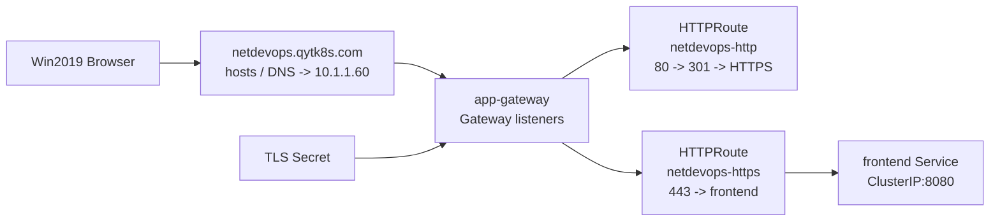
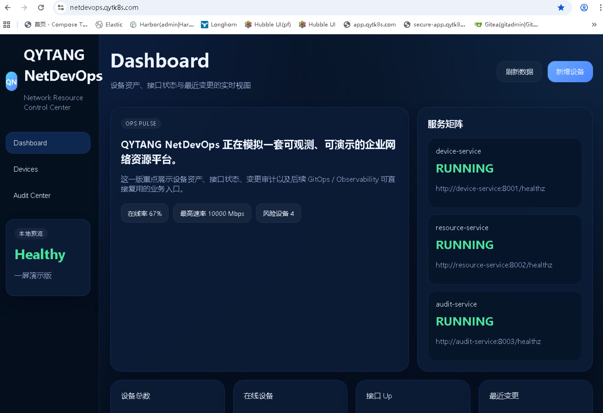

# 发布 QYT NetDevOps 正式业务入口

## 本节目标

这一节是第六章的收口页之一，要把下面几件事放到同一张图里看清楚：

- 正式业务入口在哪里
- 当前有哪些域名与账户

## 执行标记

- **执行标记：建议执行**

## 为什么这一节要单独说明正式业务入口

到上一节为止，应用已经在 Kubernetes 中跑起来，并完成了：

- 镜像构建
- `Argo CD` 同步
- 前端 Service 验证

但真正给课堂展示看的，应该是正式业务入口，而不是临时 `LoadBalancer` 或端口转发。

当前课程收口方式是：

- 正式业务入口：`https://netdevops.qytk8s.com`
- 固定映射：`10.1.1.60`
- 复用第三章已经准备好的 `Gateway API + HTTPS`

这一节当前也有一个明确边界：

- `netdevops.qytk8s.com` 的 listener、`HTTPRoute`、`ReferenceGrant` 只来自第六章自己的 manifests
- 不再跨章节复用第四章 Longhorn 的发布清单

## 当前域名与账户速查

### 域名与 IP

- `harbor.qytk8s.com -> 10.1.1.203`
- `git.qytk8s.com -> 10.1.1.202`
- `netdevops.qytk8s.com -> 10.1.1.60`
- `argocd.qytk8s.com -> 10.1.1.50`

### 需要登录的系统

- `https://harbor.qytk8s.com`
  - 用户名：`admin`
  - 密码：`Harbor12345`
- `https://git.qytk8s.com`
  - 用户名：`gitadmin`
  - 密码：`Gitea12345`
- `https://argocd.qytk8s.com`
  - 用户名：`admin`
  - 密码：`Cisc0123`

### 浏览器侧准备

在课堂浏览器环境中，应提前完成：

- 导入 `harbor-ca.crt`
- 配置 DNS 或 `hosts`
- 使用域名访问，不建议直接访问 IP

## 命名约定

当前有两套名称同时存在，但职责不同：

- 页面品牌名：`QYT NetDevOps`
- 工程目录名：`apps/qytang-netdevops`
- Gitea 仓库名：`qytang-netdevops`
- Harbor 项目名：`qytang-netdevops`

课堂上建议这样讲：

- 页面展示名已经调整为 `QYT NetDevOps`
- 但工程目录、仓库路径、镜像仓路径为了保持 GitOps 链路稳定，仍然沿用 `qytang-netdevops`

## 业务正式入口发布

这一节沿用第三章网关能力，不再给业务单独暴露临时入口。



这里要明确一个架构结论：

- 浏览器先通过 `netdevops.qytk8s.com -> 10.1.1.60` 找到统一网关入口
- `HTTP` 和 `HTTPS` 都先进入 `app-gateway`，再由不同的 `HTTPRoute` 处理
- `netdevops-http` 只负责把 `HTTP` 跳转到 `HTTPS`，`netdevops-https` 才真正转发到 `frontend`
- `TLS` 证书挂在网关侧，不挂在业务 `frontend Service` 上
- 业务 `frontend Service` 保持 `ClusterIP:8080`，对外访问统一走网关入口

## 本节必刷脚本

<div style="padding: 12px 14px; border: 1px solid #666; border-left: 6px solid #34a853; border-radius: 6px; background: rgba(52,168,83,0.08); margin: 12px 0;">
<strong>本节执行方式</strong><br/>
这一节先发布正式业务入口，再用 3 条只读命令验证 HTTP 跳转、HTTPS 首页和后端健康接口。
</div>

<div style="padding: 10px 14px; border: 1px solid #666; border-left: 4px solid #8ab4f8; border-radius: 6px; background: rgba(138,180,248,0.08); margin: 8px 0;">
<strong>执行边界</strong><br/>
这一节只有 <code>14_publish_netdevops_https_domain.sh</code> 是必须执行；后面的 3 条 <code>curl</code> 只读验证命令属于建议执行。
</div>

### 发布正式业务入口

<div style="padding: 12px 14px; border: 1px solid #666; border-left: 6px solid #ea4335; border-radius: 6px; background: rgba(234,67,53,0.10); margin: 8px 0;">
<strong>❗ 本条命令必须粘贴执行</strong><br/>
把 <code>QYT NetDevOps</code> 正式发布到 <code>https://netdevops.qytk8s.com</code>。
</div>

```bash
bash /docker_k8s_2026/k8s/06-gitops-and-automation/scripts/14_publish_netdevops_https_domain.sh
```

<div style="padding: 12px 14px; border: 1px solid #666; border-left: 6px solid #fbbc04; border-radius: 6px; background: rgba(251,188,4,0.10); margin: 10px 0;">
<strong>YAML 卡片</strong><br/>
YAML 文件：<code>k8s/06-gitops-and-automation/manifests/21_gateway_netdevops_https.yaml</code><br/>
对象：<code>HTTPRoute + ReferenceGrant</code><br/>
作用：把 <code>netdevops.qytk8s.com</code> 接到统一网关；其中一条路由负责 <code>HTTP -&gt; HTTPS</code> 跳转，另一条路由负责把 HTTPS 流量转发到 <code>frontend</code>，<code>ReferenceGrant</code> 负责允许跨命名空间引用后端 Service。
</div>

```yaml
apiVersion: gateway.networking.k8s.io/v1
kind: HTTPRoute
metadata:
  name: netdevops-http-redirect
  namespace: gateway-demo
spec:
  hostnames:
    - netdevops.qytk8s.com
  parentRefs:
    - name: app-gateway
      sectionName: netdevops-http
  rules:
    - filters:
        - type: RequestRedirect
          requestRedirect:
            scheme: https
            statusCode: 301
---
apiVersion: gateway.networking.k8s.io/v1
kind: HTTPRoute
metadata:
  name: netdevops-https-backend
  namespace: gateway-demo
spec:
  hostnames:
    - netdevops.qytk8s.com
  parentRefs:
    - name: app-gateway
      sectionName: netdevops-https
  rules:
    - matches:
        - path:
            type: PathPrefix
            value: /
      backendRefs:
        - name: frontend
          namespace: qytang-netdevops
          port: 8080
---
apiVersion: gateway.networking.k8s.io/v1beta1
kind: ReferenceGrant
metadata:
  name: allow-gateway-demo-to-qytang-netdevops-frontend
  namespace: qytang-netdevops
spec:
  from:
    - group: gateway.networking.k8s.io
      kind: HTTPRoute
      namespace: gateway-demo
  to:
    - group: ""
      kind: Service
      name: frontend
```

课堂上先抓这几个关键点：

- `hostnames: netdevops.qytk8s.com`
  - 说明这份入口清单就是给正式业务域名准备的
- `sectionName: netdevops-http`
  - 这一段绑定网关的 `HTTP` listener，只负责跳转
- `RequestRedirect -> scheme: https`
  - 明确把明文 `HTTP` 收口到 `HTTPS`
- `sectionName: netdevops-https`
  - 这一段绑定网关的 `HTTPS` listener，负责真正转发业务流量
- `backendRefs -> frontend:8080`
  - 说明正式域名进入网关后，最终落到 `qytang-netdevops` 命名空间里的 `frontend` Service
- `ReferenceGrant`
  - 允许 `gateway-demo` 里的 `HTTPRoute` 合法引用 `qytang-netdevops` 命名空间里的后端 Service

## 正式业务入口验证

<div style="padding: 10px 14px; border: 1px solid #666; border-left: 4px solid #8ab4f8; border-radius: 6px; background: rgba(138,180,248,0.08); margin: 8px 0;">
<strong>ℹ️ 可选执行</strong><br/>
下面 3 条验证命令建议逐条执行；它们不改变状态，只用于证明正式入口已经发布成功。
</div>

### 1. 验证 HTTP 是否会跳转到 HTTPS

```bash
curl -I --resolve netdevops.qytk8s.com:80:10.1.1.60 http://netdevops.qytk8s.com/
```

这条命令主要验证：

- 域名 `netdevops.qytk8s.com` 是否已经正确指向 `10.1.1.60`
- 网关的 `80` 端口是否已经生效
- `HTTP` 是否会按预期跳转到 `HTTPS`

### 2. 验证 HTTPS 首页是否正常

```bash
curl --resolve netdevops.qytk8s.com:443:10.1.1.60 --cacert /docker_k8s_2026/k8s/01-k8s-architecture/pki/harbor/harbor-ca.crt https://netdevops.qytk8s.com/
```

这条命令主要验证：

- `443` 端口是否已经生效
- `TLS` 证书是否正确
- 前端首页是否已经通过正式域名正常返回

### 3. 验证后端健康接口是否也能经由正式域名访问

```bash
curl --resolve netdevops.qytk8s.com:443:10.1.1.60 --cacert /docker_k8s_2026/k8s/01-k8s-architecture/pki/harbor/harbor-ca.crt https://netdevops.qytk8s.com/api/device/healthz
```

这条命令主要验证：

- 业务正式域名不仅能打开首页
- 还能够继续把 `/api/device/healthz` 正确转发到后端服务
- 说明网关到前后端的正式入口链路已经打通

### 4. Win2019 浏览器确认正式业务入口

<div style="padding: 10px 14px; border: 1px solid #666; border-left: 4px solid #8ab4f8; border-radius: 6px; background: rgba(138,180,248,0.08); margin: 8px 0;">
<strong>ℹ️ 可选执行</strong><br/>
命令验证通过后，可以再用 <code>Win2019</code> 浏览器确认正式业务首页是否已经能通过域名正常打开。
</div>

- 浏览器访问：`https://netdevops.qytk8s.com`
- 如果实验环境没有独立 DNS，就先在 `Win2019` 的 `hosts` 里把 `netdevops.qytk8s.com` 解析到 `10.1.1.60`
- 首次访问前，仍要确认浏览器已经导入课程里的 `harbor-ca.crt`
- 打开后重点看：
  - 页面能否通过正式域名正常打开
  - 地址栏是否已经是 `https://netdevops.qytk8s.com`
  - 是否看到 `QYT NetDevOps` 的正式首页，而不是临时端口或其他测试页面



## 本节完成标准

满足下面条件即可进入课堂测试与演示页：

- `https://netdevops.qytk8s.com` 可访问
- `https://netdevops.qytk8s.com/api/device/healthz` 返回正常
- `https://argocd.qytk8s.com` 可访问
- 已理解当前域名、账户与正式入口访问方式

## 下一步

进入单独的课堂测试与演示页：

- `docs/06_gitops_demo_and_testing.md`
