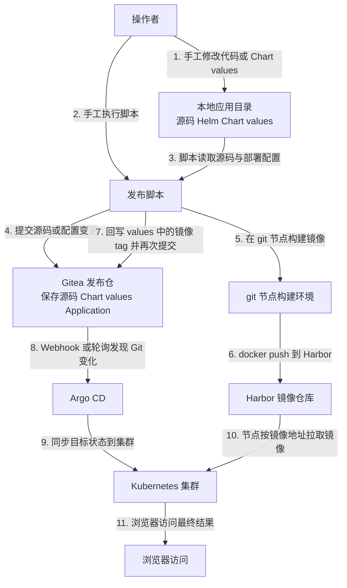

# GitOps 课堂测试与演示

## 本节目标

这一节专门用于课堂现场演示与测试，不再和域名、账户速查混在一起。

本节只关注两类动作：

1. 改代码发布新版本
2. 改 YAML 做声明式扩缩容

## 当前课堂定位

这一节不是在讲新的基础设施，而是在验证第六章前面已经刷通的链路：

- 代码可以同步到 `Gitea`
- 镜像可以推送到 `Harbor`
- `Argo CD` 会自动收敛
- 页面或副本数会按 Git 中目标状态变化

## 演示 A：改代码发布新版本

### 最短动作

这部分现在已经收成课堂最短路径：

1. 改前端代码
2. 只改 `VERSION`
3. 执行脚本

### 推荐修改位置

- `apps/qytang-netdevops/frontend/index.html`
- `apps/qytang-netdevops/frontend/app.js`

### 只改这一个变量

打开：

- `k8s/06-gitops-and-automation/scripts/16_release_frontend_gitops.sh`

只修改：

```bash
VERSION="${VERSION:-v0.1.3}"
```

这里的 `VERSION` 主要不是去替你修改页面源码里的文字，而是作为这次发布的版本号，被脚本用在下面几处：

1. 构建前端镜像时，生成：
   - `harbor.qytk8s.com/qytang-netdevops/frontend:${VERSION}`
2. 回写前端镜像 `tag` 时，写入：
   - `deploy/helm/qytang-netdevops/values.yaml`
   - `deploy/helm/qytang-netdevops/values-lab.yaml`
   - `deploy/gitops/lab/values-lab.yaml`
3. 生成两次 Git 提交说明时，也会带上这个版本号

也就是说：

- 页面内容改动，来自你手工修改前端代码
- `VERSION` 改动，决定这次发布产出的镜像版本号，以及 GitOps 最终要切换到哪个镜像 `tag`

### 明确不要手工改哪些文件

在“改代码发布”这条演示链路里，不要再手工去改下面 3 个文件：

- `deploy/helm/qytang-netdevops/values.yaml`
- `deploy/helm/qytang-netdevops/values-lab.yaml`
- `deploy/gitops/lab/values-lab.yaml`

原因是：

- `16_release_frontend_gitops.sh` 会自动回写这 3 处前端镜像 tag
- 课堂上只需要改代码，再改 `VERSION`

## !!! 演示 A 必刷脚本

### 改代码发布

```bash
bash /docker_k8s_2026/k8s/06-gitops-and-automation/scripts/16_release_frontend_gitops.sh
```

### 当前课堂流程图

这一节直接沿用 [00_gitops_theory.md](/docker_k8s_2026/k8s/06-gitops-and-automation/docs/00_gitops_theory.md) 里的完整交付链路图。

课堂上不需要再记一套新的抽象流程，只需要在这张图里重点观察：

- `8`
  - `Argo CD` 什么时候发现 Git 变化
- `9`
  - `Argo CD` 什么时候把目标状态同步到集群
- `11`
  - 浏览器什么时候看到最终结果



### 这个脚本在图里对应哪些步骤

`16_release_frontend_gitops.sh` 在课堂上最主要会落到下面这些动作：

1. `2`
   - 你手工执行脚本
2. `4`
   - 脚本先把应用目录同步到 `Gitea`
3. `5`
   - 脚本到 `git` 节点构建 `frontend:${VERSION}`
4. `6`
   - 新镜像 push 到 `Harbor`
5. `7`
   - 自动回写前端镜像 `tag`，再提交到 `Gitea`
6. `8` 和 `9`
   - 等待 `Argo CD` 发现变化并同步
7. `11`
   - 最后在浏览器里看到新结果

### 在哪里观察

课堂上最值得同时看两个地方：

- `https://argocd.qytk8s.com`
- `https://netdevops.qytk8s.com`

也就是对应图里的：

- `8`
  - Git 变化是否已经被 `Argo CD` 发现
- `9`
  - 集群是否已经收敛到新目标状态
- `11`
  - 浏览器里是否已经看到新结果

`Argo CD` 页面里建议重点看：

- `Sync Status`
- `Health Status`
- `Revision`

命令行也可以直接看：

#### 观察 1：Argo CD 当前同步状态

```bash
kubectl -n argocd get application qytang-netdevops -o wide
```

原始输出示例：

```text
root@ops:/docker_k8s_2026# kubectl -n argocd get application qytang-netdevops -o wide
NAME               SYNC STATUS   HEALTH STATUS   REVISION                                   PROJECT
qytang-netdevops   Synced        Healthy         aa1ab0bf5fdf5a40b453b5cb4f9c086ac0057b52   default
```

关键看点：

- `SYNC STATUS=Synced`
  - 说明 `Argo CD` 看到的 Git 目标状态已经和集群一致
- `HEALTH STATUS=Healthy`
  - 说明应用当前资源状态正常
- `REVISION`
  - 说明当前同步到的是哪一个 Git 提交版本

#### 观察 2：frontend 当前实际镜像版本

```bash
kubectl -n qytang-netdevops get deploy frontend -o jsonpath='{.spec.template.spec.containers[0].image}{"\n"}'
```

原始输出示例：

```text
root@ops:/docker_k8s_2026# kubectl -n qytang-netdevops get deploy frontend -o jsonpath='{.spec.template.spec.containers[0].image}{"\n"}'
harbor.qytk8s.com/qytang-netdevops/frontend:v0.1.4
```

关键看点：

- 重点看镜像名和 `tag`
- 这里的 `v0.1.4`
  - 说明集群里 `frontend` 当前准备运行的就是这次发布的新镜像版本

#### 观察 3：frontend 滚动更新是否完成

```bash
kubectl -n qytang-netdevops get deploy frontend
```

原始输出示例：

```text
root@ops:/docker_k8s_2026# kubectl -n qytang-netdevops get deploy frontend
NAME       READY   UP-TO-DATE   AVAILABLE   AGE
frontend   1/1     1            1           9h
```

关键看点：

- `READY`
  - 当前已经就绪的 Pod 数量
- `UP-TO-DATE`
  - 当前使用最新模板创建出来的 Pod 数量
- `AVAILABLE`
  - 当前可对外提供服务的 Pod 数量
- 这里 `1/1 1 1`
  - 说明这次更新后的 `frontend` 已经正常滚动完成

### 这一段最重要的话

对课堂操作体验来说：

- 你只执行一次脚本

但对 Git 历史来说：

- 当前仍然会形成“源码同步 + values 回写”两次提交

这一点要和“未来 CI 接管后的真正单次 push 流程”区分开。

## 演示 B：改 YAML 扩缩容

这一段不改代码，不重建镜像，只改目标状态。

### 演示 B 必刷脚本

```bash
bash /docker_k8s_2026/k8s/06-gitops-and-automation/scripts/17_scale_frontend_gitops.sh
```

### 直接改哪个文件

- `apps/qytang-netdevops/deploy/helm/qytang-netdevops/values-lab.yaml`

### 这一段最短动作

1. 修改 `values-lab.yaml`
2. 执行脚本
3. 观察 `Argo CD` 和副本数变化

### 哪些服务可以改 `replicaCount`

- `frontend`
- `deviceService`
- `resourceService`
- `auditService`

原因：

- 它们都是无状态服务
- 适合用来演示声明式扩缩容

### 哪些服务不要改

- `postgres`

原因：

- 当前是单实例有状态服务
- 使用单 PVC
- 当前模板保持单副本
- 部署策略是 `Recreate`

### 示例

把：

- `frontend.replicaCount: 1`

来源文件：

- `apps/qytang-netdevops/deploy/helm/qytang-netdevops/values-lab.yaml`

文件类型：

- Helm values 文件

改成：

```yaml
frontend:
  replicaCount: 2
```

### 观察方法

脚本会等待 `Argo CD` 收敛，并输出：

- `sync`
- `health`
- `frontendDesired`
- `frontendAvailable`

你也可以手工执行下面两条命令：

#### 观察 1：Deployment 期望副本数是否已经变化

```bash
kubectl -n qytang-netdevops get deploy frontend device-service resource-service audit-service
```

关键看点：

- 重点看 `frontend`
- 如果你把 `frontend.replicaCount` 从 `1` 改成 `2`
  - 这里应能看到 `frontend` 的期望副本数和可用副本数都变成 `2`

#### 观察 2：Pod 数量是否已经实际扩出来

```bash
kubectl -n qytang-netdevops get pods -o wide
```

关键看点：

- 重点看 `frontend` 相关 Pod
- 应能看到对应数量的 `frontend` Pod 已经运行起来

## 本节测试通过标准

下面这些满足即可认为课堂测试链路正常：

- `https://argocd.qytk8s.com` 可访问
- `https://netdevops.qytk8s.com` 可访问
- `Application` 为 `Synced / Healthy`
- 可以完成一次“改代码发布”演示
- 可以完成一次“改 YAML 扩缩容”演示

## 常见误区

### 误区 1：运行 `16` 或 `17` 就等于本地目录已经自动备份

不是。它们只是把应用目录同步到 `Gitea`，不等于替你自动 `commit/push` 本地目录到你的远端。

### 误区 2：扩缩容演示应该去改 GitOps 目录里的 `values-lab.yaml`

当前课堂入口应统一为：

- `deploy/helm/qytang-netdevops/values-lab.yaml`

### 误区 3：`postgres` 也应该一起演示横向扩容

当前不合适。它在本课程环境里是单实例有状态服务。

## 下一步

第六章主线已经完整闭环，下一章进入可观测性与追踪。
